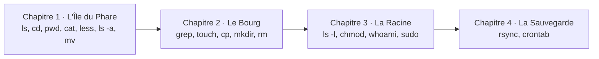

# Scénarios — Quêtes de Sysadmin

*Apprendre la ligne de commande Linux en jouant.* Publié sur
https://sysadmin.rouages.net et intégrable dans d'autres sites
(voir [INTEGRER.md](INTEGRER.md)). Le moteur est dans `src/moteur/` :

- `shell.ts` : le moteur d'une machine (chemins, permissions, tubes `|`,
  redirections `>` et `>>`, `sudo`, événements) ;
- `console.ts`, `machines.ts`, `poste.ts` : le réseau simulé (le poste de
  départ, une machine par histoire, `ssh` et `exit` pour passer de l'une à
  l'autre) ;
- `commandes/` : les commandes, par famille (`fichiers`, `texte`, `systeme`,
  `reseau`, `git`) ; chacune lit ses arguments et l'entrée du tube, renvoie
  sa sortie et signale ses erreurs à part (elles ne passent pas dans les
  tubes, comme la sortie d'erreur d'un vrai shell) ;
- `monde.ts` : les briques d'un monde (lieux, objets, droits, événements) ;
- `chapitres/` : un fichier par chapitre, et `index.ts` qui les range en
  histoires ;
- `commandes/manuel.ts` et `commandes/pages.ts` : le manuel (`man`, `--help`,
  `man -k`).

L'interface est dans `src/interface/` (`jeu.ts`, `styles.css`), l'élément
`<quetes-de-sysadmin>` dans `src/element.ts`. Tous les textes (histoires,
messages, manuel, interface) sont dans `src/textes/fr/*.ftl` (voir
`docs/TRADUIRE.md`). Les parties sont rejouées par `tests/quetes.test.ts`.

## Principes

- **Inspiré de l'original, sans le recopier** : l'idée (un lieu = un dossier,
  un objet = un fichier, des commandes apprises en avançant) vient de
  [Terminus](https://web.mit.edu/mprat/Public/web/Terminus/Web/main.html),
  créé au MIT par Shawn Conrad et Michele Pratusevich. Les chapitres 1 et 2
  ont leurs propres lieux et leurs propres énigmes (l'île du Phare, le Bourg
  du port) ; ils ne suivent pas le parcours de l'original. Le jeu est né
  sous le nom « Terminus en français » sur Les rouages du net (rouages.net)
  avant de devenir ce projet indépendant, en octobre 2026.
- **Nos propres textes** : l'histoire, les lieux et les dialogues sont
  originaux, ce n'est pas une traduction.
- **De vraies commandes, de vrais comportements** : mêmes chemins (`..`, `~`,
  `/`), mêmes règles (`mv` renomme, `cp` copie, `rm` est définitif, les
  jokers `*` sont développés avant la commande, comme le fait le shell). Les
  écarts volontaires sont signalés dans le code et listés ci-dessous.
- **Un seul monde, relié par `ssh`** : on part de son **poste**
  (`vous@poste`) ; chaque histoire tourne sur une machine du réseau
  (`royaume`, `datacenter`, `fourmiliere`, `manuscrit`, `bibliotheque`), que
  l'on rejoint avec `ssh` et que l'on quitte avec `exit`. Le poste n'a au
  départ que la clé du royaume : finir l'Effaceur donne les clés des quatre
  autres machines, qui se jouent ensuite dans l'ordre que l'on veut. Le menu
  reste un raccourci (accessibilité, enseignant·es) ; l'attribut `histoire`
  ouvre directement une histoire, même sans sa clé.
- **Histoires et chapitres** : cinq histoires ; dans une
  histoire, chaque chapitre a son monde, ses commandes et sa fin, et s'ouvre
  quand le précédent est terminé. La progression est gardée dans le
  navigateur (`localStorage`, clé `quetes-de-sysadmin`, réglable par l’attribut `cle`), chapitre par chapitre.
- **Des exemples sans danger** : adresses IP privées (RFC 1918), de
  collecte d'opérateur (RFC 6598) ou réservées à la documentation (RFC 5737),
  noms de domaine en `.example` (RFC 6761). Seule exception : 9.9.9.9, le
  vrai résolveur DNS public de Quad9.
- **Sorties authentiques** : `ping`, `dig`, `traceroute`, `curl`, `ps`,
  `systemctl` répondent en anglais, comme sur un vrai système ; `git` et
  les messages d'erreur de base (« Permission non accordée ») en français,
  comme avec un système réglé en français.

### Le manuel, premier réflexe

Pour apprendre à se dépanner seul·e, le manuel est disponible partout, dès le
chapitre 1, et pour toutes les commandes du jeu (même celles qu'on n'a pas
encore le droit de lancer, comme sur un vrai système) :

- `man commande` : une page au format habituel (NOM, SYNOPSIS, DESCRIPTION,
  OPTIONS, EXEMPLES, VOIR AUSSI), fabriquée par `commandes/manuel.ts` à
  partir de la définition de la commande et de ses compléments
  (`commandes/pages.ts` : options, exemples, renvois) ;
- `commande --help` : un résumé ;
- `man -k mot` et `apropos mot` : chercher une commande par mot-clé ;
  `whatis commande` : une ligne ;
- une option inconnue donne le vrai message des coreutils : « ls : option
  invalide -- 'z' / Saisissez « ls --help » pour plus d'informations. »

Dans le chapitre 1, le cours sur les fichiers cachés ne donne plus l'option :
il renvoie à `man ls`, et la gardienne du phare renvoie aux EXEMPLES de
`man mv`. Au chapitre 2, le parchemin présente `--help` et `man -k`.

### Écarts volontaires avec un vrai Linux

| Commande | Dans le jeu | Sous Linux |
|---|---|---|
| `less` | affiche tout, comme `cat` | affiche page par page (`q` pour quitter) |
| `mv` | ne déplace que des objets (fichiers) | déplace aussi les dossiers |
| `rm -r`, `cp -r` | refusés | effacent / copient des dossiers entiers |
| `grep` sans résultat | « (aucune ligne ne contient …) » | n'affiche rien |
| `man` | affiche la page d'un coup, en quelques sections | ouvre une page plein écran (flèches, `/mot` pour chercher, `q` pour quitter), bien plus longue |
| `ls -l` | type et droits, propriétaire, groupe (= propriétaire), taille, nom | ajoute le nombre de liens et la date |
| permissions | propriétaire, groupe, autres ; pas de bits spéciaux (setuid, setgid, sticky) ni d'ACL | aussi setgid sur les dossiers partagés, ACL (`setfacl`) |
| `usermod -G` | prend effet tout de suite | les groupes d'une session sont lus à la connexion : il faut se reconnecter (le jeu le dit dans le texte) |
| `chown`, `chgrp` | `-R` seulement | aussi `--reference`, `-h`… |
| `chmod -w` (sans u/g/o) | agit sur tout le monde | tient compte du masque `umask` |
| `rm` d'un fichier protégé en écriture | efface sans demander | demande confirmation |
| `sudo` | redemande le mot de passe seulement au premier usage du chapitre | s'en souvient environ 15 minutes |
| `cat` d'une archive | message d'erreur | affiche des octets illisibles |
| `ping` | 4 envois par défaut | continue jusqu'à Ctrl+C |
| `traceroute` | s'arrête 3 sauts après le dernier qui répond | continue jusqu'à 30 sauts |
| `ps aux` | utilisateur, PID, %CPU, %MEM, commande | ajoute VSZ, RSS, TTY, STAT, START, TIME |
| `tar` | taille calculée (texte compressé au tiers, médias à 98 %) ; s'il n'y a pas la place, rien n'est écrit | vraie compression ; une archive partielle peut rester |
| `git` | une seule branche (`main`), fichiers à la racine du dépôt seulement, identifiants calculés par le jeu, `commit` exige `-m` | branches, sous-dossiers, SHA-1/SHA-256, éditeur de texte |
| journal nginx | format « combined » sans la page d'origine ni le navigateur | deux champs de plus en fin de ligne |
| `ssh` | clé seulement (pas de mot de passe ni d'agent) ; une clé est acceptée si c'est la bonne machine ; pas de commande à distance ; message d'usage raccourci ; option inconnue : message des coreutils | mot de passe, agent, `authorized_keys` côté serveur, commande à distance |
| `exit` | a sa page `man` | commande intégrée à bash : `help exit` |
| session `ssh` | la machine garde son état tant que la page reste ouverte ; un rechargement relance le chapitre en cours | la machine garde son état |
| sections du manuel | 1 (commandes) et 8 (administration : `usermod`, `reboot`) | aussi 2 à 7 (appels système, fichiers de configuration…) |
| systemd | services seuls (pas de cibles, de dépendances, de timers ni de fichiers d'unité modifiables) ; l'horloge avance d'une seconde par action ; `journalctl -f` non simulé | unités de tous types, `daemon-reload`, `journalctl -f` |
| `systemctl` sans être root | « Access denied », il faut `sudo` | demande le mot de passe (polkit) |
| `sudo` après `reboot` | se souvient encore du mot de passe | le redemande |
| `sshd` | une partie des mots-clés ; toutes les erreurs listées d'un coup ; pas de mot de passe demandé quand `PasswordAuthentication yes` (le refus annonce `publickey,password`) | s'arrête à la première erreur ; propose le mot de passe |
| `ufw` | règles IPv4 et IPv6 confondues (lignes « (v6) » pour la forme) ; pas de règles sortantes, de routage, de journalisation, d'`insert` ni de `reset` ; messages proches de la traduction française d'ufw | tout cela |
| `ss` | sockets décrites par le chapitre, et la session ssh en cours | toutes les sockets du système |
| fail2ban | une seule prison (`sshd`) ; `findtime` non appliqué (tous les échecs du journal comptent) ; filtre réduit à « Failed password », « Invalid user », « Failed publickey » ; le poste banni garde sa session ouverte | plusieurs prisons ; fenêtre `findtime` ; filtres complets ; le bannissement coupe aussi la session en cours |
| `rsync` | copie locale seulement (pas de `user@machine:`) ; un fichier change si son contenu change ; chiffres de « sent/received » indicatifs | aussi à distance par SSH, compare taille et date |
| `crontab`, cron | l'éditeur est toujours `nano` ; pas de variables d'environnement ni de `%` ; le jeu « fait passer la nuit » quand la crontab change | cron tourne en continu ; `select-editor` au premier `crontab -e` |
| s'enfermer dehors | le menu du jeu rouvre la session | console de secours (VNC, KVM) de l'hébergeur |
| `nano` | une zone de texte : `^O` écrire, `^X` quitter (avec `O`/`N`/`^C`), boutons pour les claviers sans Ctrl ; pas de recherche, de couper-coller ni de numéros de ligne ; le texte passe à la ligne ; messages proches de la traduction française de nano | tous les raccourcis de la barre d'aide, pas de retour à la ligne automatique |

## Histoire 1 : l'Effaceur

Une créature, l'Effaceur, parcourt le royaume et efface tout ce qu'elle
touche. On découvrira qu'elle n'est pas méchante : c'est un programme qui
obéit à un ordre ancien, écrit par erreur dans sa configuration, à la
Racine (`/`).
Morale technique : un programme fait ce qu'on lui a dit, pas ce qu'on voulait.

### Chapitre 1 — L'Île du Phare (fait)

L'Effaceur a effacé l'ampoule du phare : sans lumière, aucun bateau ne peut
quitter l'île pour le Bourg.

| Lieu | Énigme | Commande apprise |
|---|---|---|
| Cabane | lire le message de Maëlle, la gardienne du phare | `ls`, `cat` |
| Plage | panneau, ravaudeuse (touche Tab, flèche ↑) | `cd`, `cd ..`, `pwd` |
| Colline/EcoleDesSignaux/SalleDExercice | remettre le crabe dans le Seau | `mv objet Lieu` |
| Colline/EcoleDesSignaux/Cours | manuel, chemins, fichier caché `.note_secrete`, déplacer et renommer d'un coup | `man`, `~`, `/`, `ls -a` |
| Jetee | ranger le filet qui bloque le Phare au Hangar du Port | `mv filet ~/Port/Hangar` (chemin depuis `~`) |
| Port/Remise → Phare/Escalier/Lanterne | rapporter l'ampoule de secours cachée sous le nom exact `ampoule` | `ls -a`, `mv .ampoule_de_secours …/Lanterne/ampoule` |

### Chapitre 2 — Le Bourg (fait)

Le bateau dépose le personnage au Bourg du port.

| Lieu | Énigme | Commande apprise |
|---|---|---|
| Mairie | quelle affiche parle de l'Effaceur, puis la clé sous le `.paillasson` | `grep Effaceur *`, `ls -a` |
| Mairie/Archives | lire la chronique de l'Effaceur | `grep`, `grep -i` |
| Boulangerie | trois levains pour le boulanger | `cp` |
| Atelier | fabriquer un engrenage, puis cinq : l'horloge repart et ouvre la grille de la Ruelle | `touch`, `cp` |
| Ruelle | barricade trop lourde pour `mv` | `rm` (et pas de corbeille) |
| Ruelle/Cour/Egout | payer les rats avec le fromage du Marché, sans y retourner | `cp ~/Marche/fromage .` (chemin complet, `.`) |
| Egout/Galerie | retrouver Nour au bord du Toboggan | — |
| Ecole | reconstruire la Classe de Nour (un lieu) | `mkdir` |

### Chapitre 3 — La Racine (fait)

Pourquoi « La Racine » et pas « Le Noyau » : sous Linux, le noyau (*kernel*)
est le programme central du système ; l'arborescence des fichiers, elle,
part de la racine `/`, et l'administrateur s'appelle `root`.

Le Toboggan dépose le personnage dans sa vraie maison, `/home/vous`. Le
monde ressemble enfin à un vrai Linux : `/home`, `/etc`, `/var/log`, `/root`.

| Lieu | Énigme | Commande apprise |
|---|---|---|
| `/home/vous` | l'Effaceur efface un souvenir à chaque commande : le lieu `souvenirs` est en `rwxrwxrwx` | `ls -l`, `chmod o-w` (effacer = écrire dans le lieu) |
| `/var/log` | le journal du démon montre deux cibles au lieu d'une | `cat`, `grep cible` |
| `/etc/effaceur.conf` | « cible = /Royaume /Corbeille » : une espace en trop ; le fichier appartient à root | Permission non accordée |
| `journal.txt` | retrouver son mot de passe (noté, « très mauvaise idée ») | `grep "mot de passe"` (guillemets) |
| `/etc` | installer la version corrigée | `sudo cp ~/effaceur.conf.corrige /etc/effaceur.conf` |
| bonus | `/root`, `/etc/sudoers`, `/home/nour` (journal intime : on ne le lit pas, même root) | `sudo ls`, `sudo cat`, `whoami`, `sudo cd` (introuvable : `cd` est intégré au shell) |

Le dénouement : le personnage était l'administrateur·ice du royaume. C'est
lui ou elle qui avait écrit la configuration, avec une espace de trop.
L'Effaceur n'était pas méchant : il faisait exactement ce qu'on lui avait
écrit. Le message de `sudo` (« Réfléchissez avant de taper ») est le vrai.

### Chapitre 4 — La Sauvegarde (fait)

Maëlle veut que les souvenirs ne puissent plus disparaître : un disque de
sauvegarde est monté sur `/mnt/sauvegarde`. Le chapitre se joue sur
`royaume` ; les clés des autres machines restent données à la fin de La
Racine (chapitre 3).

| Étape | Commande apprise |
|---|---|
| Copier | `rsync -av ~/souvenirs/ /mnt/sauvegarde/souvenirs/` (la barre finale compte), `rsync -n` pour essayer |
| Automatiser | `crontab -e`, une ligne `15 3 * * * rsync -a ~/souvenirs/ /mnt/sauvegarde/souvenirs/` (ou `@daily`) ; `crontab -l` |
| La nuit passe | le jeu lance les tâches qui tombent entre minuit et 6 h (`src/moteur/cron.ts`) ; un souvenir arrivé dans la journée doit se retrouver dans la sauvegarde |
| Restaurer | au matin, un souvenir est effacé : `rsync -a` ou `cp` depuis la sauvegarde |

Objectif vérifié sur l'état : la nuit a mis la sauvegarde à jour (y compris
le nouveau souvenir), le souvenir effacé est revenu à l'identique, et une
tâche de nuit avec `rsync` reste planifiée.

Pièges prévus : `rsync` sans `-a` (`skipping directory`), la barre finale
oubliée (`souvenirs/souvenirs`), une crontab invalide (`bad hour`, refusée
à l'installation), une tâche qui ne tombe pas la nuit, une tâche qui échoue
(le courrier de cron montre l'erreur de rsync), `--delete` après
l'effacement (la sauvegarde perd aussi le souvenir). Autre solution
acceptée : `@daily`, copie du dossier entier, restauration avec `cp`.
Débrief : barre finale, `-n`, planifier, tester la restauration, règle
3-2-1 et versions ; liens vers `rsync(1)` et `crontab(5)`.

## Histoire 2 : Le Datacenter (faite)

Premier jour de stage : le site de la médiathèque répond par des erreurs 503.
Awa, responsable d'exploitation, est en réunion ; ses notes guident.

| Étape | Commande apprise |
|---|---|
| Lire le journal `/var/log/nginx/access.log` | `head`, `tail`, `wc -l` |
| Compter les erreurs 503 | `grep " 503 " … \| wc -l` (tube) |
| Trouver qui envoie autant de demandes | `cut -d " " -f 1 … \| sort \| uniq -c \| sort -n \| tail -3` |
| Voir la surcharge | `ps aux` |
| Bloquer le robot dans un fichier de root | `echo "deny …;" \| sudo tee -a /etc/nginx/bloques.conf` (et pourquoi `sudo echo … >>` échoue) |
| Faire relire la configuration | `sudo systemctl reload nginx` |
| Relancer le service bloqué | `sudo kill PID` (systemd le relance) |
| Écrire le rapport | `… > rapport.txt`, `echo … >> rapport.txt` |

Pièges prévus : `kill` avant de bloquer (le service repart à 99 %), `tee`
sans `-a` ou `>` qui écrase `bloques.conf` (une sauvegarde `.bak` existe).

### Chapitre 2 — Deuxième jour (fait)

Malo arrive en renfort : il doit lire les journaux de nginx sans `sudo`, et
l'équipe web a besoin d'un dossier partagé fermé aux autres comptes. La
machine a de vrais comptes et groupes (`/etc/passwd`, `/etc/group`), comme
une Debian : les journaux appartiennent à `www-data`, groupe `adm`, en 640.

| Étape | Commande apprise |
|---|---|
| Comprendre pourquoi on lit les journaux sans `sudo` | `id`, `id malo`, `groups`, `ls -l /var/log/nginx` |
| Donner la lecture des journaux à Malo | `sudo usermod -aG adm malo` |
| Dossier d'équipe | `sudo chgrp equipe-web /srv/equipe` puis `sudo chmod 770 /srv/equipe` (ou `chown root:equipe-web`, `chmod g+w,o-rx`) |

Objectifs vérifiés sur l'état : Malo lit les deux journaux et reste dans
`equipe-web`, les journaux restent fermés aux autres, et l'équipe (et elle
seule) entre, lit et écrit dans `/srv/equipe`.

Pièges prévus : `usermod -G` sans `-a` (Malo perd `equipe-web`),
`chmod o+r` sur les journaux (adresses IP lisibles par tous : données
personnelles), `chmod 777` sur le partage, `chgrp` sans être propriétaire.
Débrief : moindre privilège, `-aG`, setgid pour aller plus loin, liens vers
`usermod(8)`, `chmod(1)` et les groupes système de Debian.

### Chapitre 3 — La nuit du redémarrage (fait)

Le serveur a redémarré cette nuit (mises à jour automatiques) et le site
est tombé. Deux problèmes cachés depuis vendredi : `nginx` a été désactivé
pendant un test, et un `chown -R root:` a donné à root le dossier où
`php-fpm` (compte `www-data`) écrit son journal. La machine a un vrai
systemd simulé (`src/moteur/systemd.ts`) : services, journal, horloge,
redémarrages.

| Étape | Commande apprise |
|---|---|
| Trouver ce qui ne tourne pas | `systemctl --failed`, `systemctl status nginx catalogue` |
| Comprendre pourquoi | `journalctl -xeu catalogue`, `journalctl -b -p err`, `ls -l /var/log` |
| Réparer | `sudo chown www-data: /var/log/catalogue`, `sudo systemctl restart catalogue` |
| Que ça tienne | `sudo systemctl enable --now nginx` |
| Le prouver | `sudo reboot` (la session ssh est coupée), puis `systemctl --failed` |

Objectif vérifié sur l'état : après un redémarrage, sans rien relancer à la
main, les deux services tournent, et on a consulté leur état.

Pièges prévus : `start` sans `enable` (nginx ne revient pas au redémarrage
suivant), `chmod 777` sur le dossier des journaux, `systemctl` sans `sudo`.
Débrief : `--failed` après chaque redémarrage, `journalctl -xeu`, start
n'est pas enable, le dossier d'un service appartient à son compte, liens
vers `systemctl` et `journalctl` (freedesktop.org).

## Histoire 3 : Le Paquet perdu (faite)

« Internet ne marche plus » au café associatif. Le carnet de Kofi donne la
méthode : tester de proche en proche. Prolonge le module « De l'Entrée à la
page ».

| Étape | Ce qu'on découvre |
|---|---|
| `ping 192.168.1.1` | le réseau local marche |
| `ping 9.9.9.9` | internet marche |
| `ping lettres.example` | « Temporary failure in name resolution » : le DNS |
| `dig lettres.example`, `cat /etc/resolv.conf` | l'ordinateur interroge l'ancienne box, disparue |
| `dig @9.9.9.9 lettres.example` | le nom existe bien |
| `sudo cp /etc/resolv.conf.box /etc/resolv.conf` | DNS réparé |
| `ping lettres.example` | 100 % de pertes… |
| `traceroute lettres.example` | box, opérateur, point d'échange, hébergeur, puis silence |
| `curl -I https://lettres.example` | `HTTP/2 200` : le serveur ignorait juste le ping |

## Histoire 4 : La Machine à remonter le temps (faite)

Le chat d'Inès, romancière, a marché sur le clavier ; elle a enregistré et
fait un commit. `git log`, `git show HEAD`, `git diff HEAD~1 roman.txt`,
`git restore --source=HEAD~1 roman.txt`, puis `git add` et `git commit`
pour enregistrer la version réparée (sans effacer l'histoire). Ensuite,
mettre ses poèmes à l'abri : `git init`, `git add .`, `git commit -m`.

## Histoire 5 : Les Archives (faite)

Le serveur de la bibliothèque du quartier s'éteint à minuit ; Rosa n'a
qu'une clé USB de 64 Mo. `du -sh` et `df -h` montrent que le fonds (174 Mo)
ne tient pas ; `tar` échoue (« Aucun espace disponible sur le
périphérique »). `find fonds -name "*.tmp"` trouve 120 Mo de fichiers
temporaires, effacés avec `-delete`. L'archive compressée (`tar -czf`)
fait alors 48 Mo ; `tar -tzf` la vérifie. Morale d'archiviste : une seule
copie n'est pas une sauvegarde.

## Histoire 6 : Les Lettres du quartier (en cours)

L'association de Kofi (vue dans Le Paquet perdu) loue un petit serveur pour
son site, `lettres.example` (machine `lettres`, même adresse que dans Le
Paquet perdu). L'hébergeur l'a livré avec la configuration par défaut :
connexion root et mots de passe acceptés.

### Chapitre 1 — Fermer la porte (fait)

Le serveur SSH simulé (`src/moteur/sshd.ts`) lit `/etc/ssh/sshd_config`
comme OpenSSH : mots-clés, `Include` lu à sa place, **première valeur lue
qui l'emporte**, valeurs par défaut. La configuration appliquée est celle du
dernier démarrage ou rechargement du service `ssh`, et c'est elle que la
commande `ssh` du poste consulte pour accepter ou refuser une connexion.

| Étape | Commande apprise |
|---|---|
| Voir les attaques | `journalctl -u ssh` (force brute sur root, admin, test, ubuntu) |
| Changer la configuration | `sudo nano /etc/ssh/sshd_config` : `PermitRootLogin no`, `PasswordAuthentication no` |
| Vérifier | `sudo sshd -t` (fichier et ligne de l'erreur), `sudo sshd -T` (configuration effective) |
| Appliquer | `sudo systemctl reload ssh` (refusé si la configuration est fausse : l'ancienne reste) |
| Prouver qu'on peut encore entrer | `exit`, puis `ssh lettres` |

Objectif vérifié sur l'état : la configuration *appliquée* refuse root et
les mots de passe, accepte toujours le compte `vous`, et une nouvelle
connexion a réussi depuis.

Pièges prévus : faute de frappe (`PermitRootLogin non`), le fichier
`sshd_config.d/50-cloud-init.conf` inclus en tête qui garde
`PasswordAuthentication yes`, modifier sans recharger, un `AllowUsers` qui
oublie son propre compte (on s'enferme dehors : la session en cours reste
ouverte, et le menu du jeu sert de console de secours de l'hébergeur).
Autre solution acceptée : un fichier `sshd_config.d/00-…conf`, lu en
premier. Débrief : clés seulement, jamais root en direct, `sshd -t` et
`sshd -T`, garder une session ouverte, liens vers `sshd_config(5)` et
`sshd(8)` (man.openbsd.org).

### Chapitre 2 — Le pare-feu (fait)

Un scan (sortie de nmap) montre la base de données du site (MariaDB, 3306)
joignable depuis internet. Le pare-feu simulé (`src/moteur/parefeu.ts`)
suit ufw : politique par défaut, règles ordonnées (la première qui
correspond décide), connexions établies jamais coupées. La commande `ssh`
du poste s'y heurte : `deny` donne `Connection timed out`, `reject`
`Connection refused`.

| Étape | Commande apprise |
|---|---|
| Qui écoute, et où ? | `ss -tln`, `sudo ss -tlnp` (0.0.0.0 contre 127.0.0.1) |
| Autoriser les portes utiles | `sudo ufw allow "Nginx Full"`, `sudo ufw limit OpenSSH` (ou `allow from 192.0.2.2 to any port 22`) |
| Activer | `sudo ufw enable` (question o/n) |
| Vérifier | `sudo ufw status verbose`, puis `exit` et `ssh lettres` |

Objectif vérifié sur l'état : pare-feu actif, entrant refusé par défaut,
SSH joignable depuis le poste, 80 et 443 depuis internet, 3306 fermé, et
une nouvelle connexion ssh réussie depuis l'activation.

Pièges prévus : activer avant d'autoriser SSH (la session tient, la
suivante est bloquée : le menu sert de console de secours), `default allow`
(la base reste ouverte), oublier le site, ne pas activer. Autre solution
acceptée : `default reject` et SSH depuis l'adresse du poste seulement.
Débrief : `ss -tlnp` d'abord, autoriser SSH avant `enable`, `limit`,
`bind-address`, liens vers `ufw(8)` et `ss(8)`.

### Chapitre 3 — La sentinelle (fait)

fail2ban tourne avec les réglages de Debian (prison `sshd`, bannissement de
10 minutes). `/var/log/fail2ban.log` montre les robots qui reviennent dès la
fin de leur bannissement, et Rania, la webmestre, bannie après cinq erreurs
de nom d'utilisateur. Le fail2ban simulé (`src/moteur/fail2ban.ts`) lit la
configuration dans l'ordre `jail.conf`, `jail.d/*.conf`, `jail.local`,
`jail.d/*.local` (le dernier lu l'emporte, `[sshd]` sur `[DEFAULT]`), compte
les échecs dans le journal de SSH et bannit à `maxretry`, sauf `ignoreip`.
La commande `ssh` du poste se heurte aux bannissements (`Connection
refused`).

| Étape | Commande apprise |
|---|---|
| Comprendre | `cat /var/log/fail2ban.log`, `sudo fail2ban-client status sshd`, `journalctl -u ssh` |
| Rendre l'accès à Rania | `sudo fail2ban-client set sshd unbanip 198.51.100.40` |
| Régler | `sudo nano /etc/fail2ban/jail.local` : `bantime = 1h`, `ignoreip = 127.0.0.1/8 ::1 192.0.2.2 198.51.100.40` |
| Appliquer et vérifier | `sudo fail2ban-client -t`, `sudo systemctl reload fail2ban`, `sudo fail2ban-client status sshd` |

Objectif vérifié sur l'état : la configuration chargée active la prison,
bannit au moins une heure et ignore Rania et le poste ; Rania et le poste ne
sont pas bannis, les deux robots si ; et l'on a consulté l'état de la prison
depuis.

Pièges prévus : faute de syntaxe (le vrai message de configparser),
`maxretry = 3` sans `ignoreip` (le poste, qui a raté trois connexions hier,
se bannit lui-même : le menu sert de console de secours), oublier de
recharger, oublier que Rania reste bannie (un bannissement survit au
rechargement), modifier `jail.conf` (ça marche, mais un avertissement
explique pourquoi c'est une mauvaise idée). Autre solution acceptée :
`jail.d/*.local`, `bantime = -1`, `ignoreip` en CIDR.

## Idées pour la suite

- L'Effaceur, chapitre 4 : les sauvegardes (`rsync`, `cron`) pour que plus
  rien ne se perde.
- Le Datacenter, chapitre 4 : les certificats TLS et `openssl`, en lien avec
  « Le cadenas » du module 1.
- Le Paquet perdu, chapitre 2 : le réseau local (`ip a`, adresses privées,
  NAT), en lien avec « La box ».

## Pour ajouter un chapitre

1. Créer `src/scripts/terminus/chapitres/mon-chapitre.ts` qui exporte un
   `Chapitre` (voir `monde.ts`) : commandes connues, monde (`d()` pour un
   lieu, `f()` pour un objet), événements (condition → message, une seule
   fois) et l'événement final.
   Si l'histoire a besoin de processus, d'un réseau ou de dépôts git, les
   décrire dans `etat()` (voir l'en-tête de chaque fichier de `commandes/`).
2. L'ajouter à une histoire de `HISTOIRES` dans `chapitres/index.ts` (ou
   créer une nouvelle histoire).
3. Vérifier qu'on peut le finir : une partie complète jouée par un script
   (le moteur se compile avec esbuild pour Node), puis dans Chromium à 1000
   et 375 px.
