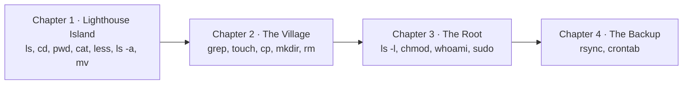

# Scenarios — Sysadmin Quests

*Learn the Linux command line by playing.* Published at
https://sysadmin.rouages.net and embeddable in other sites (see
[EMBEDDING.md](EMBEDDING.md)). The engine is in `src/engine/`:

- `shell.ts`: a machine's engine (paths, permissions, pipes `|`,
  redirections `>`, `>>`, `2>`, `2>>`, `&>`, `2>&1`, `>&2`, `<`, `<<<`,
  command lists `;`, `&&`, `||`, `sudo`, events);
- `console.ts`, `machines.ts`, `workstation.ts`: the simulated network (the
  starting workstation, one machine per story, `ssh` and `exit` to go from
  one to another);
- `commands/`: the commands, by family (`fichiers`, `texte`, `systeme`,
  `reseau`, `git`…); each one reads its arguments and the pipe's input,
  returns its output and reports its errors separately (they don't go
  through pipes, like a real shell's standard error);
- `world.ts`: the building blocks of a world (places, objects, rights,
  events);
- `chapters/`: one file per chapter, and `index.ts` which groups them into
  stories;
- `commands/manual.ts` and `commands/pages.ts`: the manual (`man`,
  `--help`, `man -k`).

The interface is in `src/interface/` (`game.ts` and its parts, `styles.css`), the
`<quetes-de-sysadmin>` element in `src/element.ts`. All texts (stories,
messages, manual, interface) are in `src/texts/<language>/*.ftl`, English
first (see `docs/TRANSLATING.md`). Games are replayed by
`tests/quests.test.ts` and one test file per story.

The stories and chapters below keep their original French titles, which are
also their names in the French version of the game; the English version
translates them (`src/texts/en/`).

## Principles

- **Inspired by the original, without copying it**: the idea (a place = a
  directory, an object = a file, commands learnt as you go) comes from
  [Terminus](https://web.mit.edu/mprat/Public/web/Terminus/Web/main.html),
  created at MIT by Shawn Conrad and Michele Pratusevich. Chapters 1 and 2
  have their own places and puzzles (the Lighthouse island, the harbour
  Town); they don't follow the original's route. The game was born as
  "Terminus en français" on Les rouages du net (rouages.net) before becoming
  this independent project, in October 2026.
- **Our own texts**: the story, places and dialogues are original, not a
  translation.
- **Real commands, real behaviours**: same paths (`..`, `~`, `/`), same
  rules (`mv` renames, `cp` copies, `rm` is final, `*` globs are expanded
  before the command runs, as the shell does). Deliberate differences are
  marked in the code and listed below.
- **One world, linked by `ssh`**: you start from your **workstation**
  (`you@desk`); each story runs on a machine of the network (`kingdom`,
  `datacenter`, `fourmiliere`, `manuscrit`, `bibliotheque`…), which you
  reach with `ssh` and leave with `exit`. At first, the workstation only has
  the kingdom's key. The other stories open **in waves**
  (`unlocking.ts`): each declares in `chapters/index.ts` (`after`) the
  chapters to finish before receiving its key, what it assumes you already
  know. Under a locked story, the menu shows what is missing; on-call duty
  only draws its incident from open stories. The menu stays a shortcut
  (accessibility, teachers); the `story` attribute opens a story directly,
  even without its key.

  | Story | opens after |
  |---|---|
  | The Eraser (The Eraser) | (from the start) |
  | The Data Centre, The Lost Packet, The Time Machine, The Archives | "The Root" (The Eraser) |
  | The Workshop, On Call | "The night of the reboot" (The Data Centre) |
  | The Neighbourhood Letters | "The night of the reboot", "The Lost Packet" |
  | The Gazette | "The Time Machine", "The night of the reboot" |
  | The Game Library | "The versions" (The Archives) |
  | The Community Centre | "Shut the Door" (The Neighbourhood Letters) |
  | The Co-op | "Sharing a home" (The Neighbourhood Letters), "Second day" (The Data Centre) |
  | The Hive | "The firewall" (The Neighbourhood Letters), "The Jump" (The Community Centre) |
  | The Audit | "The sentinel" (The Neighbourhood Letters), "Shared permissions" (The Co-op) |
  | The Lab, The Watch, Junk Mail, The Fleet, The Patch | see their sections below |
- **Stories and chapters**: in a story, each chapter has its world, its
  commands and its ending, and opens when the previous one is finished.
  Progress is kept in the browser (`localStorage`, key
  `quetes-de-sysadmin`, set with the `save-key` attribute), chapter by
  chapter. Each chapter shows a difficulty from 1 to 5 stars
  (`difficulty.ts`), on an absolute scale: what the chapter assumes (its
  prerequisites) and its size, so adding a story never changes the level
  of the chapters it doesn't come after.
- **Safe examples**: private IP addresses (RFC 1918), carrier-grade NAT
  (RFC 6598) or addresses reserved for documentation (RFC 5737), names in
  `.internal` for internal machines and networks (reserved by ICANN for
  private networks in 2024) and in `.example` for anything public: sites,
  DNS zones, emails (RFC 6761). An invented name (`cooperative.fr`) could
  belong to someone: the game would teach you to aim at a real machine. The
  workstation's `/etc/hosts` explains it to players. Only exception:
  9.9.9.9, Quad9's real public DNS resolver.
- **Authentic outputs**: `ping`, `dig`, `traceroute`, `curl`, `ps`,
  `systemctl` answer in English, as on a real system; `git` and the basic
  error messages ("Permission denied") follow the game's language, as with
  a system set to that language.

### The manual, the first reflex

To learn to help yourself, the manual is available everywhere, from
chapter 1, and for every command of the game (even those you aren't allowed
to run yet, as on a real system):

- `man command`: a page in the usual format (NAME, SYNOPSIS, DESCRIPTION,
  OPTIONS, EXAMPLES, SEE ALSO), built by `commands/manual.ts` from the
  command's definition and its additions (`commands/pages.ts`: options,
  examples, cross-references);
- `command --help`: a summary;
- `man -k word` and `apropos word`: look for a command by keyword;
  `whatis command`: one line;
- an unknown option gives the real coreutils message: "ls: invalid option
  -- 'z' / Try 'ls --help' for more information."

In chapter 1, the lesson on hidden files no longer gives the option: it
points to `man ls`, and the lighthouse keeper points to the EXAMPLES of
`man mv`. In chapter 2, the scroll introduces `--help` and `man -k`.

### Deliberate differences from a real Linux

Messages checked against the tools' sources, and what could not be
checked, are listed in [ACCURACY.md](ACCURACY.md).

| Command | In the game | On Linux |
|---|---|---|
| `less` | shows everything, like `cat` | shows page by page (`q` to quit) |
| redirections | `>`, `>>`, `2>`, `2>>`, `&>`, `&>>`, `2>&1` and `>&2` read from left to right (`>f 2>&1` is not `2>&1 >f`), `/dev/null` (even without a `/dev` in the world), `< file`, the here-string `<<<`; a redirection that can't write doesn't stop the command from running | other descriptors (`3>`, `<&`, `exec`), `>|`, process substitution `<(…)` |
| expansions | `$HOME`, `$USER`, `$LOGNAME`, `$SHELL`, `$PATH`, `$PWD`, `$OLDPWD`, `$HOSTNAME`, `$UID` as a Debian login sets them; `~`, `~/…`, `~account`; `$(…)` and `` `…` `` (run without the story's events; unquoted, the output's words stay words, an operator in them is no operator); braces `{a,b}`, `{1..10}`, `{01..03}`, `{a..e}`; `*`, `?` and `[…]` in every part of a path, a final `/` keeps only places; an unknown variable stays as typed | an unknown variable is empty; `$RANDOM`, `$$`, `$((…))`, `${VAR:-x}` and the other parameter forms; splitting by `IFS`; `extglob` |
| builtins | `true`, `false`, `test` and `[ … ]`, `type` (`-t`, `-p`, `-a`), `command` (`-v`, `-V`), `alias` and `unalias` (the first word of each command of a pipeline; Debian's colour aliases listed but not expanded, `ls` and `grep` colour anyway) are there in every chapter; a chapter's command brings its everyday companions (`echo` → `printf`, `find` → `xargs`, `mkdir` → `rmdir`, `export` → `env`, `printenv`: `COMPANIONS` in `shell.ts`); `type` and `command -v` know the colour aliases of Debian's `~/.bashrc` (`ls`, `grep`); `printf` (`%s %b %c %d %i %u %o %x %X %e %f %g`, flags, width, precision, the format reused); `echo -e`/`-E` | `help` for builtins, `hash`, `printf -v`, `%q`, an alias ending with a space |
| a chapter's commands | the commands its chapter teaches, plus those of the chapters it assumes (`availability.ts`) when its machine's system has them (POSIX utilities on every Unix-like system, a Debian tool only on Debian, a cmdlet only on Windows, a CL command only on IBM i) and when the tool's model or configuration is there (`docker` with `state.docker` or `/etc/docker`…; otherwise "command not found"); sudo only with the chapter's password; the others answer "you don't have this command yet" | every installed program runs; what is installed depends on the packages, not on a list |
| history | `!!`, `!n`, `!-n`, `!prefix`, `!$`, `!^`, `!*` (as typed, quotes kept), shown before they run | word designators (`!!:2`), modifiers (`:h`, `:s/a/b/`), `^old^new` |
| quoting | `'…'`, `"…"` and the backslash (outside quotes, the next character as it is: `\;`, `\(`, `a\ b`; inside double quotes, before `$`, `` ` ``, `"`, `\`) | `$'…'` (ANSI-C quoting), `$"…"` |
| `find` | several starting places; `-name`, `-iname`, `-path`, `-type f/d/l`, `-mtime`, `-mmin`, `-newer`, `-size` (rounded up to its unit, like GNU), `-perm` (exact, `-`, `/`, octal only), `-user`, `-group`, `-empty`, `-maxdepth`, `-mindepth`; `!`/`-not`, `-a`, `-o`, `( )`; `-print`, `-print0`, `-printf` (`%p %f %s %u %g %m`), `-delete`, `-exec … ;` and `-exec … +`; names in alphabetical order; a file without a date is recent | `-xdev`, `-prune`, `-ls`, `-ok`, `-execdir`, `-regex`, `-atime`/`-ctime`, `-links`, symbolic `-perm` modes, `-depth`, the directory's own order |
| `xargs`, `env`, `printenv` | come with `find` (`xargs`) and `export` (`env`, `printenv`); `xargs -0`, `-n`, `-L`, `-I`, `-r`, `-t`, `-d`, its quotes, exit codes 123 and 127; `env` shows what a login sets and what was exported, `-i`, `-u`, `NAME=value command` | `xargs -P`, `-p`, `-s`; `env -S`, `--chdir` |
| `head`, `tail`, `sort`, `uniq`, `cut` | `head`/`tail` `-n N` (`-nN`, `-N`), `head -n -N`, `tail -n +N`, `-c`; `sort -n`, `-h`, `-V`, `-f`, `-r`, `-u`, `-k F[.C][,F[.C]][flags]`, `-t`, `-c`, `-s`, `-b`, `-o` (texts compared in French collation, ties by the whole line); `uniq -c`, `-d`, `-u`, `-i`, `-f`, `-s`; `cut -f`/`-c`/`-b` with ranges, `-d`, `-s`, `--complement`, `--output-delimiter` | `sort -m`, `-R`, `-M`, `-z`, `--parallel`; `uniq -w`, `-D`; `cut -z`; the C locale's byte order |
| `mv` | only moves objects (files) | also moves directories |
| `rm -r` | refused (`rm -d` and `rmdir` remove an empty place) | deletes whole directories |
| `ls` | `-a`, `-A`, `-l`, `-h`, `-n`, `-i`, `-d`, `-1`; sorted by name (French collation), `-t` (a file without a date counts as recent; ties by name), `-S`, `-X`, `-U`, `-r`, `--sort=`; `-R`; several operands: the files together, then each place under its name | `-F`, `-c`/`-u` (other times), `--time-style`, `-v` (version sort), the C locale's byte order |
| `cp`, `mv`, `rm`, `rmdir` | `cp -r`/`-R`/`-a`/`-p` (root keeps the owner), `-i`, `-n`, `-f`, `-v`, several sources into a place; `mv -i`/`-n`/`-f`/`-v`; `rm -f`/`-i`/`-v`/`-d`; `rmdir -p`/`-v`/`--ignore-fail-on-non-empty`; a question answered `y` (or `o` in French) | `cp -u`, `-l`, `-s`, `--backup`, `-t`; `mv -u`, `--backup`; `rm -I`, `--one-file-system` |
| `grep` with no result | "(no line contains …)" | shows nothing |
| `grep` | basic (default), extended (`-E`) or fixed-string (`-F`) regular expressions, translated into JavaScript expressions; no `[[:alpha:]]` classes nor `\1` back-references; context (`-A`, `-B`, `-C`, `-NUM`, `--group-separator`, `--no-group-separator`) with `-n`, `-H`, `-v`, `-m`, `-c` and `-o` as GNU grep 3.11 prints them; `-e`, `-f`, `-w` and `-x` (turned into JavaScript lookarounds and anchors), `-l`, `-L`, `-s`; `-r`/`-R` walk a directory in the game's usual order (sorted names, like `ls`), where GNU follows the directory's own unsorted order, with `--include`, `--exclude`, `--exclude-dir` (`*` and `?` only) | full POSIX, `-b`, `-z`, `-a`, `--label`, `--binary-files`, `--devices`, `-d ACTION`, abbreviated long options, `[...]` in `--include` globs |
| colours (`ls`, `grep`, `diff --color`, `systemctl`, `journalctl`, `ip -c`, `git`) | `ls` and `grep` colour on screen by default, like the `--color=auto` aliases of Debian's `~/.bashrc` (without an `alias` command); `ls` keeps the `/` after places even in colour; only the default colours of common types (places, links, programs, archives, images); the interface's "Colours" button plays the part of a terminal without colours | `LS_COLORS`/`dircolors`, `GREP_COLORS`, `diff --palette`, `SYSTEMD_COLORS`; the alias is read from `~/.bashrc` |
| `man` | shows the page at once, in a few sections | opens a full-screen page (arrows, `/word` to search, `q` to quit), much longer |
| `ls -l` | `total` (KiB of 4 KiB blocks), type and rights, links (1 for a file, 2 plus the sub-places for a place), owner, group, size, date (`Mar  3 08:15` within six months, `Mar  3  2025` beyond or in the future; `3 mars` in French, from `Intl`), name, columns aligned like GNU ls; a file without a date is as old as the machine's clock; a `/` after places' names (colour is never the only sign); `-F` adds `@` and `*` | hard links counted (always 1 here); `/` only with `-F`; dates in the C locale's exact spellings |
| permissions | owner, group, others; special bits shown (`s`, `t`); a directory's setgid passes its group (and the setgid) to what is created in it; 4-digit `chmod`; setuid and sticky not applied, no ACLs; a file moved into a setgid directory without a group of its own takes its group too | setuid, sticky applied, ACLs (`setfacl`), `mv` keeps the group |
| `usermod -G` | takes effect at once | a session's groups are read at login: you must log in again (the game says so in the text) |
| `chown`, `chgrp` | `-R` only | also `--reference`, `-h`… |
| `chmod -w` (without u/g/o) | acts on everyone | takes the `umask` into account |
| `umask` | a command with its `man` page; applies to the session; other accounts' mask is read from `/etc/profile`, `/etc/profile.d/*.sh`, `~/.bashrc`, `~/.profile` (the last `umask` line wins) | a bash builtin (`help umask`); `pam_umask`, `login.defs` |
| accounts (`usermod`, `userdel`, `gpasswd`, `chage`) | `usermod -L/-U/-e/-s/-G/-u` (`-u` refused while the account runs a process; files belong to names, so they follow); `userdel [-r] [-f]` (refused if a process of the account is running); `gpasswd -a/-d`; `chage -l/-E` (dates as YYYY-MM-DD); no readable `/etc/shadow`; shadow-utils' messages in the game's language | every option, `passwd`, `deluser`, `/etc/shadow` |
| `sudo -i`, `sudo -s`, `su` (root shells) | `sudo -i`, `sudo -s`, `sudo bash`, `sudo su`, `sudo su -` (sudo's policy checks the account's shell, or `su`), `sudo -u account -i`; `su [-] [account]` asks that account's password and always answers `su: Authentication failure` (root is locked on a Debian installed with sudo), except from root; the shell's prompt (`root@host:~#`), `$HOME`, `$USER`, `$UID`, root's `PATH` (sudo's `secure_path`), a fresh environment (variables and aliases of the shell below are not there), `cd` to `/root` for a login shell (created if the world has none); `exit` or Ctrl-D back (`logout` or `exit`); commands typed there run as root for the story's events; root needs no password for sudo; a new connection starts from your own shell again | `su -c` runs as cron does; root's own history, `~/.bashrc`, `sudo -E -s`, `su` with a known root password, `sudo -k`/`-v`, the timestamp's timeout |
| `sudo`, `sudoers`, `visudo` | `/etc/sudoers` and `@includedir` (files with no dot or `~`), rules `who hosts=(account) [NOPASSWD:] commands`, `Cmnd_Alias`, wildcards; `sudo -l [-U account]`; `visudo [-c] [-f file]` checks when the editor closes and asks "What now?"; an error in the policy blocks sudo; only the player runs commands with sudo (other accounts: `sudo -l -U`); no user or host aliases, no `!` | sudoers' whole grammar, plugins, `sudoedit` |
| `who`, `pkill`, `which` | sessions described by the chapter (a session lives as long as its `sshd` runs); `pkill [-u account] [pattern]`; `which` deduces the path (`/usr/bin`, or `/usr/sbin` for section 8) | `w`, `loginctl`, all procps options; `which` reads the PATH |
| `rm` of a write-protected file | deletes without asking | asks for confirmation |
| `sudo` | asks for the password again only on the chapter's first use | remembers it for about 15 minutes |
| `cat` of an archive | an error message | shows unreadable bytes |
| systemd's dependencies (`After=`, `Requires=`, `Wants=`, `BindsTo=`, `PartOf=`, `Restart=`, the start limit) | units that start "in parallel" start one after the other in the order of their definition (the race is always lost the same way); a few targets only, declared by the chapter (`network-online.target`); a service is ready when it starts (no `Type=notify` handshake); PostgreSQL is a single service; no `Conflicts=`, `Requisite=`, slices nor sockets | a real job queue, every target, `postgresql@17-main.service` behind `postgresql.service` |
| mounts at boot (The Canteen) | the fstab lines on a simple device become `.mount` units with the device's delay; `nofail` mounts are waited for only by `RequiresMountsFor=`, the others by every service; no `x-systemd.*` options, no `mount --bind` | `local-fs.target`, `x-systemd.automount`, `x-systemd.device-timeout=`… |
| `systemd-analyze`, `networkctl` | `calendar`, `time`, `blame`, `critical-chain`, `verify` (unknown sections and keys, required units that don't exist); `networkctl list`, `status`, `reload` | every verb (`plot`, `dot`, `security`…), every option |
| `ping` | 4 pings by default | goes on until Ctrl+C |
| `ping -6`, `ping6` | on a machine speaking IPv6 or looking at one from outside: iputils' IPv6 output, a link-local address refused without `%interface` (or `-I`), the router's "Address unreachable" for an address of its prefix that nobody has; the times are computed | every option, flood, `-s`, `-t` |
| `traceroute` | stops 3 hops after the last one that answers | goes on up to 30 hops |
| `ps aux` | user, PID, %CPU, %MEM, command | adds VSZ, RSS, TTY, STAT, START, TIME |
| `tar` | computed size (text compressed to a third, media to 98 %); if there isn't room, nothing is written; `-z`/`-j`/`-J`/`-a`, reading recognises the compression (a wrong letter: the decompressor's error, exit code 2); the directories are entries (`d/` before `d/a`); `-tv` (and `-cvv`, `-xvv`) the long listing (`drwxr-xr-x you/you 0 2027-01-01 00:00 d/`) | real compression; a partial archive may remain; directories in the file system's order |
| compressed files (`compression.ts`, `commands/compress.ts`): `gzip`, `gunzip`, `zcat`, `zgrep`, `zless`, `zmore`, `zdiff`, `bzip2`, `bunzip2`, `bzcat`, `xz`, `unxz`, `xzcat`, `zip`, `unzip` | a compressed file is a binary file starting with the real header (gzip's magic, flags, date, original name, XFL; `BZh9`; `\xfd7zXZ`; `PK\x03\x04`), then the text scrambled with a fixed key stream, then gzip's trailer (CRC-32, ISIZE): `cat` shows garbage, `file` describes it like libmagic, and pipes, redirections and copies keep it readable; `gzip` `-c -d -f -k -l -r -t -v -q -1…-9` with gzip's messages and exit codes (1 error, 2 warning: `already has .gz suffix`, `already exists; not overwritten`, `is a directory -- ignored`, `unknown suffix`), compressed data refused on a terminal; `zcat x` reads `x.gz`; `less` reads a `.gz` like Debian's lesspipe; `zgrep` passes grep's options and prefixes the file's name; logrotate's `compress` writes a real `.gz`; `zip`/`unzip` (not installed by default: `apt install zip unzip`) with `-r`, `-q`, `-l`, `-d`, `-o`, `-n` and unzip's question | no DEFLATE: compressed sizes are estimates (a log to about 30 %, media unchanged); no `-S`, `-N`/`-n` (names are never restored), `bzip2`'s and `xz`'s other options; `xz -l` one stream, one block; `zip` without `-u`, `-d`, `-m`, `-e`; `unzip` without `-x`, `-j`, `-p` |
| `git` | a single branch (`main`), files at the repository's root only (subdirectories in The Tool Library's repositories), identifiers computed by the game, `commit` and `tag -a` require `-m`; `log` with `--oneline`, `-p`, `-n`, `--format`, a revision; remotes by path only (bare repositories of the machine), or a story's forge URL; `push` and `pull` fast-forward only (no merge), `push --force`/`+refspec`, tags; `reset`, `commit --amend`/`--allow-empty`, `reflog` (`HEAD@{N}`, `--date=iso`), `config`, `archive`, `-C`; `pre-receive` and `post-receive` hooks; `push` figures approximate | branches, SHA-1/SHA-256, text editor, remotes over SSH or HTTPS, fetch and remote-tracking branches, merges, rebase, every hook, `gc` |
| scripts (`sh`, `bash`, `./script`, git hooks, `postrotate`, cron lines, `ExecStart=`) | read and run like the interactive line (`script.ts` through `compound.ts` and `control.ts`): every compound, functions (`name() { …; }`, bash's `function name { …; }`), `$1`…`${10}`, `$#`, `$@`, `"$@"`, `$*`, `$0`, `shift`, `local`, `return`, `exit N`, `set -e` (not in a test, the left of `&&`/`\|\|`, after `!`), `set -u`, `set -x` (`+ cmd`, bash's quoting and `++` in `$(…)`), `set -o pipefail` (bash), `set --`, `trap '…' EXIT`, `getopts`, `.` and `source` (bash), `sh -c`, `-e`, `-u`, `-x`, `-n`; the `#!` line picks the shell (none: bash); `/bin/sh` is dash on Debian: `[[`, `function`, arrays, `$'…'`, `source`, `==` in `[ ]` and `-o pipefail` fail with dash's own messages, its `echo` reads backslashes; each shell's error wording (`name: line 3:` for bash, `name: 3:` for dash, none for FreeBSD's sh and Solaris's /bin/sh) checked against dash 0.5.12 and bash 5.2; a syntax error stops the script after the lines before it ran; CR LF lines keep their `\r`; a child shell (its variables, functions and `cd` stay inside; it starts from the exported variables; cron gives `HOME`, `LOGNAME`, `SHELL`, `PATH=/usr/bin:/bin`) | a command's exit code is 0 if it wrote no error (unless it sets its own); errors and output come out mixed, in order (a pipe after a script gets both); only `read` takes the script's input; no arrays (bash says `syntax error near unexpected token \`('`), `select`, `eval`, `exec`, `wait` on a script's jobs, signals (`trap` stores them, only `EXIT` fires); `set -e`/`-u`/`-x` act in scripts only, not on the interactive line; dash's arithmetic messages only for division by zero; Solaris's `/bin/sh` takes `$(…)` and `$((…))` that the real Bourne shell refuses; systemd runs `ExecStart=` without a shell, the game reads it with `sh` |
| `diff` | normal format, `-u` (three lines of context), `-r`, `-q`; the time in the `-u` header is the machine's | every option |
| `date`, `test`, `readlink` | `date` without option or `+FORMAT` (common directives); `test` (and `[ … ]`): `-e -f -d -L -s -r -w -x -n -z`, `=`, `!=` (and `==`, refused by dash), numeric comparisons; bash's `[[ … ]]` (patterns with `==`/`!=`, `=~`, `&&`, `\|\|`, `!`, parentheses, no word splitting); `readlink [-f]` | `date -d`, `-u`…; full `test`; `realpath`; `[[ … ]]`'s `=~` reads the expression as JavaScript's and sets no `BASH_REMATCH` |
| The Kiosk (The Gazette) | a simulated Node.js app: version read at start through a link, `/health` as JSON, configuration in a `.env` file, schema migration at start (never backwards); an hour of simulated visits on each nginx reload in "The canary" | a real app and its PostgreSQL database |
| nginx log | "combined" format without the referrer and the user agent | two more fields at the end of the line |
| `ssh` | two models: on most machines, a key is accepted if it is the one the game gave for that machine; on `maison` and its internal network (`access.ts`), the real behaviour: the other side's `authorized_keys`, passphrase, password if sshd accepts it (three tries), `-J`/`ProxyJump` (the next name is resolved by the jump machine), `-L` with `-f -N` (a process to stop with `kill`), remote command, `-G` (excerpt); no agent, `-R`, `-D` nor certificates; a single host key (ed25519); shortened usage message | all of it, agent, `ForwardAgent`, remote and dynamic forwarding |
| `exit` | has its `man` page | a bash builtin: `help exit` |
| `ssh` session | the machine keeps its state while the page stays open; a reload restarts the current chapter | the machine keeps its state |
| manual sections | 1 (commands), 5 (configuration files: `sshd_config`, `ssh_config`, `sudoers`) and 8 (administration: `usermod`, `reboot`) | also 2, 3, 4, 6 and 7 (system calls, libraries…) |
| systemd | services only (no targets nor dependencies; timers and hand-written units: see below); the clock moves one second per action | units of every type |
| `tail -f`, `journalctl -f` (live activity) | the command keeps control until Ctrl-C; the screen moves 3 s on the machine per real second, and each typed command moves a few (`Chapter.activity`, see `src/engine/activity.ts`): visitors, robots, scanners write to the logs; in a pipe (`tail -f log \| grep …`), the game shows it once without following | real time; a pipe that follows continuously; `tail -F` reopening a replaced file |
| `systemctl` without being root | "Access denied", you need `sudo` | asks for the password (polkit) |
| `sudo` after `reboot` | still remembers the password | asks for it again |
| `sshd` | some of the keywords; all errors listed at once; the password is only asked on machines with the real ssh (`maison`); no `StrictModes` (rights of `~/.ssh` not checked) nor options in `authorized_keys` | stops at the first error; offers the password everywhere; refuses an `authorized_keys` writable by others |
| `sed` | GNU's on Linux, BSD's on FreeBSD: `s` (flags `g`, `p`, `I`, N), `d`, `p`, `q`, one address (a number, `$`, `/regex/`) or a range (`2,4`, `/a/,/b/`, `3,$`, `/re/,+N`) and `!`, `-n`, `-E`/`-r`, `-e`, `-i` (GNU: optional suffix glued to the option; BSD: required, as the next word, `-i ''`). The BSD version reads the file's name as the script when `-i` takes the script as its suffix, with BSD's messages | `a`, `i`, `c`, `y`, hold space, labels (a branch fails with "undefined label"), ranges of addresses, `-f`, `-s`, `-z` |
| `stat` | GNU's `-c FORMAT` (`%s`, `%n`, `%U`, `%G`, `%a`, `%A`, `%y`, `%Y`, `%F`) and `-f` (file system); BSD's `-f FORMAT` (`%z`, `%N`, `%Su`, `%Sg`, `%Lp`, `%Sp`, `%Sm`, `%m`) on FreeBSD; each refuses the other's option | the other format sequences, `-L`, `-t`, inodes and devices |
| `date` | `+FORMAT`; on Linux, GNU's `-d` (`yesterday`, `tomorrow`, `N days ago`, `+N weeks`, an ISO date, `@seconds`) and `-s` (root); on FreeBSD, BSD's `-v` (adjust or set a field: `y m w d H M S`), `-j`, `-u`; each refuses the other's options | GNU's full date grammar ("next Friday"), BSD's `-f` input format, `-r` |
| FreeBSD (`state.os`) | a machine of the story "The Other Unix": its login banner and `uname`, `freebsd-version`; Debian's commands are "not found" (`systemctl`, `journalctl`, `apt`, `ss`, `ip`, `ufw`, `iptables`…), `bash` too until `pkg install bash`; a script's `#!` line names an interpreter that must exist ("./script: not found"); sudo reads `/usr/local/etc/sudoers`; `man` shows the BSD page of `date`, `sed`, `stat`, `ps`, `ls`, `grep`, `find`, `du` (and SEE ALSO leaves out Debian-only commands) | the other tools' BSD versions (`cp`, `tar`, `xargs`… behave as on Linux), `csh`/`tcsh`, `pw`, jails, ZFS, ports |
| Solaris 10 (`state.os`) | a machine of the story "The Old Sun": its login banner, `uname` (SunOS, sun4u sparc) and `isainfo`; Debian's and FreeBSD's commands are "not found" (`systemctl`, `top`, `free`, `stat`, `ss`, `ip`…); the old `/usr/bin` tools refuse modern options with Solaris's messages (`grep` without `-q`/`-E`/`-r`, and no context `-A`/`-B`/`-C` in `/usr/xpg4/bin/grep` either, `sed` without `-i`, `tar` without `z`, `find` without `-maxdepth`/`-delete`, `du` without `-b`, `date` without `-d`, `ps aux` without a dash), while `/usr/xpg4/bin/…` and `/usr/ucb/ps` behave like their POSIX and BSD versions; `man` shows the Solaris page of `grep` and `ps`; sudo (from sunfreeware) reads `/usr/local/etc/sudoers` | a single global zone, Solaris's `ls -l` and `df` formats, `pfexec` and RBAC, `/usr/xpg4/bin` for other tools than those named |
| `svcs`, `svcadm`, `svcprop` | SMF services by FMRI (or the end of it), their state (online, disabled, maintenance, legacy_run), `svcs -a`, `-x` (why a service is in maintenance), `-l`, `-p`, `-H`; `svcadm enable`/`disable` (`-t`), `restart`, `refresh`, `clear` (root); `svcprop -p` | milestones, dependencies between services, `svccfg` and manifests, `svcs -d`/`-D`, `-o` |
| `zfs`, `zpool` | `zfs list` (`-t snapshot`), `zfs snapshot` (root), `zfs destroy` of a snapshot, `zfs get`; `zpool list`, `zpool status` | `zfs rollback`, `send`/`receive`, clones, properties beyond a few, sizes that follow the files |
| `prstat`, `pkginfo`, `isainfo`, `zoneadm`, `zonename` | one snapshot of the processes (`prstat`); the SVR4 packages (`pkginfo`, `-l`); the instruction sets; the global zone | `prstat`'s refresh and sorting options, `pkgadd`/`pkgrm`, non-global zones |
| `iconv`, `file`, character sets | a file may be LATIN1 (`File.charset`): `cat`, `grep`, `head`… show `�` for its accented letters on the UTF-8 terminal; `iconv -f`/`-t` between LATIN1 and UTF-8 (`-l`), and a UTF-8 text converted "from LATIN1" becomes mojibake (`é`); `file` tells ASCII, UTF-8 and ISO-8859 texts, tar archives, data; a redirection keeps the charset a command wrote in (`pg_dump` of a LATIN1 database), `scp` keeps a file's charset and archive | other charsets (CP1252…; EBCDIC: see below), `//TRANSLIT`, `file -i` |
| EBCDIC and binary files | a file may hold raw bytes (`File.charset = 'binary'`): `cat`, `head`… show � above 0x7F and drop control bytes; `wc -c` counts its bytes; `file` says data; `iconv` knows EBCDIC-US (glibc's gaps), IBM037/CP037 and ASCII, stops at the first byte or character it can't convert with its position, `-c` drops them (exit code 0, like glibc 2.39), `-o`; a redirection keeps raw bytes | other EBCDIC code pages (1047, 500…), `//TRANSLIT`, `iconv`'s partial output buffering |
| `od`, `xxd`, `hexdump`, `dd` | `od` with `-A`, `-t` (c, x, o, u, d on 1, 2 or 4 bytes), `-c`, `-b`, `-x`, `-N`, `-j`, `-v`, repeated lines as `*`; `xxd` with `-s`, `-l`, `-c`, `-g`, `-p`, `-u`; `hexdump` default and `-C`, `-n`, `-s`, `-v`; `dd` with `if`, `of` (`/dev/null` included), `bs`, `ibs`, `obs`, `cbs`, `count`, `skip`, `conv=ascii,ebcdic,ibm,block,unblock,lcase,ucase`, `status=none`, GNU's translation tables; its statistics always show the same duration | `od -w`, `-a`, floating types; `xxd -r`, `-b`, `-i`; `hexdump -e`; `dd`'s `seek`, `iflag`/`oflag` effects, devices |
| `cobc` and COBOL programs | GnuCOBOL 3.1.2: fixed (reference) format checked for its column-7 indicator, `-free` refusing sequence numbers, COPY looked up in the current directory, `-I` and `/usr/share/gnucobol/copy`, PERFORM of a missing paragraph, PROGRAM-ID; `-x`, `-m` (default, `NAME.so`, a segmentation fault if executed), `-c`, `-o`, `--version`; a program's RETURN-CODE is its exit code; the story's programs (EBC2ASC, CONTRIB) are recognised by their PROGRAM-ID and run in TypeScript from their files, another program only prints its DISPLAY literals | a real compiler: no other syntax or semantic checks (it stops after the first kind of error where GnuCOBOL goes on, e.g. with the follow-on errors of a missing copybook), no listing, `cobcrun`, `-j`, environment-variable file mapping (the programs take their files as arguments) |
| `$?` and command lists (`;`, `&&`, `\|\|`) | the interactive shell expands `$?` (outside single quotes) to the previous command's exit code; a line can be a list (`splitList` in `tools.ts`), split outside quotes, `\` escapes and `$(…)`: `&&` and `\|\|` with equal precedence from the left, `;`; each command runs as if typed alone (the story's events, `afterCommand`, the summary), the history keeps the whole line; sudo's password, a question or nano pauses the list until answered; a command that leaves the session (`exit`, `ssh`, `reboot`, a cut network, `tail -f`) ends the line there; bash's syntax errors (`syntax error near unexpected token`, exit code 2); cron lines and `underCommand` run lists too | what follows `ssh host`/`exit` runs on the original machine once it ends |
| compound commands, expansions, here-documents (`compound.ts`, `control.ts`, `arith.ts`) | `for NAME in WORDS` (wildcards, braces, `$(…)`, `seq`), `for ((…;…;…))`, `if`/`elif`/`else`, `while`, `until`, `while read` from `< file`, a here-document or a pipe (the pipe's loop in a subshell: its variables are lost, as with bash's `lastpipe` off), `case` (`\|`, `*`, `;;`, `;&`, `;;&`), `break`/`continue [N]`, `{ …; }`, `( … )` (a subshell), `!`, `((…))`, `$((…))` (C operators, bash's messages), `${X:-w}`, `${X:=w}`, `${X:+w}`, `${X:?m}`, `${#X}`, `${X#p}`, `${X##p}`, `${X%p}`, `${X%%p}`, `${X/a/b}`, `${X//a/b}`, `${X:o:l}`, `${X^^}`, `${X,,}`; an unset variable is empty; `$0`, `$#`, `$$`, `$!`; here-documents `<<EOF`, `<<-EOF`, `<<'EOF'`; an unfinished input (open compound, quote, here-document, trailing `\|`, `&&`, `\|\|` or `\`) shows the secondary prompt `>` (Ctrl-C drops it, Ctrl-D gives `unexpected end of file` or ends a here-document with bash's warning); the history keeps it as one line (cmdhist); each command of a loop runs as if typed (events, `afterCommand`), but only a loop's first round counts for the summary and the notebook; a question pauses the loop; `read` (`-r`, `-p`, several names, `$REPLY`); an expansion error drops the rest of the input; functions (`name() { …; }`, `function name { …; }`, `$1`, `$#`, `"$@"`, `local`, `return`, `type` says "is a function", `unset -f`), `[[ … ]]`, `$'…'`, `source` and `.`, `${10}` | arrays, `select`, `IFS`, `set -u`/`-e`/`-x` on the line (they act in scripts), `printf -v`; inside a compound, only `read` reads the compound's input (`cat` there reads nothing); a compound's `2>` is ignored; each command's output ends its own line (`echo -n` in a loop doesn't join them); a loop stops after 10,000 rounds (the page would freeze) |
| a Debian machine's default state (`debian.ts`) | a Debian machine whose chapter models no mounts, processes, memory or network gets a small Debian 13 virtual machine's: `/dev/vda1` on `/` (20 GB, 1.6 GB of system files), `/dev/vda15` on `/boot/efi`, `udev`, the tmpfs of `/run`, `/dev/shm`, `/run/lock`, `/run/user/UID` (`df`, `mount`, `findmnt`; sysfs, proc, devpts and cgroup2 only for `mount` and `findmnt`); the base processes (systemd, journald, udevd, timesyncd, dbus, logind, cron, agetty, sshd's listener and the session's `sshd-session`, the login `bash`) and the services the chapter's systemd model runs, plus `ps` itself; 2 GiB of memory without swap (`free`, `top`); `lo` and `eth0` with the machine's documentation address and the network's `.1` as gateway (`ip`, `hostname -I`); `/etc/os-release` (a link to `/usr/lib/os-release`, in a world with `/usr/lib`), `/etc/debian_version`, `hostnamectl` (`status`, `hostname`, `set-hostname`); no rsyslog and no `lsb_release`, as on a fresh Debian 13 | the same machine everywhere (a QEMU/KVM guest), no kernel threads but four, `ps` doesn't show the commands of a pipe, the base network is only `ip`'s and `hostname`'s (`ping` and the firewalls keep their own models), `hostnamectl` has no pretty or transient name, chassis or icon settings |
| package management (`commands/apt.ts`, `packages.ts`) | a Debian 13 machine has about sixty base packages (a minimal server with SSH: `bash`, `coreutils`, `systemd`, `openssh-server`, `sudo`…, their trixie versions, sections, short descriptions and main files) plus the chapter's; `apt search` (name or description, a regular expression), `show`, `policy` (installed and candidate versions, priorities 500 and 100), `list [--installed\|--upgradable] [pattern]` (`[installed,automatic]`), `remove` (a service stopped and disabled, its programs gone, its configuration kept: `rc`), `purge` (`nginx*`), `autoremove` (the dependencies apt installed itself), apt 3.0's layout (`REMOVING:`, `Summary:`), an essential package asks for `Yes, do as I say!` (refused with `-y`); apt's stable-CLI warning on standard error when its output goes to a pipe or a file; `apt-get` (`update`, `install`, `remove`, `purge`, `autoremove`, `upgrade`, `dist-upgrade`, `-y`, `-qq`, `E:` errors, exit code 100, the classic "The following NEW packages will be installed:" layout, a question only when dependencies come along) and `apt-cache` (`policy`, `show`, `search`, `depends`, `pkgnames`); `dpkg -l` (columns as wide as their longest value, `ii`/`rc`, shell patterns), `-L`, `-S` (an exact path, or a pattern; `/bin/ls` belongs to no package on merged /usr), `-s`; `lsb_release` once `lsb-release` is installed | about sixty packages rather than three hundred (no libraries but libc6), indicative versions and sizes, no maintainer, no long descriptions, no multi-arch `:amd64` names; removing a base package doesn't take its commands away (only a catalogue package's programs leave the disk); a `Yes, do as I say!` removal of an essential package removes it from the lists only; `dpkg -L` gives the main files only (programs, configuration, documentation, manual pages); no `apt-mark`, `dpkg -i`, `dpkg-query -W` |
| systemd and the journal, everyday forms | a Debian machine whose chapter models no systemd gets the base services (cron, ssh, systemd-journald, -logind, -timesyncd, -udevd, dbus, getty@tty1; the static ones say so), booted three days earlier, with cron's last hourly run and the player's login in the journal; `systemctl status` without a unit (the machine, `running` or `degraded`, the units and failures, the boot, the control groups as a tree: each service's processes under `system.slice`, the session's under `user.slice`); `list-unit-files` (`STATE`: enabled, disabled, static; `PRESET`: Debian enables everything; `--type`, `--state`, patterns); `is-enabled` (static, exit code 1 when disabled), `is-failed`; `journalctl --since`/`--until` with `"1 hour ago"`, `"30 min ago"`, `-1h`, `+1h`, today, yesterday, a date; `-p err` and `-p warning..err`, `-b`, `-b -1`, `-b 0`, `--list-boots`, `-r`, `-g`, `-o short`, `short-iso`, `short-precise`, `short-full`, `short-unix`, `cat`, `--no-pager` | a chapter's own systemd model keeps its own units (the base ones are not added to it); `list-unit-files` lists the modelled services, timers and a few targets (not the three hundred units of a real machine), `Units:` is a round count; durations over a day in systemd's relative form ("3 days", "1 day 2h"); no `-o json`, `verbose`, `export`, nor `--since` with weekdays |
| accounts: `useradd`, `adduser`, `passwd`, `su`, `getent`, `w`, `lastlog2` | `useradd` with Debian's defaults (no home without `-m`, `/bin/sh`, a group named after the account, uid from 1000, `-r` below 1000; `-m` copies `/etc/skel`, mode 755; `-s`, `-G`, `-g`, `-d`, `-u`, `-c`, `-N`, `-e`; shadow's messages and exit codes 3, 4, 6, 9) and no password yet (`passwd -S`: L); `adduser` (Debian's: the `info:` lines, home in mode 700, the password asked twice, chfn's questions then `Is the information correct?`, the `users` group; `--disabled-password`, `--comment`, `--shell`, `--ingroup`, `--uid`, `--system`; `adduser ACCOUNT GROUP`); `passwd` with PAM's prompts (one's own after the current password, at least six characters, different from the old one; root for anyone; failures with exit code 10), `-S` (P, L, NP), `-a`, `-l`, `-u` (refused for an account without a password), `-d`, `-e`; the player's new password is sudo's; `su ACCOUNT` opens it with its password (a locked one fails), root's only once set; `getent passwd`, `group`, `hosts` (`/etc/hosts`, then the story's DNS), `shadow` (root; yescrypt-looking hashes), exit code 2 for a missing key; `w` (`-h`, `-s`) from the sessions; `lastlog2` (`-u`, `-a`): Debian 13 dropped `lastlog`, which answers "command not found" with a pointer | passwords are kept in clear by the game (never shown), no password quality checks but length and reuse, no `/etc/shadow` file in the worlds (getent shadow builds its lines), `adduser`'s and `passwd`'s other options, `groupadd`, `deluser`, `chpasswd`, `newgrp`; a mismatched password in `adduser` asks `Try again?` once more and then goes on without one |
| small tools (`commands/small-tools.ts`): `basename`, `dirname`, `realpath`, `yes`, `tac`, `nl`, `column`, `paste`, `md5sum`, `sha1sum`, `cmp`, `whereis`, `more`, `vmstat`, `lscpu`, `sync`, `timeout`, `install`, `chattr`, `lsattr`, `shutdown`, `poweroff`, `halt`, `ss -s` | coreutils' messages and exit codes (`missing operand`, `Try '… --help'`); `realpath` follows links (`-e`, `-m`, `-s`); `nl -b -n -w -s`; `column -t -s -o` (two spaces between columns); `paste -d -s`; real MD5 and SHA-1 digests with `-c`; `cmp` (`differ: char N, line L`, `EOF on`, exit codes 0/1/2, `-s`); `whereis` from the game's commands; `vmstat` and `-s` from the memory model; `lscpu` of a small KVM machine with the model's CPUs; `timeout` (124, 137 with KILL, 125, 127); `install -m -o -g -d -D`; `chattr +i/+a` honoured by `rm`, `mv`, `chmod`, `touch`, `tee`, redirections, nano and creation in the directory, even for root (`Operation not permitted`), `lsattr`'s 22 columns; `shutdown +N`/`HH:MM`/`-c` (scheduled), `shutdown now`, `-r now`, `poweroff`, `halt` (root) drop the session; `htop` and `cal` aren't installed on a minimal Debian (command not found) | `yes` on the screen stops after a screenful (`^C`, exit code 130); `timeout` only cuts `sleep` (the game's other commands are instant); a powered-off machine comes back at once (as if the host's console powered it on), a scheduled shutdown never happens; `chattr`'s other attributes are only stored; `vmstat` shows one line (no delay or count), its io and system columns are fixed |
| network clients (`commands/net-clients.ts`): `wget`, `nslookup`, `host` without a DNS model | `wget` goes through the game's `curl` (same answers): its log on the error output (`--DATE--  URL`, `Resolving`, `Connecting to`, `HTTP request sent, awaiting response... 200 OK`, `Length`, `Saving to: ‘index.html’`), an existing name gets `.1`, `-O FILE`, `-O -`, `-q`, `-qO-`, `--spider`, `--header`; exit codes 4 (network), 8 (server error), 3 (file); `nslookup NAME [SERVER]` and `host` ask the DNS of `/etc/resolv.conf` through the story's model (`dns.ts`, or the network of The Lost Packet), never `/etc/hosts`; without a model, the servers time out (`;; no servers could be reached`); `tracepath`, `mtr`, `ifconfig`, `route` aren't installed on Debian (command not found), and typing one earns a tip pointing to `ip a`, `ip r`, `ss` | `wget`'s progress bar drawn once, finished; no `-r`, `-m`, `-c`, `-N`; `nslookup` has no interactive mode and asks for A records only |
| `cp -u`, `touch`, `find -prune`/`-xdev`/`-ls` | `cp -u` copies only over an older destination (a file without a date is recent); `touch` on an existing file makes it recent (Permission denied if neither yours nor writable); `find -prune` doesn't enter the directory it matched, `-xdev` (`-mount`) lists a mount point without entering it, `-ls` lists like `ls -dils` | `touch -t`, `-d`, `-r`; `find -L`, `-newerXY` |
| jobs (`jobs.ts`), `nohup`, `watch` | `cmd &` prints `[N] PID` and runs at once (its output shows straight away), reported `[N]+  Done` (or `Exit N`) after the next command; `sleep` and follows (`tail -f`, `journalctl -f`, `watch`) put in the background keep running; `jobs` (`-l`, `-p`, `-r`, `-s`), `fg`, `bg`, `wait` (a never-ending job holds the prompt until Ctrl-C; a waited job is not reported), `disown` (`-a`), `kill %N` or a job's PID (`Terminated`, `Killed`), `$!`, job specs `%N`, `%%`, `%+`, `%-`, `%name`; Ctrl-Z (keyboard or button) stops a follow (`Stopped`); `nohup` appends to `nohup.out` (here or in `$HOME`) or says `ignoring input` when redirected; `watch [-n N] [-t]` redraws its screen (title, `Every N.Ns:`, the machine and `date`) when the output changes, as the game's time passes, until Ctrl-C | real concurrency: a background job finishes before the next prompt, `sleep` never ends by itself, a follow's lines are not printed while in the background, `fg` of `sleep` returns at once; jobs don't show in `ps`; `watch -d`, `-g`, `-e`, the interval only shown (the screen follows the game's ticks); `screen` |
| IBM i (`state.os = 'ibmi'`) and PASE | a machine of the story "The Order Book": `ssh` lands in PASE (bash and Unix utilities: `ls`, `cat`, `grep`, `file`, `iconv`, `od`, `scp`, `ssh`; `uname` says OS400), Linux's administration tools are "command not found"; the IFS shows `/QSYS.LIB/ORDERS.LIB/…` (ORDHDR's member as fixed EBCDIC records); PASE resolves names through `/etc/hosts`; the profile is the player's account in capitals (YOU) | the IFS's case-insensitive root, CCSID tags on every stream file (only CPYTOIMPF's files have one), QShell (`qsh`), `/QOpenSys` and the IBM i host table (`CFGTCP`) |
| `tn5250` and the 5250 session | `tn5250 HOST` from the workstation: the sign-on display (user, then a hidden password; CPF1120, CPF1107), a short main menu (90 signs off), then the `===>` command line where each line is a CL command, until `SIGNOFF`; no rescue snapshot during such a session | a real 5250 screen: 24×80 fields, function keys (F3, F4 prompting, F1 help: replaced by `CMD ?` and `?` at a reply prompt), the menus (only typed commands), subfile options in list panels (replaced by the equivalent commands), paging (long lists show their first and last lines and how many were left out), `tn5250`'s options and keyboard maps |
| CL commands (`src/engine/cl.ts`, `commands/ibmi.ts`) | 27 commands: `SIGNOFF`, `WRKACTJOB`, `WRKSBS`, `WRKJOBQ`, `WRKSYSSTS`, `DSPMSG`, `WRKMSGQ`, `DSPJOBLOG`, `WRKOBJLCK`, `DSPRCDLCK`, `ENDJOB`, `SBMJOB`, `CALL`, `ENDSBS`, `STRSBS`, `WRKOUTQ`, `WRKSPLF`, `DLTSPLF`, `CLROUTQ`, `DSPDTAARA`, `CHGDTAARA`, `DSPLIB`, `DSPLOG`, `CRTSAVF`, `DSPSAVF`, `SAVLIB`, `CPYTOIMPF`, with their key parameters, keywords or positional values (up to their positional limit), quoted strings, special values and lists; the analyser's errors CPD0030 (unknown command, then CPF0006), CPD0043, CPD0065, CPD0071, CPD0040, CPD0013, CPD0018 (then CPF0001); every message is shown with its ID in front (`CPF3771: …`), the way PASE's `system` prints them; their manual pages (`man WRKACTJOB`, `man wrkactjob`, `CMD ?`) list parameters | prompting, continuation lines, variables and expressions, `*LIBL` searches through a real library list, authority checking (the profile acts as if it had *JOBCTL, *SPLCTL and *SAVSYS), the other parameters and their validity checks, message files (texts written in the game, from IBM's; the save messages CPF3794, CPF3789, CPF3707 checked against the CL pages of IBM i 7.5's documentation), a few message IDs and texts not checked (CPD2420 for an invalid reply, the analyser's CPD messages, CPA4067's inquiry) |
| IBM i jobs and messages | jobs in subsystems (`state.ibmi`): status, function, job log, object and record locks; QBATCH runs one batch job at a time from its job queue; an inquiry message waits for a reply among its values at DSPMSG's `Reply` prompt (`?` shows its second-level text), the reply drives the story's program (R retries, C/D/F cancel, G skips); `ENDJOB` ends a job at once (end code 50) and releases its locks; `SBMJOB` queues `CALL PGM(…)` or a CL command; the history log (QHST) records job ends and saves; a fixed clock | job priorities, time slices, controlled-end delays, the system reply list (`WRKRPYLE`), `SNDRPY`, message keys, break messages, `WRKJOB`, job descriptions and routing |
| Spooled files and the ASP | spooled files grouped per job (count, pages, status, user data, output queue, size); `WRKSPLF SELECT(user device form-type user-data)`, `DLTSPLF` by name and job (`SPLNBR` a number, `*LAST`, `*ALL`, `*ONLY`) or `FILE(*SELECT)`, `CLROUTQ`; the system ASP's use computed from its base and the spooled files, its threshold (CPF0907) | writers and printing, `CHGSPLFA`, `HLDSPLF`, printer files' attributes (`CHGPRTF`), the creation date selection, independent ASPs, the automatic cleanup |
| Save files, `SAVLIB`, `CPYTOIMPF`, `db2` | `SAVLIB` of one library to a save file: an object locked for update by a job is skipped (CPF3202, CPF3741, CPF3771) unless `SAVACT` (`*LIB`, `*SYSDEFN`, `*SYNCLIB`, CPI3712); a save file with data asks CPA4067 (C, G) on a 5250 screen and takes the default reply C from PASE, unless `CLEAR(*ALL)`; `CPYTOIMPF` to a stream file in CSV with `MBROPT`, `STMFCCSID` (`*STMF`: the table's CCSID 37 for a new file, 819, 1208, 1252, `*PCASCII`, `*STDASCII`), `RCDDLM`, `STRDLM`, `FLDDLM`, `ADDCOLNAM`; `db2` in PASE: one `SELECT` on one table (columns, `COUNT(*)`, one `WHERE` comparison, `ORDER BY`, `FETCH FIRST`) | `RSTLIB`, tapes, `SAVOBJ`, `SAVACTWAIT`'s waiting, `TOFILE`, `DTAFMT(*FIXED)`, number and date formats, other CCSIDs, SQL joins and updates, `STRSQL` |
| Line endings (CR LF) | a file written on Windows keeps its `\r\n`: `./script` with `#!/bin/bash\r` fails like the kernel and bash ("`/bin/bash^M: bad interpreter`", code 126); run by `bash`/`sh`, an empty line is the command `$'\r'`, an assignment at the end of a line keeps its `\r`, and `cd` refuses `$'…\r'` in bash's wording; `file` names the interpreter (Bourne-Again shell script, `executable`) and says "with CRLF line terminators"; `cat -A`/`-v`/`-E`/`-T`/`-n`; nano shows such a file converted ("Converted from DOS format") and writes it back in DOS format | other effects of a `\r` in an external command's arguments (the game's word splitting drops it), dash's own wording under `sh`, nano's M-D toggle |
| `dos2unix`, `unix2dos`, `tr` | in-place conversion (`-n` to a new file, `-i` counts, `-q`, `-k`), a binary file skipped, its messages shown on the output rather than stderr; an unknown option prints the usage (exit code 1, like dos2unix 7.5) in the game's short form; `tr` with `-d`, `-s`, translation, escapes (`\r`, `\n`, `\t`, octal), ranges and `[:upper:]`, `[:lower:]`, `[:digit:]`, `[:space:]`, GNU's "extra operand" errors (it reads no file) | code pages, BOM options, `-c` (complement) |
| `.gitattributes` | the only hidden file git tracks in the game; `text`, `text=auto`, `eol=lf`, `eol=crlf` normalise CR LF to LF when a file goes into the repository (`git add` warns "CRLF will be replaced by LF"), `-text` and `binary` don't; the last matching line wins | checkout conversion (eol=crlf on checkout), `core.autocrlf`, `git add --renormalize`, `.gitignore`, patterns with directories |
| A Windows Server (`state.os = 'windows'`) | an internal host of the story "Next Door Windows": drives as the world's top directories (`C:` is `/C`), names compared without case, volumes (size, what the system uses outside the modelled files), services, SMB shares (who may change them), the System log, SMB1 off, local accounts with their SMB passwords; its OpenSSH lands in Windows PowerShell 5.1 (DefaultShell), an administrator's key read from `C:\ProgramData\ssh\administrators_authorized_keys`; `exit` closes without "logout" | on cabinet, everything that changes the machine (`state.windows.readOnly`: the write cmdlets answer with a note of the game); the Windows engine itself: see its rows below |
| PowerShell (`src/engine/powershell.ts`, `commands/powershell.ts`) | 21 read-only cmdlets (`Get-ChildItem`, `Get-Content`, `Set-Location`, `Get-Location`, `Get-Service`, `Get-PSDrive`, `Get-Volume`, `Get-WinEvent`, `Get-EventLog`, `Get-SmbShare`, `Where-Object`, `Sort-Object`, `Select-Object`, `Format-Table`, `Format-List`, `Measure-Object`, `Write-Output`, `Clear-Host`, `Get-Help`, `Get-Command`, `Get-Alias`), their 5.1 aliases (`ls`, `dir`, `cat`, `cd`, `pwd`, `sort`, `select`, `where`, `?`, `ft`, `fl`, `help`, `man`…), `cd..`, `hostname`, `whoami`; a pipeline of objects with typed properties; parameters by name, by unambiguous prefix (any case) or by position, `-Name:value`, `-?`, `-ErrorAction SilentlyContinue`; numbers with `KB`/`MB`/`GB`/`TB`; Where-Object's simple form (`Where-Object Length -gt 1GB`) and a script block with one comparison on `$_`; Out-Default's tables (grouped by directory or provider, as the format files do) and lists (five properties or more); errors in 5.1's layout (`CommandNotFoundException`, `NamedParameterNotFound`, `AmbiguousParameter`, `MissingArgument`, `PositionalParameterNotFound`, `PathNotFound`…); `Get-Help` shows the game's manual page in PowerShell's layout, `man Get-ChildItem` on Linux the same page (section PS) | superseded by the Windows engine's rows below (on cabinet the cmdlets that change something still answer with a note of the game) |
| `mount -t cifs`, `mount.cifs` (`src/engine/cifs.ts`) | the share's directory grafted at the mount point (like NFS); `cifs-utils` needed (util-linux's "helper program" message); options `credentials=` (username, password, domain), `username=`, `password=`, `domain=`, `uid=`/`gid=` (names or numbers), `file_mode=`, `dir_mode=`, `vers=` (1.0 refused by a server with SMB1 off: error 112), `ro`, `_netdev`, `nofail`, `noauto`, `x-systemd.*`, `guest`; the password prompt; errors 13, 2, 22, 16 and mount.cifs's own (bad UNC, credential file, bad user name, chdir) with cifs-utils 7.0's exit codes (1, the errno, 32), its explanation before error 112 and its "could not connect to" for an unreachable server; the files show the mount's owner, group and modes, chown and chmod change nothing visible; writes need the account's right on the share; `df` shows the server's volume; `mount`'s line like `/proc/mounts`; `mount -a` and `findmnt --verify` with network lines (no source check) | Kerberos (`sec=krb5`), `multiuser`, `cifsacl`, `noperm`, the cache options, reconnection, a second mount on the same point (refused with error 16), the server's ACLs (a share says who may change it), smbclient's dates on directories |
| `smbclient` and a Windows server | `-L` (host or `//host`) lists the shares with the administrative ones (`ADMIN$`, `C$`, `D$`, `IPC$`) and "SMB1 disabled"; a session's `-c` commands on the share (writes if the account may change it); `-U user` without `%password` prompts | an interactive session, NetBIOS browsing |
| **Windows engine:** the language (`powershell-parse.ts`, `commands/powershell.ts`) | Windows PowerShell 5.1's parser in its two modes (argument and expression): statements (`;`, new lines), `if`/`elseif`/`else`, `foreach`, `try`/`catch [Type]`/`finally` (`$_` an error record with `.Exception.Message`; a non-terminating error isn't caught), `exit`, `throw`; script-terminating errors (`throw`, `-ErrorAction Stop`, `$ErrorActionPreference = 'Stop'`) end the line or the script, statement-terminating ones only their statement; a script's own variable scope (`.\script.ps1` reads the session's, a task's `powershell.exe -File` starts empty), `exit N` in `.\script.ps1` ends the script and sets `$LASTEXITCODE`; assignments (`=`, `+=`, `-=`, `$env:X =`, `$x.Prop =`, `$h['k'] =`); pipelines whose first element may be an expression; redirections `>`, `>>`, `2>$null`, `2>&1`, `*>`; numbers (`0x1F`, `1.5GB`), `'single'` and `"double"` strings (`$var`, `${var}`, `$env:X`, `$(…)`, backtick escapes, `""`), arrays (`1,2,3`, `@()`, ranges `1..5`), hashtables `@{}`, script blocks with `$_`/`$PSItem`, casts and type literals (`[int]`, `[datetime]`, `[math]::Round()`, `[string]::IsNullOrEmpty()`), member access, method calls (strings, dates, hashtables, arrays, ACL objects), member enumeration (`(Get-Service).Name`), indexes; operators with 5.1's precedence: comparisons with `c`/`i` forms (`-eq`…`-notin`, `-like`, `-match` and `$Matches`, `-replace`, `-split`, `-join`, `-is`, `-as`), `-and`/`-or`/`-xor`/`-not`/`!`, arithmetic, `-f` with .NET formats (`N2`, `F1`, `D4`, `X`, dates `yyyy-MM-dd`); automatic variables (`$true`, `$false`, `$null`, `$Error`, `$LASTEXITCODE`, `$?`, `$PSVersionTable`, `$HOME`, `$PWD`, `$Matches`); parse errors in 5.1's layout (`&&` and `\|\|`, PowerShell 7's pipeline chain operators: `InvalidEndOfLine`, `TerminatorExpectedAtEndOfString`, `MissingEndCurlyBrace`, `ExpectedValueExpression`, `EmptyPipeElement`, `UnexpectedToken`); runtime errors (`InvokeMethodOnNull`, `MethodNotFound`, `TypeNotFound`, `InvalidCastFromStringToInteger`); unquoted `user:(OI)(CI)(M)` runs `(OI)` as a command, as in PowerShell | `trap`, here-strings, splatting, classes, loop labels, `switch -File`, `filter`, the pipeline running a function's process block item by item while the next command waits (the game runs each command to its end before the next), a mandatory parameter's prompt without `!?` help, a call depth stopped at 100 (Windows PowerShell's limit is higher), endless loops stopped by the game after 10,000 iterations on a line (real PowerShell runs until Ctrl+C), `Get-Module` lists every module of the machine as if imported, `-OutVariable` (accepted, ignored), scopes beyond the session's and a script's own (no `$script:`/`$global:`), a catch's type matched by its name only (no .NET hierarchy beyond `Exception`), `$OFS` and culture, type accelerators beyond a short list, a binding error names the alias typed (`ls : …`, story 30's wording; real 5.1 may name the cmdlet) |
| **Windows engine:** commands and the pipeline | cmdlets found by name or alias (5.1's aliases, `sc` is `Set-Content`, `%`, `?`), native programs with or without `.exe`, `.\script.ps1` (local scripts run, RemoteSigned; `script.ps1` without `.\` gives the "Suggestion [3,General]" line); parameters by name, unambiguous prefix or position, with type conversion (a `SecureString` parameter refuses a string, `Int32` refuses text, `ScriptBlock`, `Hashtable`, `DateTime`); common parameters (`-ErrorAction` Stop/SilentlyContinue/Ignore, `-ErrorVariable` (`+name` adds), `$?` after each statement of a script too, `-WhatIf` with the real "What if: Performing the operation …" text, `-Confirm`, high-impact cmdlets asking unless `-Force`); questions (`Read-Host [-AsSecureString]`, confirmations `[Y] Yes [A] Yes to All…`) answered on the next line, the statement then run again in full; Where-Object (both forms), ForEach-Object (`-Begin`/`-End`, `-MemberName`), Sort-Object (several properties, calculated ones), Select-Object (`-First`, `-Last`, `-Skip`, `-Index`, `-Unique`, `-ExpandProperty`, calculated `@{Name=;Expression=}`), Group-Object, Measure-Object, Format-Table/Format-List (the type's list view), Out-String, Out-Null, Write-Host/Warning/Error, Get-Member, Get-Date, New-Object, Select-String, Get-Variable, Get-History; Out-Default's views per type (directory and hive groups, registry `Property` cells on several lines, MatchInfo as lines, dates in their long form); Tab: cmdlet names, parameters, Windows paths | a statement interrupted by a question loses what it wrote before it (it runs again from its start, so an earlier item of the same statement may be done twice), streaming (a pipeline's errors come before its formatted output), PSReadLine's cycling completion (Tab completes the common part, the second Tab lists), `Format-Table -AutoSize`/`-Wrap` (tables are sized to their content), Get-Member lists only properties and a few methods |
| **Windows engine:** files and the registry (`commands/windows-files.ts`, `windows-registry.ts`) | FileSystem, Registry (`HKLM:\`, `HKCU:\`, `Registry::HKEY_…`) and `Env:` providers; Get-ChildItem (`-Recurse`, `-Depth`, `-Filter`, `-Include`, `-Exclude`, `-File`, `-Directory`, `-Force`, `-Name`), Get-Item, Get-Content (`-Tail`, `-TotalCount`, `-Raw`), Set-Content, Add-Content, Out-File and `>`/`>>`, New-Item (files, folders, missing parents with `-Force`, keys), Remove-Item (the "has children and the Recurse parameter was not specified" question, hidden items need `-Force`), Copy-Item (a folder without `-Recurse` copied empty; with `-Recurse` what can be read is copied, merged into an existing folder, and each unreadable file or folder is a non-terminating error of its own), a file a running service holds open (`WinService.opens`) can't be removed nor moved ("being used by another process", `RemoveFileSystemItemIOError`), `compact` (`/c`, `/u`, `/s[:DIR]`, `/i`, `/q`, listing: NTFS compression, a text file about 6.7 to 1, the volume's free space follows, an open file `[ERR]`), Move-Item, Rename-Item, Test-Path (`-PathType`), Set-Location into the registry (prompt `PS HKLM:\SOFTWARE>`), Push/Pop-Location, Get-ItemProperty, Get-ItemPropertyValue, Set-ItemProperty, New-ItemProperty ("The property already exists." without `-Force`), Remove-ItemProperty; NTFS checks for each read, write, create and delete, the volume's free space ("There is not enough space on the disk."); services' keys under `HKLM:\SYSTEM\CurrentControlSet\Services` built from the services (`Start`, `ObjectName` change them); `reg query` (`/v`, `/s`), `reg add`, `reg delete` | file attributes but hidden (read-only, system), alternate data streams, symbolic links and junctions, `Compress-Archive`, Out-File writes text (5.1 writes UTF-16 LE with a BOM), `Get-Content -Wait`, registry permissions, HKCR/HKU, `reg add` overwrites without asking, `reg export`/`import`, compression ratios fixed by kind (text, other), `compact /f`/`/a` accepted and ignored, `Compress-Archive` |
| **Windows engine:** NTFS permissions (`windows-acl.ts`, `commands/windows-acl.ts`) | a security descriptor per file or folder (owner, explicit entries; inherited entries computed from the parents with (OI), (CI), (IO), (NP), CREATOR OWNER becoming the owner, generic rights mapped), the access check in canonical order (explicit Deny, explicit Allow, then inherited, nearest first; an explicit Allow beats an inherited Deny), the owner's implicit right to read and change permissions; FileSystemRights named like .NET (`Modify, Synchronize`); Get-Acl (table and list with `Access` on several lines, `Sddl`, `.Access` as rule objects), Set-Acl with SetAccessRule/AddAccessRule/RemoveAccessRule/RemoveAccessRuleAll/PurgeAccessRules/SetAccessRuleProtection/SetOwner, New-Object FileSystemAccessRule and NTAccount; icacls display ("Successfully processed 1 files; Failed processing 0 files"), `/grant[:r]`, `/deny`, `/remove[:g\|:d]`, `/inheritance:e\|d\|r`, `/setowner`, `/reset`, `/T`, `/C`, `/Q`; takeown (`/F`, `/A`, `/R`); new items owned by their creator (the Administrators group for an administrator); access through a share = share permissions AND NTFS, used by `mount -t cifs` and `smbclient` | inherited entries are computed, not copied (a moved file takes its new parent's at once, where Windows keeps the old copies until reapplied), no SACL (`Audit` empty), no integrity labels, no privileges (backup, restore) beyond an administrator's right to take ownership, icacls' exit code for an unknown account (1332) uncertain, `/save`, `/restore`, `/setintegritylevel` |
| **Windows engine:** accounts (`windows-accounts.ts`, `commands/windows-accounts.ts`) | local users (built-in Administrator, Guest, DefaultAccount, WDAGUtilityAccount; RIDs, SIDs from the machine's SID), groups (BUILTIN\… and the machine's own, members as identities, nested Authenticated Users in Users), the token of an account (Everyone, Authenticated Users, INTERACTIVE or NETWORK, its groups); Get-LocalUser (list: PasswordLastSet, PasswordExpires from the 42-day policy, LastLogon), New-LocalUser, Set-LocalUser (SecureString only; complexity checked: three kinds of characters, six at least, not the name), Enable/Disable/Remove-LocalUser, Get-LocalGroup, New-LocalGroup, Get/Add/Remove-LocalGroupMember (MemberExists, PrincipalNotFound), ConvertTo-SecureString (`-AsPlainText -Force`), `net user` (list, details, set a password, `/add`, `/active`, `/expires:` the account's own expiry date, not its password's), `net localgroup` (members, `/add`, `/delete`), `net accounts`, `whoami` (`/user`, `/groups`); a disabled account or an expired password refuses ssh | (Active Directory: see its rows) local password history and minimum age, local lockout, `net user NAME *` (its prompt), `Rename-LocalUser`, user rights (log on as a batch job, as a service), an account past its `/expires:` date still logs on |
| **Windows engine:** services and processes (`windows-services.ts`, `commands/windows-services.ts`) | services with a logon account and the password the Service Control Manager stored; Start/Stop/Restart-Service (dependencies started first, dependents need `-Force`, "cannot be started due to the following error: Cannot start service X on computer '.'", CouldNotStartService), Set-Service (`-StartupType`, `-Status`, `-DisplayName`, `-Description`; no `-Credential` in 5.1), Get-Service (`-DependentServices`, `-RequiredServices`, its list view); a password changed since, a disabled or expired account: error 1069 with events 7038 and 7000 in System and 4625 in Security; a disabled service: 1058; `sc.exe query`, `qc` (SERVICE_START_NAME), `start`, `stop`, `config` (`start=`, `obj=`, `password=`, `DisplayName=`, `binPath=`), `net start`/`net stop` (by display name too), `net helpmsg`; Get-CimInstance/Get-WmiObject for Win32_Service (StartName, PathName, ProcessId), Win32_LogicalDisk, Win32_OperatingSystem, Win32_ComputerSystem with WQL `-Filter`/`-Query`; Get-Process (5.1's table), Stop-Process | pending states and "WARNING: Waiting for service … to start", recovery actions, service SIDs and triggers, a fixed list of system processes with made-up figures, WQL beyond `=`, `<>`, `LIKE`, `AND`, `OR` |
| **Windows engine:** event logs (`commands/windows-events.ts`) | System, Application, Security, Setup, Windows PowerShell, Microsoft-Windows-TaskScheduler/Operational (disabled by default, as on Windows Server); record numbers; Get-WinEvent (`-LogName` with wildcards, `-MaxEvents`, `-ProviderName`, `-FilterHashtable` with LogName, Id, Level, ProviderName, StartTime, EndTime; `-ListLog`; `-Oldest`; its table grouped by provider and its list view), Get-EventLog (`-Newest`, `-EntryType` including FailureAudit, `-Source`, `-InstanceId`, `-After`, `-Before`, `-List`), `wevtutil el`, `gl`, `sl /e:` | `-FilterXPath`, `-FilterXml`, message templates and languages, `Clear-EventLog`, `Write-EventLog`, log sizes and retention |
| **Windows engine:** scheduled tasks (`windows-tasks.ts`, `commands/windows-tasks.ts`) | tasks with a principal (SYSTEM, or a local user and the stored password), actions, daily, weekly and once triggers; Get-ScheduledTask (its table and list), Get-ScheduledTaskInfo (LastTaskResult in decimal: 0, 267011, 267009, 2147943726, 2147943731, 2147943730, 2147942402), Start/Stop/Enable/Disable-ScheduledTask, Set-ScheduledTask `-User`/`-Password` (checked when set: "The user name or password is incorrect."), Unregister-ScheduledTask; New-ScheduledTaskAction (`-Execute`, `-Argument`, `-WorkingDirectory`), New-ScheduledTaskTrigger (`-Daily` `-DaysInterval`, `-Weekly` `-DaysOfWeek`, `-Once`, `-AtStartup`, `-AtLogOn`, `-At 3am`; one kind only, or "Parameter set cannot be resolved"), New-ScheduledTaskPrincipal, Register-ScheduledTask (`-User`/`-Password` checked, `-Principal`, `-RunLevel`, `-Description`, a taken name refused unless `-Force`, event 106; LastTaskResult 267011 until it runs); a run: the logon (events 104 and 101, 4625), then the action as that account (powershell.exe `-File` runs the script through the game's PowerShell: non-terminating errors leave the exit code at 0, `exit N` and `throw` set it), events 107/110, 100, 200, 201, 102, 203/103; `advanceWindows` lets the clock run minute by minute; `schtasks /query` (`/fo LIST`, `/v`), `/run`, `/end`, `/change` (`/ru`, `/rp`, `/enable`, `/disable`), `/delete` | New-ScheduledTaskSettingsSet, a task registered without a password runs at night as if its user were logged on, several actions, conditions and settings (idle, AC power, "run as soon as possible after a missed start"), repetition within a day, schtasks /v shows a subset of its fields |
| **Windows engine:** the machine, its shares and network (`commands/windows-system.ts`, `windows-world.ts`) | `windowsMachine()`: a Windows Server 2022 with C:\ (Windows, Program Files, ProgramData, Users and profiles) and its default ACLs, data volumes, the default services, the registry's usual keys, local accounts, logs, OpenSSH with password logon; Get-Volume, Get-PSDrive (the registry's current location too), Get-SmbShare, Get-SmbShareAccess, Grant/Revoke/Block/Unblock-SmbShareAccess (asking unless `-Force`), New-SmbShare (`-FullAccess`, `-ChangeAccess`, `-ReadAccess`, `-NoAccess`), Remove-SmbShare, Get-ComputerInfo, Get-NetIPAddress, Test-NetConnection (`-Port`), `hostname`, `ipconfig` (`/all`), `ping` (the addresses of the machine's hosts file, itself, its gateway) | one network adapter, no firewall (`Get-NetFirewallRule` is a later step), no DNS client, no WinRM, made-up figures for memory and CPU |
| **Windows engine:** reaching it, cmd.exe (`commands/cmd.ts`, `console.ts`) | a story's main machine with `os: 'windows'` reached by `ssh` from the workstation (keys from `administrators_authorized_keys` for administrators, or a password; a disabled account refused), an internal host the same way; OpenSSH lands in PowerShell when `HKLM:\SOFTWARE\OpenSSH` has DefaultShell, otherwise in cmd.exe (prompt `user@HOST C:\…>`); `powershell` and `cmd` start one shell inside the other, `exit` comes back, then closes ("Connection to … closed." without "logout"); cmd's `dir` (its header and totals), `cd`, `type`, `echo`, `set`, `ver`, `mkdir`, `cls`, `exit`, `%VAR%`, and the programs; `powershell -Command`, `-File`, `cmd /c` | batch files, cmd's pipes and redirections (its lists `&`, `&&`, `\|\|` and `^` escapes do work; `echo` drops a trailing space), `for`, `if`, `start`, `copy`/`del`/`move` in cmd, the exact case of the computer name in cmd's prompt (`user@COMPUTER`), PowerShell 7, the console's colours |
| **Windows engine:** the language, step 2 (`powershell-parse.ts`, `commands/powershell.ts`) | functions: `function Name { param(…) … }` and `function Name($a, $b) { … }`, typed parameters (`[string]`, `[int]`, `[switch]`, arrays) with defaults, binding by name, unambiguous prefix and position (declaration order, or `Position=`), a simple function's extra values in `$args`, `$input`, `$PSBoundParameters`; advanced functions (`[CmdletBinding()]`, `[Parameter(Mandatory, Position, ValueFromPipeline, ValueFromPipelineByPropertyName)]`, `[ValidateSet()]`, `[Alias()]`): strict binding with the real errors, a missing mandatory parameter asked for ("cmdlet X at command pipeline position 1 / Supply values for the following parameters:"); `begin`/`process`/`end`; `return`; a function's own scope (dynamic: it reads the caller's variables, its assignments stay its own), `$global:`, `$script:`; `while`, `do { } while/until`, `for (init; cond; step)`, `$i++`, `$i--`, `*=`, `/=`; `switch` (values compared like `-eq`, several clauses can match, `default`, `-Wildcard`, `-Regex` with `$Matches`, `-CaseSensitive`, script-block conditions, arrays item by item, `break`, `continue`); `break`/`continue` in loops (and out of a ForEach-Object script block, as in PowerShell); `<# block comments #>` and comment-based help (`.SYNOPSIS`, `.DESCRIPTION`); dot-sourcing (`. .\lib.ps1`), `Import-Module` of a `.psm1`/`.ps1` or of a module of the machine (an absent one: `Modules_ModuleNotFound`), `Get-Module`; Get-Command and Get-Help show a function (its syntax line as Get-Help writes it), Tab completes it | see the language's first row (`trap`, splatting, labels…) |
| **Windows engine:** Windows Defender Firewall (`windows-firewall.ts`, `commands/windows-firewall.ts`) | profiles Domain, Private, Public (on by default, `NotConfigured` defaults: inbound blocked, outbound allowed), the adapter's category (DomainAuthenticated on a domain's machine, Private otherwise); rules with name, display name, group, direction, action, profiles, protocol, local and remote ports, remote addresses (Any, an address, a range, a CIDR or mask, LocalSubnet, DefaultGateway, DNS); the decision: a matching block rule wins, then a matching allow rule, otherwise the profile's default; a profile turned off lets everything in; Windows Server 2022's defaults for what the game models (OpenSSH SSH Server (sshd) on, File and Printer Sharing (SMB-In) on, Echo Request off, Remote Desktop off, WinRM HTTP-In with its Public rule limited to LocalSubnet; on a domain controller the AD DS, Kerberos and DNS rules); Get-NetFirewallRule (its list view with PolicyStoreSource, `-Name`, `-DisplayName`, `-DisplayGroup`, `-Enabled`, `-Direction`, `-Action`, `-PolicyStore`, `CmdletizationQuery_NotFound_*`), Get-NetFirewallPortFilter and Get-NetFirewallAddressFilter in both directions of the pipeline, New-NetFirewallRule (GUID name without `-Name`, `-PolicyStore "domain\GPO"`), Set-, Enable-, Disable-, Remove-NetFirewallRule, Get-/Set-NetFirewallProfile, Get-/Set-NetConnectionProfile; `netsh advfirewall firewall show/add/delete/set rule`, `netsh advfirewall show/set allprofiles state`; ssh (`Connection timed out`), smbclient (`NT_STATUS_IO_TIMEOUT`), `mount -t cifs` (`mount error(115): could not connect to …`), Test-NetConnection (`TcpTestSucceeded`, the port's service must run) and `ping` from a Windows machine go through the target's firewall | IPsec and connection security rules, program and service conditions, edge traversal, the firewall's log file, outbound filtering of the game's own connections, `ping` from Linux (it ignores the Windows firewall), the exact wording of New-NetFirewallRule's errors for a port without TCP/UDP and for an invalid address (uncertain), `RemoteDynamicKeywordAddresses` shown on every rule (uncertain on Server 2022), the default File and Printer Sharing (SMB-In) rule on with profile Any (Windows enables it when a share is created; uncertain) |
| **Windows engine:** Active Directory (`windows-ad.ts`, `commands/windows-ad.ts`) | a domain on its domain controller (`state.ad`, built by `domainController()`), members joined with `windowsMachine({ domain })` (local Administrators hold Domain Admins, Users hold Domain Users; the player is a domain account); objects with DN, objectGUID and SID (the domain's SID and RID, deterministic), the default containers (CN=Users, CN=Computers, CN=Builtin, OU=Domain Controllers) and groups (Domain Admins 512, Domain Users 513, Domain Computers 515…; Builtin Administrators, Users…), OUs protected from accidental deletion, users (enabled, the password and when it was set, must change at next logon, never expires, the account's expiry, badPwdCount, lockout, last logon, Department, Title, Office, Manager…), groups (Global, DomainLocal, Universal; Security, Distribution; nesting; the primary group), computers; the domain's policy (7 characters, complexity, 42 days, 24 remembered, no lockout by default); a logon with `DOMAIN\user` or `user@domain` on a member (ssh: Logon Type 8; smbclient `-U DOMAIN\user` or `-W`, `mount -t cifs` with `domain=`: Logon Type 3): a wrong password counts, resets after the observation window, locks at the threshold (4740 on the domain controller with the Caller Computer Name: the member for ssh, the client for SMB), 4625 with its status and sub-status on the member, 4624 on success; a locked, disabled, expired or must-change account refused; domain groups (nested) in the tokens of NTFS and share permissions, icacls and Grant-SmbShareAccess take them; Get-ADUser, Get-ADComputer, Get-ADGroup, Get-ADOrganizationalUnit, Get-ADObject (`-Identity` as DN, GUID, SID or sAMAccountName, a missing one terminating even with `-ErrorAction SilentlyContinue`; `-Filter` with `-eq -ne -like -notlike -gt -ge -lt -le -and -or -not`, `*`, `$variables` and dates; `-LDAPFilter` with the bitwise matching rules; `-SearchBase`, `-SearchScope`; `-Properties` list or `*`, the default property sets sorted by name; "One or more properties are invalid"), New-ADUser (created disabled, a refused password leaves it created and disabled), Set-ADUser (`-Replace`, `-Clear`, `-Add`), Remove-ADUser (asks), Enable-/Disable-/Unlock-ADAccount, Set-ADAccountPassword (`-Reset`, `-OldPassword`; complexity: three kinds, not the sAMAccountName nor a part of the name; a reset doesn't unlock), Search-ADAccount (`-LockedOut`, `-AccountDisabled`, `-AccountInactive` 15 days or `-TimeSpan`/`-DateTime`, never used counting, `-AccountExpired`, `-AccountExpiring`, `-PasswordExpired`, `-PasswordNeverExpires`, `-UsersOnly`, `-ComputersOnly`), New-/Set-/Remove-ADGroup, Get-ADGroupMember (`-Recursive`, lower-case property names), Add-/Remove-ADGroupMember, Get-ADPrincipalGroupMembership, New-/Set-/Remove-ADOrganizationalUnit (`Access is denied` while protected, leaf only without `-Recursive`), Move-ADObject, Get-ADDomain, Get-ADDomainController, Get-/Set-ADDefaultDomainPasswordPolicy; the AD Recycle Bin (`ad.recycleBin`: a deleted object goes to CN=Deleted Objects with a `\0ADEL:` DN, Deleted, LastKnownParent; Get-ADObject `-IncludeDeletedObjects`, Restore-ADObject back to its parent with its SID, password and groups, its parent required, Get-ADOptionalFeature); the module only on the domain controller or a member with the tools (`domain.tools`); `net user /domain`, `whoami` and `whoami /groups` with the domain | one domain and one domain controller (no replication, sites, trusts, FSMO transfers), no Kerberos (a logon is checked at once, no tickets, no 4768/4771), no fine-grained password policies, no password history, no ACLs on directory objects nor delegation, no Enable-ADOptionalFeature (a story declares the Recycle Bin on; its deleted objects keep every attribute and link, no tombstone after 180 days), `-Server`/`-Credential` accepted and ignored, a few properties (`-Properties *` lists the game's), the order of results (creation order), New-ADUser's sAMAccountName defaulting to `-Name` (uncertain: Microsoft Learn says `-SamAccountName` is required), Search-ADAccount `-AccountInactive` counting accounts never used (as documented by observation, uncertain) |
| **Windows engine:** Group Policy (`windows-gpo.ts`, `commands/windows-gpo.ts`) | GPOs (`state.ad.gpos`: name, id, status, versions, owner, settings for the computer or the user: a firewall rule, a firewall profile, a drive map, a logon script, a user right, the account policies, a registry value; permissions with GpoApply for security filtering, Authenticated Users by default), the Default Domain Policy and Default Domain Controllers Policy with their real ids, links on the domain and OUs (enabled, enforced, link order), inheritance blocked on an OU; the resulting policy (LSDOU without L and S: the domain then each OU down, link order 1 last in its container, a blocked OU dropping what comes from above unless enforced, enforced links winning over those below) with each GPO applied or filtered out (`Disabled (Link)`, `Disabled (GPO)`, `Denied (Security)`, `Not Applied (Empty)`); its application at logon (`windowsLogin`) and by `gpupdate` (`/force`, `/target:`) or Invoke-GPUpdate (`-Computer` a machine of the story): GPO firewall rules replace the previous ones (PolicyStoreSource the GPO's name, PolicyStoreSourceType GroupPolicy), drive maps (`net use`); `gpresult /r` (its layout: RSOP data, COMPUTER and USER SETTINGS, applied GPOs highest precedence first, filtered GPOs with their reason, the security groups; `/scope:`, `/h` a file, `/s` another computer and `/user` someone with RSoP data there, otherwise "does not have RSoP data", "The RPC server is unavailable" for an unknown computer); the domain's workstations as RSoP sources (`ad.clients`: who is logged on where, the policy computed at their logon and by Invoke-GPUpdate `-Computer`), Get-GPResultantSetOfPolicy (`-Computer`, `-User`, `-ReportType`, `-Path`); a GPO linked twice on a path processed once; Get-GPO, New-GPO, Remove-GPO, New-GPLink (`-Order`), Set-GPLink (`-LinkEnabled`, `-Enforced`, `-Order`), Remove-GPLink, Get-GPInheritance (lower-case Name and Path, GpoLinks, InheritedGpoLinks in precedence order), Set-GPInheritance, Get-GPPermission, Set-GPPermission (`-Replace` to lower a permission), Get-GPOReport (XML or HTML) | no sites nor local policy (Local Group Policy always "Not Applied (Empty)"), no WMI filters, loopback processing, slow-link detection or background refresh every 90 minutes, a small set of settings (no Set-GPRegistryValue; settings are declared by the story or by New-NetFirewallRule `-PolicyStore`), Get-GPOReport's and Get-GPResultantSetOfPolicy's content in the game's short form, workstations that aren't machines of the game (no firewall nor logon of their own, Invoke-GPUpdate applies at once, without its random delay), user rights and logon scripts recorded (gpresult, `appliedSettings`) but not enforced at logon, the computer's token shown with INTERACTIVE, the texts of Get-GPO's "not found", New-/Set-GPLink's link errors and Set-GPPermission's refusal (uncertain), gpresult's copyright line without its year |
| **Windows engine:** CSV (`commands/windows-files.ts`) | Export-Csv (`#TYPE` line unless `-NoTypeInformation`, the first object's properties as header, values in double quotes, doubled quotes inside, a null left empty, arrays as `System.Object[]`, `-Delimiter`, `-Append` without a second header, `-NoClobber`), ConvertTo-Csv, Import-Csv (the `#TYPE` line skipped, `-Header`, `-Delimiter`, every value as text; "Could not find file") | `-Encoding` accepted and ignored (the game's files are text), `-UseCulture` is a comma (en-US), `-QuoteFields`/`-UseQuotes` (PowerShell 7) refused, ConvertFrom-Csv |
| **Windows engine:** domain accounts on members, Windows' OpenSSH client (`windows-tasks.ts`, `commands/windows-tasks.ts`, `commands/windows-system.ts`, `commands/windows-ad.ts`, `ldap.ts`) | a scheduled task under a domain account (`LENDING\rsilva`): the domain controller checks its stored password at each run like any logon (Logon Type 4: a wrong one counts towards the lockout, 4740 names the member as the caller, 4625 on the member), LastTaskResult 0x8007052E, 0x80070775 when locked, 0x80070533/0x80070532/0x80070701/0x80070773 for disabled, password expired, account expired, must change; Set-ScheduledTask, Register-ScheduledTask and `schtasks /change /ru /rp` take a domain account (its password checked, a wrong one counting too; "No mapping between account names and security IDs was done" for an unknown one); Principal.UserId and schtasks' Run As User show `DOMAIN\user`; a trigger's repetition (every N minutes for a duration, or until the next start), shown in Triggers' Repetition (Interval PT5M, Duration PT12H) and by `schtasks /query /v` (Repeat: Every, Until: Duration); `ssh` (ssh.exe, installed by default on Windows Server 2019 and later) from a Windows machine to the story's other machines: the game's ssh, keys in `%USERPROFILE%\.ssh`, names resolved by the hosts file then the domain's DNS (the story's machines, in the language); Add-/Remove-ADPrincipalGroupMembership (`-MemberOf`, removing asks), the primary group refused ("The user cannot be removed from a group because the group is currently the user's primary group"); LDAP filters' ordering matches `>=` and `<=` (numbers compared as numbers, text without case), in Get-AD* `-LDAPFilter` and `ldapsearch` | services under a domain account (still local only), New-ScheduledTaskTrigger's `-RepetitionInterval`/`-RepetitionDuration`, the task's random delay and "stop at duration end", `cmdkey` and saved credentials, Enter-PSSession, Invoke-Command and `-CimSession` (remoting goes through ssh), ssh.exe's Windows-only options, an ordering match on an attribute without an ordering rule (accepted, uncertain) |
| The Music School (story 31) | `stave` as the story's main machine, built with `windowsMachine()`; its users, groups, shares with their own permissions, NTFS permissions on the shares' folders, the Agenda service under `.\svc_agenda`, a nightly task, System events of an update restart (1074, 6006, 6005, 6013) and the service's logon failure at boot (7038, 7000, 4625); a chapter's goal checked through `shareAccess` (what each teacher could do over SMB) and on the service's stored password; the Agenda's log (open while it runs: `opens`) and its level read from `agenda.ini` when it starts (`onStart`); 189 daily logs of a few GB filling D: (the volume's base computed for 180 MB free); the backup nights replayed at the start of chapter 4 with `advanceWindows` (the real script, as `svc_backup`: silent successes that skip Bank, then the expired password), each script run of a task recorded (`psScriptRuns`: exit code, errors met) | the Agenda's log doesn't grow while you play, nor does the app write anything at the debug or info level; the teachers' and the office's own attempts are told by the story (Samir's messages), not made over SMB; the password manager is an exported text entry; no Effective Access tab nor `Get-NTFSAccess`; `Set-Service -Credential` doesn't exist in 5.1, so `sc.exe config` (or the Services console, not simulated) is the way; `sc.exe config` doesn't check the password, as on Windows (the next start does) |
| PostgreSQL across versions | a database's encoding (`\l`, `createdb -E`), an 8.4 server on Solaris (its connection messages, `/tmp` socket, `SELECT version()`), `pg_dump` writing in the database's encoding (`SET client_encoding`, `-E`), `psql -f` decoding a script by its `SET client_encoding` (an error for LATIN1 bytes declared UTF8, mojibake for UTF-8 bytes declared LATIN1); `ALTER DATABASE … SET default_transaction_read_only`; `pg_ctl -D DIR start` (in `/usr/lib/postgresql/16/bin`) refusing a data directory of another version | byte order itself (a data directory of the same version but another architecture would also fail: told in the story, not simulated), `pg_upgrade`, `listen_addresses`/`pg_hba.conf` between machines (set by the story) |
| BSD `ps`, `ls`, `grep`, `find`, `du` | on FreeBSD: `ps` with BSD options (`aux` with or without a dash, `a`, `x`, `u`, `j`, `l`, `-e` the environment, `-U`, `-p`, `-o`/`-O` with BSD keywords, no long options), only your terminal processes by default, your login shell and `ps` itself listed; `ls` refuses GNU's long options (only `--color`) and colours only with `-G`; `grep -P`, `find -printf`, `du -b` refused (GNU only), with getopt's or find's messages. On Linux, GNU's `grep -P` (JavaScript's regular expressions), `find -printf` (`%p %f %s %u %g %m`, `\n`) and `du -b` | BSD `ps`'s other keywords and `-L`, `ls`'s BSD-only options (`-T`, `-W`…) and its long format's dates, BSD `grep`'s finer differences, `find -ls` |
| `pkg` | `search`, `install` (with its question, `-y`), `info` (`NAME`), `delete`, `update`, `upgrade`: the story's catalogue (nginx, bash); an installed package's files under `/usr/local`, its rc script and its message | dependencies, repositories, `pkg audit`, locks |
| `service`, `sysrc`, `rc.conf` | rc services: `start`, `stop`, `restart`, `reload`, `status`, the `one` prefix, `enable`/`disable`, `service -e`; rc.subr's refusal without `NAME_enable="YES"` in `/etc/rc.conf`; `sysrc NAME`, `NAME=VALUE`, `-x`, `-a` | `rcorder`, `/etc/rc.conf.local` and `rc.conf.d`, rc script variables beyond `_enable` |
| `sockstat` | the listening sockets with their account, program and PID (`-4`, `-6`, `-l`) | connected sockets, `-c`, Unix sockets, jails |
| `pfctl`, `pf.conf` | `-nf` (check), `-f` (load), `-e`/`-d`, `-sr`, `-si`, `-F rules`; `service pf start` with `pf_enable`; rules `pass`/`block` (`drop`, `return`), `in`/`out`, `quick`, `proto`, `from`, `to`, `port` (numbers, names, lists `{ }`), `all`, macros, `set skip`; the LAST matching rule decides unless `quick`; an incoming TCP connection is decided this way (ssh and the port scanners see it); the connections already open are kept | NAT and `rdr`, tables, anchors, `scrub` (accepted, ignored), state options, `max-src-conn-rate`, logging (`pflog`) |
| `iptables`, `iptables-save` | the host firewall's **filter** table: the built-in chains INPUT/OUTPUT/FORWARD, their policy, user chains; matches `-p`, `--dport`/`--sport`, `-s`/`-d`, `-i`/`-o`, `-m state`/`conntrack --state`/`--ctstate`; targets ACCEPT, DROP, REJECT, LOG, RETURN, a jump to a user chain; `-L` (`-n`, `-v`, `--line-numbers`), `-S`, `-A`/`-I`/`-D`/`-R`, `-P`, `-F`, `-N`/`-X`; `iptables-save`. The INPUT chain decides an incoming TCP connection (ssh and the port scanners see it, like ufw); it arrives on `eth0`, a connection from the machine itself on `lo`. The OUTPUT chain decides a program's outgoing connection (The Bastion's miner). Root only | the nat table's packet rewriting (a router's NAT is in `nft`), mangle/raw, counters, `-m` beyond state/conntrack, `ip6tables`, `iptables-restore`, the web of rule extensions |
| `ufw` | IPv4 and IPv6: `/etc/default/ufw`'s `IPV6=` read on `enable` and `reload` and when a rule is added (with `IPV6=no`, no "(v6)" twin and IPv6 unfiltered; a rule added then stays IPv4 only until added again); `from` an IPv6 network; no outgoing rules, routing, logging, `insert` nor `reset`; messages in the game's language, close to ufw's own | all of it |
| `ss`, `netstat` | the sockets described by the chapter, the current ssh session (on the port you came in through), and the chapter's other connections while their process lives; `netstat` is the net-tools counterpart of `ss` (`-t`, `-u`, `-l`, `-a`, `-n`, `-p`) | every socket of the system; Unix domain sockets; `netstat -r`/`-i` |
| fail2ban | `sshd`, `nginx-limit-req` and `recidive` jails (others load, without a filter; an enabled jail without a log prevents starting); a jail's `port` limits the ban; `findtime` not applied (every failure in the log counts); filter reduced to "Failed password", "Invalid user", "Failed publickey"; the banned workstation keeps its open session | several jails; `findtime` window; full filters; the ban also cuts the current session |
| `rsync` | `-a`, `-v`, `-n`, `--delete`; local, or remote over ssh (`machine:path`, in either direction, with the same keys and jumps as `ssh`); a file changes if its contents change; "sent/received" figures approximate | compares size and date, every option, rsync daemon |
| `scp`, `ssh-copy-id` | `scp`: `-r`, `-P`, `-J`, `-i`, a copy in either direction (not between two remote machines), immediate progress line; `ssh-copy-id`: `-i`, `-p`, `-J`, the most recent `~/.ssh/id*.pub` key by default | `scp` between two remote machines (`-3`); `ssh-copy-id -f`, `-n` |
| `sftp` | interactive session (`sftp>`) through the same jumps and keys as `ssh`; `ls`, `cd`, `pwd`, `lcd`, `lls`, `lpwd`, `get [-r]`, `put [-r]`, `mkdir`, `rm`, `rmdir`, `rename`, `help`, `bye`; an existing directory receives the contents | `-b` (batch file), `reget`/`reput`, globs, `chmod`, `df` |
| `lftp` and shared hosting | FTP (Pure-FTPd) that refuses clear text (explicit FTPS, AUTH TLS); certificate checked against the requested name (`ssl:verify-certificate`); `-u`, `-e`, `-c`, `open`, `user`, `set`, `ls`, `cd`, `pwd`, `lcd`, `lpwd`, `mirror` (`-R`, `--delete`, `--dry-run`, `-v`), `put`, `get`, `mkdir`, `rm`, `cat`; the connection happens on the first remote command; the hosting is described by the story | SFTP and HTTP through lftp, `~/.lftprc`, `~/.netrc`, queues, background jobs, globs |
| internal machines | behind `maison`, `wiki` and `archives` exist as soon as you connect to them; you get in by ssh from `maison`, or with `-J` from the workstation (`exit` then brings you back to the workstation); a missing program answers `command not found` | a real, routed network |
| `crontab`, cron | each job runs as `/bin/sh -c` (dash, its messages: `/bin/sh: 1: foo: not found`) with cron's environment (`HOME`, `LOGNAME`, `SHELL`, `PATH=/usr/bin:/bin`); the editor is always `nano`; no environment variables in the crontab nor `%`; the game "lets the night pass" when the crontab changes | cron runs continuously; `select-editor` on the first `crontab -e` |
| `unattended-upgrade`, `apt-config` | `--dry-run`, `-d`, `-v`; `Origins-Pattern` (keys `o`, `n`, `l`, `a`, `site`, wildcards), `Package-Blacklist`, `Mail`, `MailReport`, `Automatic-Reboot`, `Automatic-Reboot-Time`; `apt-daily-upgrade.service` only runs the pass if `APT::Periodic::Unattended-Upgrade` asks for it; `apt.conf.d` read like apt (last value wins, lists that grow, `;` required); `apt-config dump [prefix]`; package origins described by the chapter; the scheduled reboot isn't played | autoremove, `MinimalSteps`, battery, `#include`/`#clear`, full `--debug` output, `apt-cache policy` |
| `apt` | `update`, `install [-y]`, `list --installed`, `list --upgradable`, `upgrade` and `full-upgrade` (the updates described by the chapter); a small catalogue, approximate versions and sizes; a package that fails to start isn't left "half-configured"; an interrupted upgrade leaves its packages unpacked (`dpkg --configure -a`); `/var/run/reboot-required` for a kernel or the libc | the whole Debian catalogue, `remove`, `search`, `show`, `apt-get`…; dpkg keeps each package's state |
| local network (`ip`, `ifup`, `ifdown`) | `ip addr`, `ip link`, `ip route` (show, add, del, set, `-br`, `-d`), `-4`/`-6`, `ip neigh` (the link's router only); IPv6 on a machine whose link has a router (ipv6.ts): link-local and SLAAC addresses computed from the MAC (modified EUI-64), `ip -6 addr add/del`, `ip -6 route` (proto ra, a gateway by hand), `/proc/sys/net/ipv6/conf/*/` (`accept_ra`, `autoconf`, `disable_ipv6`, whose static addresses don't come back); a SLAAC address appears and disappears at once with the settings (no lifetimes, DAD, privacy or stable-privacy addresses); 802.1Q VLAN interfaces; `/etc/network/interfaces` read like ifupdown (`auto`, `iface … inet static`, `manual`, `loopback`, `address`, `netmask`, `gateway`, `vlan-raw-device`, `source`; `iface … inet6 static|auto|manual` with `address`, `netmask`, `gateway`, `accept_ra`, `autoconf`); the switch and its ports are described by the chapter; no visible ARP, MTU, bonding nor systemd-networkd | all of iproute2, ifupdown2, NetworkManager, systemd-networkd |
| `dnsmasq` | DHCP only (DNS options are accepted and ignored); `interface` (with `*`), `except-interface`, `dhcp-range`, `dhcp-host`, `dhcp-option`; devices ask for an address each time the service starts; the address is derived from the MAC address; no lease renewal | DNS, TFTP, PXE, DHCPv6, renewal |
| `nft` (nftables) | `ip`, `ip6` and `inet` tables (an IPv4 packet crosses ip and inet, an IPv6 one ip6 and inet); IPv6 only for the packets that reach a machine speaking IPv6 (`input`: TCP, echo, neighbour discovery), the routers' local networks staying IPv4; matches `ip6 saddr`/`daddr` (prefixes), `ip6 nexthdr`, `meta nfproto`, `icmp type` and `icmpv6 type` by name or number (unknown names refused); base `filter` and `nat` chains (hooks, priorities, policy), regular chains (`jump`, `goto`); matches `iifname`, `oifname`, `ip saddr`, `ip daddr`, `ip protocol`, `meta l4proto`, `tcp`/`udp` `dport`/`sport` (services known to the game), `ct state`, `!=` negation, anonymous sets; actions `counter`, `log`, `accept`, `drop`, `reject`, `masquerade`, `snat` (in `postrouting`), `dnat` (in `prerouting`, to an address and port); `define`, `include`; `-f`, `-c`, `-a`; `add`, `insert`, `delete`, `flush`, `list`; the traffic is that of the devices described by the chapter (and visitors from the internet), and counters count one pass per exchange; error messages close to nft's; the `input` chain doesn't cut the game's ssh session | named sets, maps, `limit`, `quota`, IPv6 forwarding and NAT66, `bridge`, `netdev`, `nft monitor`, rules on packet contents |
| `nft` under ufw and fail2ban | on machines without hand-written nftables rules: `list ruleset`, `list tables`, `list table`, read-only; `ip filter` table (chains `INPUT`, `OUTPUT`, `ufw-before-input`, `ufw-user-input`, `ufw-after-input`), `inet f2b-table` table of fail2ban's nftables action; counters at zero; a multi-port profile as a `{ 80, 443 }` set | the `ip6 filter` table, ufw's logging and routing chains, real counters; you could write to it (and ufw would overwrite it) |
| `sysctl`, `conntrack` | `sysctl`: read, `-w`, `key=value`, `-p`, `--system`, `-a`, `-n` on a few keys (`/proc/sys` is a real directory of the game); `/etc/sysctl.d/*.conf` then `/etc/sysctl.conf` at boot; `conntrack -L` (`-p`, `-s`, `-d`), `-C`, `-F`: the current exchanges, including the ssh session | every kernel key; `conntrack -E`, `-D`, detailed UDP and ICMP states |
| `wg`, `wg-quick` (WireGuard) | `genkey`, `genpsk`, `pubkey`, `show`, `showconf`; `wg-quick up`, `down`, `strip`; the `wg-quick@wg0` service; the public key isn't computed with Curve25519 (a fingerprint stands in for it, in the right format); peers are described by the chapter (Malik's laptop, another site's router and its network); `wg-quick` adds a route per `AllowedIPs` outside the interface's network; a peer behind a home router (NAT) is only reachable with `PersistentKeepalive` (no simulated delay); no `wg set`, `PostUp`, checked `PresharedKey`, IPv6, nor all traffic through the tunnel on the router side; `wg-quick` without sudo refuses instead of re-running sudo | Curve25519, `wg set`, `syncconf`, `PostUp`/`PostDown`, IPv6, `wg-quick save` |
| OpenLDAP (`ldapsearch`, `ldapadd`, `ldapmodify`, `ldapdelete`, `ldappasswd`, `ldapwhoami`, `slappasswd`, `slapcat`) | one directory per machine (`state.ldap`), a reduced schema (core, cosine, inetorgperson, nis: the common classes, their required attributes); LDIF (`changetype`, `add`/`replace`/`delete`, `-`, folded lines), filters `&`, `\|`, `!`, `=`, `*`; `-x`, `-D`, `-W`, `-w`, `-H`, `-Y EXTERNAL` (root through `ldapi:///`, as on Debian), `-b`, `-s`, `-LLL`, `-f`, `-c`; Debian's access rights (anonymous read except `userPassword`, write by the administrator or root); `{SSHA}` in the right format, but not a real SHA-1; the commands don't read the keyboard (a file or a pipe) | `cn=config`, replication, indexes, `memberOf`, base64 (`::`), TLS, SASL other than EXTERNAL, the full filter syntax (`>=`, `~=`) |
| FreeRADIUS (`freeradius`, `radtest`) | `clients.conf` (address or network, secret), the `ldap` module enabled by a link in `mods-enabled` (`server`, `identity`, `password`, `base_dn`, `user`, `group` and `membership_filter`), the `users` file (`DEFAULT`, `Ldap-Group`, `Auth-Type := Reject`, replies, `Fall-Through`); configuration read at start; `-XC`, `-X` (service stopped, the access point's requests told in short); access points speak PAP (as EAP-TTLS/PAP), no simulated EAP; a simplified configuration syntax | EAP (PEAP, TLS), accounting, `sites-available`, `unlang`, SQL, every module |
| Redis (`redis-server` service, `/etc/redis/redis.conf`) | only `bind` is read, at the service's start and restart (`*`, `0.0.0.0`, or loopback `127.0.0.1`/`::1`; without `bind`, every interface) to decide where port 6379 answers from; no simulated `redis-cli`, `requirepass` nor `protected-mode`; PostgreSQL has no `listen_addresses` (its port is closed with ufw) | the whole `redis.conf`, `redis-cli`, ACLs, `CONFIG SET`, `listen_addresses` in `postgresql.conf` |
| nmap | TCP only; `-sV`, `-sT`, `-sS` (root), `-sn`, `-Pn`, `-n`, `-F`, `-p`, `-oN`; targets are a name, an address, a network (`/16` to `/32`) or a range `192.0.2.20-25`; everything is seen from the internet (127.0.0.1: from inside, without firewall); only the chapter's machines answer, an address outside the simulated network never answers; the 1000 common ports shrink to the declared services; the duration is computed, without waiting | `-sU`, `-O`, `-A`, NSE scripts, `-oX`/`-oG`, packet timing, every service's real ports |
| Lynis (`lynis audit system`) | some sixty lines instead of 300; reads `sshd_config`, pending apt updates, `UMASK` in `/etc/login.defs`, `/etc/issue` and ufw; the index is computed with fixed penalties (not Lynis's weighting); `/var/log/lynis-report.dat` is written (`hardening_index=`, `warning[]=`, `suggestion[]=`); only `audit system`, `show version`; without root, the audit is refused (Lynis would run in restricted mode) | the 200 tests, profiles, `show details`, `--pentest`, compliance modules |
| `ping` on a local network | a device answers if it is in the VLAN of the interface whose network contains its address; a private address sent to the home router is lost; a device name is recognised without DNS | ARP, local DNS, `/etc/hosts` |
| `tmux`, `uname`, `dpkg` | `tmux new [-s]`, `ls`, `attach [-t]`, `detach`, `kill-session`, one window per session; no key bindings (`tmux detach` for Ctrl+b d); attach replays the last lines; the session's name shows before the prompt (the status bar); `uname -r/-a`; `dpkg --configure -a` | windows, panes, key bindings, `screen`; every dpkg option |
| `nginx` | `-t`, `-T`, `-v`; some of the directives; `listen [::]:80` (IPv6 only) and `ipv6only=off` (both families; next to `listen 80`, the reload fails on `bind() … Address already in use`, which `nginx -t` doesn't see); on a machine speaking IPv6, `proxy_pass http://localhost:…` tries `[::1]` then `127.0.0.1`; the site is chosen by `server_name` then `default_server`; `location` by prefix, `=`, `^~`, or regular expression (`~`, `~*`, JavaScript syntax rather than PCRE), chosen in nginx's order; `proxy_set_header` (variables `$remote_addr`, `$proxy_add_x_forwarded_for`, `$http_…`, `$host`, `$scheme`), `root`, `alias`, `index`, `return`, `proxy_pass` to a simulated app or an `upstream` (`weight`, `backup`, `down`, weighted round robin, next server if one doesn't answer; `max_fails`/`fail_timeout` not applied); `try_files` read but not applied | every directive and module |
| Apache (`apache2ctl`, `a2ensite`, `a2enmod`…) | `configtest`/`-t`, `-S`, `-M`, `-v` (even without root); `start`, `stop`, `restart`, `graceful` go through systemd; some of the directives (others are refused like those of a missing module: "Invalid command"); virtual host chosen by address and port, then `ServerName`/`ServerAlias`, otherwise the first; `<Directory>` without wildcards; `.htaccess` reread on each request, with `AllowOverride` by category; `mod_rewrite`: `RewriteEngine`, `RewriteCond` (`-f`, `-d`, `-s`, `=`, expressions, `[NC]`, `[OR]`), `RewriteRule` (`[L]`, `[END]`, `[R]`, `[F]`, `[G]`, `[QSA]`, `[NC]`), in the server or per directory, at most 10 internal redirects; no PHP, CGI, compression nor access log; without an argument, `a2ensite` & co. list the choices without asking | every directive and module, interactive `apache2ctl` without an argument |
| `curl` on the site's machine | only reaches the machine itself (localhost, its name, its address), or an `ssh -L` tunnel opened on the workstation | the whole network |
| `curl -4`, `-6`, `-v` (IPv6) | on a machine speaking IPv6 (and from a vantage point on the internet, `lookout`): names resolved through `/etc/hosts` and the story's DNS (the zone's public servers from outside), IPv6 first then IPv4 (happy eyeballs, a refusal moves on at once), `[addr]` URLs; `-v` shows curl 8's lines (resolution, tries, request, headers); a filtered port answers at once with its timeout's message (error 28); only nginx and the apps of the story's server answer | every option, real timings, proxies, HTTP/2 |
| `curl` on a machine with metrics (The Bike Share) | the story's network (`state.metricsNet`): names from `/etc/hosts`, each machine's ufw (a dropped port answers at once with error 28), what listens on each port (Prometheus's and the Alertmanager's APIs, exporters, the app, a relay); `-s`, `-S`, `-f`, `-i`, `-I`, `-v` (short), `-X`, `-d`, `--data-urlencode`, `-G`, `-g`, `-H` (the Host header reaches a k3s cluster's Traefik: The Pool) and curl's URL patterns (`{…}` in an unquoted URL), `-o`, `-w '%{http_code}'` | every option, real timings |
| Prometheus (`prometheus.ts`, `promql.ts`) | `prometheus.yml`: `global`, `rule_files` (globs), `scrape_configs` with `static_configs` (targets, labels), `alerting`; go-yaml's "field … not found" messages; scrapes every `scrape_interval` through the story's network (`up`, `scrape_duration_seconds`, `scrape_samples_scraped`, staleness markers), errors as Prometheus words them (context deadline exceeded, connection refused, no such host, HTTP status); a time series database kept 3 hours; recording and alerting rules (`for`, `labels`, `annotations` with `$labels`, `$value`, `humanize`, `humanizePercentage`, `printf`), alerts inactive, pending, firing, resolved, `ALERTS`, sent to the Alertmanager every minute; reload on SIGHUP or `POST /-/reload` (with `--web.enable-lifecycle` in `ARGS`), the old configuration kept on an error; the API: `/api/v1/query` (GET or POST, `time`), `/api/v1/targets`, `/api/v1/alerts`, `/api/v1/rules`, `/api/v1/status/config` (the file as written), `/api/v1/label/…/values`, `/-/healthy`, `/-/ready`, JSON as Go writes it (`<` as `\u003c`) | service discovery, relabelling, HTTPS and authentication, `query_range`, the web interface, remote write, native histograms, the rule's query printed back canonically |
| PromQL | selectors and matchers (`=`, `!=`, `=~`, `!~`), range vectors, `offset`; `rate`, `irate`, `increase`, `delta` (Prometheus's extrapolation, counter resets), `deriv`, `predict_linear`, `*_over_time`, `abs`, `absent`, `clamp_min`, `clamp_max`, `round`, `time`, `vector`, `scalar`; `sum`, `avg`, `min`, `max`, `count` with `by`/`without`; arithmetic, comparisons (filter or `bool`), `and`, `or`, `unless`, one-to-one matching with `on`/`ignoring`; the "metric might not be a counter" info; Prometheus's parse errors | subqueries, `group_left`/`group_right`, `topk`, `quantile`, `histogram_quantile`, `@`, string functions |
| `promtool` | `check config` (and the rule files it names), `check rules`, `check metrics` (two lint checks), `query instant` (`--time`); `test rules` not simulated (the story tries rules on made-up days itself) | `test rules`, `query range`, `tsdb`, `push` |
| node exporter, the app's `/metrics` | a few families each: CPU, load, memory, file systems (computed from the machine's files, like `df`), network; the app's requests by route and status, a histogram, a gauge per station, computed from its traffic since its process started (a restart resets the counters) | every collector |
| Alertmanager and `amtool` | `alertmanager.yml`: `route` (`receiver`, `group_by`, `group_wait`, `group_interval`, `repeat_interval`, `matchers`, `match`, `match_re`, `continue`, nested routes), `receivers` (only `webhook_configs` deliver), `inhibit_rules`; grouping and repeats checked every 15 seconds; silences and their states; reload on SIGHUP or `POST /-/reload`; API v2 (`/api/v2/alerts`, `/api/v2/silences` GET and POST, `/api/v2/silence/ID` DELETE, `/api/v2/status`); `amtool alert query` (`--silenced`, `--inhibited`, `-o extended`/`json`), `silence add` (`--duration`, `--start`, `--end`, `--comment`, `--author`), `silence query` (`--expired`, `-q`), `silence expire`, `check-config`, `config`, `config routes [test]` (`--config.file`, `--verify.receivers`) | email and chat integrations, templates, clustering, time intervals, retries |
| Forgejo (`forge.ts`, The Tool Library) | accounts, tokens with scopes (`all`, `read:`/`write:` + `repository`, `admin`, `user`), basic authentication and Sudo (tokens listed and deleted only with basic authentication), `prohibit_login` stopping tokens; an organisation's repository with team members and direct collaborators; protected branches (exact name, then glob patterns): a force-push always refused, `enable_push`/`enable_push_whitelist`, `require_signed_commits` (a commit verified when signed by a key of the account whose address committed), refused in the pre-receive hook with Forgejo's messages; Actions secrets (never shown back); commit statuses "workflow / job (event)"; pull requests from a fork; the API's JSON for users, tokens, repositories, collaborators, branch protections, statuses, secrets, runs (Forgejo 11's `/actions/runs`), pulls, tags; a job's log page and `/NAME.keys` | no web interface, merges, reviews, issues, webhooks' deliveries, LFS, packages, mirrors, 2FA; required approvals and status checks are kept but there is no merge to enforce them on; the API's error messages approximated where uncertain (an unknown token's 401); answers unpaginated; served without checking TLS |
| Forgejo Actions (`forge.ts`) | workflows in `.forgejo/workflows/*.yml` (the playbooks' YAML subset): `on:` as a string, a list or a map (`branches`, `tags`), `push`, `pull_request`, `pull_request_target`, `workflow_dispatch`; jobs with `runs-on`, `needs`, `if:` (`github.*`, `secrets.*`, `env.*`, `==`, `!=`, `&&`, `\|\|`, `!`, `startsWith`, `contains`), `env:` at every level, steps with `uses:` (`actions/checkout`, its `with: ref:`) or `run:`; secrets for every event but a fork's `pull_request`; masking of each line of a secret in the logs | a `run:` is read by a small interpreter (`echo`/`printf` with `> file` and `\| base64`, `pip install`, `pytest`, `mkdocs build`, `rsync`/`ssh` to the deploy account, checked against its authorized_keys and `restrict`, `from=`, `command="rrsync DIR"`), not a shell in a container; runner labels not matched; no matrix, services, artifacts, caches, contexts beyond those listed; Forgejo's approval of fork runs not modelled |
| `forgejo` (`commands/forge.ts`) | `admin user list` (Go's tabwriter), `create`, `change-password`, `must-change-password`, `delete` (refused while the account owns repositories, `--purge`), `generate-access-token`; refused as root; `--config` needed to find `app.ini` | `admin repo-sync-releases`, `doctor`, `dump`, `migrate`, `admin auth`… not simulated; `forgejo web` is the service |
| git's signatures (`commands/git.ts`, `sshsig.ts`) | `gpg.format ssh`, `user.signingKey` (a path to the private or public key), `commit.gpgsign`, `tag.gpgsign`, `-S`, `--no-gpg-sign`; `verify-commit`, `verify-tag`, `log --show-signature`, `%G?`, `%GK`, `%GS`; `gpg.ssh.allowedSignersFile` with the author's address as principal, namespaces; `ssh-keygen -Y sign`/`verify`/`find-principals`/`check-novalidate` (the SSHSIG armour, namespace and digest checked) | the cryptography is simulated (a signature holds the key and the SHA-256 of the message); openpgp signing fails (no key for git); `key::` literal keys and ssh-agent not simulated; a key's passphrase isn't asked; `valid-after`/`valid-before` and certificates in allowed_signers ignored |
| libvirt (`libvirt.ts`, The Health Centre) | one host, `qemu:///system` only; domains with their definition (name, uuid, memory and current memory, vCPUs, disks, interfaces, written back as libvirt 11 writes it, the running definition with its backing chain), states and reasons (`running (booted)`, `paused (I/O error)`, `shut off (destroyed)`…), autostart (`/etc/libvirt/qemu/autostart`), a transient domain when undefined while it runs; a guest boots in one command, shuts down at the next (unless paused: the ACPI button goes unheard), reboots in the same QEMU (its running definition unchanged); a guest that writes into a full file system is paused (`werror=enospc`), `domblkerror` says `no space`; QEMU holds its chain's files (`lsof`, a removed file's space kept until it stops, block jobs still reading it); the domain XML read like libvirt (libxml2's messages for a malformed document, the schema's message for an invalid one, a multicast MAC refused, a missing MAC generated); storage pool `default` (a directory), the `default` NAT network (virbr0, its dnsmasq leases) and the host's bridge `br0`; a guest on the bridge gets its address from the office's DHCP at boot, keyed by its client identifier (from `/etc/machine-id`, as systemd-networkd's DUID), and the office's DNS answers for every name a lease was given; two running guests with the same MAC or address on the bridge answer in turn | live migration, other pools and volume management (`vol-create`, `vol-delete`), `net-edit` and other network definitions, the guest agent (`domifaddr --source agent`, `domfsinfo`), NUMA, CPU pinning, hugepages, devices other than disks and interfaces, `virsh edit`'s "Try again?" question (the change is dropped, see the message), the interactive virsh shell, an interactive `virsh console` (it shows what the console printed and gives the prompt back), guests' content inside the images (a guest is an internal host of the story); block jobs finish at once; reverting to an external snapshot is refused (libvirt 9.10 can) |
| `virsh` snapshots and block jobs | internal snapshots inside the qcow2 image (with the memory when the domain runs, `qemu-img info`'s snapshot list), external disk-only ones (an overlay named after the snapshot, `snapshot-list --tree`); `snapshot-delete` of an external snapshot merges its overlay into the image it froze and removes the file (libvirt 9.0 and later), `--metadata` only forgets it; `blockcommit` (`--active`, `--top`, `--base`, `--shallow`, `--pivot`, `--delete`, `--wait`, `--verbose`), `blockjob --pivot/--abort/--info`; a commit needs room for what the base gains (`Commit failed`); `blockresize` grows only (QEMU's refusal for a shrink) | the job's real progress, `blockcopy`, `blockpull`, checkpoints, `--reuse-external`, `--diskspec` and `--memspec` read but ignored; the error for a snapshot-delete whose overlay left the chain is approximated |
| `qemu-img` | `info` (`--backing-chain`, `-U`; sizes as QEMU's `size_to_str` writes them), `create` (`-f`, `-b`, `-F`), `resize` (`+`/`-`, `--shrink` required to shrink, data then lost), `convert -O` (the chain flattened), `commit` (the top image emptied), `check`, `snapshot -l/-c/-d`; the lock of a running QEMU ("Failed to get shared "write" lock") | `--output=json`, `amend`, `map`, `measure`, `rebase`, `bench`, encryption, compression, preallocation; a qcow2's size is an estimate (what was written), not its clusters |
| `virt-install`, `virt-clone`, `growpart`, `systemd-machine-id-setup` | `virt-install` defines and starts a domain (`--name`, `--memory`, `--vcpus`, `--disk path=…,size=…`, `--network network=…\|bridge=…`, `--import`/`--cdrom`/`--location`/`--pxe`, `--noautoconsole`), no installer runs; `virt-clone` (`--original`, `--name`, `--auto-clone`, `--file`) with the source shut off or paused: a new uuid, new MACs, the disk copied (its machine-id and hostname with it); `growpart DISK N` (`-N`) and `resize2fs` on a guest's single partition; `systemd-machine-id-setup` fills a missing or empty `/etc/machine-id` from the VM's UUID (and the guest's next boot does too) | `virt-sysprep`, `virt-customize`, `virt-df`, `virt-viewer`, `virt-manager`; `growpart` on other disks or partition layouts |
| keepalived (`keepalived.ts`, The Blood Drive) | `/etc/keepalived/keepalived.conf` read when keepalived starts and on reload (SIGHUP): `global_defs` (`router_id`, `enable_script_security`, `script_user`), `vrrp_script` (`script`, `interval`, `weight`, `fall`, `rise`), `vrrp_instance` (`state`, `interface`, `virtual_router_id`, `priority`, `advert_int`, `nopreempt`, `authentication` PASS, `virtual_ipaddress`, `track_script` with its own weight, `unicast_src_ip`, `unicast_peer`); its messages for unknown keywords (with the line), invalid VRIDs and priorities, a missing track script, nopreempt with state MASTER; a VRRPv2 election second by second: initial BACKUP state, master down interval (3 × advert_int + skew), adverts to 224.0.0.18 or the unicast peers, priority 0 when a master stops, preemption and `nopreempt`, a tie won by the higher address, FAULT for a failed check of weight 0, the weights of the tracked checks, an advert for the same VRID with other addresses dropped as bogus, the firewall of the receiving node (nftables' input hook) deciding what keepalived hears; the master holds the virtual addresses (`ip a`, secondary) and sends gratuitous ARPs; a reload keeps the state of an instance that kept its VRID and interface; `keepalived -t` ("(Line N)" in front of the errors found while the file is read, exit code 5 for any error or warning, 4 for a file that can't be read: `config_test_exit` of keepalived 2.3.3), `-v` | one instance per node takes part (the first one), no `vrrp_sync_group`, VRRPv3, `use_vmac`, `notify*` scripts, LVS (`virtual_server`); AH authentication read but not checked; the usual checks (`pidof`, `killall -0`, `pgrep`, `systemctl is-active`) are computed, other scripts run in the game's shell; a vrrp_script defined after the instance that tracks it is "not found", as in keepalived (checked when the track_script line is read) |
| HAProxy (`haproxy.ts`, The Blood Drive) | `/etc/haproxy/haproxy.cfg` read like HAProxy 3.0 (sections `global`, `defaults`, `frontend`, `backend`, `listen`; `bind`, `default_backend`, `balance` roundrobin/leastconn/first, `server` with `check`, `inter`, `fall`, `rise`, `backup`, `weight`, `maxconn`, `disabled`, `default-server`, `option httpchk [METHOD] URI`, `http-check send`, `http-check expect status|rstatus`, `option allbackups`, `stats socket`); `haproxy -c -f` (ALERT lines with the file and line, "did you mean", a missing default_backend, warnings for http-check rules without httpchk), `-q`, `-v`, `-vv`; the service checks the file before a reload (Debian's ExecReload); a frontend bound to an address the node doesn't hold fails unless `net.ipv4.ip_nonlocal_bind` is 1; health checks every `inter` (L4OK, L4CON, L7OK, L7STS), a server starting UP (one failure marks it DOWN), `fall`/`rise`; the runtime API through `socat` (`show stat`, `show servers state`, `show info`, `show backend`, `enable`/`disable server`, `set server … state ready|drain|maint`, `set server … weight`, `get`/`set weight`, `help`); the HTTP log format in `/var/log/haproxy.log` (Debian's rsyslog rule), check transitions and drain/maintenance messages; a donor's request every two seconds through whoever holds the virtual address; `kill` of haproxy restarted by systemd (`Restart=always`) | `show stat` prints its first 51 fields; sessions are a count that rises and falls with traffic, not real connections; no ACLs, stick tables, SSL, cookies or persistence; a reload starts the servers' states afresh (no `server-state-file`); `/run/haproxy/admin.sock` is a plain file in the world |
| nginx's access logs (`nginx.ts`, The Choir) | `log_format name [escape=…] 'string' …` (`combined` predefined, a duplicate refused), `access_log path [format]` and `access_log off` at `http` or `server` level (the server's own replace the http block's; Debian's default `/var/log/nginx/access.log combined`), checked by `nginx -t` (`unknown log format`, `unknown "x" variable`); `map $source $variable { … }` in `http`: exact keys, then regular expressions in order (`~`, `~*`, numbered and named captures, PCRE's `(?P<name>…)`), `default`, `hostnames`/`volatile` accepted, `include`, nginx's messages (`invalid number of the map parameters`, `the duplicate "x" variable`); the variables of the log line (`$remote_addr`, `$remote_user`, `$time_local`, `$time_iso8601`, `$request`, `$status`, `$body_bytes_sent`, `$http_referer`, `$http_user_agent`, `$host`, `$request_uri`…, an empty one written `-`); a deleted log is created again at the next line | `buffer=`, `gzip=`, `if=`, `open_log_file_cache`, `error_log`'s format, `map` over strings with `hostnames` matching, a map in `stream` |
| MariaDB's server (`mariadb.ts`, The Allotments) | MariaDB 11.8 as Debian 13 ships it: `/etc/mysql/my.cnf` and its `!includedir` read at start (the groups `[server]`, `[mysqld]`, `[mariadb]`, `[mariadbd]`, `[mariadb-11.8]`, dashes or underscores, `loose-`, `skip-`; an unknown variable or a bind-address the machine doesn't have stops it, with mariadbd's messages); the variables (`SET GLOBAL` for the dynamic ones, `ERROR 1238` for the others, `SET PERSIST` refused; `wait_timeout` copied into each session when it connects); accounts `'user'@'host'` tried from the most specific host, the named user before the anonymous one, `unix_socket` and `mysql_native_password` (the real hash), `IDENTIFIED VIA … OR …`, Debian's root and `mysql@localhost`, `mariadb.sys`; privileges at the global, database and table levels; `max_connections` and the extra slot of `CONNECTION ADMIN`; `wait_timeout` closing idle sessions ("Aborted connection" in the journal); `read_only` and `READ_ONLY ADMIN`; the slow query log in MariaDB's format; a row-based binary log with GTIDs, a replica's IO and SQL threads, their errors (1062, 1032), `sql_slave_skip_counter`, `Seconds_Behind_Master`; the `mysql` and `mysqld` aliases of the unit | one binary log file, no rotation; only row changes replicate (no DDL, no account statement); no reverse DNS (as with `skip-name-resolve`); no roles, no column privileges, no TLS; the clock moves thirty seconds per command; a dump's consistency is decided from the server's state (writes arriving, locks), not from the rows of a real moment |
| MariaDB's SQL (`mariadb-sql.ts`) | `SHOW` (DATABASES, TABLES, [FULL] PROCESSLIST, VARIABLES, STATUS, GRANTS, CREATE TABLE, CREATE USER, INDEX, REPLICA/SLAVE STATUS, MASTER/BINLOG STATUS, BINARY LOGS, WARNINGS), `USE`, `SELECT` (columns, `count(*)`, WHERE as `sql-where.ts` reads it, one GROUP BY column, ORDER BY, LIMIT; `@@variables`, `VERSION()`, `CURRENT_USER()`…; `information_schema.PROCESSLIST`, `mysql.user`, `mysql.db`), `INSERT`, `UPDATE`, `DELETE`, `TRUNCATE`, `CREATE/DROP DATABASE` and `TABLE` (as a dump writes them), `CREATE/DROP INDEX`, `ALTER TABLE ADD/DROP INDEX`, `EXPLAIN` (type ALL or ref, rows from the table's size), `CHECKSUM TABLE`, `KILL`, `SET`, account statements, `GRANT`, `REVOKE`, `FLUSH`, `CHANGE MASTER TO`, `START/STOP/RESET SLAVE`; the error codes and SQL states of the KB (1044, 1045, 1046, 1049, 1054, 1062, 1064, 1130, 1142, 1146, 1198, 1227, 1288, 1290, 1396, 1698…) | no joins, subqueries, expressions or functions in the columns; `=` and LIKE compare as `sql-where.ts` does; transactions accepted, writes applied at once; values are text; `mysql.user` is read, never written |
| `mariadb`, `mariadb-dump`, `mariadb-admin`, `mariadb-check`, `mariadb-secure-installation` (`mariadb-client.ts`, loaded with the story: the `mariadb` family) | the client's tables on a terminal, tab-separated rows in a pipe or a file (`-B`, `-N`, `-t`, `-E`, `\G`), `-e` and scripts with "at line N" and `-f`, `-p` asked or glued, `-h` over TCP to the story's machines (bind-address and ufw decide), the interactive monitor (`MariaDB [db]>`, `use`, `source`, `status`, `help`, a statement over several lines, `exit`, the reconnection after a lost connection); `mariadb-dump`'s header and statements as 11.8 writes them (sandbox line, conditional comments, `DROP TABLE`, `CREATE TABLE`, `LOCK TABLES`, extended INSERT), `--single-transaction`, `--lock-tables`, `-x`, `--skip-lock-tables`, `-A`, `-B`, `--master-data`, `--gtid`, `--dump-slave`, `-r`; `mariadb-admin` ping, status, processlist, kill, variables, version, create, drop, shutdown, start-slave/stop-slave; `mariadb-check`; `mariadb-secure-installation`'s questions; the old names `mysql`, `mysqldump`, `mysqladmin`, `mysqlcheck`, without a deprecation warning as on Debian 13 (its patch silences upstream's) | no `~/.my.cnf`, no pager, no history; routines and events exist in no database of the story; the monitor ignores Ctrl-C |
| Dovecot 2.4 (`dovecot.ts`, The Lifeboat) | Debian 13's `dovecot-core` 2.4.1: `dovecot.conf` and `!include`/`!include_try` read like doveconf (`key = value`, named filters `quota "User quota" {…}`, sections, the last value wins), its errors with the file and line (`Unknown setting`, `Missing '}'`, `Unexpected '}'`), applied at start and on `doveadm reload`/`systemctl reload` (a wrong file keeps the running configuration); the passwd-file userdb (`/etc/dovecot/users`, `userdb_*` extra fields such as `userdb_quota_storage_size`); Maildir++ mailboxes (`cur`, `new`, `tmp`, `.Folder`, files named `time.MusecPpid.host,S=size,W=vsize:2,flags`); the quota plugin (`quota_driver` count or maildir and its `maildirsize` file, `quota_storage_size`, the 10M `quota_storage_grace`, `quota_full_tempfail`, `quota_exceeded_message`, `quota_warning` filters running a service once a percentage is crossed); LMTP delivery with Pigeonhole's Sieve plugin (`sieve_script` storages: before scripts then the active personal one, `~/.dovecot.sieve`), its log lines in `mail.log` (`stored mail into mailbox`, `failed to store into mailbox … Quota exceeded`, `fileinto action`, `sent vacation response`, `discarding vacation response …`) and its replies (`250 2.0.0 <user> id Saved`, `552 5.2.2`, `452 4.2.2`) | no IMAP, POP3 or ManageSieve sessions (no mail client is simulated); only the quota and sieve settings are validated; `maildirsize` is never recalculated on its own past 5120 bytes; a userdb field overrides the quota filter's setting; vacation replies and reject notices are recorded, not sent |
| Sieve (`sieve.ts`) | RFC 5228 as Pigeonhole compiles it: strings, `text:` blocks, lists, numbers with K/M/G, comments; `require` and the capabilities Pigeonhole announces; `if`/`elsif`/`else`, `stop`, `keep`, `discard`, `fileinto` (`:copy`, `:create`), `redirect`, `reject`, `vacation` (`:days`, `:subject`, `:from`, `:addresses`, `:mime`, `:handle`); tests `address`, `envelope`, `header`, `exists`, `size`, `body`, `allof`, `anyof`, `not`, `true`, `false` with `:is`, `:contains`, `:matches`, `:all`, `:localpart`, `:domain`; errors `NAME: line N: error: …` then `NAME: error: parse failed`/`validation failed`, with Pigeonhole's wording (`unknown command 'x' (only reported once at first occurrence)`, `unknown tagged argument …`, `the X command accepts no sub-tests, but tests are specified`, `expected end of command ';' or the beginning of a compound block '{', but found identifier`, `requires N positional argument(s)`, checked against Pigeonhole's sieve-validator.c, sieve-parser.c and cmd-require.c); sievec exits 1 without a message of its own; the implicit keep; vacation's checks (RFC 5230 and Pigeonhole: `<>`, the user's own address, MAILER-DAEMON, owner-, -request, list headers, Auto-Submitted, Precedence, a message not addressed to the user or its `:addresses`, one reply per sender per `:days`, clamped to 1-60 days) | no comparators besides `i;ascii-casemap`, no variables, imap4flags, include, editheader; the lexer stops at its first error (Pigeonhole goes on and may report more); the `.svbin` is a stand-in, not byte code; `sievec -d` prints the commands and their lines |
| `doveadm`, `doveconf`, `sievec`, `sieve-test` (`inbound-client.ts`, the `inbound` family) | `doveadm quota get` (table, kilobytes, `-` for no limit) and `recalc`, `expunge [-d]`, `search` (guid and uid), `fetch` (mailbox, uid, date.received, date.saved, size, hdr.*, body, text), `mailbox list/create/delete/rename/status`, `user` (userdb fields, masks), `sieve list/get/put [-a]/activate/deactivate/delete/rename`, `log errors`, `reload`, `-u` masks and `-A`; search query errors as doveadm's `i_fatal` prints the parser's (`Fatal: Invalid search date parameter: X`, `Unknown argument X`, `Missing argument`, `Invalid size: X` from str_parse_get_size, from Dovecot's mail-search-build.c and mail-search-register-human.c; exit 89); search queries (`mailbox`, ALL, NOT, OR and parentheses, before/since/on, saved…, sent…, dates and intervals in w/d/h/m/s, larger/smaller, from/to/cc/subject/body/text/header, seen/unseen/deleted/new/old); `doveconf -n`, a setting, a section, `-h`; `sievec` (a file or a directory, `.svbin` next to it, exit codes); `sieve-test` (`-a`, `-r`, `-f`, `-m`, `-s`, the "Performed actions" and "Implicit keep" report) | doveadm's formatters: table, tab and pager only; doveadm needs root (the configuration's permissions); no `doveadm who`, `kick`, `index`, `backup`; `sieve-test -e` stores nothing; vacation is printed by sieve-test without the checks the real delivery makes |
| rspamd (`rspamd.ts`, The Lifeboat) | rspamd 3.12 (Debian 13): UCL as rspamd reads it (`key = value;`, objects, named objects, lists, comments; `delimiter is missing`), `local.d/` merged over the defaults and `override.d/` over both, read at start and on reload (a wrong file stops a start, a reload keeps the old configuration); the actions and their thresholds (defaults reject 15, add header 6, greylist 4; `null` disables one); the greylist module (a first triplet deferred, its retry after five minutes passes); `multimap` rules of type from (SMTP sender by default, `extract_from` mime or both), rcpt, ip, header with `filter` email:domain/email:user, `score` or `action`; `settings` rules (from, from_mime, rcpt, ip; ANDed kinds; `apply { actions }`, `want_spam`); Bayes in Redis with `min_learns`, learned per message id, relearned in the other class; the milter's answers to Postfix (`5.7.1 Spam message rejected`, `4.7.1 Try again later`, `X-Spam: Yes`); `rspamd_task_write_log` lines in `/var/log/rspamd/rspamd.log` | the symbols come from a set of rules the game knows (reverse DNS, a blocklist, SPF, DKIM and DMARC from the story's network, HTML only, all-caps subject, tracking redirectors, image and short text, list headers), with rspamd 3.12.1's default weights (`conf/scores.d`, the rules' `score`, SUBJ_ALL_CAPS's and PHISHING's dynamic factors); the story's blocklist answers as `RBL_SPAMCOP`, a rule of its own (3.12's default RBLs have no SpamCop), and a tracking redirector raises R_SUSPICIOUS_URL, which rspamd keeps for obscured URLs; Bayes is a naive Bayes on the words of the subject and body (four letters or more, any alphabet), so it learns whatever language the mail is in: the story's mail is written in the player's language and its word lists keep spam and ham apart in each language; no fuzzy storage, neural networks, controller web interface or rspamc's JSON |
| `rspamc`, `rspamadm` (the `inbound` family) | `rspamc [symbols]` on files, directories (recursively) or stdin (`-i`, `-F`, `-r`), laid out as `rspamc.cxx` prints it (`[Metric: default]`, Action, Spam, Score, symbols sorted with strcmp, `Message-ID` or `undef`, `Urls`/`Emails` when the message has some), `stat` (actions, learned, the Bayes statfiles), `learn_spam`, `learn_ham` (`success = true;`, HTTP 208 for a message already learned), `uptime`; `rspamadm configtest` (syntax OK, ucl errors, exit 1), `configdump [actions|multimap|settings]` | rspamc talks to the local rspamd only; no `-j`, `counters` prints its header only; `configdump` knows three sections |
| Postfix receiving (`inbound.ts`, The Lifeboat) | `smtpd` for `virtual_mailbox_domains` (others: `Relay access denied`), `smtpd_milters` with rspamd's proxy on `inet:localhost:11332` and `milter_default_action`, `virtual_alias_maps` (`orig_to=` in the log), `virtual_transport = lmtp:unix:private/dovecot-lmtp`, the lines of smtpd, cleanup, qmgr, lmtp and bounce in `mail.log` as Postfix 3.10 writes them | no real SMTP session; `virtual_alias_maps` is read from its text file (no `postmap` needed); a deferred inbound message is retried by its sender's side, not from Postfix's queue (`mailq` doesn't show it) |
| OpenTofu (`hcl.ts`, `tofu.ts`, The Mapping Party) | OpenTofu v1.13.10's CLI as its sources write it: HCL bodies, blocks, templates and hclsyntax's syntax errors; `fmt` (indentation, aligned `=`, exit code 3 with `-check`, `-diff`); `init` from a filesystem mirror (`.terraform.lock.hcl` with an `h1:` hash, the "Incomplete lock file information" warning); `validate` against hashicorp/dns 3.6.2's schema (`dns_a_record_set`, `dns_aaaa_record_set`, `dns_cname_record`: required, optional, computed, ForceNew); variables from defaults, `TF_VAR_`, `terraform.tfvars`, `*.auto.tfvars`, `-var-file`, `-var`; plan and apply with refresh, drift, `+ ~ - -/+`, hidden unchanged attributes, `-detailed-exitcode`, `-refresh-only`, `-destroy`, import blocks; the local backend's state (JSON format 4, serial, lineage, `.backup`) and lock (Lock Info, force-unlock refused); `import`, `state list/show/rm/mv`, `output` (`-raw`, `-json`); the diagnostics' box at 78 columns | one provider, no modules, workspaces, `count`/`for_each`, data sources, functions, operators, conditionals or heredocs; remote backends and `-generate-config-out` absent; the TSIG key isn't checked; an unset variable is an error, as with `-input=false` (tofu never prompts for it); a saved plan (`-out`) is a marker, `tofu apply FILE` is not supported; named keeps dynamic updates in memory and a growing `.jnl`, never rewrites the zone file, and a restart doesn't replay the journal against a hand-edited file (BIND would refuse it as out of sync); only `-help` of a few subcommands is OpenTofu's own text |
| SOPS and age (`sops.ts`, `commands/secrets.ts`, The Tenants' Union) | SOPS 3.10.2 (the upstream .deb; SOPS isn't in Debian's archive) and age 1.2.1 (Debian 13): age's X25519 keys written as real Bech32 with its checksum (`AGE-SECRET-KEY-1…`, `age1…`, "malformed recipient … invalid checksum"), the identity file age-keygen writes (`# created:`, `# public key:`), `-o` that never overwrites (`O_EXCL`, mode 0600, "failed to open output file"), `-y`, the public key and the world-readable warning on stderr; SOPS's dotenv store (comments kept and encrypted as `type:comment`, the metadata as sorted `sops_…` lines flattened like `stores/flatten.go`, `\n` escaped), the `ENC[AES256_GCM,data:…,iv:…,tag:…,type:str]` format with a 32-byte IV, a 16-byte tag and the key's path as additional data, the MAC over all values encrypted with the last modification date, `_unencrypted` by default, `encrypted_regex`/`unencrypted_regex`/suffixes; `.sops.yaml` found from the current directory upwards, `path_regex` relative to its directory, `age` as a comma-separated (or folded) string or `key_groups`; the identities from `SOPS_AGE_KEY`, `SOPS_AGE_KEY_FILE` and `$XDG_CONFIG_HOME` or `~/.config/sops/age/keys.txt` (root's own under sudo); `-e`, `-d`, `-r`, `-i`, `--output`, `--extract`, `--age`, `--add-age`, `--rm-age`, `--ignore-mac`, `encrypt`, `decrypt`, `edit` (SOPS_EDITOR, EDITOR, then vim, nano, vi; "File has not changed, exiting."), `rotate` (a new data key), `updatekeys` (the diff, "Is this okay? (y/n):", Go's log lines, the same data key), `set`, `filestatus`; the messages and exit codes of `usererrors.go` (the no-key report, wrapped like `go-wordwrap`), `aes/cipher.go`, `common.go` and `codes.go` (128, 51, 25, 100, 200, 203); the binary store for other extensions | the cryptography is a deterministic stand-in: SHA-256 keystreams and tags instead of AES-GCM, a hashed wrapping of the data key instead of X25519 and ChaCha20-Poly1305 (the armored age file has the real header's shape, not its cryptography), two SHA-256 instead of SHA-512 for the MAC, and the public key derived from the secret by a hash: nothing outside the game could decrypt these files, nor the game decrypt real ones; only the dotenv and binary stores (no YAML, JSON or INI); no PGP, KMS or Vault keys, no Shamir threshold, no `exec-env`, `exec-file`, `publish`, `keyservice` or `groups`; an editor that leaves invalid syntax ends the edit instead of reopening it; `sops --help` is abridged; `--version` always reports that the version check failed (no network) |
| `.gitignore` (`ignoredBy` in `commands/git.ts`) | gitignore(5)'s patterns in a repository that tracks subdirectories: comments, `!`, a trailing `/` for directories, anchoring by a `/`, `*`, `?`, `[]`, `**`; an ignored file left out of `git status` and `git add .`, a tracked file staying tracked, `git add` of an ignored file refused with Git 2.47's message unless `-f` | only the root's `.gitignore` (no nested ones, no `.git/info/exclude`, no `core.excludesFile`); no `git check-ignore` |
| OpenBao (`openbao.ts`, `commands/bao.ts`, The Hostel) | OpenBao v2.7.3's CLI and API as its sources write them: `bao status` (the seal status table, exit code 2 while sealed), `operator unseal` (hidden prompt, hex or base64 shares, a share counted once, a wrong share failing the attempt at the threshold and resetting it, "invalid key: failed to decrypt keys from storage: cipher: message authentication failed"), `operator init` (already initialized), `operator seal` (sudo); tokens `s.` + 24 base62 characters (OpenBao disables server-side consistent tokens by default), accessors, policies, parents and orphans revoked with their tree, TTLs up to 768h, `token create/lookup/revoke/capabilities/renew`, `login` and `~/.vault-token`; ACL policies in HCL (`path`, `capabilities`, `*` and `+`, the priority rules, deny, sudo on root-protected paths, "invalid capability", unclosed blocks, invalid keys); KV version 2 at `secret/` (the preflight on `sys/internal/ui/mounts/`, `data/` and `metadata/` paths, versions, `kv get/put/patch/list/rollback/metadata get`, `-field`, `-version`, `-mount`); `read`, `write`, `list` on API paths; the file audit device (one JSON object per request and response, strings HMAC'd with the device's salt, `sys/audit-hash`); the API's error layout ("Error making API request.", URL, "Code: N. Errors:", the multierror "1 error occurred" of an ACL denial); flags after arguments ignored with OpenBao's warning; `BAO_ADDR`/`VAULT_ADDR`, `BAO_TOKEN`/`VAULT_TOKEN`, plain HTTP to the TLS listener refused | one KV mount and the token auth method only: no AppRole, userpass, namespaces, leases, identity, response wrapping, transit, PKI or database engines; no rekey, generate-root, raft or auto-unseal; TLS isn't checked (the CLI reaches https://127.0.0.1:8200 without a CA; curl to port 8200 says self-signed without `-k`); `-format=json` prints a reduced response; audit entries keep the main fields (time, type, auth, request with path, remote_address, response data), the request ids and ports are made up; the unseal nonce and ids are derived, not random UUIDs; the subcommands not modelled are absent from the help; colours are not used |
| NUT's model (`nut.ts`, The Climbing Wall) | NUT 2.8.1 as Debian 13 ships it: `ups.conf`, `upsd.conf` (LISTEN only at start), `upsd.users` (actions, instcmds, `upsmon primary`/`secondary` and the old master/slave), `upsmon.conf`, `upssched.conf` read like parseconf; the units `nut-driver@NAME`, `nut-server`, `nut-monitor`; upsd's protocol errors and logins; the variables of usbhid-ups with the APC HID subdriver (`ups.status` CAL, OL/OB, DISCHRG, CHRG, LB, RB, FSD; the writable ones of apc-hid.c, `battery.mfr.date`); upsmon's poll loop, its default notification messages, `POLLFAIL_LOG_THROTTLE_MAX`, is_ups_critical, MINSUPPLIES, the primary's forced shutdown (FSD, HOSTSYNC, FINALDELAY, POWERDOWNFLAG, SHUTDOWNCMD) and the kill power at the end of the halt (offdelay, ondelay), messages of `clients/upsmon.c`; upssched's timers and its "must be set before any ATs"; a quick test's results ("Done and passed", "Done and warning") | one UPS, on USB; time in one-second steps, fifteen seconds per command, the whole drill during `upsmon -c fsd`; a halt has a fixed duration per machine and stops the services at its start; the battery's runtime is a simple function of charge, health and load; a quick test doesn't switch to battery; no SSL, no `upsmon -p`; upssched's pipe and lock are not created; the journal of the end of a halt (nutshutdown) is not written, as journald has stopped |
| `upsc`, `upscmd`, `upsrw`, `upsmon`, `upsd`, `upsdrvctl`, `upssched`, `ipmitool` (`commands/nut.ts`, the `nut` family) | the clients' usage texts, "Init SSL without certificate database" on stderr, "OK" on stderr, `Error: Unknown UPS`, `Instant command failed: Access denied`, `Set variable failed: …`, the prompts for a missing username, password or value; `upsc -l`/`-L`/`-c`; `upsmon -c fsd|reload|stop` and `-K`, its "Failed to signal the currently running daemon"; `upsd -c`; `upsdrvctl -t shutdown`; ipmitool's `chassis status`, `chassis policy`, `power status`, `sel list` | upsmon and upsd typed alone start their service; ipmitool only reaches the local BMC; `upscmd -w` and `upsrw -w` don't wait |
| Garage's model (`garage.ts`, The Dance Troupe) | Garage v2 as its documentation and sources describe it: a cluster of nodes with roles (zone, capacity, tags) in a versioned layout whose changes are staged (`assign`, `--replace`, `remove`, `revert`) and applied with `--version N` (its refusals: the version number missing or wrong, fewer nodes with a capacity than the replication factor); `replication_factor = 3`, a quorum of two; buckets with global aliases, website access (the web endpoint serves any object to anyone, the index and error documents, the bucket chosen by the Host header or `bucket.root_domain`); keys `GK…` with a 64-hex secret, per-bucket read, write and owner, `--create-bucket`; the S3 API's checks and messages in Garage's order (`Garage does not support anonymous access yet`, `Date is too old` for a request dated more than 24 hours before the server's clock, `AuthorizationHeaderMalformed` with the scope expected, `No such key`, `Invalid signature`, `Bucket not found`, `Operation is not allowed for this key.`), presigned URLs refused past a week (`X-Amz-Expires may not exceed a week`) or once expired; lifecycle rules limited to Expiration and AbortIncompleteMultipartUpload | the signature is a digest of the secret and the request, not SigV4's HMAC chain, so nothing outside the game could check it; there is no RPC: the CLI reads the cluster's state directly, and `-h`/`-s` are accepted but ignored; data placement is per zone, not per partition, and a new layout's transfer is immediate; no multipart uploads (a big object is stored whole, with a multipart-looking ETag); lifecycle rules are stored, not run; no K2V, no admin API; `garage layout show` and `apply` print no partition statistics (Garage's "Optimal partition size" table), and usable capacity is always 100 %; after a replacement the dead node is not listed as "draining metadata"; the command line's own errors (a missing argument, an unknown subcommand) use clap 4's wording, Garage 2.1 parses with structopt (clap 2) |
| AppArmor's model (`apparmor.ts`, The Zine Library) | AppArmor 4.1.0 as Debian 13 ships it: profiles of `/etc/apparmor.d` read like apparmor_parser (abi, includes with `if exists` and directories, variables from the tunables, `profile NAME ATTACHMENT flags=(…)`, file rules with `owner`, `deny`, `audit`, the modes r w a l k m and ix px ux cx, capability rules; other rules accepted), globbing (`*`, `**`, `?`, `{a,b}`, `[…]`), the policy in the kernel (load, replace, remove; a replaced profile reaches the processes it confines, a removed one leaves them unconfined, a profile attaches at exec), enforce and complain (deny rules hold, unlogged), the audit records `apparmor="DENIED"`/`"ALLOWED"`/`"STATUS"` in the kernel's log, or in `/var/log/audit/audit.log` (and the journal) once auditd runs; `disable/` links; the php-fpm profile of `apparmor-profiles` | the world's other profiles, abstractions and tunables are trimmed; hats and subprofiles are listed but not entered; a child executed `cx` stays under its parent; network, signal, unix, dbus, mount rules have no effect; no profile cache, no policy namespaces, no `kill`/`prompt` behaviour; only the accesses the story's programs make are checked; the parser's syntax errors are fewer and their wording approximated (missing comma, mode, top-level rule, missing include); a profile reloaded unchanged still writes a `profile_replace` record |
| `aa-status`, `apparmor_parser`, `aa-enforce`, `aa-complain`, `aa-disable`, `aa-autodep`, `aa-logprof`, `aa-genprof` (`commands/apparmor.ts`, the `apparmor` family) | aa-status's layout and counts (binutils/aa_status.c), its exit code 4 and "You do not have enough privilege to read the profile set."; apparmor_parser's `-r`, `-a`, `-R`, `-Q`, `-N`, `-C`, `-v` ("Replacement succeeded for …"), "Unable to replace … Permission denied; attempted to load a profile while confined?", "Profile already exists", "Profile doesn't exist"; the tools' "Setting %s to complain mode.", "Disabling %s.", "Profile for %s not found, skipping", "Writing updated profile for %s.", the flags rewritten in the file and the profile reloaded; aa-autodep's profile (complain, base, a script's interpreter `ix` and the bash abstraction); aa-logprof's questions (Profile, Path, New Mode, Severity, the numbered options, Allow, Deny, Ignore, Glob, Glob with Extension, New, Owner, Abort, Finish; Inherit, Unconfined, Deny for an exec; the capability; "= Changed Local Profiles =", Save, View) | a question is answered with a letter and Enter; aa-logprof adds its rules before the profile's closing brace instead of rewriting the profile in order, proposes only the nameservice, bash and ssl_certs abstractions, and rates severity for a handful of paths; Child and Named exec modes are not offered; aa-genprof can't watch another window (its Scan reads what came after its mark); the Python tools' errors as root-less are simplified to "ERROR: [Errno 13] Permission denied: '…'"; no `--json` for aa-logprof, `aa-status --json` is minimal; the tools answer in English in every language |
| `garage`, `aws`, `rclone` (`objects-client.ts`, the `objects` family) | `garage`: its outputs and the admin API's errors ("Error: GetBucketInfo returned NoSuchBucket (404): …") as Garage 2.1.0's CLI prints them, status (healthy and failed nodes), node id, layout show/assign/remove/revert/apply, bucket list/info/create/delete/allow/deny/website, key list/info (`--show-secret`)/create/delete/rename/allow/deny, stats; needs root (it reads `/etc/garage.toml`). The AWS CLI v2: settings from the command line, the environment and `~/.aws/credentials` and `~/.aws/config` (profiles, `endpoint_url`), `aws s3` ls (PRE, `--recursive`, `--human-readable`, `--summarize`), cp, mv, rm, sync (`--delete`, `--exclude`, `--include`, `--dryrun`, size and date), mb, rb, presign (default 3600 s, any duration signed without checking, as botocore does), website; `aws s3api` list-buckets, list-objects-v2, head-object, get-object, delete-object, get/delete-bucket-website, get-bucket-versioning, put/get/delete lifecycle; `aws configure` (its four questions), set, get, list, list-profiles; messages "An error occurred (CODE) when calling the OP operation: MESSAGE", HeadObject's bare status, `Unable to locate credentials`, `upload failed:`, exit codes 1, 252, 253, 254, 255. rclone 1.60 (Debian 13): `--config`, `RCLONE_CONFIG`, an s3 remote's `access_key_id`, `secret_access_key`, `region`, `endpoint`, `no_check_certificate`; ls, lsl, lsd, cat, size, copy, copyto, sync (deletes what the source lacks; `--backup-dir` on the same remote, not overlapping; `--suffix`; nothing deleted after an error), check (sizes and MD5s, its NOTICE counts, exit code 1), `-n`, `-v`; the AWS SDK v1's error format and the three attempts | aws and rclone only reach the endpoints the story declares (`s3.kestrel.example`, the local node on port 3900, the web endpoint); aws's sync compares size and modification time as the CLI does, rclone sizes and MD5s (not times); rclone's statistics block is shortened and its retries print one summary line per attempt; no `rclone config` wizard, mount, serve or other backends; curl towards the cluster knows `-I`, `-i`, `-o`, `-O`, `-s`, `-f`, `-w` and `-H` |
| restic over sftp (`commands/restic.ts`, The Shelter) | `-r sftp:user@host:/path` and `RESTIC_REPOSITORY`: the repository on another machine of the story, read and written there, its files read as that account; an unknown host (`ssh: Could not resolve hostname`) or account (`Permission denied (publickey)`) and restic's sftp error; `snapshots --path`, `--host`, `--latest N` (per host and paths), `--json` | the account's key is assumed to be in place (no ssh agent, no key or known_hosts check); no `restic init` over sftp |
| The Shelter's network (`chapters/shelter.ts`) | curl from the story's machines towards the site's name (through meadow's resolver and its cache) and the story's addresses: Hillside's address and paddock time out after the flood, Riverbend's public address is forwarded to haven, whose ufw and nginx answer; the `postgresql` package (Debian 13's 17) makes the postgres account and an empty cluster | a fixed port forward; the request's source seen by haven's firewall is a fixed outside address; the app connects to its database without a role of its own; restored files belong to root |
| Rocky Linux (`rhel.ts`, The Language Café) | `state.os = 'rhel'`: Debian's own tools (apt, dpkg, ufw, a2ensite, apache2ctl, update-rc.d, unattended-upgrade, lsb_release, ifup) answer `-bash: X: command not found`; Fedora's prompt `[you@kettle ~]$`; `ls -l` marks every file with a `.` after its mode; `ls -Z`, `ps -Z` (a LABEL column) and `id`'s `context=`; a new file takes its place's label (a home's: user_home_t, /tmp's: user_tmp_t), `mv` keeps it, `cp` doesn't (`cp -a` does) | `ps -Z` keeps the game's `aux` columns; no motd.d, no cockpit banner, no "Last login" line; `/var/log/messages` and `/var/log/secure` are written once, not by rsyslog as the story goes |
| SELinux (`selinux.ts`, The Language Café) | the targeted policy of selinux-policy 42.1.27 as far as httpd goes: file contexts, equivalences and specificity (local rules win), port types, httpd_t's read/search/name_bind/name_connect and the booleans that widen them (`httpd_can_network_connect`, `httpd_can_network_relay`, `httpd_graceful_shutdown`, `httpd_read_user_content`, `httpd_enable_homedirs`, `nis_enabled`), enforcing/permissive and `/etc/selinux/config` at boot, `/.autorelabel`, AVC/SYSCALL/PROCTITLE records | a subset of the policy's file contexts, port types, booleans and modules; only httpd is confined; levels are always `s0`; a policy package written by `audit2allow -M` is not a real `.pp` (the game keeps its rules) |
| `getenforce`, `setenforce`, `sestatus`, `getsebool`, `setsebool`, `chcon`, `restorecon`, `semanage`, `semodule`, `ausearch`, `audit2why`, `audit2allow` (`commands/selinux.ts`, the `rhel` family) | their messages and formats at policycoreutils/libselinux 3.11 and audit 4.2.1: `semanage fcontext`, `port`, `boolean` with `-a`/`-d`/`-m`/`-l`/`-C`/`-e`, "already defined, modifying instead", `ValueError: Type … is invalid…`; restorecon's "Relabeled … from … to …" (`-n`: "Would relabel"), the type only unless `-F`; audit2why's boolean and TE explanations; audit2allow's rules and its IMPORTANT banner; ausearch's `----`/`time->` groups, `-ts recent/today/boot/HH:MM`, `<no matches>`; `semanage`, `audit2why`, `audit2allow` only once policycoreutils-python-utils is installed | `ausearch -i` prints the raw records; `semodule -l` lists a few dozen modules; `semanage` has no `login`, `user`, `module`, `node`, `interface`, `permissive` objects; booleans' descriptions are sepolicy's fallback ("Allow httpd to can network connect"), as without policy.xml |
| firewalld (`firewalld.ts`, `firewall-cmd`) | firewalld 2.4.3: runtime and permanent configurations, `--reload` and `--runtime-to-permanent`, zones and their sources, services, ports and rich rules (source address, service or port, accept/reject/drop) as `Rich_Rule` writes them back; `--list-all`'s layout, "success", "Warning: ALREADY_ENABLED", `INVALID_SERVICE`/`INVALID_PORT`/`INVALID_RULE`, "Authorization failed." without root, "FirewallD is not running" | IPv4 TCP only; a subset of the services (`--get-services`); no policies, ipsets, ICMP, masquerade, forwarding, direct rules or `firewall-offline-cmd`; a rejected connection fails at once |
| `dnf`, `rpm` (`rpm.ts`, `commands/rhel-packages.ts`) | DNF 4.20 (Rocky and RHEL 10's dnf, not dnf5): install (the transaction table, "Is this ok [y/N]:", `-y`), remove, search (its sections), info, list, provides (also in /usr/bin and /usr/sbin), repolist, history, makecache; "No match for argument", "Unable to find a match", the superuser error; rpm `-q`, `-qa`, `-qi`, `-ql`, `-qc`, `-qf`, `-V`; Rocky 10.3's packages and versions | a few dozen packages; no download, GPG prompt or scriptlet output; dependencies listed by hand; `rpm -i`/`-e` refused (use dnf); `dnf upgrade` has nothing to do |
| httpd on Rocky (`httpd-rhel.ts`, The Language Café) | httpd 2.4.63 as Rocky packages it: `httpd.conf` and `conf.d/*.conf` (Listen, DocumentRoot, `<Directory>` with Require, `<VirtualHost>`, ServerName/ServerAlias, ProxyPass), welcome.conf's test page for a refused "/", AH00072/AH00015 at start, AH00132, AH00035, AH01630, AH00957/AH00959/AH01114 in error_log, the access log, "Server configured, listening on" in the journal | other known directives are accepted and ignored (unknown ones: AH00526); no `httpd -t` or `apachectl`; a failed proxy worker is not put in error state for 60 s; no TLS |
| Rootless Podman (`podman.ts`, The Walking Club) | Podman 5.4.2 as Debian 13 ships it: each account's own images and containers; the user namespace from `/etc/subuid`/`/etc/subgid` (the account as 0, its ranges from 1), built at the account's first command and kept until `podman system migrate` or a reboot; without ranges the "cannot find UID/GID … no subuid ranges found" error and the single mapping warning, then the layer's "potentially insufficient UIDs or GIDs" error; `--userns=keep-id[:uid=,gid=]`; `:U` chowning from inside the namespace (refused on files it doesn't map), `:Z` accepted and doing nothing (no SELinux); ports published by pasta (refused below `net.ipv4.ip_unprivileged_port_start`, or taken) or rootlessport (`--network slirp4netns`); the user session warnings when the account's manager doesn't run; a container started from a session lives in the account's manager and dies with it; the app's process under its host uid in `ps` and pasta's sockets in `ss` | one registry declared by the story; the pause process is the namespace itself; no pods, networks, volumes' commands or healthchecks; `podman run` without `-d` returns like `-d`; `exec` knows `id`, `whoami`, `ls`, `cat`, `touch`; `podman info` shows part of its fields; container ids derived, not random |
| Quadlet, `systemctl --user`, `loginctl` (`podman.ts`, `commands/podman.ts`, the `podman` family) | `.container` files read from `~/.config/containers/systemd` and `/etc/containers/systemd/users[/UID]`, converted like Podman 5.4.2's Quadlet (the `[X-Container]` group, `--replace --rm --cgroups=split --sdnotify=conmon -d`, `systemd-%N`, "unsupported key", "no Image or Rootfs key specified"), at `daemon-reload` and when the manager starts; `user@UID.service` started by `loginctl enable-linger` and at boot when `/var/lib/systemd/linger/ACCOUNT` exists, stopped by `disable-linger`; `systemctl --user` found through `$XDG_RUNTIME_DIR` or `-M ACCOUNT@` (systemd 257's bus errors), `enable` on a generated unit refused; `journalctl --user`, `--user-unit` | the manager's units are only Quadlet's (no hand-written user units, no timers); `loginctl` has `enable-linger`, `disable-linger`, `show-user`, `list-users`, `list-sessions`; only the player's ssh session exists; the generator's errors go to the system journal under `user@UID.service` |
| `tcpdump`, `socat`, `pidof` | `tcpdump` on a VRRP node's link: the advertisements of the nodes and of other routers, gratuitous ARP and the gateway's ARP requests and their replies, as tcpdump 4.99 prints them (`-n`, `-v` with the virtual addresses, `-e`, `-c`, `-i`, names from `/etc/hosts`, 224.0.0.18 as `vrrp.mcast.net`), seen before the firewall; filters `vrrp`, `arp`, `proto 112`, `ip proto 112`, `host`, `src`, `dst`, `and`, `or`, `not`, parentheses; root only; `socat` between STDIO and a UNIX socket (the stats socket's rights, `Connection refused` when nothing listens); `pidof` (`-s`, exit code 1) | `tcpdump` sees no other traffic (TCP, UDP: no packet), captures ten seconds without `-c` (as if Ctrl-C), `-w`/`-r` files; socat's other address types |
| `jq` | jq 1.7's core: paths, `[]`, `?`, pipes, commas, objects and arrays, string interpolation, comparisons, arithmetic, `and`/`or`/`not`, `//`, and common functions (`select`, `map`, `length`, `keys`, `has`, `to_entries`, `sort_by`, `group_by`, `join`, `test`, `startswith`…), `@csv`, `@tsv`; `-r`, `-c`, `-n`, `-S`, `-e`, `-R`, `-s` | variables, `reduce`, `def`, paths, most `@` formats, streaming |
| An outside database (The Pool) | `db.pool.internal` accepts one password for the account `booking` (`k.story.dbPassword`), checked when the app starts (node-postgres's `password authentication failed`, SQLSTATE 28P01); a password change on the database keeps the open sessions, as PostgreSQL does | the database itself (no `psql` to it), several accounts |
| `kubectl` (The Pool) | kubectl 1.31 against a single-node k3s: `get` (pods, deployments, replicasets, services, endpoints, endpointslices, ingresses, ingressclasses, configmaps, secrets, events, nodes, namespaces, `all`; `-o wide/yaml/json/name/jsonpath`, `-A`, `-n`, `-l`, `--show-labels`, `-w`), `describe`, `logs` (`--previous`, `-c`, `--tail`, `-f`, `-l`, `deploy/NAME`), `apply -f` (files, directories, `-R`, `--dry-run`), `create` (`-f`, `configmap`, `secret generic`, `deployment`, `namespace`), `delete`, `edit` (nano on the live object), `rollout status/history/undo/restart/pause/resume`, `scale`, `set image`, `exec` (BusyBox's `sh` and a few applets), `port-forward` (holds the terminal until Ctrl-C, forwards nothing), `run`, `expose`, `top`, `explain` (a few fields), `cluster-info`, `version`, `config` (`view`, `get-contexts`, `current-context`, `set-context --current --namespace`), `api-resources`; strict decoding of the manifests against a schema per kind; `kubectl apply`'s three-way merge replaces lists wholesale; like the upstream kubectl, k3s's kubectl reads `~/.kube/config` when `KUBECONFIG` is not set | `patch`, `label`, `annotate`, `cp`, `proxy`, `auth`, `wait`, `diff`, kustomize, plugins; the strategic merge by key; k3s's kubectl only reads `/etc/rancher/k3s/k3s.yaml` unless `KUBECONFIG` is set |
| The k3s cluster (`k8s.ts`) | one node; kube-system as k3s 1.31 installs it (CoreDNS, local-path-provisioner, metrics-server, Traefik 2.11, ServiceLB's pods, Helm install pods shown); Deployments, ReplicaSets and Pods with deterministic hashes; the rolling update's arithmetic (maxSurge, maxUnavailable, the unhealthy old pods first), revisions, `minReadySeconds`, `progressDeadlineSeconds`; the kubelet's image pulls and their back-off (containerd's messages), `CreateContainerConfigError`, restarts with CrashLoopBackOff's back-off (10 s doubled to 5 min), `OOMKilled` (137) when an app's memory passes its limit, httpGet/tcpSocket/exec probes; environment variables and mounted files from ConfigMaps and Secrets read when the container starts; a Deployment's `kubernetes.io/change-cause` copied to its new ReplicaSet (and back by `rollout undo`); `kubectl top` from the apps' declared memory and CPU; requests against the node's allocatable (`FailedScheduling`); events deduplicated and kept an hour; Endpoints (ready pods) and EndpointSlices; Traefik routes an Ingress's host and path to a Service's port (404 otherwise; its log says why a route was skipped); time passes second by second (ten seconds a command) | many nodes, DaemonSets, Jobs, StatefulSets, PersistentVolumes and the local-path provisioner's work, RBAC, admission, network policies, pods deleted at once (no `Terminating` grace), no startup probes, no QoS eviction (a node's memory is never short: only limits kill), the kubelet doesn't refresh a running pod's mounted ConfigMaps and Secrets, Secrets stored in clear in the simulated etcd (no `--secrets-encryption`), Traefik's TLS (port 443 answers like 80) |
| CUPS's scheduler (`cups.ts`, The Staff Room) | `cupsd.conf` read when cupsd starts (`cupsd -t` checks it): `LogLevel`, `MaxLogSize` (cupsd rotates a log into `NAME.O` when it next writes past it), `PreserveJobHistory`, `PreserveJobFiles` (`Yes`, `No`, seconds, `1w`, `1d`…), `ErrorPolicy`, `Port`/`Listen`, `<Location>` with `Order`, `Allow`, `Deny` (an address, a network in CIDR or netmask form, a partial address, `@LOCAL` from the server's interfaces, `@IF(name)`, `all`; the longest location wins; localhost always allowed), `<Policy default>` with its `<Limit>` blocks (`Require user @OWNER @SYSTEM`, groups) and `JobPrivateValues`; unknown directives logged and ignored; queues kept in memory and written to `printers.conf` on change and on stop (a hand edit made while cupsd runs is lost), read at start (a queue without its PPD prints raw); queue states (idle, processing, stopped with a message; accepting or not); jobs (pending, processing, completed, canceled, aborted) and their spool files `c00042` and `d00042-001`, a document removed by hand aborts its job ("Aborting job because it has no files."), a missing control file makes cupsd forget the job at start; printing at the device's pages per minute; a failed job's debug history dumped at `LogLevel warn` (`LogDebugHistory`); `error_log`, `access_log`, `page_log` lines; the web interface's pages on port 631 (home, printers, jobs, admin) from the machine itself; the story's staff and pupils' requests (one a minute) checked like `Print-Job`: the location, the queue shared, accepting, its allowed users | classes, filters and backends (a document "prints" at the printer's speed), authentication (a remote client's user name is trusted, as without `AuthType`; a local user is who they are), TLS and certificates, subscriptions and notifications, `MaxJobs`, quotas, `cups-browsed`'s own queues, SIGHUP (`systemctl reload cups` is refused, as Debian 13's unit has no `ExecReload=`) |
| CUPS's commands (`commands/cups.ts`) | `lpstat` (`-t -r -d -v -a -p -o -s -u -l -W`, a destination after an option, `%c` dates in the C locale, `lpstat.c`'s columns), `lp` (`-d -n -t -o -s`, standard input), `lpr` (`-P -# -T`), `lpq` (`-P -a`, Rank/Owner/Job/File(s)/Total Size), `cancel` (ids, `QUEUE-ID`, a destination, `-a`, `-u`, `-x` purging even a finished job), `lprm` (`-P`, `-`), `cupsenable`/`cupsdisable` (`-c`, `-r`), `cupsaccept`/`cupsreject` (`-r`), `lpadmin` (`-p -E -v -m everywhere\|raw\|MODEL -P -D -L -o printer-is-shared -o printer-error-policy -u allow:/deny: -d -x`; `-E` before `-p` is encryption; IPP Everywhere refused on a non-IPP URI or a printer without it; the deprecation warnings), `lpoptions` (`-d` in `~/.cups/lpoptions`, `-p`, `-l`, `-x`), `lpinfo` (`-v` with the backends and the devices found, `-m`, `--make-and-model`, `-l`), `cupsctl` (the settings; `--[no-]share-printers`, `--[no-]remote-admin`, `--[no-]remote-any`, `--[no-]user-cancel-any`, `--[no-]debug-logging`, `NAME=value`, `JobPrivateValues`/`JobPrivateAccess` in the default policy; it restarts cupsd), `cupsd -t`, `driverless` (the list, `--std-ipp-uris`, a PPD) | an operation the policy refuses answers `Forbidden` (`cancel: cancel-job failed: Forbidden`, `lpadmin: Forbidden`, `cupsenable: Operation failed: client-error-forbidden`) without asking for a password; `-h` and `-U` accepted and ignored (one local server); `lpoptions -l` lists two options; the message for an unreachable printer is approximated; `ipptool`, `lpmove`, `lpc`, `cupstestppd` not simulated |
| `base64` | GNU coreutils' encoding and `-d`, `-w`; `echo -n` before it in a pipe leaves out the newline | `-i` without effect, no `--help` beyond the manual |
| `sleep` | returns at once; in a story where time matters (The Bike Share), that much time passes for the whole story (at most a day) | waits |
| sockets in IPv6 (`ss`, the apps) | `0.0.0.0` IPv4 only, `[::]` IPv6 only, `*` an IPv6 socket that also takes IPv4 (IPV6_V6ONLY off); `ss -4`/`-6`; `net.ipv6.bindv6only` read; nginx's sockets follow its loaded `listen` lines (`[::]:80`, `ipv6only=off`) | every socket option |
| `nmap -6`, `nc -4`/`-6` | from the vantage point: the story's server's ports in each family (its firewall, its sockets, neighbour discovery: a server that drops it "seems down"); an IPv6 literal needs `-6` (nmap's message) | real probes, `-6` with `-sU`, OS detection |
| `tar` | `-c`, `-t`, `-x`, `-z`, `-v` (also on extraction), `-f`, `-C`, and the old style without a dash (`tar czf`, `tar xvf`); lists files only; a truncated archive stops at the cut (messages close to GNU tar); root keeps owners and rights | also `--strip-components`, `-p`, `-j`/`-J`, `tar -tv`'s long listing, the directories in lists, multi-volume archives… |
| `ssh-keygen` | `-R`, `-F`, `-l -f`; creates ed25519 keys only (`-t`, `-C`, `-N`, `-f`), fake but well-formed, with their randomart; `-Y sign`/`verify`/`find-principals`/`check-novalidate` (see git's signatures) | every key type, conversion, certificates… |
| `certbot` | a single certificate, the chapter's; `certificates`, `renew`, `certonly`, `reconfigure`; simulated authority (the HTTP-01 challenge goes through the simulated nginx); the files in `live/` are rewritten (no links to `archive/`); the nginx plugin doesn't change the configuration | several certificates, a real ACME authority, symbolic links, DNS challenges |
| `openssl` (`commands/openssl.ts`, `pki.ts`) | OpenSSL 3.5's subcommands for a small authority: `genpkey` (`-algorithm RSA\|EC`, `-pkeyopt rsa_keygen_bits:N`/`ec_paramgen_curve:P-256\|P-384`), `genrsa`, `ecparam -genkey`, `pkey` (`-pubout`, `-text`), `rsa -modulus`; `req` (`-new -key`, `-newkey rsa:N\|ec`, `-subj`, `-addext`, `-x509` with the default configuration's `v3_ca`, `-days` (30 by default), `-config`/`-extensions`, the questions of the default configuration without `-subj`, `-in … -noout -text`, `-verify`); `x509` (`-text`, `-dates`, `-subject`, `-issuer`, `-serial`, `-ext`, `-checkend` with its exit code, `-fingerprint` SHA-1/SHA-256, `-modulus`, `-pubkey`, `-hash`; printed in the order of the line; `-req` with `-CA`/`-CAkey`, the `.srl` file and `-CAcreateserial`, `-set_serial`, `-extfile`/`-extensions`, `-copy_extensions none\|copy\|copyall`, `-signkey`, "Certificate request self-signature ok"); `verify` (`-CAfile` plus the system store, `-untrusted`, `-crl_check(_all)`, `-CRLfile`, `-verify_hostname`, `-purpose`, `-partial_chain`, `-show_chain`; exit code 2); `s_client` against the story's services (the chain built from the top, each verify error, `-showcerts`, `-CAfile`, `-cert`/`-key`, the client CA names); `ca` with an `openssl.cnf` (`$dir`, `index.txt`, `index.txt.attr`, `serial`, `crlnumber`, `newcerts/`, `copy_extensions`, `x509_extensions`; signing with its two questions or `-batch`, `-revoke` with `-crl_reason`, `-gencrl` with `default_crl_days`/`-crldays`, `-status`); `crl` (`-text`, `-nextupdate`, `-CAfile`); OpenSSL's messages and X509 error numbers (2, 3, 9–12, 18–26, 32, 62); keys derived, never random; private keys created 0600 | no real cryptography (a certificate's PEM holds the game's description; a signature is the issuer's key identifier; fingerprints are SHA-1/SHA-256 of that PEM); no passphrase on keys (`-aes256`, a `-newkey` without `-noenc`: the game says so); a subset of the extensions (subjectAltName DNS/IP, basicConstraints, keyUsage, extendedKeyUsage, the key identifiers always added); no `ocsp`, `pkcs12`, `dgst`, `enc`; `s_client` returns at once; no policy matching beyond `commonName = supplied` |
| `update-ca-certificates` (`commands/openssl.ts`) | `/etc/ca-certificates.conf` and every `*.crt` under `/usr/local/share/ca-certificates` (a `.pem` ignored, a file with several certificates or none warned by rehash) become links in `/etc/ssl/certs` (`name.pem`, the `hash.0` links) and the bundle `ca-certificates.crt` that curl, wget and openssl read; "N added, M removed; done."; `--fresh`; root only | the store holds four of Mozilla's roots instead of about 150; the hooks of `/etc/ca-certificates/update.d` are not run; the Java store is not updated |
| curl and wget on an internal PKI | the story's services reached by name from its machines (`pkiNet`); the chain checked against the trust store or `--cacert` (curl allows a partial chain, as since 7.68), then the name (the CN only without a DNS subjectAltName, as curl does): curl's error 60 messages; `-k`, `--cert`/`--key` (error 58), `-v`'s TLS lines, `-f`, `-o`, `-w`; wget's "cannot verify … issued by" with the real issuer, `--no-check-certificate`, `--ca-certificate` | no `--capath` reading, no OCSP, no TLS versions or ciphers to choose |
| nginx's client certificates | `ssl_client_certificate` (or `ssl_trusted_certificate`), `ssl_verify_client on\|optional\|optional_no_ca`, `ssl_verify_depth` (1 by default), `ssl_crl`, read on loading; OpenSSL's check of the client's chain with the CRLs of the whole chain (the root's CRL too, "unable to get certificate CRL"); the 400 pages "No required SSL certificate was sent" and "The SSL certificate error", the reason in `error.log` at level info; a certificate whose key is not `ssl_certificate_key`'s refused on loading ("key values mismatch") | `$ssl_client_*` variables, `ssl_ocsp`, `ssl_password_file` |
| `curl https://` | checks the dates and names of the presented certificate (error 60), `-k` to skip | also checks the full chain of trust, OCSP… |
| clock | Paris time: CET in winter, CEST in summer (unless the chapter sets a time zone) | the machine's time zone |
| `restic` | `-r` and `--password-file`/`-p`, or the environment (`RESTIC_REPOSITORY`, `RESTIC_PASSWORD_FILE`, `RESTIC_PASSWORD`), or the password typed; `init`, `snapshots`, `ls`, `find`, `diff`, `dump`, `restore`, `backup`, `forget`, `prune`, `check` (`--read-data`), `stats`, `key list/add/remove/passwd` (`--new-password-file`, `--user`, `--host`); `forget --keep-within` (y, m, d, h, from the newest snapshot); each key's password opens the repository, the current key can't be removed; one "pack" per backup; repository files unreadable but not binary; no progress bars | all of it, and `mount`, `copy`, `tag`, `--repository-file`, `--password-command`, remote repositories (sftp, S3, rest-server) |
| `cryptsetup` | LUKS2 only (one cipher, aes-xts-plain64, argon2id): `luksFormat` (the real YES question, the existing signature's warning, a passphrase twice or a key file, `-q`), `open`/`luksOpen` (three tries, `--key-file`), `close`/`luksClose`, `status`, `luksDump`, `luksAddKey`, `luksRemoveKey`, `luksKillSlot`, `isLuks`, `luksUUID`, `luksHeaderBackup`; the real refusals (a device in use, a mounted mapping, a wrong key) and exit codes; no real encryption: the clear file system is kept in the header while closed; salts and digests derived from the UUID | plain, LUKS1, BitLocker and TrueCrypt modes, `--header`, tokens, `reencrypt`, `luksHeaderRestore`, `benchmark`, `resize`, `refresh`, `erase` |
| `/etc/crypttab`, `cryptdisks_start`, `cryptdisks_stop` | crypttab read by Debian's scripts (name, `UUID=` or `/dev/…` source, key file or `none`, options); the key file's rights checked (Debian's warning: not owned by root, or usable by its group or others); the outputs of Debian's scripts (cryptsetup 2.7's cryptdisks_start and cryptdisks_stop, cryptdisks-functions, and the LSB logging: `NAME (starting)...`, `done.`/`failed.`, `cryptsetup:` warnings folded at 80 columns), three tries for a passphrase, one for a key file; crypttab isn't read at boot (no simulated reboot here) | `systemd-cryptsetup@.service`, the initramfs, `keyscript=`, `tries=`, `discard` applied |
| `mkfs.ext4` | `-L`, `-F`, `-q`; mke2fs 1.47's report (blocks, inodes, superblock backups computed from the size); refuses a mounted device or one in use (a LUKS device open, a RAID member); asks before writing over a file system | `-b`, `-i`, `-m`, `-O`, `-E`, other file systems (`mkfs` alone) |
| `sha256sum` | a real SHA-256 (FIPS 180-4) of the file's bytes, ending newline included; `-c` (`--quiet`, `--status`), OK / FAILED / FAILED open or read and GNU's warnings; a file the game describes only by its size is hashed on its description | `-b`, `--tag`, `-z`, `--strict`, `--ignore-missing` |
| shell variables (`export`, `unset`, `NAME=value command`) | `$NAME`/`${NAME}` replaced for the variables set in the session (an unset one stays as typed); exported variables form a program's environment; sudo resets it (env_reset) except `sudo NAME=value command` and `sudo -E` | `PATH`, `HOME` and the other usual variables, `env`, `set`, arrays, `${NAME:-default}` and other expansions |
| `dd if=/dev/urandom` | `count=` is required (the device never ends); the "random" bytes are derived from the target and a counter, the same in every game | `/dev/zero`, `/dev/random` blocking, `iflag=fullblock` |
| symbolic links | `ln -s` (`-f`, `-n`), followed to read, write and enter; `ls -l` shows them; `readlink`, `realpath` | also `find -L`… |
| `curl` | `-I`, `-i`, `-k`, `-L`, `-H` (Host, or a forwarded header), `-X`, `-d` (only the method), `-o FILE` and `-O` (the body into a file, with the progress meter of a finished transfer on the error output unless `-s`; not with `-w`); only reaches the machine you are on (nginx, Caddy, an app on its port, a container) | every option, the whole network |
| DNS (BIND) | A, AAAA, CNAME, MX, NS, TXT, SOA zones; a primary (`named`), a secondary that copies when the serial increases (at once), a public resolver with a cache, or the machine's server as a recursive resolver (`recursif`); a `;` inside quotes isn't a comment, a TXT's strings are joined; `dig` (`@server`, type, `+short`, `+noall +answer`), `host`, `named-checkzone`, `named-checkconf` (braces and files), `rndc reload`/`status`; no AUTHORITY section, DNSSEC nor reverse zones (no `ip6.arpa`, no `dig -x`); seen from outside (a vantage point), names are resolved on the secondary, without a resolver cache | all of it |
| Postfix | `main.cf` read like `postconf` (some of the parameters; an unknown name: "unused parameter"), `postconf` (`-n`, `-d`, `-x`, `-e`, `-h`), `postfix check/reload/start/stop/status/flush`, `postqueue -p/-f`, `mailq`, `postsuper -d`; the queue (reasons, identifiers) and `/var/log/mail.log`; no real SMTP: the servers on the other side (declared by the story) check SPF, DKIM, DMARC with the simulated DNS, without a cache; Postfix doesn't retry by itself (`postqueue -f`); the chroot is only simulated for the milter's socket | a full MTA, automatic retries, TLS, `master.cf` |
| OpenDKIM | `opendkim.conf` (`Domain`, `Selector`, `KeyFile`, `Socket`, `Mode`, `RequireSafeKeys`); refuses an unreadable key or one readable by others; `opendkim-genkey` (`-b`, `-d`, `-D`, `-s`, `-v`), `opendkim-testkey` (`-d`, `-s`, `-k`, `-v`); no real cryptography (the public key is computed from the private file), no `KeyTable`/`SigningTable` nor DNSSEC | real RSA signing, key tables, several domains |
| Ansible | `ansible.cfg` (`./`, `~/.ansible.cfg`, `/etc/ansible`), INI inventory (groups, `:vars`, `:children`), a subset of YAML; modules `ping`, `debug`, `apt`, `copy`, `file`, `lineinfile`, `user`, `service`/`systemd`, `command`, `shell`; `become`, `--check`, `--diff`, handlers, `--limit`, `--force-handlers`; ssh connection without questions (BatchMode); no real fact gathering, Jinja variables, roles, loops nor Python on the targets | Jinja templates, roles, collections, `ansible-vault`, facts |
| Caddy | the Caddyfile (addresses, global options, one or several sites, the adapter's errors), `caddy validate`, `adapt` (simplified JSON), `fmt`, `reload` (through the admin API), `version`; automatic HTTPS: a Let's Encrypt certificate for domain names, 308 redirection, a failed challenge if DNS doesn't lead to the machine or if the firewall closes 80 and 443; directives applied: `root`, `file_server`, `respond`, `redir`, `reverse_proxy` (others are recognised with no effect); a failed challenge is retried as soon as its cause is gone; JSON logs | named matchers, `handle`, ZeroSSL, internal certificates (`localhost`, IPs), renewal, `caddy run` beside the service |
| SPF, DKIM, DMARC | SPF (RFC 7208): `ip4`, `a`, `mx`, `include`, `all`, `redirect=`, qualifiers, at most ten lookups, two records = `permerror`; DKIM: the key published under `selector._domainkey`, CNAMEs followed; DMARC (RFC 7489): `p=`, `rua=`, relaxed alignment (organisational domain: the last two labels); aggregate reports are files given by the story | `ip6`, `exists`, `ptr`, SPF macros, strict alignment, `sp=`, `pct=` applied, reports received as attachments |
| `awk` | program in single quotes: patterns, `BEGIN`/`END`, fields, arrays, `printf`, common functions, `-F`, `-v`; no `getline`, redirection in `print`, user-defined functions nor `?:` | the full language (mawk on Debian) |
| web traffic | in "Concert night", one minute of simulated traffic after each nginx reload; `limit_req` follows nginx's algorithm (leaky bucket, burst, `nodelay`); no `delay=` nor `limit_conn` | real, continuous traffic |
| Docker | images from a simulated registry, containers (layer, volumes, bind mounts, ports, `--restart`), `run`, `ps`, `images`, `pull`, `logs` (`-n`, `-t`), `exec` (`-u`; `ls`, `cat`, `env`, `id`, `whoami`), `cp`, `stop`, `start`, `restart`, `rm`, `port`, `update --restart`, `inspect` (`-f '{{.Field}}'`), `volume`; without `-d`, `run` returns; no network between containers outside Compose, no `build` | all of Docker |
| Docker Compose | `compose.yaml` in reduced YAML (mappings, lists, strings, `[a, b]`); keys `image`, `ports`, `volumes`, `environment`, `env_file`, `depends_on`, `restart`, `user`, `read_only`, `cap_drop`, `security_opt`; `up` (recreates what changed), `down` (`-v`), `ps`, `logs`, `config`, `restart`, `stop`, `start`, `exec`, `pull`; a service that fails to start is restarted once if it has a `restart` policy | the whole Compose specification, `build`, `healthcheck`, profiles |
| Docker and the firewall | a port published on 0.0.0.0 answers from outside whatever the ufw rules (like Docker's iptables rules); `nc -zv` from another machine; `system df`, `image prune` (`-a`), `container prune`, `volume prune` (`-a`), `system prune` (`-a`, `--volumes`), `rmi` | the DOCKER-USER chain, ufw-docker, `iptables -L` |
| A container's user | `--user`/`-u` and `user:` (a name from the image or `uid[:gid]`, an uid unknown to the image gets gid 0), `docker exec -u`; the container's uid is the machine's (no userns-remap): Unix rights applied by number on bind mounts, files created as that uid, processes visible in `ps aux`; `--read-only` prevents writing outside volumes; `--cap-drop` and `--security-opt` are kept (and shown by `inspect`) with no other effect; a fallen container is restarted on each command (no doubling delay) | userns-remap, rootless mode, real capabilities, seccomp, AppArmor, rights on named volumes |
| `nc` | `-z`, `-v`, a port range; without `-z`, returns | full netcat (listen, send, proxy) |
| disks (`lsblk`, `mount`, `umount`) | devices described by the chapter; `mount` without an argument, `-o ro`; a read-only medium refuses any creation (an existing file's contents can still be changed by a redirection); on a machine with described storage (`storage.ts`, The Lab), `lsblk` shows disks, partitions, RAID arrays and open LUKS mappings (`crypt`), with `-d` and `-o` (NAME, MAJ:MIN, RM, SIZE, RO, TYPE, MOUNTPOINT(S), MODEL, SERIAL, FSTYPE, UUID) | every option, real file systems; RM and RO always 0 |
| `smartctl` | `-a`, `-x`, `-H`, `-i`, `-A`, `-l error`, `-l selftest`, `-t short/long` (the test is logged at once, without waiting); an ATA disk's attributes, values derived from the chapter's counts; exit code as a bit mask (64, 128) | NVMe, SCSI, `-d`, `-s`, `-X`, the drive database, every attribute |
| `mdadm` | RAID 1 only: `--detail` (`-D`), `--detail --scan`, "manage" mode (`--fail`, `--remove` including `failed`, `--add`, `--re-add`, several in a row); the real kernel's refusals (removing an active member, failing the last up-to-date member, a partition already in use); one array rebuilt at a time, half an hour per command; a whole disk in an array erases its table | `--assemble`, `--grow`, `--examine`, `--zero-superblock`, `--monitor`, other RAID levels, a real bitmap (`--re-add` catches up faster) |
| `mdadm --create` | RAID 1 only (`--level`, `--raid-devices`, `--run`, `missing`), on free disks or partitions; the real "Continue creating array?" question; the initial sync progresses with the commands | other levels, `--chunk`, `--bitmap`, `--name`, `--homehost` |
| `sfdisk` | GPT tables: `-l`, `-d`, writing a script read from standard input (that of `-d`); refuses a disk in use; copies the script's identifiers, like the real one | interactive mode (a message explains it), `--force`, `--no-reread`, MBR tables, hand-written scripts beyond `start=`, `size=`, `type=`, `uuid=` |
| `grub-install` | `grub-install /dev/DISK` in BIOS mode on a GPT table: the "BIOS boot" partition is required; refuses a partition | UEFI, `--target`, `--boot-directory`, `update-grub` |
| LVM (`pvs`, `vgs`, `lvs`, `pvcreate`, `pvremove`, `vgextend`, `vgreduce`, `pvmove`, `lvextend`) | 4 MiB extents, segments per PV; `lvextend -L`/`-l` (`+`, `%FREE`, `%VG`), `-r` (lvm2 2.03's output); real refusals (partitioned disk, member of an array, PV still in use, not enough space); default columns only | `lvcreate`, `lvreduce`, `lvremove`, snapshots, thin volumes, `-o`, `--units`, `pvdisplay`… |
| fstab, emergency mode (`mount -a`, `blkid`, `findmnt`, `systemctl default`) | fstab read like mount and systemd (`UUID=`, `LABEL=`, `/dev/…`, `/dev/disk/by-*`, `nofail`, `noauto`); at boot, a missing source without `nofail` stops the machine in emergency mode (faithful systemd log, the 90 s wait played at once); `systemctl default`/`exit` resume with the fstab read at the last `daemon-reload`; `mount -a`'s hint when fstab has changed; `findmnt --verify` (sources, types, mount points); `blkid` (`-U`, `-L`) | swap, network mounts, `x-systemd.*`, `fsck`, hand-written `.mount` units, `findmnt` on /proc and /sys |
| `resize2fs`, `update-initramfs` | `resize2fs` grows an LV's ext4 to its size (online); `update-initramfs -u` keeps a copy of `mdadm.conf` | shrinking, a given size, other file systems; the initramfs's real contents |
| `rsnapshot` | `configtest`, `-t`, `-v`, `du`, rotation of the levels (`cp -al` then `rsync`); some of the directives; messages close to rsnapshot 1.4 | `backup_script`, `link_dest`, `sync_first`, remote backups |
| PostgreSQL | roles and "peer" authentication; `psql -c/-f/-l` with a reduced SQL (`SELECT count(*)`, `SELECT … WHERE … ORDER BY … LIMIT`, `DELETE`, `INSERT INTO … [(columns)] VALUES (…), (…)`, `TRUNCATE`, `DROP TABLE`, `ALTER ROLE … PASSWORD` by the `postgres` account, `\l`, `\dt`, `\d`, `\du`); WHERE (`sql-where.ts`) with `=`, `<>`, `<`, `<=`, `>`, `>=`, `AND`, `OR`, `NOT`, parentheses, `IS [NOT] NULL`, `[NOT] LIKE`/`ILIKE`, `[NOT] IN (…)`, `current_date`, `now()`, `DATE '…'`, `'…'::date`, `± interval '2 years'`; psql's `--csv`, `-A` (`-F`), `-t`; a role's password is only read by one chapter's app ("The Traces"); `pg_dump` (text, `-Fc`, `-t`, `-f`), `pg_restore` (`-l`, `-d`, `-t`, `--data-only`, `--clean`), `createdb`, `dropdb`; a `-Fc` archive only holds a reference kept by the game; one primary key per table | all of PostgreSQL, interactive psql, WAL and point-in-time recovery |
| `lsof`, `truncate`, `logrotate` | `lsof` only knows the open files described by the chapter (`+L1`, `-p`, `-u`, a file); `logrotate`: some of the directives, `-d`, `-f`, `-v`, shortened outputs; a rotation removes only the log that passes `rotate` and, with `maxage N`, the rotated logs 1 to N+1 older than N days ("removing old log"), as logrotate does: numbered files beyond a lowered count stay | every option, every open file of the system, `dateext` (its glob of old logs), `olddir` |
| memory (`free`, `top`, `dmesg`) | each process's memory is described by the chapter; no swap (except a hypervisor whose guests don't fit, The Health Centre: what doesn't fit is in swap at once and leaves it as soon as it fits), the cache isn't freed (`available` = `free`); the OOM killer kills the biggest process (no `oom_score_adj`); `top` shows a snapshot and returns (`-b`, `-n`, `-o`, `-c`); `dmesg` (`-T`) for root only | swap, cache reclaim, the OOM killer's score, interactive `top`, `htop` |
| processor (`uptime`, `top`, `ps -o`, `renice`, `nice`, `pgrep`, `systemd-cgtop`, `CPUQuota=`) | each process's demand (in CPUs) is described by the chapter; the CPU is shared between all processes at once by their nice weight (the kernel's table: 1024 at 0, 15 at 19), never more than a process wants, a service's processes together never more than its `CPUQuota=`; `CPUWeight=` multiplies the weight of the service's processes; the load average decays towards the number of threads that want to run (1, 5, 15 min); `nice` runs its command at once (the game's commands are instant); `renice -g` is refused; `systemd-cgtop` shows one snapshot, services only; `ps -o` knows `pid`, `ppid`, `user`, `ni`, `pri`, `%cpu`, `%mem`, `stat`, `comm`, `args` | autogroups and the cgroup hierarchy share first between sessions and services (so `renice` between two services acts less than here on a default Debian), per-thread nice values, `sy`/`wa`/`st` time, interactive `top` and `systemd-cgtop`, every `ps` column |
| limits (`ulimit`, `prlimit`, `LimitNOFILE=`, `/proc/PID/limits`) | only the open-files limit is modelled (the other lines of `/proc/PID/limits` and `ulimit -a` are a Debian machine's); `/proc/PID` exists only for the processes a chapter describes; `ulimit` acts on the game's shell; `limits.conf` is never read (as for systemd services) | every resource (`-u`, `-s`, `-c`…), pam_limits for new sessions |
| signals (`kill`, `pkill`, `killall`) | `-l`, `-SIGNAL`, `-s`, `-0`; KILL always ends a process, STOP/CONT pause and resume it, the others end it unless it ignores them (a script's `trap`, described by the chapter); `killall` matches a process by its exact program name (`-u`, `-v`), `pkill` by a pattern; the children of a process that ends are adopted by init | handlers that do something else, `pstree`, process groups and sessions |
| `gpg` (GnuPG) | the cryptography is **simulated**, not real: an "encrypted" file keeps its plaintext and shows opaque PGP armour, a signature records the signer and a digest of the content; so it teaches the workflow (encrypt a backup, verify a release), not secrecy. `--list-keys`/`-K`, `--import`, `--export`, `-c`/`-e -r` and `-d`, `-s`/`-b`/`--clearsign` and `--verify`, `-a`, `-o`, `-u`; the keyring is seeded by the chapter | real OpenPGP, key generation, subkeys, expiry, the web of trust, `--encrypt` to several recipients' real keys, smartcards |
| PostgreSQL server (`pg_stat_activity`, `SHOW`, `ALTER SYSTEM`, `pg_reload_conf()`, `pg_terminate_backend`, `EXPLAIN`, `CREATE INDEX`) | a few settings, read from `postgresql.conf` then `postgresql.auto.conf`, those marked "requires restart" applied on restart only; sessions described by the chapter; `pg_stat_activity` with `WHERE col = 'v' [AND …]`, `ORDER BY`, `LIMIT`; `EXPLAIN` of a `SELECT` on one table with one equality: Index Scan if an index covers the column, else a (parallel, beyond 100,000 rows) Seq Scan, with costs computed from the table's declared size; B-tree indexes on one column | statistics, the planner's real costs, joins, multi-column and other index types, `pg_stat_statements`, `pg_ctl`, interactive `psql` |
| PostgreSQL roles and replication (`CREATE ROLE`, `GRANT`, `ALTER DEFAULT PRIVILEGES`, `SET ROLE`, `\dp`, `pg_lsclusters`, `pg_ctlcluster`, `pg_isready`, `pg_promote()`) | table privileges only, one schema whose `USAGE` and the database's `CONNECT` stay PUBLIC's; memberships always inherited; `psql -c` runs several statements separated by `;` and stops at the first error; a standby's state is described by the chapter (no WAL, no second server): promotion, `standby.signal` and restart, the read-only errors | column and function privileges, `WITH GRANT OPTION`, row-level security, real streaming replication, `pg_basebackup`, `pg_rewind` |
| rsyslog (`/etc/rsyslog.conf`, `rsyslog.d`, `rsyslogd -N1`, `logger`) | the configuration read when the service starts: `module`/`$ModLoad`, `imudp`/`imtcp` inputs (also `$UDPServerRun`), `template` and `$template` with a few properties (`%HOSTNAME%`, `%FROMHOST-IP%`, `%PROGRAMNAME%`, dates), selectors, property filters, `if … then` with `==`, `!=`, `contains`, `startswith`, `and`, `or`, `not`, blocks, `&`, `stop`/`~`; files written in the traditional format; the remote machines send one message each per command, received if rsyslog listens and the firewall lets them in | `omfwd` and forwarding, queues, TLS, `imfile`, `imjournal`, `mmjsonparse`, most properties and functions of RainerScript, rate limiting |
| The journal on disk (`journalctl --disk-usage`, `--vacuum-size`/`--vacuum-time`/`--vacuum-files`, `journald.conf`) | the files of `/var/log/journal` and their sizes (they count in `df` and `du`); `SystemMaxUse=` and `MaxRetentionSec=` (a systemd time span: `30day`, `1month`, `4w 2d`, seconds without a unit; from `journald.conf` and its drop-ins) read when journald starts, then the oldest archived files deleted, and those whose last entry is older than the retention; the active file rotated at 128M | `SystemKeepFree=`, `RuntimeMaxUse=`, `MaxFileSec=`, compression, the files' content (`journalctl` reads the simulated journal, not these files) |
| NFS (`/etc/exports`, `exportfs`, `showmount`, `mount -t nfs`, fstab's `nfs` lines) | exports read like `exportfs` (clients by address, network, name or `*`, a space before the parentheses giving the options to everyone, the default options shown by `-v`), loaded by `exportfs -r` or when nfs-server starts; a client's mount grafts the server's directory (one tree: what one writes, the other sees); every access decided with the client's numbers (uid, gids), `root_squash`/`all_squash`, `ro`; names shown by each machine for those numbers; the firewall checked on 2049 (mount) and 111 (showmount) | NFSv3 and its other ports (mountd, statd), Kerberos (`sec=krb5`), idmapd, `subtree_check`, locks, `showmount -a`/`-d`, the server's cache of credentials |
| Samba (`smb.conf`, `testparm`, `smbpasswd`, `pdbedit -L`, `smbclient`) | a standalone server: shares with `path`, `read only`/`writable`, `valid users`/`invalid users` (names, `@group`), `guest ok`, `create mask`, `directory mask`, `force create mode`, `force directory mode`, `force user`, `force group`; synonyms and case ignored; smb.conf read for each connection; Samba's own passwords; Linux permissions applied to the connected user; `smbclient -L`, `-U user[%password]`, `-N`, `-c` with `ls`, `cd`, `put`, `get`, `mkdir`, `rm` | printers, domains and Active Directory, ACLs and `vfs objects`, `hosts allow`, `smbclient`'s interactive session (only `-c`), `testparm` doesn't wait for Enter |
| `iostat`, `pidstat`, `ionice` | `iostat` `-c`, `-d`, `-x`, `-k`, `-m`, `-y`, interval and count; `pidstat -d`, `-u`; `ionice -p`, `-c`, `-n`; one disk, a simplified queue model (waiting climbs beyond 60 % of capacity); ionice priorities only count with `mq-deadline` or `bfq`; every report gives the current instant | several disks, partitions (`-p`), `iotop`, `ionice` on a command to start, cgroup v1 `blkio` |
| systemd overrides | `systemctl edit`, `set-property` (`MemoryMax=`, `IOReadBandwidthMax=`, `IOWriteBandwidthMax=`), `daemon-reload`; in overrides, only `MemoryMax=`, `IO*BandwidthMax=` and `Restart=` of `[Service]` count; a service restarted by `Restart=` starts again at once | every directive, `RestartSec=`, `StartLimitBurst=`, `systemctl cat`, `revert` |
| `df`, `du` | `df -h`, `-i`, `-T` (the medium's type, ext4 by default); `du -s`, `-h`, `-a`, `-c`, `-b`, `-d N`/`--max-depth`, `--inodes`, `--apparent-size`; whole 4 KiB blocks like ext4 (an empty file none, a place its own block), apparent sizes with `-b` or `--apparent-size`; `df` counts the files' apparent sizes | sparse files, other block sizes; `-h` rounds to the nearest (GNU rounds up); `df --output`, `-x`, `du --exclude`, `--time` |
| inodes | `df -i`, `du --inodes`: one inode per file or place; a medium can declare its number of inodes (and those used by the system); no free inode, no creation | reserved blocks, `tune2fs`, inodes of symbolic links and special files |
| `find` | `-name`, `-type`, `-mtime`, `-maxdepth`, `-delete`, `-print`; age is counted on the simulated machine's clock | `-exec`, `-newer`, `-size`, `-user`, operators (`-o`, `!`) |
| "Argument list too long" | a program (not `cd`, `echo`, `pwd`, `test`, `printf`) refuses more than 2 MiB of arguments (ARG_MAX) | the limit also counts the environment; `xargs` |
| huge outputs | the screen only keeps the last 2,000 lines of an output (with a note) | the terminal's scrollback |
| time | each machine has a time zone and a clock offset (`state.clockTime`); `date` (`-s`), `timedatectl` (`status`, `show`, `list-timezones`, `set-timezone`, `set-ntp`, `set-time`, `timesync-status`); timesyncd tries its servers (`NTP=`, otherwise `FallbackNTP=`) and syncs at once when it starts; the journal follows the machine's time; time zones come from `Intl` | gradual clock adjustment, a separate RTC, `hwclock`, chrony |
| monitoring | `check_disk` (`-w`, `-c`, `-W`, `-K`, `-p`), `check_http` (`-H`, `-I`, `-p`, `-u`, local machine only), `check_procs` (`-C`, `-w`, `-c`); exit codes 0 to 3; no real `man` page (plugins answer `--help`) | every plugin and its options, `check_curl` |
| `mail`, `last` | `mail`: `-s`, `-E`, local delivery in `/var/mail` after `/etc/aliases` (on a machine with Postfix, mail goes through its queue and can leave the machine), list of the mailbox without interactive mode; `last`: logins described by the chapter, `-n` | mail leaving the machine (MTA), interactive `mail`, `lastb`, `who` |
| systemd timers | hand-written units in `/etc/systemd/system` (`.service`: `Type=`, `ExecStart=`, `User=`; `.timer`: `OnCalendar=` with day of week, `*-*-*` and `H:M[:S]`, `OnBootSec=`, `OnActiveSec=`, `OnUnitActiveSec=`, `Unit=`), to the minute; `list-timers`, `systemd-analyze calendar`; cron mails what a job writes | `Persistent=`, `RandomizedDelaySec=`, `AccuracySec=`, dependencies between units |
| exit codes | a command returns 1 if it wrote an error, unless it gives its own (plugins, `grep`); in a pipe, the last command's | every code of the real tools |
| zombies | `ps -ef` shows the parent; no signal acts on a zombie; they disappear when their parent stops | `wait()`, `SIGCHLD`, adoption by a subreaper |
| `sudo -u`, `crontab -u`, `usermod -L` | `sudo -u account` without other options; `crontab -u` for root only; `usermod -L/-U` marks the account without showing `/etc/shadow` | every option |
| locking yourself out | the game's menu reopens the session | the host's rescue console (VNC, KVM) |
| other editors | `vi`, `vim`, `emacs`, `nvim`, `micro`, `ed`…: "command not found" (code 127), and the game shows `nano` with the file typed | Debian's `vi` (vim-tiny) exists; others once installed |
| `nano` | a text area: `^O` write, `^X` exit (with `Y`/`N`/`^C`), buttons for keyboards without Ctrl; no search, cut and paste nor line numbers; the text wraps; messages close to nano's in the game's language | every shortcut of the help bar, no automatic wrapping |

## Story 1: The Eraser

A creature, the Eraser, roams the kingdom and erases everything it touches.
We find out it isn't wicked: it is a program obeying an old order, written
by mistake in its configuration, at the Root (`/`). Technical moral: a
program does what it was told, not what was meant.

The places and files below carry their French names, which are also the
internal names; the English game translates them (`Phare` → `Lighthouse`,
`crabe` → `crab`, `names.ftl`).

### Chapter 1 — Lighthouse Island (done)

The Eraser has erased the lighthouse's bulb: without light, no boat can leave
the island for the Town.

| Place | Puzzle | Command learnt |
|---|---|---|
| Cabane | read the message from Maëlle, the lighthouse keeper | `ls`, `cat` |
| Plage | sign, net mender (Tab key, ↑ arrow) | `cd`, `cd ..`, `pwd` |
| Colline/EcoleDesSignaux/SalleDExercice | put the crab back in the Bucket | `mv object Place` |
| Colline/EcoleDesSignaux/Cours | manual, paths, hidden file `.note_secrete`, moving and renaming at once | `man`, `~`, `/`, `ls -a` |
| Jetee | move the net blocking the Lighthouse to the Harbour's Shed | `mv filet ~/Port/Hangar` (path from `~`) |
| Port/Remise → Phare/Escalier/Lanterne | bring back the spare bulb, hidden, under the exact name `ampoule` | `ls -a`, `mv .ampoule_de_secours …/Lanterne/ampoule` |

### Chapter 2 — The Village (done)

The boat drops the character at the harbour Town.

| Place | Puzzle | Command learnt |
|---|---|---|
| Mairie | which poster speaks of the Eraser, then the key under the `.paillasson` | `grep Effaceur *`, `ls -a` |
| Mairie/Archives | read the Eraser's chronicle | `grep`, `grep -i` |
| Boulangerie | three sourdoughs for the baker | `cp` |
| Atelier | make a gear, then five: the clock starts again and opens the Alley's gate | `touch`, `cp` |
| Ruelle | a barricade too heavy for `mv` | `rm` (and no recycle bin) |
| Ruelle/Cour | the Sewer's manhole is padlocked: its password (`loutre`, `otter` in English) is one line of the long chronicle; an object of that name in the Yard opens it, so the chapter can't be won without `grep` | `grep Egout chronique.txt`, `touch loutre` |
| Ruelle/Cour/Egout | pay the rats with the Market's cheese, without going back | `cp ~/Marche/fromage .` (full path, `.`) |
| Egout/Galerie | find Nour at the edge of the Slide | — |
| Ecole | rebuild Nour's Classroom (a place) | `mkdir` |

### Chapter 3 — The Root (done)

Why "The Root" and not "The Kernel": on Linux, the kernel is the system's
central program; the file tree starts from the root `/`, and the
administrator is called `root`.

The Slide drops the character in their real home, `/home/vous` (`/home/you`
in English). The world finally looks like a real Linux: `/home`, `/etc`,
`/var/log`, `/root`.

| Place | Puzzle | Command learnt |
|---|---|---|
| `/home/vous` | the Eraser erases a memory on each command: the `souvenirs` place is `rwxrwxrwx` | `ls -l`, `chmod o-w` (erasing = writing in the place) |
| `/var/log` | the daemon's log shows two targets instead of one | `cat`, `grep cible` |
| `/etc/effaceur.conf` | "cible = /Royaume /Corbeille": one space too many; the file belongs to root | Permission denied |
| `journal.txt` | find your password (written down, "a very bad idea") | `grep "mot de passe"` (quotes) |
| `/etc` | install the fixed version | `sudo cp ~/effaceur.conf.corrige /etc/effaceur.conf` |
| bonus | `/root`, `/etc/sudoers`, `/home/nour` (a diary: we don't read it, even as root) | `sudo ls`, `sudo cat`, `whoami`, `sudo cd` (not found: `cd` is a shell builtin) |

The outcome: the character was the kingdom's administrator. They were the
one who wrote the configuration, with one space too many. The Eraser wasn't
wicked: it did exactly what had been written for it. `sudo`'s message
("Think before you type") is the real one.

### Chapter 4 — The Backup (done)

Maëlle wants memories never to disappear again: a backup disk is mounted on
`/mnt/sauvegarde`. The chapter plays on `royaume`; the keys to the other
machines are still given at the end of The Root (chapter 3).

| Step | Command learnt |
|---|---|
| Copy | `rsync -av ~/souvenirs/ /mnt/sauvegarde/souvenirs/` (the trailing slash matters), `rsync -n` to try |
| Automate | `crontab -e`, a line `15 3 * * * rsync -a ~/souvenirs/ /mnt/sauvegarde/souvenirs/` (or `@daily`); `crontab -l` |
| The night passes | the game runs the jobs that fall between midnight and 6 am (`src/engine/cron.ts`); a memory that arrived during the day must end up in the backup |
| Restore | in the morning, a memory is erased: `rsync -a` or `cp` from the backup |

Goal checked on the state: the night updated the backup (including the new
memory), the erased memory is back, identical, and a night job with `rsync`
stays scheduled.

Expected traps: `rsync` without `-a` (`skipping directory`), the trailing
slash forgotten (`souvenirs/souvenirs`), an invalid crontab (`bad hour`,
refused on install), a job that doesn't fall in the night, a job that fails
(cron's mail shows rsync's error), `--delete` after the erasure (the backup
loses the memory too). Other accepted solutions: `@daily`, copying the whole
directory, restoring with `cp`. Debrief: trailing slash, `-n`, scheduling,
testing the restore, the 3-2-1 rule and versions; links to `rsync(1)` and
`crontab(5)`.

## Story 2: The Data Centre (done, five chapters)

First day of the internship: the media library's website answers with 503
errors. Awa, the operations lead, is in a meeting; her notes guide you.

| Step | Command learnt |
|---|---|
| Read the log `/var/log/nginx/access.log` | `head`, `tail`, `wc -l` |
| Count the 503 errors | `grep " 503 " … \| wc -l` (pipe) |
| Find who sends so many requests | `cut -d " " -f 1 … \| sort \| uniq -c \| sort -n \| tail -3` |
| See the overload | `ps aux` |
| Block the robot in a file owned by root | `echo "deny …;" \| sudo tee -a /etc/nginx/blocked.conf` (and why `sudo echo … >>` fails) |
| Have the configuration reread | `sudo systemctl reload nginx` |
| Restart the stuck service | `sudo kill PID` (systemd restarts it) |
| Write the report | `… > rapport.txt`, `echo … >> rapport.txt` |

Expected traps: `kill` before blocking (the service goes back to 99 %),
`tee` without `-a` or `>` overwriting `blocked.conf` (a `.bak` backup
exists).

### Chapter 2 — Second day (done)

Malo comes to help: he must read nginx's logs without `sudo`, and the web
team needs a shared directory closed to other accounts. The machine has real
accounts and groups (`/etc/passwd`, `/etc/group`), like a Debian: the logs
belong to `www-data`, group `adm`, mode 640.

| Step | Command learnt |
|---|---|
| Understand why you can read the logs without `sudo` | `id`, `id malo`, `groups`, `ls -l /var/log/nginx` |
| Give Malo read access to the logs | `sudo usermod -aG adm malo` |
| Team directory | `sudo chgrp web-team /srv/equipe` then `sudo chmod 770 /srv/equipe` (or `chown root:web-team`, `chmod g+w,o-rx`) |

Goals checked on the state: Malo reads both logs and stays in `web-team`,
the logs stay closed to others, and the team (and only the team) enters,
reads and writes in `/srv/equipe`.

Expected traps: `usermod -G` without `-a` (Malo loses `web-team`),
`chmod o+r` on the logs (IP addresses readable by everyone: personal data),
`chmod 777` on the share, `chgrp` without being the owner. Debrief: least
privilege, `-aG`, setgid to go further, links to `usermod(8)`, `chmod(1)`
and Debian's system groups.

### Chapter 3 — The night of the reboot (done)

The server rebooted last night (automatic updates) and the site went down.
Two problems hidden since Friday: `nginx` was disabled during a test, and a
`chown -R root:` gave root the directory where `php-fpm` (account
`www-data`) writes its log. The machine has a real simulated systemd
(`src/engine/systemd.ts`): services, journal, clock, reboots.

| Step | Command learnt |
|---|---|
| Find what isn't running | `systemctl --failed`, `systemctl status nginx catalogue` |
| Understand why | `journalctl -xeu catalogue`, `journalctl -b -p err`, `ls -l /var/log` |
| Repair | `sudo chown www-data: /var/log/catalogue`, `sudo systemctl restart catalogue` |
| Make it last | `sudo systemctl enable --now nginx` |
| Prove it | `sudo reboot` (the ssh session is cut), then `systemctl --failed` |

Goal checked on the state: after a reboot, without restarting anything by
hand, both services run, and you have checked their state.

Expected traps: `start` without `enable` (nginx doesn't come back at the
next reboot), `chmod 777` on the log directory, `systemctl` without `sudo`.
Debrief: `--failed` after every reboot, `journalctl -xeu`, start isn't
enable, a service's directory belongs to its account, links to `systemctl`
and `journalctl` (freedesktop.org).

### Chapter 4 — The great fire (done)

Last night, the host's datacenter burned down (a nod to the OVHcloud fire in
Strasbourg, in March 2021). The host delivers a new machine, same name and
same address, but empty, and with a **new SSH host key**. The nightly
backups were in another datacenter: they are mounted on `/mnt/sauvegarde`,
with Awa's recovery plan (`PRA.txt`).

| Step | Command learnt |
|---|---|
| Reconnect | `ssh datacenter` refuses ("REMOTE HOST IDENTIFICATION HAS CHANGED!"); compare the announced fingerprint, `ssh-keygen -R datacenter.internal` (the name written in `known_hosts`), then `yes` |
| Install the web server | `sudo apt update`, then `sudo apt install nginx` (which starts and enables it); `curl http://localhost` |
| Check the backup | `tar -tzf`: last night's archive is truncated ("Unexpected EOF"); `ls -l` shows its size |
| Restore | `sudo tar -xzf /mnt/sauvegarde/medialibrary-2026-10-22.tar.gz -C /` |
| Reload without breaking | `sudo nginx -t` ("a duplicate default server"), remove `sites-enabled/default`, `sudo nginx -t`, `sudo systemctl reload nginx` |
| Test | `curl http://medialibrary.example` |

Goal checked on the state: nginx runs, starts with the machine, and serves
for `medialibrary.example` the page of the last intact backup (the 22nd's).

Expected traps: `apt install` before `apt update` ("Unable to locate
package"), `apt` without `sudo` (dpkg's lock), the truncated archive
(extracted, it gives back the configuration without the pages: 404), an
extraction into `~` (without `-C /`), Wednesday's backup (older than
needed), the two `default_server` (the reload is refused, the old
configuration stays), `ssh-keygen -R datacenter` (the short name isn't in
`known_hosts`). Other accepted solutions: restoring before installing (nginx
doesn't start on install, then `systemctl start`), keeping Debian's site and
removing the media library's `default_server`, `cd /` then `tar -xzf`
without `-C`. Debrief: 3-2-1 with a far copy, a written and tried recovery
plan, rereading your backups, accepted loss (one day), host key, `nginx -t`;
links to apt(8), nginx's documentation, GNU tar and ssh-keygen.

### Chapter 5 — The certificate has expired (done)

Three months after the fire, the media library's HTTPS certificate expired
this morning; browsers show a warning. On the day of the fire, the
certificate had been requested before the site was restored: certbot noted
`/var/www/html` (Debian's default site) as the challenge directory. For 30
days, every automatic renewal has failed silently (404). Since June 2025,
Let's Encrypt no longer sends an email before expiry.

| Step | Command learnt |
|---|---|
| See as a visitor | `curl https://medialibrary.example` (error 60), `openssl s_client -connect … \| openssl x509 -noout -dates` |
| The certificate on disk | `sudo certbot certificates`, `openssl x509 -in … -noout -dates -subject -ext subjectAltName` |
| Why it wasn't renewed | `systemctl --failed`, `journalctl -u certbot`, `sudo certbot renew --dry-run` (the challenge gets a 404) |
| The right directory | `cat /etc/letsencrypt/renewal/medialibrary.example.conf`; `sudo certbot renew --webroot -w /var/www/medialibrary` |
| Have nginx serve the new one | `sudo systemctl reload nginx` (nginx reads the certificate on load) |
| Make it last | `sudo certbot reconfigure --cert-name medialibrary.example --deploy-hook "systemctl reload nginx"` |

Goal checked on the state: nginx presents a valid certificate for both of
the site's names, the next automatic renewal would succeed (the challenge is
served), and nginx will be reloaded afterwards (a deploy hook in the renewal
file, an executable script in `renewal-hooks/deploy/`, or certbot's nginx
plugin).

Expected traps: `certbot` without `sudo`, `--dry-run` that saves nothing,
fixing only `webroot_path` without `[[webroot_map]]`, the renewed
certificate that nginx doesn't serve yet, a non-executable deploy hook
script, `--nginx` without the `python3-certbot-nginx` package. Other
accepted solutions: editing the renewal file with `nano`,
`certonly --webroot -w … -d … -d …`, `--deploy-hook` on `renew`, the nginx
plugin (`apt install python3-certbot-nginx`, `certbot renew --nginx`),
restarting the `certbot` service. Debrief: 90 days and 30 days, monitoring
expiry yourself, `--dry-run`, the HTTP-01 challenge, deploy hook; links to
certbot's documentation, Let's Encrypt's challenges and `openssl x509`.

## Story 3: The Lost Packet (done)

"The internet doesn't work any more" at the community café. Kofi's notebook
gives the method: test step by step, from near to far.

| Step | What you find out |
|---|---|
| `ping 192.168.1.1` | the local network works |
| `ping 9.9.9.9` | the internet works |
| `ping letters.example` | "Temporary failure in name resolution": DNS |
| `dig letters.example`, `cat /etc/resolv.conf` | the computer asks the old home router, which is gone |
| `dig @9.9.9.9 letters.example` | the name does exist |
| `sudo cp /etc/resolv.conf.box /etc/resolv.conf` | DNS repaired |
| `ping letters.example` | 100 % packet loss… |
| `traceroute letters.example` | home router, ISP, exchange point, host, then silence |
| `curl -I https://letters.example` | `HTTP/2 200`: the server was just ignoring ping |

## Story 4: The Time Machine (done)

The cat of Inès, a novelist, walked on the keyboard; she saved and made a
commit. `git log`, `git show HEAD`, `git diff HEAD~1 roman.txt`,
`git restore --source=HEAD~1 roman.txt`, then `git add` and `git commit` to
record the repaired version (without erasing history). Then, putting her
poems in safety: `git init`, `git add .`, `git commit -m`.

## Story 5: The Archives (done, two chapters)

The neighbourhood library's server shuts down at midnight; Rosa only has a
64 MB USB stick. `du -sh` and `df -h` show that the collection (174 MB)
doesn't fit; `tar` fails ("No space left on device"). `find fonds -name
"*.tmp"` finds 120 MB of temporary files, deleted with `-delete`. The
compressed archive (`tar -czf`) is then 48 MB; `tar -tzf` checks it. An
archivist's moral: a single copy isn't a backup.

### Chapter 2 — The versions (done)

Since January, the collection lives on a new server, backed up every night
with restic on the disk the town hall lends (`/mnt/mairie`, almost full).
Four nights ago, an "automatic correction" script damaged the transcription
of Marie's diary; each backup kept the damaged version. Thirty snapshots,
from 7 January to 5 February.

| Step | Command learnt |
|---|---|
| Open the repository | `restic -r … --password-file … snapshots` (or the password typed in) |
| Find when it happened | `restic find --long journal_de_marie.txt` (the date changes on 2 February), `restic diff A B`, `restic dump ID file` |
| Restore | `restic restore ID --target /tmp/restauration --include …` then `cp` (the full path is recreated), or `restic dump … > file` |
| Make room | `restic forget --keep-daily 7 --keep-weekly 4 --keep-monthly 12 --dry-run`, then without `--dry-run`, then `restic prune` (or `--prune`); `df -h /mnt/mairie` |
| Check | `restic check` |
| Protect the password | `chmod 600 ~/.config/restic/mot-de-passe` |

Goal checked on the state: the diary is back, identical, a snapshot still
holds the good version, the disk has space again, the repository has been
checked since its last change, and the password file is no longer readable
by other accounts.

Expected traps: `restic` without `-r`, a wrong password, the restore that
recreates the full path under `--target`, `forget` without `prune` (the
space doesn't come back), too strict a policy before restoring (no snapshot
holds the good version any more). Other accepted solutions: redirected
`dump`, `forget --prune` at once, a new backup after restoring then a
shorter policy. Debrief: versions rather than a mirror, retention policy,
forget isn't prune, check and test restores, encryption and keeping the
password; links to restic's documentation.

## Story 6: The Neighbourhood Letters (nine chapters)

Kofi's association (seen in The Lost Packet) rents a small server for its
site, `letters.example` (machine `letters`, the same address as in The Lost
Packet). The host delivered it with the default configuration: root login and
passwords accepted.

### Chapter 1 — Shut the Door (done)

The simulated SSH server (`src/engine/sshd.ts`) reads `/etc/ssh/sshd_config`
like OpenSSH: keywords, `Include` read in its place, **the first value read
wins**, default values. The applied configuration is the one of the `ssh`
service's last start or reload, and that is what the workstation's `ssh`
command checks to accept or refuse a connection.

| Step | Command learnt |
|---|---|
| See the attacks | `journalctl -u ssh` (brute force on root, admin, test, ubuntu) |
| Change the configuration | `sudo nano /etc/ssh/sshd_config`: `PermitRootLogin no`, `PasswordAuthentication no` |
| Check | `sudo sshd -t` (file and line of the error), `sudo sshd -T` (effective configuration) |
| Apply | `sudo systemctl reload ssh` (refused if the configuration is wrong: the old one stays) |
| Prove you can still get in | `exit`, then `ssh letters` |

Goal checked on the state: the *applied* configuration refuses root and
passwords, still accepts the player's account, and a new connection has
succeeded since.

Expected traps: a typo (`PermitRootLogin non`), the
`sshd_config.d/50-cloud-init.conf` file included first that keeps
`PasswordAuthentication yes`, changing without reloading, an `AllowUsers`
that forgets your own account (you lock yourself out: the current session
stays open, and the game's menu serves as the host's rescue console). Other
accepted solution: a `sshd_config.d/00-…conf` file, read first. Debrief:
keys only, never root directly, `sshd -t` and `sshd -T`, keep a session
open, links to `sshd_config(5)` and `sshd(8)` (man.openbsd.org).

### Chapter 2 — The firewall (done)

A scan (nmap's output) shows the site's database (MariaDB, 3306) reachable
from the internet. The simulated firewall (`src/engine/firewall.ts`) follows
ufw: default policy, ordered rules (the first that matches decides),
established connections never cut. The workstation's `ssh` command runs into
it: `deny` gives `Connection timed out`, `reject` `Connection refused`.

| Step | Command learnt |
|---|---|
| Who listens, and where? | `ss -tln`, `sudo ss -tlnp` (0.0.0.0 versus 127.0.0.1) |
| Allow the useful doors | `sudo ufw allow "Nginx Full"`, `sudo ufw limit OpenSSH` (or `allow from 192.0.2.2 to any port 22`) |
| Enable | `sudo ufw enable` (y/n question) |
| Check | `sudo ufw status verbose`, then `exit` and `ssh letters` |

Goal checked on the state: firewall active, incoming denied by default, SSH
reachable from the workstation, 80 and 443 from the internet, 3306 closed,
and a new ssh connection succeeded since it was enabled.

Expected traps: enabling before allowing SSH (the session holds, the next
one is blocked: the menu serves as a rescue console), `default allow` (the
database stays open), forgetting the site, not enabling. Other accepted
solution: `default reject` and SSH from the workstation's address only.
Debrief: `ss -tlnp` first, allow SSH before `enable`, `limit`,
`bind-address`, links to `ufw(8)` and `ss(8)`.

### Chapter 3 — The sentinel (done)

fail2ban runs with Debian's settings (`sshd` jail, 10-minute ban).
`/var/log/fail2ban.log` shows robots coming back as soon as their ban ends,
and Rania, the webmaster, banned after five user-name mistakes. The
simulated fail2ban (`src/engine/fail2ban.ts`) reads the configuration in the
order `jail.conf`, `jail.d/*.conf`, `jail.local`, `jail.d/*.local` (the last
read wins; `[sshd]` over `[DEFAULT]`, whatever the file), counts failures in
SSH's log and bans at `maxretry`, except `ignoreip`. The workstation's `ssh`
command runs into the bans (`Connection refused`).

| Step | Command learnt |
|---|---|
| Understand | `cat /var/log/fail2ban.log`, `sudo fail2ban-client status sshd`, `journalctl -u ssh` |
| Give Rania her access back | `sudo fail2ban-client set sshd unbanip 198.51.100.40` |
| Tune | `sudo nano /etc/fail2ban/jail.local`: `bantime = 1h`, `ignoreip = 127.0.0.1/8 ::1 192.0.2.2 198.51.100.40` |
| Apply and check | `sudo fail2ban-client -t`, `sudo systemctl reload fail2ban`, `sudo fail2ban-client status sshd` |

Goal checked on the state: the loaded configuration enables the jail, bans
for at least an hour and ignores Rania and the workstation; Rania and the
workstation aren't banned, both robots are; and you have checked the jail's
state since.

Expected traps: a syntax error (configparser's real message), `maxretry = 3`
without `ignoreip` (the workstation, which failed three connections
yesterday, bans itself: the menu serves as a rescue console), forgetting to
reload, forgetting that Rania stays banned (a ban survives the reload),
editing `jail.conf` (it works, but a warning explains why it's a bad idea).
Other accepted solutions: `jail.d/*.local`, `bantime = -1`, `ignoreip` in
CIDR.

### Chapter 4 — Sharing a home (done)

The community café (the one from The Lost Packet) moves onto the Lettres'
server: two sites on one machine. And Rania's workshop calendar, a small
Node.js program listening only on `127.0.0.1:3000`, must show under
`http://letters.example/agenda/`.

| Step | Command learnt |
|---|---|
| See how a site is enabled | `ls -l /etc/nginx/sites-enabled` (a symbolic link) |
| Create the café's site | `sudo cp sites-available/letters sites-available/cafe`, `sudo nano …` (server_name, root, no default_server) |
| Enable it | `sudo ln -s /etc/nginx/sites-available/cafe /etc/nginx/sites-enabled/` |
| Test before DNS | `curl -H "Host: cafe.example" http://127.0.0.1` |
| Publish the calendar | `location /agenda/ { proxy_pass http://127.0.0.1:3000/; }`, `sudo nginx -t`, `sudo systemctl reload nginx` |
| Understand a 502 | `sudo tail /var/log/nginx/error.log`, `sudo systemctl enable --now agenda` |

Goal checked on the state: nginx serves the café's page for `cafe.example`,
the Lettres' for `letters.example`, the calendar under `/agenda/` and
`/agenda/semaine`, and the `agenda` service will start with the machine.

Expected traps: `ln -s` with a relative path read from the wrong place (a
broken link, `nginx -t` fails), the copied file that keeps `default_server`
("duplicate default server") or `server_name` ("conflicting server name",
the café shows the Lettres), the calendar stopped (502, `connect() failed`
in error.log), `proxy_pass` without a trailing slash ("Cannot GET
/agenda/"), `start` without `enable`. Other accepted solutions: a file
written from scratch, `localhost` in `proxy_pass`, a copy instead of a link
in `sites-enabled`. Debrief: sites-available and sites-enabled,
default_server and server_name, testing with `Host`, proxy_pass's trailing
slash, 502 and error.log, an app behind a proxy on 127.0.0.1; links to
nginx's documentation.

### Chapter 5 — Works on my machine (done)

Kofi "pointed" cafe.example at the server… in his own computer's
`/etc/hosts`. At his place, the café's site works; elsewhere, the name leads
to the old host, and `www.cafe.example` doesn't exist. The Lettres' server
is authoritative for the zone (BIND, `named`); the registry keeps a copy
(`ns2.registry.example`). The simulated DNS is in `src/engine/dns.ts`.

| Step | Command learnt |
|---|---|
| See what others see | `dig cafe.example` (public resolver, old address, decreasing TTL) |
| Ask the authoritative servers | `dig @localhost cafe.example`, `dig @ns2.registry.example cafe.example SOA +short` |
| Fix the zone | `sudo nano /etc/bind/zones/db.cafe.example`: the address, `www IN CNAME cafe.example.`, the serial |
| Check, reload | `named-checkzone cafe.example …`, `sudo rndc reload`, `journalctl -u named` |

Goal checked on the state: both authoritative servers answer the new address
for `cafe.example` and `www.cafe.example`, the MX is still there, the
Lettres' zone hasn't moved.

Expected traps: the "home-made" `/etc/hosts`, the resolver keeping the old
answer in cache (a 24-hour TTL), a mistyped address (`bad dotted quad`, the
zone stays the old one), the forgotten serial ("zone serial unchanged", ns2
keeps the old zone), the forgotten trailing dot
(`cafe.example.cafe.example.`), `rndc` without `sudo`. Other accepted
solutions: an A record for `www`, `systemctl reload named`. Debrief: test
like the others, authoritative servers versus resolver, serial,
`named-checkzone`, trailing dot, lowering the TTL before a move; links to
BIND's documentation and RFC 1034.

### Chapter 6 — Concert night (done)

Concert night at the café: the calendar (an app serving some twenty pages
per second) no longer answers, visitors get 504s. A robot is scraping the
calendar from three addresses, 24 requests per second. After each nginx
reload, the game plays a minute of traffic, written to `access.log`.

| Step | Command learnt |
|---|---|
| Read the response codes | `awk '{print $9}' access.log \| sort \| uniq -c` |
| Find who is asking | `awk '{print $1}' … \| sort \| uniq -c \| sort -n`, `awk '$9 == 504 {print $1}' …` |
| Limit the rate | `limit_req_zone $binary_remote_addr zone=agenda:10m rate=2r/s;` then `limit_req zone=agenda burst=10 nodelay;` (and `limit_req_status 429;`) |
| Check | `sudo nginx -t`, `sudo systemctl reload nginx`, the next minute in `access.log` and `error.log` |

Goal checked on the state: during the last simulated minute, every visitor
request was served, and rate limiting refused at least 60 % of the robot's
requests.

Expected traps: `limit_req` without `limit_req_zone` ("zero size shared
memory zone"), a limit without burst (a page and its four files at once:
real people are refused), too loose or misplaced a limit (the robot still
gets through), `deny` of the robot's addresses (works tonight, but isn't a
lasting rule). Other accepted solutions: the zone in `conf.d/`, the limit on
the whole site, a rate of 1 request per second. Debrief: read the logs
before acting, limit per address where it is costly, burst and `nodelay`,
429, `deny` versus a lasting rule; links to `limit_req`, the log format and
awk (POSIX).

### Chapter 7 — The port (done)

SSH's log overflows with robots, all on port 22. Rania suggests moving SSH
to port 2222: it protects from nothing, but the log will be readable again.
Three doors to open before closing one (sshd, ufw, the workstation's
`~/.ssh/config`), and a sentinel to warn.

| Step | Command learnt |
|---|---|
| Understand | `journalctl -u ssh`, `sudo ufw status`, `sudo nft list ruleset` (the rules ufw and fail2ban write) |
| Listen on both ports | `Port 22` and `Port 2222` in `sshd_config`, `sudo sshd -t`, `sudo ufw allow 2222/tcp`, `sudo systemctl reload ssh`, `sudo ss -tlnp` |
| Test from the workstation | `Port 2222` in `~/.ssh/config` (or `ssh -p 2222`); the host key is recorded as `[letters.example]:2222` in `known_hosts` |
| Close the old door | remove `Port 22`, `sudo ufw delete allow OpenSSH` |
| The sentinel | `[sshd]` then `port = 2222` in `jail.local`, `sudo systemctl reload fail2ban`, `sudo nft list table inet f2b-table` |

Goal checked on the state: sshd only listens on 2222; ufw lets 2222 through
and no longer 22; the sshd jail blocks port 2222; the workstation is
connected through port 2222 thanks to its `~/.ssh/config`.

Expected traps: removing port 22 before opening 2222 in ufw (a warning; the
next connection hangs, the menu serves as a rescue console), forgetting the
workstation ("Connection refused" on 22, with a reminder of the port), a
`port = 2222` in `jail.local`'s `[DEFAULT]`, which `jail.conf`'s
`[sshd]` `port = ssh` keeps overriding. Other accepted solutions:
`ssh -p 2222` to test, `port = ssh,2222`, `ufw limit 2222/tcp`. Debrief: a
port isn't a protection, open before closing, everything that mentions the
port follows, ufw and fail2ban write nftables rules, `ssh.socket` on Ubuntu;
links to `sshd_config(5)`, `ssh_config(5)`, `jail.conf(5)` and ufw.

### Chapter 8 — Repeat offenders (done)

Since the port change, the same addresses are banned for an hour, unbanned,
banned again, over and over; and the calendar's robot, which nginx has
limited since concert night, insists ("limiting requests" in `error.log`).
`jail.conf` has ready-made jails, disabled.

| Step | Command learnt |
|---|---|
| Understand | `grep -c "Ban 203.0.113.66" /var/log/fail2ban.log`, `grep -c "limiting requests" /var/log/nginx/error.log`, `grep "^\[" /etc/fail2ban/jail.conf` |
| Enable the jails | `[recidive]` and `[nginx-limit-req]` with `enabled = true` in `jail.local` (or `jail.d/*.local`) |
| Check | `sudo fail2ban-client -t`, `sudo systemctl reload fail2ban`, `sudo fail2ban-client status`, `status recidive`, `status nginx-limit-req`, `sudo nft list table inet f2b-table` |

Goal checked on the state: `recidive` and `nginx-limit-req` loaded, both
repeat offenders banned by `recidive` (on every port), the robot's three
addresses by `nginx-limit-req`, Rania and the visitors spared, `recidive`
longer than `sshd`, a jail's state checked.

Expected traps: `enabled = true` in `[DEFAULT]` (every jail of `jail.conf`,
including apache and postfix: "Have not found any log file", the service
doesn't reload), a `recidive` that doesn't ban longer than `sshd`, Rania
removed from `ignoreip` (the nginx jail bans her; `unban`). Other accepted
solutions: `jail.d/*.local`, `bantime = -1`, another `maxretry`. Debrief:
log, filter, action; enable in its own section; `dbpurgeage`;
`bantime.increment`; links to `jail.conf(5)`, fail2ban's `jail.conf` and
`limit_req`.

### Chapter 9 — The Repair Café (done)

The repair workshop's old host is closing; their site ran on Apache, with a
`.htaccess` that rewrites the short addresses of the repair guides
(`/guide/42`, printed as QR codes on the posters). Rania installed
`apache2`, which doesn't start. It goes behind nginx, on `127.0.0.1:8080`,
like the calendar. The chapter compares Apache and nginx.

| Step | Command learnt |
|---|---|
| Understand the failure | `systemctl status apache2`, `journalctl -u apache2` ("Address already in use"), `sudo ss -tlnp` |
| Change port | `Listen 127.0.0.1:8080` in `/etc/apache2/ports.conf`, `sudo apache2ctl configtest`, `sudo systemctl restart apache2` |
| Enable the site | `sudo apache2ctl -S`, `sudo a2ensite repair` (Rania's link, without `.conf`, is ignored), `<VirtualHost 127.0.0.1:8080>` |
| Publish it | `sudo ln -s /etc/nginx/sites-available/repair /etc/nginx/sites-enabled/`, `sudo nginx -t`, `sudo systemctl reload nginx` |
| The short addresses | `<Directory /var/www/repair> AllowOverride All`, `/var/log/apache2/repair-error.log`, `sudo a2enmod rewrite`, `sudo systemctl restart apache2` |

Goal checked on the state: Apache runs, enabled at boot, only listens on the
loopback; through nginx, `repair.example` serves the workshop's home page
and `/guide/42` guide 42; `letters.example` stays intact.

Expected traps: port 80 already taken (AH00072), the AH00558 warning
(harmless), a `Listen 8080` that listens on every address, the default site
answering (VirtualHost left on `*:80`, a link without `.conf`, or nginx
passing `Host: 127.0.0.1:8080`), the `.htaccess` ignored (404, Debian's
`AllowOverride None`), `RewriteEngine` without the module (500, "Invalid
command" in the site's log), an insufficient `AllowOverride` category ("not
allowed here"), a looping rule (AH00124). Other accepted solutions: the
rules in the VirtualHost (`RewriteRule ^/guide/…`), `AllowOverride
FileInfo`, `*:8080`, `000-default` moved too with `proxy_set_header Host
$host;` in nginx, or disabled (`a2dissite`). Debrief: nginx and Apache side
by side, one program per port, `-S`, `Host` behind a proxy, `.htaccess` and
performance; links to Apache's documentation (virtual hosts, `.htaccess`,
`mod_rewrite`).

## Story 7: The Workshop (four chapters)

The neighbourhood fablab (machine `workshop`, 192.0.2.15) lends tools to
residents through the tool library, a small web app running in Docker.
Yasmine looks after it. Docker is simulated in `src/engine/docker.ts`
(images, containers and their layer, volumes, bind mounts, published ports,
restart policies); the images' apps are described by the chapters.

### Chapter 1 — The Update (done)

The tool library was started two weeks ago with a plain `docker run`,
without a volume: its database lives in the container's layer. Version 1.5
is out, and there are 37 ongoing loans not to lose.

| Step | Command learnt |
|---|---|
| See what runs | `sudo docker ps -a`, `docker logs`, `curl http://localhost:8080` (and `docker` without `sudo`: the socket refuses) |
| Know where the data is | `sudo docker inspect -f '{{json .Mounts}}' toolshed`, `docker exec toolshed ls -l /var/lib/toolshed` |
| Put the database in safety | `sudo docker cp toolshed:/var/lib/toolshed ./backup` |
| The new container | `docker stop toolshed`, `docker run -d --name … -p 8080:8080 -v toolshed-data:/var/lib/toolshed --restart unless-stopped registry.example/toolshed:1.5` |
| Put the database back | `docker cp backup/. container:/var/lib/toolshed`, `docker restart` (the database migrates), `docker logs` |

Goal checked on the state: a version 1.5 container runs, publishes port
8080, keeps its database in a volume or a directory of the machine, finds
the 37 loans there, and will come back with the machine (`always` or
`unless-stopped`).

Expected traps: `docker` without `sudo`, `docker rm` of a running
container, `docker rm -f` before copying the database (lost for good: the
chapter restarts from the menu), port 8080 still taken by the old container
("port is already allocated"), the new container creating an empty
database, forgetting `--restart`. Other accepted solutions: a directory of
the machine (`-v /srv/toolshed:/var/lib/toolshed`), copying the
database into the volume before starting, `docker update --restart`,
`always`. Debrief: `inspect` before touching, volumes, `docker cp`,
replacing without deleting too early, `--restart`, the docker group equals
root; links to Docker's documentation.

### Chapter 2 — The Composition (done)

The fablab wants a site to book its machines: the `reservations` app and its
PostgreSQL database, described in a `compose.yaml` copied from a tutorial
(`/srv/reservations`). Compose is simulated in `src/engine/compose.ts`
(reduced YAML, variables from `.env`, the project's network where each
service is reachable by its name, named volumes).

| Step | Command learnt |
|---|---|
| Start, look | `sudo docker compose up -d`, `docker compose ps`, `docker compose logs webapp`, `curl http://localhost:8081` |
| Reach the database | `DATABASE_URL=postgres://…@db:5432/…` (the service's name, not `localhost`) |
| Keep the data | `volumes: - pgdata:/var/lib/postgresql/data` and `volumes: pgdata:` at the bottom of the file |
| Take the secret out | `${POSTGRES_PASSWORD}` in `compose.yaml`, the value in `.env`, `chmod 600 .env`; `docker compose config` |
| Make it last | `restart: unless-stopped` on each service, then `docker compose up -d` |

Goal checked on the state: the containers match the current file and `.env`,
the app is connected to the database, the database keeps its data in a
volume, the password is no longer in `compose.yaml` but in a `.env` readable
by root only, and both services have a restart policy.

Expected traps: `localhost` in a container (`ECONNREFUSED 127.0.0.1:5432`),
the obsolete `version:` (a warning), a variable missing from `.env`
(PostgreSQL refuses to initialise without a password), a password changed
after the database was created (`password authentication failed`:
`POSTGRES_PASSWORD` is only used at initialisation; `down -v` erases the
volumes), a `.env` readable by everyone, forgetting `restart`. Debrief:
service names, named volume, secrets in `.env`, `config`, `down -v`,
`restart`; links to Compose's documentation and the PostgreSQL image.

### Chapter 3 — The hole in the firewall (done)

Rania tested the server from home: PostgreSQL answers on port 5432, whereas
ufw only allows SSH, 8080 and 8081. Yasmine had added
`ports: - "5432:5432"` to the database for pgAdmin. Docker publishes this
port with its own iptables rules, applied before ufw's. And the disk is 92 %
full.

| Step | Command learnt |
|---|---|
| Test like the world | from the workstation: `nc -zv fabrique 5432` (then 22, 3306…) |
| Understand | `sudo ss -tlnp` (docker-proxy on 0.0.0.0:5432), `sudo ufw status` (no 5432); `ufw deny 5432` changes nothing |
| Close | in `compose.yaml`: remove the database's `ports:`, or `"127.0.0.1:5432:5432"`; `sudo docker compose up -d`; test again from the workstation |
| Make room | `df -h /`, `sudo docker system df`, `docker image prune -a`, `docker container prune` |

Goal checked on the state: port 5432 no longer answers from outside, both
apps still answer, the disk is under 75 %, and the useful volumes (including
`old-wiki`, which no container uses) are still there.

Expected traps: believing `ufw status`, adding a ufw rule (no effect),
`docker image prune` without `-a` (too little space gained),
`docker volume prune -a` erasing the wiki (the chapter restarts from the
menu), an image used by a stopped container (protected). Other accepted
solutions: no port at all for the database, `docker system prune -a -f`,
`docker rmi`. Debrief: publish as little as possible, `127.0.0.1` and an SSH
tunnel, test from outside, `system df` and `prune`, the danger of
`volume prune -a`; links to Docker's documentation (ufw, published ports,
pruning).

### Chapter 4 — Full powers (done)

The fablab's photo gallery (`/srv/gallery`, port 8082) receives photos sent
by visitors. Its image declares no user and `compose.yaml` has no `user:`:
it runs as root. The files it writes in the mounted `photos/` directory
belong to root on the machine, and Yasmine can no longer manage the photos
without `sudo`. Rania reminds that a flaw in the gallery would give root on
everything mounted.

| Step | Command learnt |
|---|---|
| Who am I, inside and outside | `sudo docker exec gallery-gallery-1 id` (uid=0), `ps aux` on the machine (the gallery's process as root) |
| Change user | `user: "1001:1001"` in `compose.yaml` (or `docker run --user`), `sudo docker compose up -d` |
| Understand the failure | `docker compose ps` (Restarting), `docker compose logs` (EACCES), `ls -lan photos` (numeric uid and gid, hidden files) |
| Give the directory | `sudo chown -R 1001:1001 /srv/gallery/photos`; Docker restarts the gallery by itself |

Goal checked on the state: a gallery container runs under a uid other than 0
and answers, the 14 photos are there, Yasmine (uid 1001) can write in the
directory, and neither it nor `.thumbnails` is world-writable.

Expected traps: a name unknown to the image (`user: gallery`: "unable to
find user gallery: no matching entries in passwd file"), `chown` without
`-R` (the `.thumbnails` directory stays root's), `user: node` (uid 1000: on
the machine, its files belong to the player, and Yasmine still can't write),
`chmod 777`, a deleted photo (the chapter restarts from the menu). Other
accepted solutions: `docker run -u`, another uid with Yasmine's group and
`chmod -R g+w`. Debrief: `id` and `ps aux`, the uid shared with the machine
(without userns-remap), `USER`/`--user`/`user:`, numbers rather than names,
`chown -R` rather than `chmod 777`, `--cap-drop ALL`, `no-new-privileges`,
`--read-only`, neither `--privileged` nor a mounted Docker socket, rootless
mode; links to Docker's documentation.

## Story 8: The Gazette (five chapters)

The neighbourhood's online newspaper (machine `gazette`, 192.0.2.16) learns
to deploy: Samia (editor-in-chief) and Théo (intern). Phase 6 of the
roadmap.

### Chapter 1 — The bare repository (done)

The site is served by nginx from `/var/www/gazette`, where everyone copied
their files by hand. The code is tracked by git in `~/gazette`.

| Step | Command learnt |
|---|---|
| See what has drifted | `diff -r ~/gazette /var/www/gazette` (Théo's fix only exists on the server) |
| The server's repository | `sudo git init --bare /srv/git/gazette.git`, `sudo chown -R you: …` |
| The hook | `hooks/post-receive`: `git --work-tree=/var/www/gazette checkout -f main`, `chmod +x` |
| Publish | `git remote add prod /srv/git/gazette.git`, `git commit -am`, `git push prod main` |

Goal checked on the state: the site is exactly the last commit of the
server's repository, checked out by its hook, with the article, Théo's fix,
then the calendar's corrected date (asked for once the site is online).
Expected traps: a repository created with sudo ("insufficient permission"),
no hook, a non-executable hook (git's hint), `checkout` without `-f`
(untracked files), Théo's fix overwritten by the deployment, a fix made
directly on the server. Debrief: a single source, bare repository, hooks,
`--shared=group`; links to the git book and githooks.

### Chapter 2 — Rolling back (done)

Each push is published in `/srv/gazette/releases/<date>`, and the link
`/srv/gazette/current` (served by nginx) points to the online version.
Théo's layout, without `index.html`, gives a 403.

| Step | Command learnt |
|---|---|
| Understand | `curl -I`, `ls -l /srv/gazette`, `readlink`, `ls releases/*` |
| Roll back | `ln -sfn releases/20270514101502 current` |
| The safeguard | in the hook, `cd` into the new version then `sh tests.sh` BEFORE `ln -sfn` (with `set -e`) |
| Publish the fix | `git pull prod main`, `mv home.html index.html`, `git add .`, `git commit`, `git push` |

Goal checked on the state: the new layout is online, published by the hook
after its tests, and a new broken push from Théo (simulated as soon as the
hook runs the tests) wasn't put online. Expected traps: `ln -sf` without
`-n` (the link is created inside the broken version), tests after the
switch, tests run from the repository (everything is refused), `push`
refused until you have fetched Théo's commits.

### Chapter 3 — Blue and green (done)

The Kiosk (newsletter subscriptions, Node.js) runs on the blue slot (port
3001) behind nginx; the green slot (3002) is free.

| Step | Command learnt |
|---|---|
| The new version beside it | `ln -sfn /srv/kiosk/versions/1.5.0 /srv/kiosk/vert`, `sudo systemctl start kiosk-vert` |
| Check its health | `curl -s localhost:3002/health` (503), `cat …/NOTES.txt`, the variable in `/etc/kiosk/kiosk.env`, `systemctl restart` |
| Switch | `proxy_pass http://127.0.0.1:3002/;`, `sudo nginx -t`, `sudo systemctl reload nginx` |

Goal checked on the state: nginx (loaded configuration) sends `/kiosk/` to a
healthy 1.5.0 instance, and the other instance still runs. Expected traps:
changing the link without restarting, switching before `/health`,
forgetting the `reload`, stopping blue at once.

### Chapter 4 — The canary (done)

1.6.0 passes `/health` but crashes on `/archives`. Green serves 1.5.0.

| Step | Command learnt |
|---|---|
| The canary | `upstream kiosk { server 127.0.0.1:3002 weight=9; server 127.0.0.1:3001 weight=1; }`, `proxy_pass http://kiosk/;`, reload |
| Watch | `awk '{print $9}' access.log \| sort \| uniq -c`, `grep " 500 "`, `curl localhost:3001/archives` |
| Stop, start again | `down`, reload; 1.6.1 published; a new canary; then everything to blue |

Goal checked on the state: all of `/kiosk/` goes to a healthy 1.6.1, after
an error-free 1.6.1 canary, green still on. Expected traps: switching
everything at once to 1.6.0 (every archive visit a 500), a 50 % "canary".

### Chapter 5 — The migration (done)

Théo put 2.0.0 on green and switched nginx; at start, it migrated the
database (schema 3 → 4). It doesn't work (a renamed variable), and blue
(1.6.1) can no longer read the database.

| Step | Command learnt |
|---|---|
| Understand | `curl localhost:3002/health`, `curl localhost:3001/health`, `sudo journalctl -u kiosk-vert` (the migration), the release notes |
| Fix forward | `KIOSK_SMTP_URL=…` in `kiosk.env`, `systemctl restart kiosk-vert` |
| Rebuild the safety net | `ln -sfn …/2.0.0 /srv/kiosk/bleu`, `systemctl restart kiosk-bleu` |

Goal checked on the state: nginx serves a healthy 2.x instance, and the
other instance also runs a healthy 2.x. Expected trap: going back to blue
(1.6.1), which answers 500. Debrief: back up before a migration
(`pg_dump`), expand then contract, fix forward.

## Story 9: The Game Library (three chapters)

The neighbourhood toy library's server (machine `games`, 192.0.2.17):
Bérénice (president) and Malo (volunteer). Phase 7 of the roadmap.

### Chapter 1 — The ransom (done)

Monday morning, the share (`/srv/share`) is encrypted (`.locked`); a
ransom note lies in every directory. The `frontdesk` account's password was
guessed; a program still runs under that account, and its crontab restarts
it. The NAS's nightly copy (`rsync --delete`) is encrypted too.

| Step | Command learnt |
|---|---|
| Measure | `find /srv/share -name "*.locked" \| wc -l`, `cat READ-ME-TO-RECOVER.txt` (we don't pay) |
| Stop the attack | `ps aux`, `sudo kill 3141`, `sudo crontab -u frontdesk -l/-r`, `sudo usermod -L frontdesk`, `journalctl -u ssh` |
| Find a backup | `ls /mnt/nas/share` (encrypted), `lsblk -f` (the `BACKUP` disk) |
| Restore | `sudo mount -o ro /dev/sdb1 /mnt/usb`, `restic snapshots`, `restic restore latest --target /`, `find … -delete`, `sudo umount /mnt/usb` |

Goal checked on the state: the encryptor is stopped and doesn't come back,
the account is locked, the six files are restored, no `.locked` nor ransom
note left, and the disk is unmounted. Expected traps: restoring before
stopping the encryptor (the files are encrypted again), forgetting the
crontab (it comes back), plugging in the backup during the attack,
unmounting from inside the mount point ("target is busy").

### Chapter 2 — Snapshots (done)

Setting up rsnapshot (Debian's configuration) for `/srv/share/` to the
second disk, 7 dailies and 4 weeklies, and running it with cron. The game
lets two weeks pass; on the last evening, Bérénice overwrites the inventory
with an old copy.

| Step | Command learnt |
|---|---|
| Configure | `/etc/rsnapshot.conf` (tabs), `rsnapshot configtest`, `rsnapshot -t daily` |
| Schedule | `sudo crontab -e`: `0 3 * * 1 … weekly`, `30 3 * * * … daily` |
| Observe | `ls /mnt/snapshots`, `rsnapshot du`, `ls -i` (same inode), `diff` |
| Restore | `cp …/daily.1/localhost/srv/share/inventory.csv /srv/share/` |

Goal checked on the state: 7 daily snapshots and a weekly one on
`/mnt/snapshots`, and the inventory back to its version of two days
before. Expected traps: spaces instead of tabs, an ordinary account's
crontab (cron's mail says so), the latest snapshot (taken after the
mistake).

### Chapter 3 — The Database (done)

The loans live in a PostgreSQL database; Malo copies its files with
rsnapshot while it runs.

| Step | Command learnt |
|---|---|
| Connect | `psql -l` (unknown role), `sudo -u postgres psql -d gamelib -c "\dt"` |
| Back up | `sudo -u postgres pg_dump -Fc -f /var/backups/postgresql/gamelib.dump gamelib` |
| Test | `createdb gamelib_test`, `pg_restore -d gamelib_test …`, `SELECT count(*)` |
| Repair | the `loans` table emptied: `pg_restore -d gamelib --data-only -t loans …` |
| Schedule | `sudo crontab -u postgres -e` |

Goal checked on the state: a cron job runs `gamelib`'s `pg_dump` as
`postgres`, an archive exists, a test database has the same row counts, and
the loans are back. Expected traps: the `>` redirection with `sudo -u`,
restoring over the live database, reinjecting into a full table
(duplicates), `pg_dump` in root's crontab.

## Story 10: On Call (seven chapters)

On-call nights for Neighbourhood Radio (machine `radio`, 192.0.2.18), with Zoé, a
technical volunteer. The classic failures, one per night, then monitoring
that warns before things break. Phase 7 of the roadmap.

### Chapter 1 — The full disk (done)

2:47 am: the night recording fails, "No space left on device". The stream
relay (`radio-stream`) has been writing its log in debug mode for three days
(16 GB).

| Step | Command learnt |
|---|---|
| Find | `df -h`, `sudo du -sh /var/log/*`, `tail` (DEBUG lines) |
| The trap | `rm` of a file still open: `df` stays full, `sudo lsof +L1` shows `(deleted)` |
| Empty | `sudo truncate -s 0 /var/log/radio/stream.log` (or restart the relay) |
| Fix | `loglevel = info` in `/etc/radio/stream.conf`, `systemctl restart radio-stream` |
| Prevent | `/etc/logrotate.d/radio` (`rotate`, `daily`, `copytruncate` or `postrotate … systemctl reload`), `logrotate -d` |

Goal checked on the state: the disk is under 80 %, no deleted file is still
held open, the relay runs without debug, and a valid logrotate configuration
covers its log and knows how to have it reopened. Expected traps: `rm` of an
open file, a rotation that renames without having the file reopened (the
relay writes into `stream.log.1`), a misspelt directive.

### Chapter 2 — Memory (done)

4:31 am: the live stream only broadcasts silence. The night playlist
(`radio-playlist`, a Node program) was killed by the OOM killer: it keeps
every decoded track in memory (a leak). And zombie processes (`<defunct>`)
resist `kill -9`.

| Step | Command learnt |
|---|---|
| Understand | `systemctl status` (`Result: oom-kill`), `sudo dmesg -T` or `journalctl -k` (`Out of memory: Killed process`), `free -h` |
| See the leak | restart, then `top -o %MEM` from one command to the next; the kernel strikes again |
| Contain | `sudo systemctl edit radio-playlist`: `[Service]`, `MemoryMax=600M`, `Restart=on-failure` (or `systemctl set-property … MemoryMax=`, a hand-written override and `daemon-reload`) |
| The zombies | `ps -ef` (the parent, PPID 2305), `kill` can't do anything, `sudo systemctl restart radio-podcast` |

Goal checked on the state: the playlist runs with a memory limit between
256 MB and 1 GB and an automatic restart, no zombies left, the relay active.
Expected traps: `kill -9` on a zombie, restarting without a limit (the OOM
killer comes back), a limit without `Restart=` (the playlist stays stopped),
too low a limit (killed at start) or too high, a hand-written override
without `daemon-reload`.

### Chapter 3 — Inodes (done)

3:20 am: the night recording fails again, "No space left on device", but
`df -h` says the data volume (`/srv/radio`, 1 GiB) is almost empty. The
relay has been writing a small file per listen there since March: the 65,536
inodes are used up.

| Step | Command learnt |
|---|---|
| Understand | `df -h` (22 %), `sudo touch` ("No space left on device"), `df -i` (100 %) |
| Find | `sudo du --inodes -d 1 /srv/radio`, `ls \| wc -l` |
| The trap | `rm *`: "Argument list too long" (ARG_MAX) |
| Clean up | `find /srv/radio/stats -type f -mtime +30` (look), then `-delete` |
| Prevent | a cron job (root or radio): `find … -mtime +30 -delete`; the game lets a day and a night pass |

Goal checked on the state, after the simulated night: no statistics file
younger than 31 days has disappeared, the oldest is at most 60 days old,
less than 80 % of the inodes are used. Expected traps: `rm *`, the player's
crontab (not allowed to delete `radio`'s files: cron's mail), a job that
deletes everything (the month's report is lost), a schedule that doesn't
fall in the night.

### Chapter 4 — The clock (done)

Monday, 9:12 am: the morning show (6 am – 9 am) only recorded from 8:09. The
server, migrated this weekend to a standard image, lives in UTC (cron starts
the recording at 6 am UTC, 8 am in Paris) and its clock is nine minutes
slow: timesyncd is stopped, and its configuration points to the old host's
NTP server.

| Step | Command learnt |
|---|---|
| Understand | `date` (UTC), `timedatectl` (time zone, `synchronized: no`, `NTP service: inactive`), `sudo crontab -u radio -l`, the recording's log |
| The time zone | `timedatectl list-timezones`, `sudo timedatectl set-timezone Europe/Paris` |
| NTP | `sudo timedatectl set-ntp true`; `journalctl -u systemd-timesyncd` (no answer); `NTP=ntp.hosting.example` in `/etc/systemd/timesyncd.conf`, `systemctl restart systemd-timesyncd`, `timedatectl timesync-status` |
| cron | `sudo systemctl restart cron` (it reads the time zone at start) |

Goal checked on the state: Europe/Paris time zone, clock synchronised by
timesyncd, enabled at boot, cron restarted after the time zone change.
Expected traps: `date -s` by hand (the clock drifts again), a misspelt time
zone, `set-time` with NTP active, timesyncd started without being enabled,
cron not restarted.

### Chapter 5 — The Probe (done)

After four nights of repairing after the fact, Zoé wants to be warned before
things break. Her probe (`/usr/local/bin/probe`) runs monitoring plugins and
mails whatever isn't OK; it only looks at the system disk, and nothing runs
it. Then Zoé organises a drill: the next night, two failures (the relay
falling at 1:10 am, an import exhausting `/srv/radio`'s inodes from 1:40
am).

| Step | Command learnt |
|---|---|
| The plugins | `/usr/lib/nagios/plugins/check_disk -w 20% -c 10% -W 20% -K 10% -p /srv/radio`, `check_http -H localhost -p 8000 -u /live`, `check_procs -C stream -c 1:` (outside the PATH) |
| The alert | `… \| grep -v " OK" \| mail -E -s radio-alert root`, `/etc/aliases`, `/var/mail/zoe` |
| Schedule | `probe.service` (`Type=oneshot`) and `probe.timer` (`OnCalendar=*:0/5`, `WantedBy=timers.target`), `systemd-analyze calendar`, `systemctl daemon-reload`, `enable --now`, `list-timers` (or a crontab line) |
| Check | the drill night, `journalctl -u sonde` |

Goal checked on the state, after the simulated night (replayed each time the
probe or its schedule changes): the fallen relay gave an alert within 15
minutes, the inodes before being exhausted, and no alert was sent while all
was well. Expected traps: plugins called without their path,
`OnUnitActiveSec=` alone (never fires), a timer changed without
`daemon-reload`, too tight a threshold (false alerts), a probe that watches
neither the inodes nor the live stream.

### Chapter 6 — The Post-Mortem (done)

Sunday night, Théo was on call: the live stream cut out for 45 minutes. His
notes are approximate; the facts are in the logs. The automatic update
(unattended-upgrades, needrestart) restarted the relay at 2:13 am, which
couldn't start again: an unknown option had been waiting in `stream.conf`
since 20 August, never applied.

| Step | Command learnt |
|---|---|
| The facts | `journalctl --since "2027-09-12 02:00" --until "…"`, `last`, `/var/log/apt/history.log`, `/var/log/unattended-upgrades/`, `/var/mail/theo` |
| The origin | `journalctl \| grep stream.conf` (the `sudo nano` command of 20 August) |
| Write | `nano postmortem.md`: summary, timeline, impact, causes, what worked, actions |

Goal checked on the file's state: no "(to be completed)" left, the timeline
with 2:13, 2:15 and 2:58, the impact (45 minutes), the trigger and the
cause (`stream.conf`, since 20 August), at least two actions, and no word
that looks for someone to blame (a list in the texts file). Zoé rereads at
each save and says what is missing.

### Chapter 7 — The bottleneck (done)

Every day at 4 pm, the live stream has half-second gaps. The machine looks
overloaded, but the processor does nothing: the day's archiving (an `rsync`
started by a timer) saturates the disk, and the relay's reads queue up. The
archiving mustn't be stopped: the day's shows must be archived.

| Step | Command learnt |
|---|---|
| Understand | `top` (`wa`, the load), `iostat -x` (`%util`, `r_await`), `sudo pidstat -d` (who), `journalctl -u radio-stream` |
| The false remedy | `sudo ionice -c 3 -p 2190` (nothing changes), `cat /sys/block/vda/queue/scheduler` (`[none]`) |
| Limit | `sudo systemctl set-property radio-archives "IOWriteBandwidthMax=/dev/vda 20M"` (or `systemctl edit` and `daemon-reload`) |
| Check | `iostat -x` (the wait drops), `journalctl -u radio-stream` |

Goal checked on the state: the live relay is served in time, the archiving
still runs, and its limit (saved in `/etc`) targets the right disk, without
going under 5 MiB/s. Expected traps: `ionice` under the `none` scheduler,
stopping the archiving, a limit on `/dev/sda`, too low a limit. Other
accepted solutions: `IOReadBandwidthMax=`, a path (`/srv`) instead of the
disk, `systemctl edit`. Debrief: iowait and load, `iostat -x`,
`pidstat -d`, io.max versus ionice, `set-property` versus `edit`; links to
`iostat(1)`, `systemd.resource-control(5)` and cgroup v2's io controller.

## Story 11: The Community Centre (five chapters)

The neighbourhood's community centre (machine `community`, 192.0.2.19): a
gateway, the only machine visible from the internet, and behind it an
internal network (`wiki`, 10.20.0.11, and `archives`, 10.20.0.12). Yasmine,
the coordinator, hands IT over to the player; Gaspard, the former volunteer,
has moved away. Here, ssh works for real (`access.ts`): no key given by the
game. Phase 2 of the roadmap.

### Chapter 1 — The keys (done)

A brand-new account, with a temporary password (`lilas-2027`, `lilac-2027`
in English).

| Step | Command learnt |
|---|---|
| Create your key pair | `ssh-keygen` (on the workstation), optional passphrase |
| Install it | `ssh-copy-id community` (password one last time), or `~/.ssh/authorized_keys` by hand |
| Close | `PasswordAuthentication no` in `sshd_config` (or a file in `sshd_config.d`), `sshd -t`, `systemctl reload ssh` |
| Check | `exit`, `ssh community`: in by key |

Goal checked on the state: sshd applies `PasswordAuthentication no`, a key
of your own is authorised, and a key connection happened after this load.
Expected traps: `ssh-copy-id` before `ssh-keygen` (it installs the kingdom's
key, the most recent in `~/.ssh`, which ssh won't offer), closing the door
before installing your key (the menu serves as a rescue console).

### Chapter 2 — The Jump (done)

The wiki is only reachable from the gateway; Gaspard used to leave his
private key there.

| Step | Command learnt |
|---|---|
| Jump | `ssh -J community wiki` (the wiki's host key is checked from the workstation) |
| The shortcut | `Host wiki`, `HostName wiki`, `ProxyJump community` in the workstation's `~/.ssh/config`; `ssh -G wiki` |
| Where am I? | `hostname`, the prompt |

Goal checked on the state: a key connection to the wiki, a `Host` block on
the workstation that leads there through community (checked as ssh would read
it), and no private key on community. Expected traps: `ssh wiki` from the
workstation (unknown name), from community ("Permission denied"), a private key
copied onto community (`scp`).

### Chapter 3 — The tunnel (done)

The wiki's admin page only listens on the wiki's 127.0.0.1:8080, and the
wiki has neither a browser nor curl; three sign-ups are waiting.

| Step | Command learnt |
|---|---|
| Understand | `ss -tln`, `systemctl status wiki-admin` (on the wiki) |
| The tunnel | `ssh -f -N -L 8080:localhost:8080 wiki` |
| Act | `curl localhost:8080/admin`, `/admin/approve/samir`, `/admin/approve/lea` |
| Close again | `ps`, `kill` |

Goal checked on the state: Samir and Léa approved, the advertising account
not, no tunnel left open on the workstation. Expected traps:
`-L 8080:localhost:8080 community` (localhost as seen from community),
`-L 8080:wiki:8080 community` (the service doesn't listen on the wiki's
address), `-N` without `-f`, approving the advert (you can reject it
afterwards).

### Chapter 4 — Transfers (done)

Before the general meeting: the activity report to bring back, the shared
directory's backup to redo.

| Step | Command learnt |
|---|---|
| Bring back | `scp wiki:/srv/wiki/exports/rapport-2027.pdf .` (from the workstation, through the shortcut) |
| Back up | from community, with the dedicated `id_backup` key: `rsync -avn /srv/share/ archives:/srv/backups/share/`, then without `-n` |
| Repair | `rsync -av --delete …` (after a `-n` try) |

Goal checked on the state: the report intact on the workstation, every file
of the shared directory identical on archives, with no extra copied
directory. Expected traps: the forgotten trailing slash (a
`share/share` directory), `--delete` without a dry run. The debrief
talks about FTP and telnet, which send passwords in clear text.

### Chapter 5 — The web host (done)

The Centre's new website is ready on the wiki (`/srv/wiki/site`); it is
published on shared hosting that only offers FTP, and now refuses clear-text
FTP. Gaspard used to publish with FileZilla, without encryption, to
`ftp.community.example` (a name that points to the host, but that its
certificate doesn't cover).

| Step | Command learnt |
|---|---|
| Bring back | from the workstation, `sftp wiki`: `cd /srv/wiki`, `ls`, `get -r site`, `lls`, `bye` |
| Connect | `lftp -u commcentre ftp.hosting.example` (the password asked, FTPS by default) |
| Publish | `mirror -R --delete --dry-run site public_html`, then without `--dry-run` |

Goal checked on the state: `public_html` holds exactly the wiki's site, and
the last upload went encrypted, certificate checked. Expected traps:
clear-text FTP (`421 Sorry, cleartext sessions…`), Gaspard's name
(`certificate common name doesn't match`), verification turned off
(`ssl:verify-certificate no`), `mirror` without `-R` (the old site brought
back to the workstation), `mirror -R site` without a target (a `site`
directory beside `public_html`), without `--delete` (the 2025 prices stay
online).

## Story 12: The Co-op (six chapters)

The neighbourhood's cooperative grocery (machine `coop`,
192.0.2.20): the till (a service), the till team (Lina, Karim), a shared
deployment account (`deploy`). Awa, the coordinator, hands the server over
to the player when Marc, who ran it, leaves. The roadmap's gaps: accounts,
sudoers, shared rights, a secret exposed by nginx, `X-Forwarded-For`,
`apt upgrade` and tmux.

### Chapter 1 — The departure (done)

| Step | Command learnt |
|---|---|
| See | `who`, `ps -u marc`, `sudo crontab -l -u marc`, `/home/deploy/.ssh/authorized_keys` |
| Close | `usermod -e 1` (or `chage -E 0`, `usermod -s /usr/sbin/nologin`, `userdel`); `usermod -L` alone isn't enough |
| Remove | his line in `deploy`'s `authorized_keys`, `gpasswd -d marc sudo`, `pkill -u marc` |
| Keep | the backup script outside `/home/marc`, in root's crontab (or `/etc/cron.d`) |

Goal checked on the state: marc can no longer get in (account expired,
without a shell or deleted, or password locked and no key left), his key is
no longer in `deploy` (the two others are), no sudo nor processes left, and
the backup runs as root or deploy. Expected traps: `usermod -L` alone (the
key gets through), emptying deploy's whole `authorized_keys`, `userdel -r`
before taking the script over (yesterday's backup contains it), the job in
your own crontab.

### Chapter 2 — Shared permissions (done)

| Step | Command learnt |
|---|---|
| The directory | `chgrp -R till`, `chmod -R g+w`, `chmod g+s` (or `2775`), `ls -ld` |
| The mask | `umask`, `umask 002` in Lina's and Karim's `~/.profile` (or `/etc/profile.d`) |
| sudo | `which systemctl`, `sudo visudo -f /etc/sudoers.d/till`: `%till ALL=(root) /usr/bin/systemctl restart till`, `sudo -l -U lina`, `visudo -c` |

Goal checked on the state: the directory (group till, group write, setgid),
the existing files, both accounts' mask, and what the sudo policy allows
(restarting the till) and refuses (a shell, stopping ssh), without errors.
Expected traps: a command without a path (visudo refuses and asks "What
now?"), a `till.conf` file (ignored), an `ALL` rule, `systemctl` without
arguments, a mistake written with nano (sudo refuses everything).

### Chapter 3 — The secret (done)

The payment key is lying around on the internet: the site is served from
the app's directory (`root /srv/till/app`), with its `.env` and its `.git`.

| Step | Command learnt |
|---|---|
| Observe | `curl http://coop.example/.env`, `sudo grep '\.env' /var/log/nginx/access.log` |
| Close | `location ~ /\. { deny all; }` (or rights www-data can't read), `nginx -t`, `reload` |
| Block | `deny 203.0.113.77;` |
| Change the key | `.env`, then `systemctl restart till` (the app only rereads its `.env` at start), `curl 127.0.0.1:3000/health` |

Goal checked by requests to the simulated nginx: `/.env` and `/.git/config`
are no longer served, `/` and `/till/` answer, the offending address gets
403, and the app has loaded the new key. Expected traps: blocking only
`/.env` (the token in `.git/config` still leaks), a `deny all` that closes
the whole site, the key written without restarting the app.

### Chapter 4 — The proxy (done)

Nobody can log in to the till any more: a robot is trying passwords, and the
app (Express), which sees everyone as 127.0.0.1 behind nginx, has locked
everyone out.

| Step | Command learnt |
|---|---|
| Understand | compare `/var/log/till/app.log` (127.0.0.1) and `access.log` (198.51.100.66) |
| nginx | `proxy_set_header X-Forwarded-For $proxy_add_x_forwarded_for;` (or `$remote_addr`) |
| The app | `TRUST_PROXY=loopback` in `.env` (or nginx's address), `systemctl restart till` |

On each nginx reload or app start, the game replays five minutes of traffic
(the robot, with a fake `X-Forwarded-For` on each try, then Lina). Goal
checked on this traffic: Lina gets in, and it is the robot's address that is
locked. Expected traps: nothing on nginx's side (everyone stays 127.0.0.1),
`TRUST_PROXY=true` (the robot changes address at will),
`$http_x_forwarded_for` (nginx passes on the client's header without
appending to it).

### Chapter 5 — Updates (done)

Months without an update; before opening time, the cooperative's Wi-Fi drops
once, in the middle of the upgrade.

| Step | Command learnt |
|---|---|
| See | `uname -r`, `sudo apt update`, `apt list --upgradable` |
| Upgrade | `tmux new -s maj`, `sudo apt upgrade`; after the drop: `tmux ls`, `tmux attach -t maj` (without tmux: `sudo dpkg --configure -a`) |
| Reboot | `cat /var/run/reboot-required.pkgs`, `sudo reboot`, `uname -r` |
| Check | `systemctl --failed`, `systemctl status till`, `sudo systemctl enable --now till` |

Goal checked on the state: no pending update left, dpkg clean, the new
kernel running, nginx and the till active, the till enabled at boot.
Expected traps: `apt upgrade` before `apt update` (nothing to do), the
upgrade outside tmux (dpkg interrupted, apt refuses everything), forgetting
to reboot (the old kernel runs), the till never enabled (it doesn't come
back), nested tmux.

### Chapter 6 — Automatic updates (done)

New vulnerabilities, already. Marc had installed `unattended-upgrades`
without ever enabling it (`20auto-upgrades` at "0"); Awa wants security
updates every day, a report to root, a reboot only when the cooperative is
closed (it is open 7 am – 8 pm), and above all not `nodejs` (Marc added the
version 22 repository; the till requires 20).

| Step | Command learnt |
|---|---|
| Understand | `ls /var/log/unattended-upgrades`, `systemctl list-timers`, `apt-config dump APT::Periodic`, `sudo systemctl start apt-daily-upgrade` (which does nothing) |
| Enable | `APT::Periodic::Update-Package-Lists "1";` and `APT::Periodic::Unattended-Upgrade "1";` in `20auto-upgrades` |
| Configure | `Unattended-Upgrade::Mail "root";`, `Automatic-Reboot "true";`, `Automatic-Reboot-Time "02:00";` in `50unattended-upgrades` |
| Try, then prove | `sudo unattended-upgrade --dry-run --debug` (nodejs: origin not allowed), `sudo systemctl start apt-daily-upgrade`, `/var/log/unattended-upgrades/unattended-upgrades.log` |

Goal checked on the state: both tasks enabled, a pass started by the service
installed the security updates, `nodejs` stayed at 20, the mail report and
the automatic night reboot are set, the till runs. Expected traps: a
forgotten `;` ("E: Syntax error", apt refuses everything), `origin=*`
(nodejs goes to 22: the till wouldn't restart; restart the chapter),
`Automatic-Reboot` without a time (immediate reboot in the middle of the
day), the service started before enabling. Other accepted solutions: a file
of your own (`52cooperative`), `nodejs` in `Package-Blacklist`, another
night time, another recipient. Debrief: 20auto-upgrades (when) and
50unattended-upgrades (what), third-party repositories by hand, report and
scheduled reboot; links to the Debian wiki, `unattended-upgrade(8)` and
`apt.conf(5)`.

## Story 13: The Hive (phase 9)

A third place (offices of associations, a café with a guest Wi-Fi, a
printer and cameras). Its router is a Debian (machine `hive`, 192.0.2.21):
`eth0` to the ISP's home router, `eth1` to the switch. Malik, the manager;
the electrician has split the network into VLANs on the switch. Phase 9 of
the roadmap.

### Chapter 1 — VLANs (done)

The switch has three VLANs (10 offices, 20 guests, 30 equipment), port 1 as
an 802.1Q trunk to the router; the router still talks flat.

| Step | Command learnt |
|---|---|
| See | `ip -br a`, `ip route`, `ping`, `plan-commutateur.txt` |
| Try | `ip link add link eth1 name eth1.10 type vlan id 10`, `ip addr add`, `ip link set … up`, `ip -d link show` |
| Make it last | `/etc/network/interfaces` (`auto eth1.10`, `iface eth1.10 inet static`, `address`), `ifup -a` |

Goal checked on the state: for each VLAN, an interface up on `eth1` with the
right number and the `.1` address of its network, and the same in
`/etc/network/interfaces`. Expected traps: a wrong VLAN number
(`Destination Host Unreachable`), only `ip` (doesn't survive a reboot), a
wrong mask in the file, `ip` without sudo.

### Chapter 2 — DHCP (done)

dnsmasq still serves the old flat network; the new printer can only ask for
its address over DHCP, but must keep `10.10.30.10`.

| Step | Command learnt |
|---|---|
| See | `journalctl -u dnsmasq`, `/var/lib/misc/dnsmasq.leases` |
| Configure | `/etc/dnsmasq.d/hive`: `interface=eth1.10,…` (or `eth1*`), one `dhcp-range` per VLAN, `dhcp-host=MAC,imprimante,10.10.30.10` |
| Apply | `dnsmasq --test`, `systemctl restart dnsmasq`, `ping imprimante` |

Goal checked on the state: each DHCP device has an address in its VLAN's
network, the printer its own, and dnsmasq doesn't listen on `eth0`. Expected
traps: keeping `interface=eth1` (doesn't listen on `eth1.10`), no
restriction (dnsmasq hears the home router: a "rogue DHCP"), a misspelt
option (`bad option`), the printer without a reservation.

### Chapter 3 — The Zones (done)

The addresses are there, but nothing goes out: the router doesn't forward
packets, and nobody translates the private addresses. Sacha, the former
volunteer, had done it by hand (`notes-de-sacha.txt`); everything went at
the reboot. Malik also wants zones: offices go everywhere, guests only to
the internet, equipment nowhere (but the NAS records the cameras).

| Step | Command learnt |
|---|---|
| See | `sysctl net.ipv4.ip_forward`, `nft list ruleset`, `conntrack -L` (`[UNREPLIED]`, the translated address), `journalctl -k` (`log prefix`) |
| Route, translate | `sysctl -w`, a `type nat hook postrouting` chain with `oifname "eth0" masquerade` |
| Filter | `forward` chain with `policy drop`, `ct state established,related accept`, then `iifname`/`oifname` (or `ip saddr`/`ip daddr`, sets `{ … }`) zone by zone |
| Make it last | `/etc/sysctl.d/*.conf` (or `/etc/sysctl.conf`), `sysctl --system`, `/etc/nftables.conf`, `nft -c -f`, `systemctl enable --now nftables` |

Goal checked on the state: the devices' simulated traffic (the internet from
the offices and the Wi-Fi, printing, the cameras' recording; a visitor's
phone to the NAS and a camera, the camera to its manufacturer) passes or is
blocked as planned, now and with what the router would load at boot, without
refusing a new ssh connection from the admin workstation. Expected traps:
routing without translating (replies don't come back), translating without
filtering (the camera goes out, the visitor sees the NAS), `policy drop`
without `ct state` (replies are dropped), the `input` chain closing ssh, a
mistake in the file (`syntax error`, the service doesn't start), everything
by hand (lost at `reboot`), `nft` and `sysctl -w` without sudo.

### Chapter 4 — Working from home (done)

Malik wants to open the NAS from home; someone suggests "opening port 445 on
the home router". Instead: a WireGuard VPN on the router. Malik's laptop
already has its keys (its public key is in the email); its
`malik-laptop.conf` file waits for the `[Peer]` part (the router). The zones
firewall is in place, with an `input` chain closed by default.

| Step | Command learnt |
|---|---|
| The keys | `umask 077`, `wg genkey \| tee privatekey \| wg pubkey > publickey` |
| The router | `/etc/wireguard/wg0.conf`: `[Interface]` (`Address`, `ListenPort`, `PrivateKey`), `[Peer]` (`PublicKey`, `AllowedIPs = 10.10.99.2/32`); `wg-quick up wg0`, `wg show` (`latest handshake`) |
| The laptop | the router's `PublicKey`, `Endpoint = hive.example:51820`, `AllowedIPs = 10.10.10.0/24` |
| The firewall | `udp dport 51820 accept` (input), `iifname "wg0" oifname "eth1.10" accept` (forward), in `/etc/nftables.conf` |
| Make it last | `systemctl enable --now wg-quick@wg0` |

Goal checked on the state: the laptop does its handshake and reaches the
NAS, now and at the next boot (service enabled, files), ssh stays open to
the admin workstation, and no copy of the router's private key is readable
by other accounts. Expected traps: `wg genkey > privatekey` without `umask`
(wg's warning, then a world-readable key), the `input` chain dropping UDP,
the private key given instead of the public one, `wg-quick up` then the
service ("already exists"), a rule typed by hand and lost at reboot,
`wg show` without sudo.

### Chapter 5 — The DMZ (done)

The room-booking site now runs on site, on a small server (`web`,
10.10.40.10) that the electrician put in a new VLAN 40, the DMZ. Inès, a
volunteer, would like ports 80 and 443 of the public address to lead there;
Malik wants the server, if it is hacked, to see nothing else.

| Step | Command learnt |
|---|---|
| The VLAN | `eth1.40` in `/etc/network/interfaces`, `ifup eth1.40`, `ping web` |
| Publish | a `type nat hook prerouting priority dstnat` chain, `iifname "eth0" tcp dport { 80, 443 } dnat to 10.10.40.10` |
| Let through | `forward`: `iifname "eth0" oifname "eth1.40" tcp dport { 80, 443 } accept` (the address after translation), `iifname "eth1.40" oifname "eth0" accept` (updates) |
| Check | `conntrack -L -s 203.0.113.77` (the reply comes from 10.10.40.10), `/etc/nftables.conf`, `systemctl reload nftables` |

Goal checked on the state: the simulated traffic (a visitor from the
internet to ports 80, 443 and 22 of the public address, the server to its
updates, the NAS and the printer, the offices to the server, and chapter 3's
zones) passes or is blocked as planned, now and at the next boot, ssh
staying open to the admin workstation. Expected traps: `dnat` without a
`forward` rule, a `forward` rule expecting the public address (it never
sees it), publishing everything (`dnat` without a port: the server's ssh
visible from the internet), a DMZ that can open connections inwards,
everything by hand (lost at reboot).

### Chapter 6 — The Annex (done)

The Hive opens a second place, the Annexe (network 10.20.10.0/24, a router
behind its ISP's home router). Sami, a volunteer there, has created his keys
and prepared `annex-wg0.conf`; the Annexe's router becomes one more peer on
the remote-work `wg0`.

| Step | Command learnt |
|---|---|
| The router | one more `[Peer]` in `wg0.conf`: `AllowedIPs = 10.10.99.3/32, 10.20.10.0/24`; `systemctl restart wg-quick@wg0`; `ip route` (wg-quick's route) |
| The Annexe | the router's `PublicKey` (`wg show`), `Endpoint`, `AllowedIPs = 10.10.10.0/24`, `PersistentKeepalive = 25` |
| Check | `wg show` (two peers), `ping 10.20.10.20` |

Goal checked on the state: a computer at the Annexe reaches the NAS, a
computer in the offices prints at the Annexe, the Annexe doesn't reach the
cameras, Malik still reaches the NAS, now and at the next boot. Expected
traps: the file changed without restarting `wg0`, only the tunnel address in
`AllowedIPs` (the Annexe network's packets are dropped), the offices'
network missing on the Annexe's side, no `PersistentKeepalive` (the Annexe
falls asleep behind its home router), opening everything from the tunnel
(the Annexe sees the cameras), `wg-quick up` on an interface already up.

### Chapter 7 — The Directory (done)

The team's accounts are in an OpenLDAP directory installed by Sacha on the
router (`dc=thehive,dc=example`). Before the offices' Wi-Fi, which will rely
on it, it must be brought up to date: Camille has left, Sami (the Annexe)
arrives.

| Step | Command learnt |
|---|---|
| Read | `ldapsearch -x -LLL uid=camille`, `"(memberUid=camille)" dn`, `"(objectClass=posixAccount)" uidNumber` |
| Remove | `ldapdelete -x -D cn=admin,… -W uid=camille,…`, then `ldapmodify` (`delete: memberUid`) in each group |
| Add | an LDIF based on `modele-ines.ldif` (`inetOrgPerson`, `posixAccount`, a free `uidNumber`), `slappasswd` for the hash, `ldapadd`; or `sudo … -Y EXTERNAL -H ldapi:///` |
| Check | `ldappasswd -S`, `ldapwhoami -x -D uid=sami,… -W`, `ldapsearch -x -LLL cn=bureaux` |

Goal checked on the directory's state: no trace of Camille left (entry and
`memberUid`), Sami exists (classes, hashed password, unique `uidNumber`) and
is in the `bureaux` group, `slapd` runs. Expected traps: writing anonymously
(`Strong(er) authentication required`), a wrong password (`Invalid
credentials`), a forgotten required attribute (`Object class violation`), a
clear-text password (Sacha's template had one), a `uidNumber` already taken,
Camille still in the groups after `ldapdelete`, Sami outside the group,
`slapd` stopped.

### Chapter 8 — The Office Wi-Fi (done)

No more shared Wi-Fi password on a sticky note: a WPA2-Enterprise access
point (802.1X, on VLAN 30) asks the router's RADIUS server (FreeRADIUS)
whether each person may come in, according to the directory, and in which
VLAN.

| Step | Command learnt |
|---|---|
| Let the access point talk | `iifname "eth1.30" udp dport 1812 accept` (`input` chain, in the file) |
| Declare the access point | `clients.conf`: `client bornes { ipaddr = 10.10.30.0/24  secret = … }` |
| The directory | `ln -s ../mods-available/ldap mods-enabled/ldap`; `base_dn`, `identity`, `password`, `membership_filter` (memberUid) |
| The VLAN | `mods-config/files/authorize`: `DEFAULT Ldap-Group == "bureaux"` → `Tunnel-Private-Group-Id = 10`, then `DEFAULT` → 20 |
| Check | `freeradius -XC`, `systemctl restart freeradius`, `radtest`, `journalctl -u freeradius`, `freeradius -X` (service stopped) |

Goal checked on the state: the access point's simulated requests (Malik,
Inès, Sami → VLAN 10; Léo → VLAN 20; Camille, removed from the directory →
refused) get the right answer, now and at the next boot. Expected traps: the
closed `input` chain, the configuration changed without restarting, a wrong
shared secret, the `ldap` module not enabled, the module anonymous (no
`userPassword`), no `memberOf` (the groups are `posixGroup`), the entry for
everyone before the group's, a syntax error (`Expecting section start
brace`), `freeradius -X` with the service running (`Address already in
use`).

## Story 14: The Audit (five chapters)

Nadia's bakery takes its orders online; her insurer wants a security audit
before renewing the contract. Salomé, an independent auditor, goes through
the server (machine `bakery`, 192.0.2.22: nginx, the order app under the
`commandes` account, PostgreSQL, Redis) with a fine-tooth comb and hands in
her report. The closing story: it brings together what the others teach
separately (SSH, accounts, sudo, rights, firewall, logs, cron) and asks you
to **check** as much as to fix. Everything stays defensive: you take stock,
read a report, repair, trace an intrusion back. Phase 11 of the roadmap.

### Chapter 1 — The Scope (done)

Salomé has you take stock before starting: you read the engagement letter
(the scope is ONE server, `bakery.internal`, 192.0.2.22), scan with `nmap`
and write your notes. The neighbour's server (the pizzeria, 192.0.2.24,
which shares the home router) looks "interesting" — an open database: it is
**out of scope**.

| Step | Command learnt |
|---|---|
| The framework | `cat lettre-de-mission.txt` |
| The inventory | `nmap -sV bakery.internal` (open ports and versions) |
| The evidence | `nmap -sV -oN inventaire.txt bakery.internal` |
| The notes | `nano notes-audit.md`: scope, what you found (5432 and 6379), out of scope |

Goal checked on the state: a `nmap -sV` trace of the Fournil kept in a file,
completed notes that name the database (5432), Redis (6379) and the
out-of-scope machine (Salomé rereads at each save). Expected trap: scanning
the whole network (`192.0.2.16/28`) probes the neighbour; the game accepts
it and the debrief tells it (`{ $faute }`): nothing blocks, everything is
said. Debrief: the ethics of auditing (written authorisation, exact scope,
observe without exploiting).

### Chapter 2 — The Report (done)

Four hygiene findings: C1 root can log in over SSH, C2 a forgotten account
(Lucas, an intern who left, still in sudo), C3 passwordless sudo for the
admin account (`90-cloud-init-users`), C4 `/srv/commandes/.env` (the
database password) readable by everyone.

| Step | Command learnt |
|---|---|
| C1 | `sudo nano /etc/ssh/sshd_config` (`PermitRootLogin no`), `sudo sshd -t`, `sudo systemctl reload ssh`, `sudo sshd -T` |
| C2 | `sudo userdel lucas`, or `sudo usermod -L -e 1 lucas` + `sudo gpasswd -d lucas sudo`; `id`, `sudo chage -l` |
| C3 | `sudo -l` (the `NOPASSWD` rule), `sudo visudo -f /etc/sudoers.d/90-cloud-init-users` (or `sudo rm`) |
| C4 | `ls -l`, `sudo chmod 600 /srv/commandes/.env` (or 640 with the `commandes` group) |

Goal checked on the state: root refused by the configuration sshd loaded,
without locking out the player's account; Lucas deleted (or locked, expired
AND out of sudo); no `NOPASSWD` rule left for the player's account, sudo
still working; the file closed to other accounts but readable by the app.
Expected traps: the file changed without reloading sshd ("no effect"), a new
`sshd_config` that locks the account out, an account locked but still in
sudo, a broken sudoers file, a secret closed to the app (`chown root`).

### Chapter 3 — The Exposure (done)

Salomé's port scan (`balayage-audit.txt`) finds PostgreSQL (5432) and Redis
(6379) reachable from the internet; ufw is installed but off; Redis has no
password and listens everywhere (`bind * -::*`).

| Step | Command learnt |
|---|---|
| See | `sudo ss -tlnp` (`0.0.0.0` everywhere, `127.0.0.1` only) |
| Filter | `sudo ufw allow OpenSSH`, `sudo ufw allow "Nginx Full"`, then `sudo ufw enable` |
| Close at the source | `bind 127.0.0.1 -::1` in `/etc/redis/redis.conf`, `sudo systemctl restart redis-server` |
| Check | `ss -tln`, `ufw status verbose`, a new `ssh bakery` connection |

Goal checked on the state: firewall active (incoming denied by default), SSH
from the workstation, 80 and 443 reachable from the internet, 5432 and 6379
closed, Redis active and listening only on `127.0.0.1`, a new ssh connection
succeeded since enabling. Expected traps: enabling ufw before allowing SSH,
cutting the site, too broad a rule on the database or Redis, stopping Redis
(the app needs it), changing `redis.conf` without restarting (the program
doesn't reread its configuration by itself).

### Chapter 4 — The Traces (done)

In ssh's log, a login to Nadia's account in the night of 13 March at 3:12
am, from 203.0.113.99; Nadia was asleep. Her `authorized_keys` holds two
keys: the other one passes itself off as one of Nadia's keys
(`nadia@portable`); only the fingerprint gives it away.

| Step | Command learnt |
|---|---|
| Find | `journalctl -u ssh \| grep Accepted`, `last nadia` |
| Identify | `sudo ssh-keygen -l -f /home/nadia/.ssh/authorized_keys`, compared with the fingerprint in the log |
| Revoke | remove that line (and only that one) from `authorized_keys` |
| Look for persistence | `sudo crontab -u nadia -l`, then `sudo crontab -u nadia -e` (remove `curl … \| sh`, keep `sauvegarde.sh`) |
| What it read | `sudo cat /home/nadia/.bash_history`: the intruder read `/srv/commandes/.env` (world-readable before "The Report") |
| Change the secret | `sudo -u postgres psql -c "ALTER ROLE commandes PASSWORD '…'"`, the same password in `.env`'s `DATABASE_URL`, `sudo systemctl restart commandes` |

Goal checked on the state: the intruder's key removed and Nadia's kept; the
intruder's job removed and the backup kept; a new database password of at
least twelve characters, the same in PostgreSQL and in `.env`, and the app
restarted with it. Expected traps: trusting the key's comment, erasing the
whole `authorized_keys` (Nadia locked out), `crontab -r` (the backup goes
too), too short a password, changing it on one side only (the app no longer
starts: "password authentication failed"), forgetting to restart the app.
The debrief recalls what the game doesn't simulate: keeping a copy of the
logs, notifying whoever must be (data protection authorities of several
countries are cited).

### Chapter 5 — The Follow-up Visit (done)

The fixes of chapters 2 to 4 are in place (firewall active, Redis on
localhost, root closed). Salomé comes back to check: you show it, you don't
just say it.

| Step | Command learnt |
|---|---|
| Look again | `nmap -sV bakery.internal`: only 22, 80 and 443 left; but OpenSSH's version is the one from before the update |
| Audit | `sudo lynis audit system`: a warning (`PKGS-7392`, vulnerable packages) and suggestions; `sudo grep suggestion /var/log/lynis-report.dat` |
| Fix | `sudo apt update`, `sudo apt upgrade`; `sshd_config` (`X11Forwarding`, `MaxAuthTries`, `AllowTcpForwarding`, `AllowAgentForwarding`), `UMASK` in `/etc/login.defs`, the `/etc/issue` banner; `sudo sshd -t`, `sudo systemctl reload ssh` |
| Prove | run `lynis` and `nmap -sV` again (OpenSSH's version has changed) |
| Report | `nano rapport-cloture.md`: summary, findings fixed, evidence (the exact index), still to do (a Lynis identifier still open) |

Goal checked on the state: no warning left and a hardening index of at least
70 (real, recomputed on the machine), ssh's configuration applied, a last
scan that only sees 22, 80 and 443 with OpenSSH's updated version, a last
Lynis audit that reflects the machine, and a complete report. Lynis also
gives suggestions that aren't fixed (file integrity, antimalware, remote
logging, `auditd`): they go in the report with their identifier. Expected
traps: the configuration changed without reloading sshd (Lynis reads the
file, not the service), a report without the last audit's index, an
out-of-scope scan.

### The starting plan: the audit mission (auditor's side, done)

The plan agreed with the project owner before story 14: playing **the audit
itself**, from the signed engagement to the follow-up visit, alongside the
original three chapters that had the player as **the audited party** (read
the report, fix, trace back). Everything stays defensive: nothing is
exploited; you observe, report, have things fixed and check. It became the
five chapters above: *The Scope* (new: the scan done by the player with
`nmap` replaces the provided `balayage-audit.txt`), *The Report*,
*The Exposure*, *The Traces* (the original three), and *The Follow-up Visit*
(new: `nmap` and Lynis again, and the closing report written in `nano`).
The new tool, `nmap` (with its `man` page, `--help`, the real outputs), is
simulated on the story's network only: an address outside the simulated
network never answers. Debrief links: nmap's official documentation
(https://nmap.org/book/man.html) and ANSSI's guides.

## Story 15: The Lab (four chapters)

The server of the Labo, the neighbourhood photo club (machine `lab`),
rented from a host: two 2 TB disks in software RAID 1. `md0` holds the
system (`/`), `md1` the members' photos (`/srv`). Odile, the president,
isn't a technician; the host replaces a disk on request (a ticket with the
serial number), but the RAID is the customer's business. Storage is
described by `storage.ts` (disks, SMART, GPT partitions, arrays); the
commands in `commands/storage.ts`. The story opens after "The full disk"
(On Call).

### Chapter 1 — The tired disk (done)

For two days, smartd has been writing that `sdb` has unreadable sectors, and
the kernel has reread blocks from the other mirror. Yet SMART says
"PASSED".

| Step | Commands |
|---|---|
| Read the alert | `mail`, `cat /var/mail/you`, `sudo dmesg` |
| See the RAID | `cat /proc/mdstat`, `sudo mdadm --detail /dev/md0` |
| Judge the disk | `sudo smartctl -a /dev/sdb`, then `/dev/sda` to compare |
| Take `sdb` out | `sudo mdadm --manage /dev/md0 --fail /dev/sdb2 --remove /dev/sdb2`, then `md1` and `sdb3` |
| The ticket | `smartctl -i` or `lsblk -o NAME,SERIAL`, then `~/ticket.txt` with `sdb`'s serial number |

False leads: `--remove` without `--fail` ("Device or resource busy");
taking out a member on `sda`, the healthy disk (put it back with
`--re-add`); only one array of the two; a ticket giving `sda`'s serial
number.

### Chapter 2 — The new disk (done)

The disk has been replaced, blank; the arrays run on `sda` alone.

| Step | Commands |
|---|---|
| See the new disk | `lsblk`, `cat /proc/mdstat` (`[U_]`) |
| Copy the table | `sudo sfdisk -d /dev/sda \| sudo sfdisk /dev/sdb` |
| Rebuild | `sudo mdadm --manage /dev/md0 --add /dev/sdb2`, then `md1` and `sdb3`; `cat /proc/mdstat` until `[UU]` |
| Boot from either | `sudo grub-install /dev/sdb` |

False leads: adding a partition that doesn't exist yet; the reverse
direction (`sfdisk` refuses to write on `sda`, in use); the whole disk in an
array (its table is overwritten); GRUB on a partition, or on a disk without
a "BIOS boot" partition.

Since chapter 1, the photos are in an LVM logical volume (`labo/photos`,
mounted on `/srv`) on top of `md1`, as Debian's installer suggests ("RAID
then LVM"); `lvm.ts` describes LVM.

### Chapter 3 — Running out of room (done)

`/srv` is 97 % full and the winter competition needs 1.5 TB; the `labo`
group has no space left. The host has plugged in two new 4 TB disks.

| Step | Commands |
|---|---|
| Understand | `df -h`, `sudo vgs`, `sudo pvs`, `sudo lvs`, `lsblk` |
| An array of the new disks | `sudo mdadm --create /dev/md2 --level=1 --raid-devices=2 /dev/sdc /dev/sdd` (then `y`) |
| Give it to LVM | `sudo pvcreate /dev/md2`, `sudo vgextend labo /dev/md2` |
| Grow | `sudo lvextend -r -l +100%FREE /dev/labo/photos` (or `lvextend` then `resize2fs`) |
| Booting | `sudo mdadm --detail --brief /dev/md2 \| sudo tee -a /etc/mdadm/mdadm.conf`, `sudo update-initramfs -u` |

False leads: a single disk in the group (repaired with a degraded array
`… /dev/sdd missing`, `pvmove`, `vgreduce`, `pvremove`, then `mdadm
--add`); `lvextend` without the file system (`df` doesn't move);
`sudo … >> mdadm.conf` (the redirection isn't done by root); the whole of
`mdadm --detail --scan` appended (md0 and md1 twice); the initramfs rebuilt
before the last change to `mdadm.conf`.

### Chapter 4 — The stuck reboot (done)

After a reboot (a new kernel), the server stopped in emergency mode. Théo
had added the scans' USB disk to `fstab` by its name, `/dev/sdc1`; since
chapter 3, `sdc` is one of the 4 TB disks, and the USB disk is called
`sde`. You play as root on the host's console (`fstab.ts`: reading fstab,
boot, emergency mode).

| Step | Commands |
|---|---|
| Read the log | `journalctl -xb` ("Timed out waiting for device … /dev/sdc1") |
| Find the disk | `lsblk -f`, `blkid` (`sde1`, label `SCANS`, its UUID) |
| Fix | `nano /etc/fstab`: `UUID=…  /srv/scans  ext4  defaults,nofail  0  2` |
| Check | `findmnt --verify`, `systemctl daemon-reload`, `mount -a` |
| Resume | `systemctl default` (or `exit`, or `reboot`) |

False leads: resuming the boot without fixing anything (back to emergency
mode); `/dev/sde1` (right today, fragile tomorrow); the UUID without
`nofail`; resuming without `daemon-reload` (systemd keeps the old fstab);
deleting the line (the server boots, but no more scans); an unreadable line.

## Story 16: The Watch (five chapters)

Six months after "The Audit" (story 14, "I'll come back in six months:
security has to be checked again"), Salomé returns — no longer to audit,
but to pass on a habit: the weekly security watch, which you keep up on
your own once she's gone. The Bakery's business has grown: the machine
(`kneader`, 192.0.2.24) is a new server (a migration), Salomé and Nadia take
up their roles again. Each chapter matches a real sysadmin gesture: reading
a bulletin, sorting, fixing without breaking, proving, then automating what
can be. Everything stays defensive: no real CVE is cited (fictitious
identifiers, `CVE-2099-NNNNN`, shaped like real ones), nothing is
exploited, only a version or configuration proof is checked. No new tool:
everything relies on what the game already does (`apt`, `nmap`, `lynis`,
`ss`, `curl`, `grep`, `systemctl`, `crontab`/timers,
`unattended-upgrades`).

### Chapter 1 — The Bulletin (done)

A weekly file (like a security advisory mailing list: Debian Security
Advisories, oss-security…) lists five fictitious CVEs, each with its
package, its CVSS score, the affected version range, the fixed version and a
summary. Before worrying, you must check that each line really concerns
THIS server: a package that isn't installed, or already past the fixed
version, isn't an alert.

| Step | Command learnt |
|---|---|
| Read | `cat bulletin-securite.txt` |
| Check installation and version | `apt list --installed` |
| Sort | `nano veille.md`: "Concerns this server" or "Not applicable", and why |

Goal checked on the state: `veille.md` puts nginx, rsync and openssh-server
under "Concerns this server" (the last one already protected by
`KbdInteractiveAuthentication no`, with nothing more asked), and
python3-certbot-nginx (not installed) and curl (already up to date) under
"Not applicable". Expected traps: marking certbot or curl as relevant,
forgetting nginx, rsync or openssh-server.

### Chapter 2 — The Priority (done)

Two CVEs remain to handle (nginx, rsync), with a CVSS score and a different
exposure: nginx (80, 443) is reachable from the internet; rsync has no
listening port (a command-line tool, not a service). The score alone isn't
enough: it must be crossed with exposure, already learnt in "The Scope"
and "The Exposure".

| Step | Command learnt |
|---|---|
| Review exposure | `ss -tlnp` or `nmap -sV kneader.internal` |
| Decide | `nano priorite.md`: an order of treatment, justified; and openssh-server (already protected) |

Goal checked on the state: `priorite.md` puts nginx before rsync (even
though its score is lower), with a justification that cites exposure (not
just the score), and notes that openssh-server has nothing to do here.
Expected trap: sorting only by decreasing CVSS score (rsync before nginx).

### Chapter 3 — The Fix (done)

nginx and rsync each have a Debian fix already published. `apt upgrade`
installs all available updates at once (not one by one), after refreshing
the package list.

| Step | Command learnt |
|---|---|
| Refresh | `sudo apt update` |
| Fix | `sudo apt upgrade` |
| Check the site holds | `curl -I http://fournil.example/` |

Goal checked on the state: nginx and rsync at the fixed version, and the
site still served (200). Expected trap: `apt upgrade` without `apt update`
first ("Upgrading: 0").

### Chapter 4 — No Proof, No Certainty (done)

A fix that isn't checked is only an intention (the lesson of "La
contre-visite", taken up again). You prove again that both packages are up
to date, and look in nginx's access log for whether the HTTP/2 flaw had
already been tried.

| Step | Command learnt |
|---|---|
| Prove again | `apt list --upgradable` (nothing must show any more) |
| Look for an attempt | `grep "HTTP/2" /var/log/nginx/access.log` |
| Check the site holds | `curl -I http://fournil.example/` |

Goal checked on the state: both packages confirmed up to date, an earlier
attempt found in the access log (an empty HTTP/2 request, refused by nginx,
a few days before the fix), and the site still served.

### Chapter 5 — Settling Into a Routine (done)

A one-off check isn't enough: the watch is a habit. Two things to set up,
which run on their own without replacing the human decision:
`unattended-upgrades` restricted to **security** updates only, and a weekly
appointment (a systemd timer or a `cron` job) that mails the list of
pending packages.

| Step | Command learnt |
|---|---|
| Enable | `/etc/apt/apt.conf.d/20auto-upgrades`: both periodic tasks at `"1"` |
| Restrict to security | `/etc/apt/apt.conf.d/50unattended-upgrades`: keep only the `label=Debian-Security` lines, set `Unattended-Upgrade::Mail` |
| Schedule | a systemd timer (`/etc/systemd/system/*.timer` and `*.service`, `systemctl enable --now`) or a `crontab -e` job, which mails `apt list --upgradable` with `mail` |

Goal checked on the state: both tasks of `20auto-upgrades` enabled,
`50unattended-upgrades` limited to security updates with a mail report, and
an active, persistent timer (or cron job). Expected traps: enabling without
restricting to security (or the reverse), an appointment that doesn't
survive a reboot (outside `/etc`).

### The story's debrief

What happened: a regular watch turns an alert into a routine rather than an
emergency. Good practice: sort by exposure as much as by severity, fix then
prove, look for traces of an exploitation already tried, and automate what
can be without losing the human decision. Documentation: Debian Security
(https://www.debian.org/security/), the CVE glossary
(https://www.cve.org/), the CVSS calculator
(https://www.first.org/cvss/calculator/4-0), `unattended-upgrades`
(https://wiki.debian.org/UnattendedUpgrades), `systemd.timer`
(https://www.freedesktop.org/software/systemd/man/latest/systemd.timer.html).

### What deliberately stays out of this story

Understanding a flaw to fix it better doesn't require exploiting it in the
game. A more offensive version (a Kali-like audit machine, deeper
reconnaissance tools) would remain a separate story, with its own
safeguards, to design separately if the project decides so (see
`docs/OFFENSIVE-STORY.md`).

## Story 17: Junk Mail (three chapters)

The Community Gardens (server `jardin`, 203.0.113.30, `gardens.example`)
left their host for their own server: website, mail (Postfix) and DNS
(BIND, with a secondary at the registry). Their emails no longer arrive, or
end up in spam. On the other side, simulated mail servers check SPF, DKIM
and DMARC with the DNS the internet sees: mailbox.example (strict),
verifier.example (which answers with its results, like check-auth) and
newsmail.example (the newsletter provider). The story opens after "Ça
marche chez moi" (DNS).

### Chapter 1 — The Postman (done)

| Step | Command learnt |
|---|---|
| See what's waiting | `mailq`, `grep deferred /var/log/mail.log` (451 4.7.26: neither SPF nor DKIM) |
| Read the SPF | `dig TXT gardens.example` (the old host's) |
| Fix it | the zone (`v=spf1 mx -all`), the serial, `named-checkzone`, `rndc reload`, `dig @ns2.registry.example` |
| Send again | `sudo postqueue -f`, `mailq` |

Goal checked on the state: the secondary publishes an SPF that allows
203.0.113.30, and the five welcome emails have gone. Expected traps: two SPF
records (`permerror`), the forgotten serial. Other accepted solutions: `a`,
`ip4:203.0.113.30`, `~all`.

### Chapter 2 — The Signature (done)

| Step | Command learnt |
|---|---|
| See what a recipient sees | `echo test \| mail -s test check-auth@verifier.example`, `mail` |
| The key | `opendkim-genkey -d gardens.example -s mail -D /etc/dkimkeys`, `chown opendkim:` |
| opendkim | `/etc/opendkim.conf` (`Domain`, `Selector`, `KeyFile`, `Socket`), `systemctl restart opendkim`, `journalctl -u opendkim` |
| The milter | `postconf -e` (`smtpd_milters`, `non_smtpd_milters`, `milter_default_action`), `systemctl reload postfix` |
| Publish the key | the `.txt` file in the zone, the serial, `opendkim-testkey -vvv` |

Goal checked on the state: an email dropped on the machine would be signed
for gardens.example, and the signature checks out with the key the internet
sees. Expected traps: the key created by root (unreadable for opendkim), a
world-readable key ("key data is not secure"), Debian's local socket seen
from Postfix's chroot, the two network socket syntaxes, `smtpd_milters`
alone, "key not secure" (DNSSEC, harmless), the serial.

### Chapter 3 — The Policy (done)

| Step | Command learnt |
|---|---|
| Read the aggregate reports | `grep source_ip rapports_dmarc/*.xml`, `less` (the unaligned provider, a spoofer) |
| Align the provider | `nm1._domainkey IN CNAME nm1.dkim.newsmail.example.`, the serial |
| Tighten | `_dmarc IN TXT "v=DMARC1; p=quarantine; rua=…"` |

Goal checked on the state: the internet sees p=quarantine (or reject) with
rua=, the newsletter and the server's emails pass DMARC. Expected traps:
quarantine before alignment, the provider's SPF include (which aligns
nothing), the CNAME without a trailing dot, two DMARC records.

## Story 18: The Fleet (three chapters)

The neighbourhood centres have three servers (north, south, east, on
10.30.0.0/24, a `deploy` account with passwordless sudo) and a control
machine, `pilote` (192.0.2.25, `pilot` in English), where Ansible is
installed. Théo started an `~/ansible` directory before leaving. The story
opens after "The keys" (ssh by key).

### Chapter 1 — The Inventory (done)

| Step | Command learnt |
|---|---|
| Run from the right directory | `cd ansible` (otherwise "No inventory was parsed") |
| Host keys | `ansible centres -m ping` ("Host key verification failed"), `ssh deploy@north` then `yes` |
| The account | `remote_user` in `ansible.cfg` (or `-u deploy`, `ansible_user=`) |
| The missing centre | `ansible-inventory --graph`, the INI inventory |

Goal checked on the state: the inventory's `centres` group holds the three
centres, and the last ping reached them all. Other accepted solution:
`host_key_checking = False`.

### Chapter 2 — The Playbook (done)

| Step | Command learnt |
|---|---|
| Run Théo's playbook | `ansible-playbook site.yml` (mkdir fails on north, the motd line duplicated) |
| Describe a state | `ansible-doc copy`, `ansible-doc file`, `ansible-doc lineinfile` |
| Rehearse safely | `ansible-playbook site.yml --check --diff` |
| Check idempotence | a second run: `changed=0` |

Goal checked on the state: htop installed, a single "Ansible" line in
`/etc/motd`, `/srv/shared` present on the three centres, and the last full
run changed nothing. Expected traps: `lineinfile` leaving the duplicate that
was already there, a YAML error, a misspelt module. Other accepted solution:
`command` with `creates=`.

### Chapter 3 — The Rehearsal (done)

| Step | Command learnt |
|---|---|
| Rehearse | `ansible-playbook ssh.yml --check --diff` (the handler not found) |
| One centre first | `--limit north`, the handler's name (case included) |
| Catch up the reload | `ansible north -b -m service -a "name=ssh state=reloaded"` (or `--force-handlers`) |
| All of them | `ansible-playbook ssh.yml`, then a run that changes nothing |

Goal checked on the state: on the three centres, the file and the
configuration loaded by sshd say `PasswordAuthentication no`, and the last
full run changed nothing; Ansible's record of the runs shows the change was
rehearsed (a `--check` run, then a first real change limited to part of the
centres). Expected traps: the file changed without sshd being reloaded (the
handler is only notified on a change); all three centres at once, without
the rehearsal (the chapter must then be restarted).

## Story 19: The Patch (one chapter)

The Patch ("The Patch"), the community bike workshop, has a small public
server (`rustine`, `patch` in English, 203.0.113.40, `cycles.example`) where
Inès installed Caddy "because it does HTTPS by itself". A short chapter to
compare with nginx and certbot ("The certificate has expired", Datacenter). The
story opens after "The certificate has expired" and "Sharing a home".

### Chapter 1 — The Padlock (done)

| Step | Command learnt |
|---|---|
| Read what Caddy says | `systemctl status caddy`, `journalctl -u caddy` ("no automatic HTTPS will be applied") |
| Give the site its name | the Caddyfile (`:80` → `cycles.example`), `caddy validate`, `systemctl reload caddy` |
| Let the authority through | the journal ("Timeout during connect (likely firewall problem)"), `ufw allow 80/tcp`, `ufw allow 443/tcp` |
| Check | `curl -I http://cycles.example` (308), `curl https://cycles.example` |
| The posters' name | a `www.cycles.example` block with `redir`, or a list of addresses |

Goal checked on the state: seen from the internet (the firewall counts),
https://cycles.example serves the site with a valid certificate,
http://cycles.example redirects to HTTPS, https://www.cycles.example serves
the site or redirects to it; Caddy runs and will start with the machine.
Expected traps: `http://cycles.example` (HTTP only), a misspelt directive
(the reload fails, the old configuration stays), `caddy run` beside the
service, only port 443 open (certificate obtained, but HTTP closed from
outside), an unformatted Caddyfile (`caddy fmt --overwrite`). Other
accepted solutions: `cycles.example, www.cycles.example`, `caddy reload`,
`ufw allow http`.

## Story 20: The Canteen (four chapters)

The Canteen, the neighbourhood's solidarity canteen, has a server
(`canteen`, `cantine` in French, 192.0.2.26) for its menu and bookings app
(`menu`, Node.js), its PostgreSQL database and nginx in front. Ibrahim, the
coordinator, wrote the app's unit file himself
(`/etc/systemd/system/menu.service`). The story is about the dependencies
between systemd units: the order of a boot, what happens when a service
dies, and what a boot waits for. It opens after "The night of the reboot"
and "The Probe".

### Chapter 1 — The Boot Order (done)

| Step | Command learnt |
|---|---|
| Why the app failed at boot | `systemctl status menu`, `journalctl -b -u menu` ("connect ECONNREFUSED 127.0.0.1:5432") |
| What the unit says | `systemctl cat menu`, `systemctl list-dependencies menu` |
| Give the order | `systemctl edit menu` (`After=postgresql.service`, `Requires=` or `Wants=`), or the unit file and `daemon-reload` |
| Check | `systemctl list-dependencies --after menu`, `reboot`, `systemctl --failed` |

Goal checked on the state: after a reboot started by the player,
PostgreSQL, the app and nginx run without having been started by hand, and
this was checked. Expected traps: starting the app by hand (it works until
the next boot), `Requires=` without `After=` (both start together, the app
still loses the race), a misspelt unit (`postgres.service`: ignored;
`systemd-analyze verify` reports it for `Requires=`). Other accepted
solutions: `Wants=` instead of `Requires=`, the unit file instead of a
drop-in.

### Chapter 2 — The Restart Loop (done)

| Step | Command learnt |
|---|---|
| What systemd did last night | `systemctl status menu` (Result: start-limit-hit), `journalctl -u menu` (the restarts 100 ms apart) |
| Tie the app to PostgreSQL | `systemctl edit menu`: `PartOf=postgresql.service` |
| Start again after the limit | `systemctl reset-failed menu`, `systemctl start menu` |
| Replay the night | `systemctl restart postgresql`, `systemctl status menu` |

Goal checked on the state: after a restart of PostgreSQL by the player,
the app runs again without having been started by hand since. Expected
traps: the test without a fix (the same loop, then "start of the service
was attempted too often"), `BindsTo=` (the app stops with PostgreSQL and
doesn't come back). Other accepted solution: `Restart=on-failure` with
`RestartSec=5s` (PostgreSQL has time to come back).

### Chapter 3 — The Slow Boot (done)

| Step | Command learnt |
|---|---|
| What took so long | `systemd-analyze time`, `systemd-analyze blame`, `systemd-analyze critical-chain` |
| What wait-online waits for | `networkctl`, `networkctl status eth1` (no-carrier), the `.network` files |
| Tell it | `RequiredForOnline=no` in `20-eth1.network` |
| Check | `reboot`, `systemd-analyze time` |

Goal checked on the state: after a reboot started by the player, userspace
takes less than 30 s, PostgreSQL, the app and nginx run, and this was
checked. Expected traps: removing `network-online.target` from the app only
(nginx still waits for it). Other accepted solutions: a drop-in for
`systemd-networkd-wait-online` (`--any`, `--interface=eth0`), no
configuration for eth1, or wait-online disabled (accepted, with a word on
what network-online.target then means).

### Chapter 4 — The Late Disk (done)

| Step | Command learnt |
|---|---|
| The order of the boot | `journalctl -b` (the app started, then "Mounted srv-data.mount" 25 s later), `findmnt /srv/data`, `systemd-analyze blame` |
| What the mount point hides | `umount /srv/data`, `ls /srv/data/bookings` (today's list, on the system disk) |
| Put the list back | `cp` somewhere safe, `mount /srv/data` (read from fstab), `cp` onto the disk |
| Make the app wait | `systemctl edit menu`: `RequiresMountsFor=/srv/data`; `systemctl list-dependencies menu` |
| Check | `reboot`, `systemd-analyze critical-chain menu.service` |

Goal checked on the state: the morning's bookings are back on the USB disk,
and after a reboot started by the player the app started once the disk was
mounted, and this was checked. Expected trap: the order fixed but the list
left hidden under the mount point. Other accepted solution: `nofail` removed
from fstab (the whole boot waits for the disk; the game warns about
emergency mode if it is ever missing).

## Story 21: The Observatory (four chapters)

An amateur astronomy club has a small server at a hosting provider
(`observatory`, `observatoire` in French, 192.0.2.27, two vCPUs): the club's
photo gallery (`gallery`, Node.js, port 8080) and, at night, the stacking of
the members' photos (`stack-night`, which starts eight `stack-worker`
processes). Amara, the club's volunteer sysadmin, is away observing; Jules
takes the photos. The story is about the processor: the load average, who
takes the CPU, nice, and systemd's limits. It opens after "The Memory"
(The On-Call) and "The Boot Order" (The Canteen). Then a process's limits
(open files) and signals.

### Chapter 1 — Heavy Load (done)

| Step | Command learnt |
|---|---|
| How busy is the machine | `uptime` (a load of about 9), `nproc` (2) |
| Who takes the CPU | `top`, `ps -eo pid,ni,%cpu,comm --sort=-%cpu`, `pgrep -l stack` |
| Lower the workers' priority | `renice -n 19 -u jules` (or the workers' PIDs) |
| Check | `curl -s -o /dev/null -w '%{time_total}\n' http://localhost:8080/` (0.25 s again), `top` (NI 19; the load doesn't go down) |

Goal checked on the state: the gallery answers in less than half a second,
with the eight workers still running. Expected traps: renice of the parent
only (its children keep their nice value), only some of the workers,
renice without sudo on another account's processes, killing a worker (three
hours of computing lost: the chapter must be restarted). Other accepted
solution: a negative nice value for the gallery (root only; the debrief
says the usual way is the other).

### Chapter 2 — The Quota (done)

| Step | Command learnt |
|---|---|
| What the stacking takes | `systemctl cat stacking` (`Nice=19`), `top`, `systemd-cgtop` (stacking.service near 200 %) |
| Cap it | `systemctl set-property stacking CPUQuota=80%` (or a drop-in, `systemctl edit`, and `daemon-reload` when written by hand) |
| Check | `systemd-cgtop`, `top` (the workers together at 80 %) |

Goal checked on the state: the stacking still runs, capped at 80 % of a CPU
or less (40 % of the machine, the host's baseline), by a setting written on
disk. Expected traps: `set-property Nice=` (not a resource-control
property), a quota in percent of the whole machine (`CPUQuota=150%`: still
too much; the game explains that 100 % is one CPU), a drop-in written
without `daemon-reload`, stopping the stacking (Jules's night lost; it can
be started again). A restart is accepted but costs the night's progress.

### Chapter 3 — Too Many Open Files (done)

| Step | Command learnt |
|---|---|
| What fails | `curl -i http://localhost:8080/archive` (500), `journalctl -u gallery` ("EMFILE: too many open files") |
| The process's limit | `cat /proc/840/limits` (Max open files 1024 / 524288), `sudo ls /proc/840/fd \| wc -l`, `lsof -p 840`, `prlimit --pid 840 --nofile` |
| Give the service its limit | `systemctl edit gallery`: `LimitNOFILE=4096`, `systemctl restart gallery` |

Goal checked on the state: the gallery runs with an open-files limit above
what the archive needs (2412), written in its unit. Expected traps: `ulimit
-n` in the shell (only the shell), `/etc/security/limits.conf` (pam_limits,
login sessions only), `LimitNOFILE=` without a restart (a limit is set when
the process starts), a limit too low, `prlimit` alone (works until the next
restart).

### Chapter 4 — The Stuck Process (done)

| Step | Command learnt |
|---|---|
| Who is stuck | `ps -ef` (the script and its rsync, the PPID column), `cat /usr/local/bin/sync-photos` (`trap '' INT TERM HUP`) |
| TERM is ignored | `kill 3301` (nothing), `kill 3302` (a new rsync), `kill -l` |
| Force it | `kill -KILL 3301` (or `pkill -9 -f sync-photos`), then `kill` on the orphaned rsync (PPID 1) |
| Clean up | `cat /run/sync-photos.pid`, `ps -p 3301`, `rm /run/sync-photos.pid` |

Goal checked on the state: no sync-photos nor rsync process left, the stale
PID file removed, cron still running. Expected traps: `kill` without sudo,
TERM on the script (ignored), killing rsync while the script lives (it
starts another one), removing the PID file while the script still runs.

## Story 22: The Theatre (four chapters)

A neighbourhood theatre has a server (`theatre`, 192.0.2.28) for its
ticket office (`boxoffice`, Node.js, port 3000) and its PostgreSQL 16
database (`boxoffice`). Camille runs the theatre and the website. The story
is about PostgreSQL in production: connections, slow queries, permissions
and failover. It opens after "The Database" (The Game Library)
and "The Restart Loop" (The Canteen).

### Chapter 1 — Opening Night (done)

| Step | Command learnt |
|---|---|
| What fails | `curl -i http://localhost:3000/` (500), `journalctl -u boxoffice` ("remaining connection slots are reserved for roles with the SUPERUSER attribute") |
| Who holds the connections | `sudo -u postgres psql` (reserved slots), `pg_stat_activity` (`state`, `state_change`, `query`), `SHOW max_connections` |
| End the leak | `ALTER SYSTEM SET idle_in_transaction_session_timeout = '1min'` and `SELECT pg_reload_conf()` (or `postgresql.conf` and `systemctl reload postgresql`) |

Goal checked on the state: `idle_in_transaction_session_timeout` in force
(between 1 s and 5 min), PostgreSQL running, the app gets a connection
again. Expected traps: `psql` as yourself (no role), `pg_terminate_backend`
alone (they come back: each visitor leaks a connection), `max_connections`
raised (reload isn't enough, a restart is; the leak fills it again), the
file changed without a reload, a timeout too long.

### Chapter 2 — The Slow Query (done)

| Step | Command learnt |
|---|---|
| Which query | `curl -w '%{time_total}'` (4.8 s), `journalctl -u boxoffice`, the server's log (`log_min_duration_statement`) |
| How it runs | `EXPLAIN ANALYZE SELECT … WHERE show_id = 42` (Parallel Seq Scan, Rows Removed by Filter), `\d bookings`, `count(*)` |
| A shortcut | `CREATE INDEX ON bookings (show_id)`, `EXPLAIN` again (Index Scan), `\di` |

Goal checked on the state: an index on `bookings (show_id)`, PostgreSQL and
the app running. Expected traps: `VACUUM`/`ANALYZE` alone, an index on
another column. Other accepted solutions: a named index, `CONCURRENTLY`.

### Chapter 3 — Read Only (done)

| Step | Command learnt |
|---|---|
| Who the tool is | `/etc/ticket-stats/config.env` (the app's role, owner of every table), `\du`, `\dp` |
| A reading role | `CREATE ROLE stats LOGIN PASSWORD '…'`, `GRANT SELECT ON ALL TABLES IN SCHEMA public TO stats`, tried with `SET ROLE stats; …` |
| The tables to come | Camille's migration creates `donations` as boxoffice: `ALTER DEFAULT PRIVILEGES FOR ROLE boxoffice IN SCHEMA public GRANT SELECT ON TABLES TO stats`, `GRANT SELECT ON donations`, `\ddp` |
| The tool | its `DATABASE_URL`, `systemctl restart ticket-stats` |

Goal checked on the state: a role that logs in, is neither a superuser nor a
member of boxoffice, reads every table (donations included) and writes
none, with default privileges for boxoffice's tables, and the tool restarted
with it. Expected traps: `GRANT ALL`, `SUPERUSER`, `GRANT boxoffice TO …`,
default privileges without `FOR ROLE boxoffice`, a wrong password in the
tool (`password authentication failed`).

### Chapter 4 — The Failover (done)

| Step | Command learnt |
|---|---|
| The primary is gone | `journalctl -u boxoffice` (EHOSTUNREACH), `pg_isready -h stage.internal` |
| This machine is a standby | `pg_lsclusters` (online,recovery), `pg_is_in_recovery()`, `pg_last_xact_replay_timestamp()`, the server's log, `standby.signal`, `primary_conninfo` |
| Promote | `pg_ctlcluster 16 main promote` (or `SELECT pg_promote()`) |
| Move the app | `DATABASE_URL` in `/srv/boxoffice/.env`, `systemctl restart boxoffice` |

Goal checked on the state: the local server out of recovery, the app
restarted on a `DATABASE_URL` of this machine, the ticket office answering.
Expected traps: a restart of PostgreSQL (still a standby), the app moved to
the standby before the promotion (read-only), the `.env` changed without
restarting the app. Other accepted solution: removing `standby.signal` and
restarting PostgreSQL.

## Story 23: The Huts (three chapters)

A federation of mountain huts: each hut (`hut-lake`, `hut-pass`,
`hut-ridge`, 198.51.100.11 to .13) has a small machine that sends its logs
over UDP to the valley's server (`valley`, 192.0.2.30), where Lou, the
federation's volunteer, wants to read them all. The story is about logs:
gathering them with rsyslog, the journal's size on disk, a filter for an
alert. It opens after "The Full Disk" and "The Firewall".

### Chapter 1 — Gathering the Logs (done)

| Step | Command learnt |
|---|---|
| Nothing listens | `ss -ulnp`, `/etc/rsyslog.conf` (`imudp` commented out, as Debian installs it) |
| Listen | `module(load="imudp")`, `input(type="imudp" port="514")`, `rsyslogd -N1`, `systemctl restart rsyslog` |
| Let the huts in | `ufw allow from 198.51.100.0/24 to any port 514 proto udp` |
| One file per hut | `template(… string="/var/log/remote/%HOSTNAME%.log")`, `if $fromhost-ip startswith '198.51.100.' then { action(type="omfile" dynaFile=…) stop }` in `/etc/rsyslog.d/` |

Goal checked on the state: rsyslog running with a UDP input on 514, each
hut's messages in a file holding only its lines, and no hut message routed
(under the running configuration) to a file the valley's own messages
reach. Expected traps: the file changed without a restart, the firewall,
a rule without `stop` (messages in `/var/log/syslog` too), a template that
doesn't exist (action disabled). Other accepted solutions: the legacy
syntax (`$ModLoad`, `$UDPServerRun`, `$template`, a property filter and
`& stop`), a file per address (`%FROMHOST-IP%`), `ufw allow 514/udp`.

### Chapter 2 — The Full Journal (done)

| Step | Command learnt |
|---|---|
| Where the space goes | `df -h`, `du -sh /var/log/*` |
| The journal | `journalctl --disk-usage`, `journalctl --vacuum-size=500M` |
| A lasting limit | `SystemMaxUse=` in `/etc/systemd/journald.conf` (or `journald.conf.d/`), `systemctl restart systemd-journald` |

Goal checked on the state: journald running with a limit of at most 1G,
the journal under 1G, the disk under 80 %. Expected traps: `rm` in
`/var/log/journal`, vacuuming without a limit (it grows again), the limit
written without restarting journald, a limit too high.

### Chapter 3 — Failed Logins (done)

| Step | Command learnt |
|---|---|
| What a failure looks like | `grep Failed /var/log/remote/hut-lake.log` |
| A rule with a condition | `if $programname == 'sshd' and $msg contains 'Failed password' then /var/log/remote/ssh-failures.log` |
| The order of the rules | a file read before `10-remote.conf` (`05-…`), `rsyslogd -N1`, `systemctl restart rsyslog`, `logger -t sshd -p auth.info` |

Goal checked on the state, under the running configuration: every failed
login of the huts reaches `ssh-failures.log` and nothing else does, each
hut's messages still reach a file of their own, and the file holds the
failures of at least two huts. Expected traps: the rule after the per-hut
`stop` (it never sees them), a filter on the program only (the `Accepted
publickey` lines too), a `stop` in the new rule (the per-hut files no longer
receive). Other accepted solution: the rule inside the per-hut block,
before its `stop`.

## Story 24: The Photo Club (three chapters)

A photo club keeps its members' photos on a NAS (`nas`, 192.0.2.31,
`/srv/photos`, group `club` with the setgid); the club's darkroom computer
(`darkroom.internal`, 192.0.2.32) is reached over ssh from the NAS. Margot
chairs the club. The story is about file sharing: NFS for the darkroom
computer, the numbers NFS carries, and Samba for the members' Windows
laptops. It opens after "The Late Disk" (fstab) and "Shared Rights"
(groups, setgid).

### Chapter 1 — The Shared Folder (done)

| Step | Command learnt |
|---|---|
| What is shared | `/etc/exports` (Debian's, all comments), `showmount -e` |
| An export | `/srv/photos 192.0.2.32(rw,sync,no_subtree_check)`, `exportfs -ra`, `exportfs -v` |
| The firewall | `mount.nfs: Connection timed out`, `ufw allow from 192.0.2.32 to any port 2049 proto tcp` |
| The mount | `ssh darkroom`, `mkdir /mnt/photos`, `mount -t nfs nas.internal:/srv/photos /mnt/photos`, `df -h`, `mount` |
| At every boot | `nas.internal:/srv/photos /mnt/photos nfs defaults,_netdev 0 0` in `/etc/fstab`, `mount -a` |

Goal checked on the state: the darkroom computer has the export mounted at
`/mnt/photos`, read-write, root squashed, not exported to everyone, and its
fstab describes the same mount. Expected traps: the file changed without
`exportfs -ra`, a missing mount point, the firewall, `*` or `no_root_squash`,
a space before the parentheses (the options go to everyone, the darkroom
computer gets `ro`), an export without `rw`. Other accepted solutions: a
network or a name as the client, a restart of nfs-server, `ufw allow
2049/tcp`, the fstab line first then `mount /mnt/photos`.

### Chapter 2 — Whose Files? (done)

| Step | Command learnt |
|---|---|
| The numbers | `ls -l` on both machines (nora on the NAS, `1002` on the darkroom computer), `ls -n`, `id sam` |
| root_squash | `sudo cp … /mnt/photos/…` refused, `chown` refused (Operation not permitted) |
| The same uid | `ps -u sam`, `pkill -u sam`, `usermod -u 1002 sam` on the darkroom computer |
| The files written before | `chown -R sam:club /srv/photos/2028-film-scans` on the NAS |

Goal checked on the state: Sam has the same uid on both machines, the scans
belong to Sam (and no longer to Nora's group) on the NAS, Sam can change his
albums through the mount, `root_squash` kept. Expected traps: `usermod -u
1001 sam` on the NAS (taken by Nora), `usermod` while Sam is logged in,
`no_root_squash`, `chown` as root on the client.

### Chapter 3 — The Laptops (done)

| Step | Command learnt |
|---|---|
| A share | `[photos]`, `path`, `read only = no`, `valid users = @club` in `/etc/samba/smb.conf`, `testparm -s` |
| Samba's passwords | `NT_STATUS_LOGON_FAILURE`, `smbpasswd -a sam`, `pdbedit -L` |
| The masks | `smbclient //localhost/photos -U sam -c "put …"`, `ls -l` (rw-r--r--), `create mask = 0664`, `directory mask = 2775`, `force group = club` |
| The laptops | `ufw allow from 192.0.2.0/24 to any app Samba` |

Goal checked on the state: a share serves `/srv/photos`, writable, to Sam and
Nora (with a Samba password), not to Tom (still on the NAS, no longer in the
club), not to guests; what they add is group-writable and belongs to the
club; port 445 reachable from the club's network. Expected traps: a
misspelt parameter (ignored), no Samba password, a read-only share (the
default), `guest ok = yes`, no `valid users` (Tom), the default masks.
Other accepted solutions: `writable = yes`, a list of names, `force create
mode`, the setgid of `/srv/photos` instead of `force group`, `ufw allow
445/tcp`.

## Story 25: The Bastion (four chapters)

A year after "The Watch", the Bakery delivers: a new server (`oven`,
192.0.2.33) runs the delivery app (`/srv/delivery`, a small Node app written
by Selma, a freelance developer, who deploys it with the `deploy` account).
On a Saturday morning, the hosting provider reports that the server has been
talking all night to a mining pool. Someone guessed deploy's password (a
drop-in left "for a while" in `/etc/ssh/sshd_config.d` accepted passwords
again), started a miner disguised as a kernel thread, and left ways back.
The story is incident response, after NIST SP 800-61r2: detect, contain,
eradicate, harden. It stays defensive: the intrusion is only seen through
what it left (logs, history, files), nothing teaches how to break in. It
opens after "Settling Into a Routine" (the end of The Watch).

### Chapter 1 — The Alarm (done)

| Step | Command learnt |
|---|---|
| What runs | `ps aux`, `top`, `ps -ef` (a `kworkerd` at 200 % CPU, owned by deploy, from `/tmp/.cache`; its parent `/bin/sh /tmp/.cache/.w`) |
| Where it talks to | `ss -tn` (no process), `sudo ss -tnp`, `sudo netstat -tnp` (198.51.100.66:3333) |
| How it got in | `journalctl -u ssh` (fourteen `Failed password`, then `Accepted password for deploy from 203.0.113.66`), `last` |
| The notes | `incident.md`: the program, the pool, the account, the address, the time |

Goal checked on the state: `incident.md` holds the program, the pool's
address, the account, the intruder's address and the time of the login, and
the three findings were seen. Expected traps: `ss` without `-p` or without
sudo (the process column), stopping the miner before noting (it comes back).

### Chapter 2 — Containment (done)

| Step | Command learnt |
|---|---|
| The pool | `iptables -A OUTPUT -d 198.51.100.66 -j DROP` (or its replies on INPUT) |
| The intruder | `iptables -A INPUT -s 203.0.113.66 -j DROP`, `iptables -L -n` |
| The miner | `killall kworkerd` (it comes back), the watchdog first: `kill`, `kill -STOP`, then the miner |
| The account | `usermod -L` (the password only: a key still opens it), `usermod -e 1` or `chage -E 0`, or a nologin shell |

Goal checked on the state: the pool and the intruder's address blocked,
the workstation still allowed on 22, nothing from `/tmp/.cache` running,
deploy unable to log in, the delivery app running. Expected traps: `iptables
-P INPUT DROP` without accepting ssh (the next login), the miner killed
before its watchdog, `killall -u deploy` (the app goes too, and restarting
it relaunches the miner: its `server.js` was changed), `usermod -L` alone.

### Chapter 3 — Eradication (done)

| Step | Command learnt |
|---|---|
| The crontab | `crontab -u deploy -l`/`-e`: the `@reboot` line out, `sync-orders` kept |
| The keys | `ssh-keygen -lf /home/deploy/.ssh/authorized_keys`, the fingerprint Selma gives, the intruder's line out |
| The files | `rm /tmp/.cache/kworkerd /tmp/.cache/.w` |
| What was changed | `find /srv/delivery -type f -mtime -3`, deploy's `.bash_history`, `tail server.js` |
| The signed release | `gpg --list-keys`, `gpg --verify` (BAD on the copy in deploy's home, Good in `/srv/releases`), `tar -xzf … -C /srv` |

Goal checked on the state: no `@reboot` line and `sync-orders` kept, the
intruder's key removed and Selma's kept, the miner's files gone,
`server.js` identical to the release and that release's signature checked
(a `Good signature` seen: fixing the file by hand is not enough), the app
running and nothing relaunched. Expected traps: `crontab -r`, emptying
`authorized_keys`, trusting the key's comment (both keys say
`selma@studio`), restoring from the rebuilt copy, restarting the
app before `server.js` is clean.

### Chapter 4 — Hardening (done)

| Step | Command learnt |
|---|---|
| Passwords | `sshd -T` (`passwordauthentication yes` while `sshd_config` says no), the drop-in in `sshd_config.d` read first, `systemctl reload ssh` |
| Default-deny | `iptables -A INPUT -i lo -j ACCEPT`, `-m state --state ESTABLISHED,RELATED`, ports 22, 80, 443, `iptables -P INPUT DROP`, `nmap` (3000 filtered) |
| After a reboot | `iptables-save \| sudo tee /etc/iptables/rules.v4` (a redirection runs as you) |
| deploy back | `usermod -e ""` or `chage -E -1` |

Goal checked on the state: password authentication off in the applied
configuration, INPUT policy DROP with lo, the replies, 22, 80 and 443
accepted and the app's 3000 closed from outside, the workstation still
allowed, the rules saved, deploy usable again. Expected traps: changing the
main `sshd_config` (the drop-in wins), no reload, no loopback rule, the
policy before ssh is accepted, `sudo iptables-save > file`.

## Story 26: The Other Unix (three chapters)

The neighbourhood film club's server (`projector`, 192.0.2.34) runs
FreeBSD 14: Lucien, who set it up, has moved away; Yanis, the new volunteer,
knows Debian; Romy chairs the club. In each chapter, a Debian habit breaks,
and the manual of the machine you are on is the way out. The machine's
flavour is in `state.os` (`src/engine/freebsd.ts`). It opens after "The
Firewall" and "The Bare Repository" (scripts).

### Chapter 1 — The Script That Broke (done)

| Step | Command learnt |
|---|---|
| Not found | `./nightly-backup.sh` says "not found": `#!/bin/bash`, and bash isn't in the base system (`/bin/sh`) |
| date | `date: illegal option -- d`, `man date` (BSD's), `date -v-1d +%F` |
| stat | `stat: illegal option -- c`, `stat -f %z` |
| sed | `sed -i "s/…/"` reads the file's name as the script (`undefined label`), `sed -i '' "s/…/"` |

Goal checked on the state: yesterday's archive in `/var/backups`, and
`state.conf` updated with yesterday's date. Expected traps: installing bash
(the GNU options still fail), `systemctl` and the other Linux commands.

### Chapter 2 — No systemd Here (done)

| Step | Command learnt |
|---|---|
| Not here | `systemctl`, `apt`: not found |
| The package | `pkg install nginx` (its files under `/usr/local`, its message) |
| rc.conf | `service nginx start` refuses ("Cannot 'start' nginx"), `sysrc nginx_enable=YES` or `service nginx enable` |
| Who listens | `service nginx start`, `sockstat -4l` |

Goal checked on the state: nginx installed, enabled in rc.conf, running and
listening on 80. Expected trap: `onestart` (running, but not after a
reboot).

### Chapter 3 — The Last Rule Wins (done)

| Step | Command learnt |
|---|---|
| Check | `cat /etc/pf.conf`, `pfctl -nf /etc/pf.conf` |
| Switch on | `sysrc pf_enable=YES`, `service pf start`: Yanis's last `block in all` blocks ssh and the web too (the last matching rule wins) |
| Fix | block first then pass, or `quick`; `pfctl -f /etc/pf.conf`, `pfctl -sr` |
| From outside | `nc -zv projector 80`, `nc -zv projector 3306` from the workstation |

Goal checked on the state: pf enabled and enabled at boot, 22 and 80
reachable from the internet and from the workstation, 3306 not, the rules
in force equal to `/etc/pf.conf`. Expected traps: enabling it as it is (the
next ssh connection would be refused), `pfctl -e` without `pf_enable`, an
edited file not reloaded. Other accepted solution: `quick` passes.

## Story 27: The Old Sun (three chapters)

The neighbourhood seed library's catalogue has lived since 2009 on a Sun
Fire V240 (`herbarium`, 192.0.2.35): Solaris 10 on SPARC, PostgreSQL 8.4 in
LATIN1, set up by Odette, now retired. Inaya, who coordinates the
volunteers, bought a new Debian server, `greenhouse` (192.0.2.36, reached
over ssh from herbarium). Moving off an old system: read it before touching
it, take a copy that travels, mind the character set, check, and keep the
old box. The machine's flavour is in `state.os` (`src/engine/solaris.ts`).
It opens after "The Database" and "The Script That Broke".

### Chapter 1 — Read Before Touching (done)

| Step | Command learnt |
|---|---|
| The services | `systemctl`, `top`: not found; `svcs`, `svcs -x` (sendmail, broken and unrelated), `svcs -l` |
| The data | `svcprop -p postgresql_84/data …`, `prstat`, `ps -ef` |
| The disks | `zfs list`, `zpool status`; `uname -a`, `isainfo -v` (SPARC) |
| The database | `sudo -u postgres psql -l` (seeds, LATIN1), `SELECT version()` |
| The safety net | `zfs snapshot data/postgres@before-migration`, `zfs list -t snapshot` |

Goal checked on the state: migration.md names the service, the data
directory and its dataset, the database, its version and its character
set; a snapshot of data/postgres exists. Expected traps: `grep -q` (the old
`/usr/bin/grep`; `/usr/xpg4/bin/grep`), `ps aux` (`/usr/ucb/ps aux`), the
notes without a snapshot.

### Chapter 2 — Bytes in the Wrong Order (done)

| Step | Command learnt |
|---|---|
| Odette's way | `scp` the weekly tar, `tar -xf`, `/usr/lib/postgresql/16/bin/pg_ctl -D data_64 start`: incompatible (another version; another byte order) |
| Stop what writes | `svcadm disable seed-catalogue` (the catalogue records lendings while online) |
| A dump | `pg_dump seeds > seeds.sql` (LATIN1: `file` says ISO-8859, `�` on the terminal), `scp` |
| Restore | `createdb -O catalogue seeds`, `psql -d seeds -f seeds.sql`, `SELECT name FROM varieties` |

Goal checked on the state: the catalogue stopped, greenhouse's seeds
database holds exactly herbarium's rows, accents intact. Expected traps:
starting the copied data files, dumping while the catalogue still writes
(rows missing), `iconv` to UTF-8 while the dump still says `SET
client_encoding = 'LATIN1'` (double conversion: `Crimée`). Other accepted
solutions: `pg_dump -E UTF8`, or `iconv` and the `SET` line changed too.

### Chapter 3 — Trust, Then Switch (done)

| Step | Command learnt |
|---|---|
| Check | `SELECT count(*)` on both sides |
| Switch | `catalogue.ini` (`db_host = greenhouse.internal`), `svcadm enable seed-catalogue` |
| Freeze | `ALTER DATABASE seeds SET default_transaction_read_only = on`, or `svcadm disable postgresql_84` |

Goal checked on the state: the catalogue online and writing to greenhouse,
the old database read-only or stopped, its data directory and the snapshot
still there. Expected traps: restarting the catalogue without changing its
configuration (it still writes to the old box), erasing the old data or
the snapshot.

## Story 28: The Night Batch (three chapters)

For thirty years, the Mutual (a small mutual-aid fund) collected its
members' contributions with a COBOL batch that ran every night on a service
bureau's mainframe. The bureau closes its computer room: the batch moves to
`abacus` (192.0.2.37, Debian, GnuCOBOL 3.1). The bureau still uploads the
day's contributions every night into `/srv/drop`: EBCDIC, fixed records of
40 bytes, amounts in packed decimal (COMP-3). Ramón, who wrote the programs
in 1994, retires and leaves his notes, copybooks and sources; Ayesha runs
the Mutual's IT. The lesson: the program is fine, the plumbing around it is
what breaks. Engine: `src/engine/ebcdic.ts`, `src/engine/cobol.ts`. It
opens after "Trust, Then Switch" and "The Probe".

### Chapter 1 — Fixed Width (done)

| Step | Command learnt |
|---|---|
| Not text | `file` (data), `cat` (� and @: EBCDIC, no newline) |
| Records | `wc -c` (560 = 14 × 40), the copybook `CONTRIB.cpy` (RECFM=FB, LRECL=40) |
| Bytes | `xxd`, `od -c`, `hexdump -C`: C8 = H, F0-F9 digits, 40 space, `00 00 04 25 0C` = 42.50 packed |
| Convert | `/opt/batch/bin/ebc2asc` (field by field) into `/srv/batch/in/contrib.dat`; `check.txt` |

Goal checked on the state: `contrib.dat` holds the 14 records converted
with the right amounts, and `check.txt` gives 12 contributions and the
control total 515.20. Expected traps: `iconv -f EBCDIC-US -t ASCII`
("illegal input sequence at position 75", inside the first amount),
`iconv -f IBM037 -t UTF-8` (0x25 becomes a newline), `dd conv=ascii`
(the amounts silently changed; ebc2asc then refuses them).

### Chapter 2 — Return Code (done)

| Step | Command learnt |
|---|---|
| Copybooks | `cobc -x contrib.cob`: `CONTRIBA: No such file or directory`, `-I /opt/batch/copybooks` |
| Columns | `invalid indicator 'T' at column 7`: Ayesha's lines start in column 1; code from column 8 |
| Executable | `-x` (without it, `contrib.so`: Segmentation fault) |
| Return code | `./contrib IN REPORT`, `echo $?`: 0 for the night's file, 8 for the bureau's test file |

Goal checked on the state: an executable CONTRIB with Ayesha's check
exists, it wrote the report of the 21st with return code 0, and ended with
8 on `test-bad.dat`. Expected traps: `-free` (Ramón's sequence numbers
become syntax errors), commenting out the check (`'CHECK-TOTALS' is not
defined`, or a test file that passes with 0).

### Chapter 3 — The Late File (done)

| Step | Command learnt |
|---|---|
| Diagnose | `journalctl -u night-batch` (two runs on RUN DATE 291122), `stat /srv/drop/contrib.ebc` (02:39) |
| Wait | the wrapper: `test -f /srv/drop/contrib.ebc.done \|\| exit 0`, then `rm` (or `mv`) of the `.done` |
| Try again | `OnCalendar=*-*-* 02..06:00/10` and `systemctl daemon-reload`, or a crontab (`*/15 2-6 * * *`) |
| Be told | `set -e` (no final `echo`): the unit fails; or `… \|\| … \| mail -s … you` |

Each change to the wrapper, the units or a crontab is rehearsed on the next
two nights: the file arrives at 02:41, then at 03:26 with a record lost on
the bureau's side. Goal checked on the state: in one rehearsal, the first
night's file processed once, complete, with return code 0, before 07:00;
the second night's processed, its return code 8 followed by a mail or a
failed unit; never an old file. Expected traps: a later fixed time (03:00:
the second night reprocesses the old file), a `.done` checked but never
taken away (the file processed every ten minutes), a timer edited but not
reloaded, the final `echo` that hides the code.

## Story 29: The Order Book (three chapters)

Since 1996, a flour mill has taken its bakeries' orders on an IBM i (an
AS/400 when it was bought): `mill` (192.0.2.38, IBM i 7.5). Margit wrote
its RPG programs and its nights (the import of the web's orders, the
picking lists, the invoices, the save); she has retired and comes on
Thursdays. Kwame runs the mill; Soraya takes the orders on the green screen.
Two doors to the same machine: `tn5250 mill` from the workstation (the
sign-on display, then the `===>` CL command line), and `ssh mill`, which
lands in PASE (a Unix shell, `system "CL COMMAND"`, `db2`). Behind it,
`sieve` (192.0.2.39, Debian), the new reporting server. Engine:
`src/engine/ibmi.ts`, `src/engine/cl.ts`, `src/engine/commands/ibmi.ts`.
It opens after "The Late File" and "Transfers".

### Chapter 1 — Waiting for a Reply (done)

| Step | Command learnt |
|---|---|
| MSGW | `tn5250 mill`, `WRKACTJOB` (ORDIMPORT in MSGW), `WRKJOBQ QBATCH` (the queue behind it) |
| The question | `DSPMSG QSYSOPR`: RNQ1218 "Unable to allocate a record in file ORDHDR (R C G D F)", `?` for its help |
| The cause | `DSPJOBLOG JOB(412907/ORDBATCH/ORDIMPORT)` (CPF5027), `DSPRCDLCK FILE(ORDERS/ORDHDR)`, `WRKOBJLCK` |
| Release, reply | `ENDJOB JOB(412655/SORAYA/QPADEV0004)`, then the reply R |

Goal checked on the state: every incoming order in ORDHDR, order 1847
changed, no job waiting for a reply, the job queue empty, ORDWEB running.
Expected traps: R while the record is still held (the question comes back),
`ENDJOB` on the import or C (the run lost: `SBMJOB CMD(CALL
PGM(ORDERS/ORDIMP))`, as Margit's notes say), G (the change skipped),
`CALL` (the night's programs must run in batch).

### Chapter 2 — Paper Nobody Prints (done)

| Step | Command learnt |
|---|---|
| Storage | `DSPMSG QSYSOPR` (CPF0907), `WRKSYSSTS` (% system ASP used: 91) |
| The culprit | `WRKOUTQ` (QPRINT: 18,031 files), `WRKSPLF SELECT(ORDBATCH)`: DBGLIST, user data ORDPICKDBG, HLD |
| Delete them only | `DLTSPLF FILE(*SELECT) SELECT(ORDBATCH *ALL *ALL ORDPICKDBG)` (or job by job) |
| The cause | `DSPLIB ORDERS`, `DSPDTAARA ORDERS/ORDDEBUG`, `CHGDTAARA … VALUE('N')` |

Goal checked on the state: no DBGLIST left, the 31 invoices in QPRINT,
ORDDEBUG off, the ASP under its threshold. Expected traps: `CLROUTQ QPRINT`
or every file of ORDBATCH (the invoices go too: `SBMJOB CMD(CALL
PGM(ORDERS/ORDINV))` prints them again).

### Chapter 3 — Saved, Except One (done)

| Step | Command learnt |
|---|---|
| Not saved | `DSPLOG JOB(NIGHTSAV)` (CPF3771: 15 saved, 1 not), `DSPSAVF BACKUP/ORDERS` (no ORDHDR) |
| In use | `WRKOBJLCK OBJ(ORDERS/ORDHDR) OBJTYPE(*FILE)`: ORDWEB |
| Save again | `SAVLIB LIB(ORDERS) DEV(*SAVF) SAVF(BACKUP/ORDERS) SAVACT(*LIB) CLEAR(*ALL)`, or `ENDSBS ORDSBS`, `SAVLIB`, `STRSBS ORDERS/ORDSBS` |
| Export | `CPYTOIMPF FROMFILE(ORDERS/ORDHDR) TOSTMF('/home/you/orders.csv') MBROPT(*REPLACE) STMFCCSID(1208) RCDDLM(*LF)`, `file`, `scp orders.csv sieve:/srv/reports/inbox/` |

Goal checked on the state: a save of ORDERS with ORDHDR, ORDSBS active,
and in sieve's inbox a CSV in UTF-8 with every order once and the bakeries'
names intact (an EBCDIC export converted with `iconv -f IBM037` passes
too). Expected traps: SAVLIB without SAVACT (ORDHDR skipped again), a save
file with data (CPA4067), CPYTOIMPF's default CCSID (37, EBCDIC: `file`
says data), `*PCASCII` (� on sieve), `MBROPT(*ADD)` twice (every order
twice), ORDSBS left stopped.

## Story 30: Next Door Windows (three chapters)

A cooperative of architects, the Drawing Office, runs `compass`
(192.0.2.40, Debian): the backups of the projects and Plotter, the service
that exports the drawings to PDF (account `plotter`). Next to it, `cabinet`
(192.0.2.41, an internal host), a Windows Server 2022 file server that
Priya, their contractor, installed and looks after once a month. Ifeoma
runs the office; Henrik, an architect, writes scripts on his Windows
laptop. The Linux admin's side of a mixed fleet, without simulating Windows
itself (that is a later story): a script with Windows line endings, the
Windows share mounted on Linux, and a look inside the Windows server
through its built-in OpenSSH, where the shell is PowerShell (read only).
Engine: `src/engine/windows.ts`, `src/engine/powershell.ts`,
`src/engine/commands/powershell.ts`, `src/engine/cifs.ts`,
`src/engine/commands/line-endings.ts`. It opens after "The Laptops" (the
Samba chapter) and "The Script That Broke".

### Chapter 1 — Invisible Characters (done)

| Step | Command learnt |
|---|---|
| Bad interpreter | `./nightly-copy.sh`: "`/bin/bash^M: bad interpreter: No such file or directory`"; `bash nightly-copy.sh`: `$'\r': command not found`, `cd: $'/srv/projects\r'` |
| See it | `file` ("with CRLF line terminators"), `cat -A` (`^M$`), `od -c` (`\r \n`), `dos2unix -i` |
| Convert, run | `dos2unix nightly-copy.sh` (or `sed -i 's/\r$//'`, or `cat … \| tr -d '\r' > new`), `./nightly-copy.sh` |
| Prevent it | `echo '*.sh text eol=lf' > .gitattributes`, `git add .gitattributes nightly-copy.sh`, `git commit` |

Goal checked on the state: the script in LF with its commands, the backup
made (`/srv/nightly/current`), and the repository's last commit holding a
`.gitattributes` that makes `*.sh` text, with the script in LF. Expected
traps: `chmod +x` (it was executable), a `.gitattributes` committed before
the script was converted (git normalises the index; the working copy still
has to be converted), `tr` given a file ("extra operand").

### Chapter 2 — The Share Next Door (done)

| Step | Command learnt |
|---|---|
| The shares | `smbclient -L //cabinet -U compass-svc` |
| The helper | `mount -t cifs` → "helper program", `sudo apt install cifs-utils` |
| Mount | a credentials file (`/root/.smbcredentials`, 600), `sudo mount -t cifs //cabinet/plans /mnt/plans -o credentials=…` |
| Owners | `ls -l` (root, 0755), `uid=plotter,gid=plotter` (chown changes nothing) |
| fstab | `//cabinet/plans /mnt/plans cifs credentials=…,uid=plotter,gid=plotter,_netdev,nofail 0 0`, `umount`, `mount -a` |

Goal checked on the state: the plans share mounted on `/mnt/plans` and
writable by `plotter`; a credentials file of root's readable by root alone
with the account and its password; an fstab line for the share with
`credentials=`, no password, `_netdev`, `nofail`, not SMB1, and owners that
let `plotter` write. Expected traps: `vers=1.0` (error 112, SMB1 off),
`password=` on the command line (it works, and stays in the history), a
credentials file readable by all, `chown` on the mount, an fstab line
without `nofail` or with the password.

### Chapter 3 — The Other Side (done)

| Step | Command learnt |
|---|---|
| Full | `tail /var/log/plotter/export.log`, `df -h /mnt/plans` (100%, 500G) |
| Outside the share | `du -sh /mnt/plans` (62G) |
| PowerShell | `ssh cabinet`: `PS C:\Users\you>`, `grep` "not recognized", `ls -la` "parameter name 'la'", `Get-Help`, `Get-Command` |
| The volume | `Get-Volume` or `Get-PSDrive` (D: Data, 11 MB free) |
| The culprit | `Get-ChildItem D:\ -Recurse -File \| Sort-Object Length -Descending \| Select-Object -First 5`; `Get-WinEvent -LogName System -MaxEvents 10` (srv, 2013) |
| Report | `exit`, `nano ~/cabinet-report.txt` |

Goal checked on the state: `cabinet-report.txt` names the volume `D:` and
the file `plans-full-2029-11-03.zip`; Priya then removes it. Expected traps:
deleting drawings on the share from Linux, the cmdlets that change
something (`Remove-Item`, `Restart-Service`: the server is Priya's), Linux
habits in PowerShell.

## Story 31: The Music School (four chapters)

A community music school (lessons for children and adults, a few concerts
a year) has one server, `stave` (`portee` in French, 192.0.2.42), a
Windows Server 2022: the game's first story played *on* Windows. Gabriel, a
parent who was its volunteer admin for six years, has just handed it over;
you are the new admin, a few hours a week. Mariam runs the school, Samir
coordinates the teachers, Beatriz runs the office. The server holds the
departments' shares (`Teachers`, `Office`, `Public` under `D:\Shares`,
local groups `Teachers` and `Office`, each folder with its own NTFS
permissions), the Agenda (the lesson and room booking app, a service under
its own local account `svc_agenda`), a nightly backup task (`Nightly
Backup`, `C:\Scripts\backup.ps1` as `svc_backup`, to `D:\Backup`) and their
logs in `D:\Logs`. `ssh stave` lands in cmd.exe (no OpenSSH DefaultShell):
`powershell` switches. Engine: the Windows engine (`windows*.ts`,
`commands/windows-*.ts`, `windows-world.ts`); the shared world in
`chapters/music-school.ts` (`stave()`, `staveOptions()`). It opens after
"The Other Side" and "The Share Next Door" (Next Door Windows).

### Chapter 1 — Two Locks (done)

| Step | Command learnt |
|---|---|
| cmd.exe | `ssh stave` lands in cmd.exe (`Get-SmbShare` "is not recognized as an internal or external command"); `powershell` |
| The shares | `Get-SmbShare` (or `net share` in cmd) |
| The share's lock | `Get-SmbShareAccess Teachers`: Everyone, Read (New-SmbShare's default) |
| NTFS's lock | `icacls D:\Shares\Teachers` or `Get-Acl … \| Format-List`: Teachers Modify; `Get-LocalGroupMember Teachers` |
| Open the share | `Grant-SmbShareAccess -Name Teachers -AccountName Teachers -AccessRight Change` |
| The frozen folder | `icacls D:\Shares\Teachers\LessonPlans`: no `(I)`, `Teachers:(OI)(CI)(RX)`; `icacls … /grant "Teachers:(OI)(CI)(M)"` or `/inheritance:e` |

Goal checked on the state, through the share as each teacher reaches it
(share AND NTFS, `shareAccess`): samir, lucia and yuki write in `Scores`
and in `LessonPlans` (the folder and its files); the office's accounts
can't write anywhere in the teachers' share; NTFS lets neither Everyone,
Users nor Authenticated Users write there; no teacher is in
Administrators; the teachers don't get Full Control through both layers.
Expected traps: Everyone Full Control on the share *and* NTFS (Everyone
on the share alone passes: NTFS still keeps the office out), a teacher
added to Administrators, a grant on `LessonPlans` without `(OI)(CI)` (the
folder, not its files), unquoted `(OI)(CI)` in PowerShell.

### Chapter 2 — Locked Out (done)

| Step | Command learnt |
|---|---|
| Stopped | `Get-Service Agenda` (or `sc query Agenda`): Stopped, StartType Automatic |
| Refused | `Start-Service Agenda` ("cannot be started"), `sc.exe start` (FAILED 1069), `net start` |
| Why | `Get-WinEvent -FilterHashtable @{LogName='System'; Id=7000,7038}` or `Get-EventLog System -EntryType Error`: 7038 "unable to log on as .\svc_agenda" at Sunday's boot, after the 1074 restart |
| Which account | `Get-CimInstance Win32_Service -Filter "Name='Agenda'" \| Select-Object Name, StartName, State`, `sc.exe qc Agenda`; `Get-LocalUser svc_agenda \| Select-Object Name, PasswordLastSet` (Friday) |
| The new password | `Get-Content Documents\vault-svc_agenda.txt` (the password manager's entry Mariam exported) |
| Give it to the service | `sc.exe config Agenda obj= .\svc_agenda password= …` (`sc` alone is Set-Content in PowerShell), `Start-Service Agenda` |

Goal checked on the state: the Agenda runs under `svc_agenda` with the
account's current password stored, StartType Automatic, and `svc_agenda`
isn't an administrator. Expected traps: `sc config` in PowerShell (the
alias), LocalSystem (it starts, the check refuses it: least privilege), a
new password set on the account only, a mistyped password, the service
disabled or set to Manual, `svc_agenda` added to Administrators. Deleting
the exported entry is thanked, not required.

### Chapter 3 — The Log Flood (done)

| Step | Command learnt |
|---|---|
| Full | `Get-Volume` or `Get-PSDrive D`: 180 MB free of 500 GB |
| The culprit | `Get-ChildItem D:\ -Recurse -File \| Sort-Object Length -Descending \| Select-Object -First 10 FullName, Length`; `Get-ChildItem D:\Logs\Agenda \| Measure-Object Length -Sum`: a daily `agenda-YYYY-MM-DD.log` of a few GB since 12 June |
| Why | `Get-Content C:\ProgramData\Agenda\agenda.ini`: `level=debug` (Gabriel's troubleshooting in June) |
| Look first | `Get-ChildItem D:\Logs\Agenda -Filter agenda-*.log \| Where-Object LastWriteTime -lt (Get-Date).AddDays(-30) \| Remove-Item -WhatIf`; `Remove-Item D:\Logs\Agenda\agenda.log`: "being used by another process" |
| Free | the same line without `-WhatIf` |
| Prevent | `(Get-Content agenda.ini) -replace 'level=debug', 'level=info' \| Set-Content agenda.ini`, `Restart-Service Agenda`; optionally a cleanup task (`New-ScheduledTaskAction`, `New-ScheduledTaskTrigger -Daily -At 2am`, `Register-ScheduledTask`) |

Goal checked on the state: D: has at least 100 GB free, the logs of the
last 30 days (from 18 November, Beatriz's investigation of 4 December)
are all there, the backup in `D:\Backup` is intact, and the Agenda runs
with a level below debug, read at its last start. Expected traps: deleting
the current `agenda.log` (in use), `Remove-Item D:\Logs\Agenda\*` (the
recent logs go), deleting the backup to make room, `compact /c` alone (it
buys room, the level stays), a level changed in the file but the service
not restarted, the Agenda left stopped.

### Chapter 4 — The Silent Backup (done)

| Step | Command learnt |
|---|---|
| Ready | `Get-ScheduledTask`: Ready, which says nothing of the last run |
| The result | `Get-ScheduledTaskInfo "Nightly Backup"`: LastTaskResult 2147943730, `'{0:X}' -f` → 0x80070532; `D:\Logs\Backup\backup.log`: last "copy done" on 20 December |
| The history | `Get-WinEvent -LogName Microsoft-Windows-TaskScheduler/Operational` (nothing: disabled), `wevtutil sl … /e:true`; Security 4625 "password has expired" |
| The account | `Get-LocalUser svc_backup \| Select-Object Name, PasswordLastSet, PasswordExpires` or `net user svc_backup`: expired on 20 December; the vault's policy: service accounts don't expire |
| Its logon | `Set-LocalUser svc_backup -PasswordNeverExpires $true` (or a new password with `Set-LocalUser` and `Set-ScheduledTask -User -Password` / `schtasks /change /ru /rp`) |
| Run it | `Start-ScheduledTask "Nightly Backup"`: 0; `Test-Path D:\Backup\Shares\Office\Bank`: False |
| Fail loudly | `C:\Scripts\backup.ps1` with `$ErrorActionPreference = 'Stop'` and `try { … } catch { Add-Content … "FAILED: $_"; exit 1 }` (or `-ErrorVariable`, `$?`): the task now returns 1, "Access to the path 'D:\Shares\Office\Bank' is denied." |
| Bank | `icacls D:\Shares\Office\Bank` (no svc_backup, inheritance off), `icacls … /grant "svc_backup:(OI)(CI)(RX)"` or `/inheritance:e`, `Start-ScheduledTask` |

Goal checked on the state: the task is Ready with its daily trigger, runs
as `svc_backup` (Password logon) whose logon works and whose password
doesn't expire, `svc_backup` isn't an administrator; the task's last run
returned 0 and copied Bank and the newest files; the script reports its
failures (a run of the task that met an error ended non-zero, or the
script's text makes errors stop it with an exit code); the teachers can't
read Bank. Expected traps: "it says Ready", `net user /expires:never`
(the account's expiry), a new password on the account only (0x8007052E),
a password that still expires in 42 days, the task as SYSTEM or as an
administrator, `svc_backup` in Administrators, the task disabled, the
script run by hand as an administrator (it reads Bank), a script that
copies everything but would still hide tomorrow's failure.

## Story 32: The Card Catalogue (four chapters)

Three public libraries (Central, Riverside, Hilltop) share one Active
Directory domain, `lending.internal` (NetBIOS `LENDING`): `register`
(`registre` in French, 192.0.2.46), its domain controller, a Windows Server
2022 and the story's machine (`ssh register` lands in PowerShell: the
player knows the drill since The Music School), and `stacks` (`rayons`,
192.0.2.47), the member file server, an internal host reached from
register with Windows' own OpenSSH client (`ssh stacks`). Tomas, who built
the domain, has moved to the city's IT department; you take over. Nandini
directs the network; Ines and Bongani run Riverside and Hilltop. The
natural sequel to "The Directory" (OpenLDAP): DNs, LDAP filters
(`Get-ADUser -LDAPFilter`), and the debriefs draw the parallel. Engine:
the Windows engine and its Active Directory (`windows-ad.ts`,
`windows-gpo.ts`); the whole domain in `chapters/card-catalogue.ts`
(`register()`, `stacksHost()`, `domainSpec()`): OUs per branch
(`Branches/Central`…), Groups, Leavers, Servers, Service Accounts,
Workstations (and Kiosks); people by department, sAMAccountName = first
initial + surname; AGDLP (GG_Lending, GG_Children, GG_LocalHistory,
GG_Management inside DL_Staff_RW, DL_Events_RW, DL_Archives_RW,
DL_Archives_RO, DL_Finance_RW, which alone appear in stacks' NTFS
permissions); an old leaver still in groups (`oadeyemi`), inactive
accounts (`ychen`, `pmorel`); computers (STACKS, desks, kiosks); the
Default Domain Policy (10 characters, 90 days, locked after 5 tries for 30
minutes); GPOs Staff Drives, Archives Drive (filtered to GG_LocalHistory),
Events Drive (linked to OU=Central only: chapter 3), Server Firewall; the
scan import task on stacks under Rafael's account. Tomas's handover and
conventions are in Documents. It opens after "The Silent Backup" and "The
Directory".

### Chapter 1 — Comings and Goings (done)

| Step | Command learnt |
|---|---|
| The tree | `Get-Content Documents\conventions.txt`; `Get-ADOrganizationalUnit -Filter * \| Select-Object DistinguishedName` |
| "Same as Amara" | `Get-ADPrincipalGroupMembership aokoye`: GG_Children, but also GG_Management (acting deputy) and DL_Finance_RW (an exception) |
| AGDLP | `Get-ADGroupMember DL_Events_RW`: GG_Children and GG_Management |
| Kofi | `New-ADUser -Name 'Kofi Mensah' -GivenName Kofi -Surname Mensah -SamAccountName kmensah -Path 'OU=Riverside,OU=Branches,DC=lending,DC=internal' -Department Children -Title 'Youth Librarian' -Manager iduarte -AccountPassword (ConvertTo-SecureString … -AsPlainText -Force) -ChangePasswordAtLogon $true -Enabled $true` |
| His group | `Add-ADGroupMember GG_Children kmensah` |
| Mateo | `Disable-ADAccount mrossi`, `Remove-ADPrincipalGroupMembership mrossi -MemberOf GG_Lending` (or `Remove-ADGroupMember`), `Move-ADObject … -TargetPath 'OU=Leavers,DC=lending,DC=internal'` |

Goal checked on the state: `kmensah` exists in OU=Riverside, enabled, with
a password he must change at his first logon, the ticket's GivenName,
Surname, Department, Title and Manager, and directly in GG_Children only
(no DL_ group, no administrators' group, even nested); `mrossi` still
exists, disabled, in OU=Leavers, in no group but his primary one. Expected
traps: copying Amara's groups (GG_Management, DL_Finance_RW), a DL_ group
directly (AGDLP), Domain Admins, a password with the person's name
(refused: the account is then created disabled, "The password does not
meet the length, complexity, or history requirement of the domain."), the
account left in CN=Users, another account name than the conventions',
no "change at logon", deleting Mateo (his SID; the AD Recycle Bin is on:
`Get-ADObject -Filter 'SamAccountName -eq "mrossi"' -IncludeDeletedObjects |
Restore-ADObject` brings him back with his SID and his group, then the
conventions' way).

### Chapter 2 — The Stale Password (done)

| Step | Command learnt |
|---|---|
| Locked | `Search-ADAccount -LockedOut`: rsilva |
| How | `Get-ADUser rsilva -Properties LockedOut, BadLogonCount, LastBadPasswordAttempt, PasswordLastSet`: changed on Monday, wrong passwords since |
| From where | `Get-WinEvent -FilterHashtable @{LogName='Security'; Id=4740} \| Format-List Message`: Caller Computer Name STACKS; `Get-ADUser -LDAPFilter '(lockoutTime>=1)'` |
| There | `ssh stacks` (Windows' OpenSSH client); `Get-WinEvent` Security 4625: Logon Type 4 (batch) |
| The source | `Get-ScheduledTask \| Select-Object TaskName, @{n='User';e={$_.Principal.UserId}}`, `Get-ScheduledTaskInfo 'Scan Import'` (0x80070775), `schtasks /query /v /fo list`: the scan import, every 5 minutes, as LENDING\rsilva with the old password |
| Fix | `Set-ScheduledTask 'Scan Import' -User 'LENDING\svc_scans' -Password …` (the vault's entry), or `schtasks /change /tn "Scan Import" /ru LENDING\svc_scans /rp …` |
| Unlock | `exit`, `Unlock-ADAccount rsilva` |

Since Rafael's change on Monday at 8:52, the chapter replays the task every
5 minutes (locked at the fifth try, again each time the 30 minutes end).
Unlocking lets half an hour pass (`passMinutes`): while the task holds the
old password, Rafael is locked again. Goal checked on the state: rsilva
isn't locked out half an hour after the unlock; no enabled task on stacks
holds a wrong password for him; the scan import is Ready under a service
account (OU=Service Accounts) whose stored password works, enabled, not an
administrator; the lockout policy is unchanged (5 tries, at least 30
minutes). Expected traps: unlocking first (it relocks), raising the
threshold or disabling the lockout, resetting Rafael's password (it
doesn't unlock), the task as SYSTEM, under a person's account or simply
disabled (the scans stop arriving), a wrong password for svc_scans
(refused, and it counts).

### Chapter 3 — The Policy That Doesn't Apply (done)

Monday 14 January: the Events drive (E:) is missing at Riverside and
Hilltop, and for Nandini at Central. The GPO "Events Drive" is linked to
OU=Central only (where Tomas tested it) and filtered to GG_Children only
(the managers forgotten): two layers, two symptoms in gpresult. The
domain's workstations (CENTRAL-DESK1/2, RIVER-DESK1, HILL-DESK1/2) aren't
machines of the game: who is logged on where is declared by the chapter,
their policy computed at that logon (`logonClients`).

| Step | Command learnt |
|---|---|
| No data here | `gpresult /r /user LENDING\jbaptiste` on register: "does not have RSoP data" |
| Josephine | `gpresult /s HILL-DESK1 /user LENDING\jbaptiste /r` (or `Get-GPResultantSetOfPolicy -Computer HILL-DESK1 -User LENDING\jbaptiste -ReportType Html -Path …`): Events Drive neither applied nor filtered out |
| Where it is linked | `Get-GPInheritance -Target 'OU=Hilltop,OU=Branches,DC=lending,DC=internal'`, `Get-GPOReport 'Events Drive' -ReportType Xml` (LinksTo Central) |
| The link | `New-GPLink 'Events Drive' -Target 'OU=Branches,DC=lending,DC=internal'` (and `Remove-GPLink` from Central), or a link per branch OU |
| Nandini | `gpresult /s CENTRAL-DESK1 /user LENDING\nmukherjee /r`: Filtering: Denied (Security) |
| Who may apply it | `Get-GPPermission 'Events Drive' -All`: GpoApply for GG_Children only; `Get-ADGroupMember DL_Events_RW` |
| The filtering | `Set-GPPermission 'Events Drive' -TargetName GG_Management -TargetType Group -PermissionLevel GpoApply` (or DL_Events_RW) |
| Check | `Invoke-GPUpdate -Computer HILL-DESK1 -Target User`, `gpresult /s …` again |

Goal checked on the state: for every enabled account of OU=Branches in
GG_Children or GG_Management (nested included), the resulting user
policy maps E:; for every other account of the domain (lending, local
history, leavers, service accounts, built-in accounts), it doesn't; no
link of Events Drive on the domain's root, none enforced; a workstation
of Josephine, Kofi or Nandini refreshed and has E:. Expected traps:
`gpupdate /force` on register (it refreshes register), a link on the
root, Enforced (it doesn't reach a sister OU nor pass the filtering),
GpoApply for Authenticated Users (the lending staff and the service
accounts get E:).

### Chapter 4 — Doors and Dormant Accounts (done)

Monday 28 January: the city's yearly audit (Documents\city-it-audit.txt).
stacks has a local rule "Remote Desktop - Any" (TCP 3389, Any, every
profile; the router forwards the port), and the audit wants the accounts
of people with no logon for 90 days disabled, in Leavers, out of their
groups, and listed in a CSV file. `Search-ADAccount -AccountInactive`
finds Guest and krbtgt (built-in), ychen and pmorel (the people),
oadeyemi (a leaver of May still in GG_Lending and DL_Staff_RW) and
svc_backup: its offsite copy task on stacks runs on 1 October and 1
April (a Daily trigger every 182 days), so its last logon is from
October. Leila (lhassan) is on leave since 17 December: a `-TimeSpan`
of 30 days catches her.

| Step | Command learnt |
|---|---|
| The door | `ssh stacks`; `Get-NetFirewallPortFilter \| Where-Object LocalPort -eq 3389 \| Get-NetFirewallRule`, `Get-NetFirewallAddressFilter` |
| Closed | `Disable-NetFirewallRule -DisplayName 'Remote Desktop - Any'`, or `Set-NetFirewallRule … -RemoteAddress 192.0.2.2` |
| The dormant accounts | `Search-ADAccount -AccountInactive -TimeSpan 90.00:00:00 -UsersOnly` |
| The service account | `Get-ADUser svc_backup -Properties Description`; on stacks `Get-ScheduledTask` (Offsite Copy as LENDING\svc_backup) |
| Closing them | `$old = Search-ADAccount … -SearchBase 'OU=Branches,DC=lending,DC=internal'`; `foreach ($a in $old) { Disable-ADAccount $a; …Remove-ADGroupMember…; Move-ADObject $a -TargetPath 'OU=Leavers,…' }`, or a function with `process {}` dot-sourced from a `.ps1` |
| The old leaver | `Remove-ADPrincipalGroupMembership oadeyemi -MemberOf GG_Lending, DL_Staff_RW` |
| The report | `$old \| Select-Object SamAccountName, Name, LastLogonDate \| Export-Csv Documents\dormant-accounts.csv -NoTypeInformation`, `Import-Csv` |

Goal checked on the state: from a public address (198.51.100.77) and a
kiosk (192.0.2.210), stacks refuses TCP 3389; register still reaches
stacks on 22; every profile on; ychen and pmorel disabled, in
OU=Leavers, in no group but Domain Users; oadeyemi in no group; every
other account as it was at the start (DN, enabled, groups), none
deleted; a CSV file on register's C: with a row for ychen and one for
pmorel (by sAMAccountName, name, UPN or DN) and none for an active
person. Expected traps: a firewall profile off, the rule narrowed to
LocalSubnet or the /24 (the kiosks), your own ssh rule disabled or
narrowed away (a warning; once out, a rule added to the servers' GPO
"Server Firewall" lets you in at the next background refresh), a
`-TimeSpan` too short (Leila), svc_backup disabled, built-in accounts
moved, accounts deleted (the Recycle Bin restores them).

## Story 33: The Pantry (three chapters)

A neighbourhood community grocery (L'Épicerie solidaire in French) keeps
its files on `crate` (`cagette` in French, 192.0.2.48), a small Debian
server: the households it helps (`/srv/pantry/families.csv`, sensitive
data, households as codes), the stock, the volunteers, and the app's
PostgreSQL database, dumped every night to `/var/backups/pantry.sql`. A USB
disk takes a copy home every Friday (Joaquín) and comes back on Monday.
Fatou coordinates; Mei, the treasurer, keeps the password manager and a
sealed envelope at the bank; Noor writes the nightly job. Engine: LUKS in
`luks.ts` (header, key slots, mappings, `/etc/crypttab`), `cryptsetup`,
`cryptdisks_start`/`cryptdisks_stop` in `commands/cryptsetup.ts`;
`mkfs.ext4` in `commands/disks.ts`; `sha256sum` (a real SHA-256) in
`commands/checksums.ts`; shell variables (`export`, `unset`,
`NAME=value command`, `$NAME`, `sudo -E`) in `shell.ts` and
`commands/environment.ts`; restic's `init`, `key`, environment variables
and `check --read-data`; `dd if=/dev/urandom`. The story's machine and the
restore drill's laptop, `spare` (`secours`, 192.0.2.49, an internal host),
are built in `chapters/pantry.ts`. It opens after "Snapshots" (The Game
Library: restic, then rsnapshot) and "The stuck reboot" (The Lab: fstab),
and extends the backups path (lost-disk is also in the security path).

### Chapter 1 — The Lost Disk (done)

| Step | Command learnt |
|---|---|
| The disk | `lsblk`, `lsblk -f`: sdb1, removable, ext4 OFFSITE, mounted on /mnt/offsite |
| Free | `sudo umount /mnt/offsite` |
| LUKS | `sudo cryptsetup luksFormat /dev/sdb1` (YES, Mei's passphrase twice), `cryptsetup luksDump` |
| Open, file system | `sudo cryptsetup open /dev/sdb1 offsite`, `sudo mkfs.ext4 /dev/mapper/offsite` |
| Key file | `sudo dd if=/dev/urandom of=/root/offsite.key bs=512 count=8`, `chmod 400`, `sudo cryptsetup luksAddKey /dev/sdb1 /root/offsite.key` |
| crypttab | `cryptsetup luksUUID` or `blkid`; `offsite UUID=… /root/offsite.key luks,noauto` |
| fstab | `/dev/mapper/offsite /mnt/offsite ext4 noauto,nofail 0 2` (the old `LABEL=OFFSITE` line gone) |
| Copy, close | `cryptdisks_start offsite`, `mount /mnt/offsite`, `rsync -a /srv/pantry /mnt/offsite/`, `umount`, `cryptsetup close` (or `cryptdisks_stop`) |
| The note | `rm note_from_mei.txt` |

Goal checked on the state: sdb1 (or the whole sdb) is LUKS with an ext4
inside, a slot opens with Mei's passphrase and one with a file of the
server that only root reads (not on the disk); crypttab names the LUKS
UUID (UUID= or by-uuid), that key file, `luks` and `noauto` or `nofail`;
fstab mounts `/dev/mapper/NAME` with `noauto` or `nofail`, no
`LABEL=OFFSITE` line; the pantry's files (today's families list) are on
the encrypted file system; nothing open nor mounted from the disk; no file
of the server holds the passphrase. Expected traps: luksFormat on sda1
("Device /dev/sda1 is in use. Can not proceed with format operation.")
or on the mounted sdb1, "yes" in lowercase ("Operation aborted."),
mounting the LUKS device itself (unknown filesystem type
'crypto_LUKS'), `mkfs.ext4` on the encrypted partition (the header is
wiped), a key file readable by others (cryptdisks_start's warning), a
passphrase nobody else knows, `/dev/sdb1` in crypttab, the note deleted
before its passphrase is in a slot (Mei sends it again).

### Chapter 2 — The Spare Key (done)

| Step | Command learnt |
|---|---|
| Open | `sudo cryptdisks_start offsite`, `sudo mount /mnt/offsite` |
| The job | `sudo cat /usr/local/sbin/nightly-backup`: `RESTIC_REPOSITORY`, `RESTIC_PASSWORD_FILE=/root/.restic-pass` |
| Snapshots | `export RESTIC_REPOSITORY=… RESTIC_PASSWORD_FILE=…` then `sudo -E restic snapshots` (or `sudo restic -r … -p … snapshots`) |
| The keys | `restic key list`: one key, its password on crate only |
| The spare key | `restic key add` (Mei's password twice) |
| Check | `restic check` |
| Close | `rm note_from_mei.txt`, `umount`, `cryptdisks_stop offsite` |

Goal checked on the state: the repository has a key with Mei's password
and, a different one, a key with the content of `/root/.restic-pass` (the
job still works); `restic check` ran after Mei's key was added; no file
on crate holds Mei's password; the disk is unmounted and closed. Expected
traps: `sudo restic` with exported variables (env_reset: "Please specify
repository location"), Mei's password before her key ("wrong password or
no key found"), `restic init` ("config file already exists"),
`restic key passwd` (the job's key replaced: put it back with
`key add --new-password-file /root/.restic-pass`), removing the current
key (refused), Mei's password written to a file.

### Chapter 3 — The Restore Drill (done)

Saturday: crate's loss staged on `spare`, a borrowed laptop with a fresh
Debian, the USB disk plugged in, no key file, no crypttab: only the two
secrets of Mei's envelope (in Fatou's message). The job only backs up
`/srv/pantry`; the nightly dump is never in a snapshot.

| Step | Command learnt |
|---|---|
| The log | `sudo cat /var/log/nightly-backup.log`: "backup completed" every night |
| On spare | `ssh spare`, `lsblk -f`: sdb1 crypto_LUKS |
| Open | `sudo cryptsetup open /dev/sdb1 offsite` (the passphrase), `sudo mkdir /mnt/offsite`, `sudo mount /dev/mapper/offsite /mnt/offsite` |
| The repository | `sudo restic -r /mnt/offsite/restic snapshots` (the recovery password) |
| Check it all | `restic check --read-data` |
| Restore beside | `restic restore latest --target /srv/restore` |
| Prove it | `cd /srv/restore/srv/pantry`, `sha256sum -c SHA256SUMS` |
| The database | `restic find pantry.sql`: nothing |
| Fix the job | on crate, `sudo nano /usr/local/sbin/nightly-backup`: `restic backup /srv/pantry /var/backups/pantry.sql` |
| Close | on spare, `umount`, `cryptsetup close offsite` |

Goal checked on the state: on spare, the disk was opened with a
passphrase and the repository with Mei's key, `check --read-data` ran,
the latest families list restored outside the disk, `sha256sum -c`
passed for the three files, no secret of crate (the key file, the job's
password) on spare, the disk closed; on crate, the job's `restic backup`
line includes `/var/backups`. Expected traps: trusting "backup
completed", crate's key file or password copied to spare (the drill
proves nothing), `restic check` without `--read-data`, a restore over
`/`, `sha256sum -c` from the wrong directory or on a modified file.

## Story 34: The Ferry (three chapters)

An island's ferry cooperative (Le Bac in French) runs its timetable site,
its booking app (Node.js, behind nginx) and its own DNS zone
(`ferry.example`, BIND, with a secondary at the island's fibre cooperative,
islenet) on `quay` (`quai` in French, 192.0.2.52), a small Debian server
at the harbour office. islenet turned IPv6 on a month ago: its router
advertises the prefix `2001:db8:4e1:20::/64` (RFC 3849). Amaru coordinates;
Rangi works at islenet; Tevita, who set the server up, has moved to the
mainland; Lucía writes the booking app. `lookout` (`vigie`, 198.51.100.61
and `2001:db8:c0:61::10`), islenet's monitoring box on the internet, is an
internal host reached with ssh from quay: the outside view, in both
families. Engine: `src/engine/ipv6.ts` (addresses, RFC 5952 form, prefixes,
modified EUI-64, link-local and SLAAC, `/proc/sys/net/ipv6/conf`, the IPv6
default route, `boot6`, resolution, and what the outside sees: neighbour
discovery, the firewall's verdict, who listens); `ip -6`, `ip neigh`,
`inet6` stanzas in `lan.ts` and `commands/lan.ts`; `curl`, `ping`/`ping6`
and `nc` in both families in `commands/ipv6.ts`; nftables families in
`nftables.ts`; `listen [::]`, `ipv6only`, localhost's two addresses in
`nginx.ts`; `nmap -6`; `ss -4`/`-6`; ufw's `IPV6=` and `ufw reload`. The
story's machine is built in `chapters/ferry.ts`. It opens after "The Zones"
(The Hive: `ip`, `/etc/network/interfaces`, an nftables ruleset) and "Works on my machine"
(The Neighbourhood Letters: BIND), and extends the network path.

### Chapter 1 — The New Card (done)

The network card was replaced last week: quay's SLAAC address followed the
new MAC address; the AAAA records Tevita wrote still name the old one.
IPv6 visitors knock on an address nobody has.

| Step | Command learnt |
|---|---|
| Addresses | `ip -6 addr` (scope link, scope global dynamic), `ip link` (the MAC, EUI-64) |
| Routes | `ip -6 route` (`default via fe80::… dev eth0 proto ra`), `ip -6 neigh` |
| The router | `ping -6 fe80::200:5eff:fe00:5301` (refused), then `…%eth0` |
| The DNS | `dig www.ferry.example AAAA`: the old address |
| A fixed address | `sudo ip -6 addr add 2001:db8:4e1:20::80/64 dev eth0`; `/etc/network/interfaces`: `iface eth0 inet6 static`, `address`, `gateway` |
| Publish | the zone's AAAA records, a higher serial, `named-checkzone`, `rndc reload`; `dig @ns2.islenet.example …` |
| Check | from lookout, `ping6 www.ferry.example` |

Goal checked on the state: a static address of the prefix on eth0 now and
in what the next boot would bring up, an IPv6 default route now and at
boot, and the zone's secondary giving that address for `ferry.example`,
`www` and `quay`. Expected traps: a link-local address without its
interface, `ifdown eth0` over ssh (the session drops; Amaru brings it back
up), `ifup eth0` on a configured interface, an address outside the
prefix, `accept_ra 0` without a gateway (no route at boot), the serial
unchanged (the secondary keeps the old address), the new SLAAC address in
the zone (it will move again).

### Chapter 2 — The Other Door (done)

islenet's monthly scan, now in IPv6 too, finds PostgreSQL (5432) and the
admin pages (8080) open on quay. Tevita's firewall is a `table ip filter`:
IPv6 never crosses it.

| Step | Command learnt |
|---|---|
| Outside | from lookout, `nmap -6 quay.ferry.example`, then `nmap` (IPv4), `nc -zv -6`/`-4` |
| Sockets | `sudo ss -tlnp`: `0.0.0.0:5432` and `[::]:5432`, `*:8080`; `ss -tln6` |
| Rules | `sudo nft list ruleset`: `table ip filter` |
| One policy | `/etc/nftables.conf`: `table inet filter`, `icmpv6 type { nd-neighbor-solicit, nd-neighbor-advert, nd-router-advert, … } accept`; `nft -c -f`, `systemctl reload nftables` |

Goal checked on the state, with the ruleset loaded and the one the file
gives at boot: from the internet, in IPv4 and IPv6, ssh, DNS and the site
pass, 5432 and 8080 aren't reachable; neighbour discovery passes; the
harbour office (198.51.100.40) still reads the database; the workstation
still reaches ssh; IPv6 is on now and at boot. Expected traps: turning
IPv6 off (`disable_ipv6`: the AAAA records lead nowhere, and the static
address doesn't come back), a table inet without ICMPv6 (quay vanishes in
IPv6: "Address unreachable", nmap's "Host seems down"), a hand-copied
`ip6` table missing a rule, the office's rule lost, rules typed with `nft`
and not saved.

### Chapter 3 — Both Ways (done)

The season's first Saturday. nginx only listens in IPv4 (`listen 80;`),
and Lucía's update made the app listen on `localhost`, which Node.js 17+
turns into `::1`, while nginx's `proxy_pass` asks `127.0.0.1`: 502 for
everyone.

| Step | Command learnt |
|---|---|
| Outside | from lookout, `curl -6 -v http://www.ferry.example/` (refused), `curl -v …/booking/` (falls back to IPv4, 502) |
| Sockets | `sudo ss -tlnp`: `0.0.0.0:80`, `[::1]:3000` |
| The log | `sudo tail /var/log/nginx/error.log`: `connect() failed (111: Connection refused) … upstream: "http://127.0.0.1:3000/"` |
| nginx | `listen [::]:80 default_server;`, `nginx -t`, `systemctl reload nginx` |
| The app | `/etc/default/booking`: `HOST=127.0.0.1`, `systemctl restart booking` (or `proxy_pass http://[::1]:3000/;`) |

Goal checked on the state: from the internet, in IPv4 and in IPv6, `/`
and `/booking/` answer 200. Expected traps: the file changed without a
reload, `listen [::]:80 ipv6only=off` next to `listen 80` (the reload
fails on `bind()`, `nginx -t` doesn't see it), the app on every address
(only the firewall hides it).

## Story 35: The Bike Share (three chapters)

A neighbourhood bike share cooperative (four stations, some sixty bikes)
runs its rental app on `saddle` (`selle` in French, 192.0.2.55) and the
docking stations' gateway on `hub` (`moyeu`, 192.0.2.56); `gauge`
(`jauge`, 192.0.2.54), the story's machine, is the monitoring server Aroha
set up before moving away: Prometheus, a node exporter, the Alertmanager,
and a small relay that posts the Alertmanager's webhooks to the volunteers'
chat (`#team`, `#on-call`, `/var/log/alert-relay/relay.log`). Ngozi
coordinates; Tomás writes the rental app. `saddle` and `hub` are internal
hosts reached with ssh from gauge, each with its ufw and its node exporter.
Engine: `src/engine/promql.ts` (PromQL), `src/engine/prometheus.ts`
(configuration, scrapes, the time series, rules and alerts, the API),
`src/engine/alertmanager.ts` (routes, groups, notifications, silences,
inhibition), `commands/prometheus.ts` (`promtool`, `amtool`, the daemons'
`--version`, the Alertmanager's API, curl on the story's network, `sleep`),
`commands/jq.ts`. The metrics are computed from the machines' state and
the clock (file systems from their files, the app's counters from its
traffic since its process started: a baseline, two-minute bursts of errors
every quarter of an hour, an incident in chapter 2); each command, a
minute passes (`sleep` lets more pass), and Prometheus scrapes and
evaluates every 15 seconds of it. The story's machine is built in
`chapters/bike-share.ts`. It opens after "SSH Alerts" (The Huts: reading a
service through its logs) and "Heavy Load" (The Observatory: the load
average and a process's CPU) and extends the production path.

### Chapter 1 — The Blind Spot (done)

The docking stations' gateway stopped last Saturday and nobody knew, yet
Prometheus was installed. Two targets fail in silence and a machine is
missing.

| Step | Command learnt |
|---|---|
| The targets | `curl -s localhost:9090/api/v1/targets \| jq …`, `promtool query instant http://localhost:9090 up` |
| A timeout | `context deadline exceeded`: on saddle, `curl localhost:9100/metrics`, `sudo ufw status`, `sudo ufw allow from 192.0.2.54 to any port 9100 proto tcp` |
| A refusal | `connection refused` on `127.0.0.1:3000`: the app moved to saddle |
| The exposition format | `curl localhost:3000/metrics`: `# HELP`, `# TYPE`, counters, a histogram, gauges |
| The configuration | `scrape_configs`, `static_configs`, `targets`, `labels`; `promtool check config`; `systemctl reload prometheus` (SIGHUP), `POST /-/reload` refused without `--web.enable-lifecycle` |

Goal checked on the state: the five targets (Prometheus, the three node
exporters, the app) up in the running configuration, no target down,
the file the same as what runs, saddle's 9100 open to gauge and closed to
the internet. Expected traps: 9100 opened to everyone, `POST /-/reload`
(403), a broken file reloaded (the old configuration kept, the error in
the journal), a file changed but not reloaded.

### Chapter 2 — The Threshold (done)

Two alerts: a disk under 10 % free (hub has 7 % since an old backup) and
the rental app answering errors to more than 5 % of its requests (since
this morning's release, about one return in two fails).

| Step | Command learnt |
|---|---|
| A gauge | `node_filesystem_avail_bytes / node_filesystem_size_bytes` |
| A rate | `sum by (job) (rate(http_requests_total{status=~"5.."}[5m])) / sum by (job) (rate(http_requests_total[5m]))` |
| The rules | `/etc/prometheus/rules/*.yml`: `alert`, `expr`, `for`, `labels` (`severity`), `annotations` (`summary`); `promtool check rules`; reload |
| The states | `/api/v1/alerts`: pending, firing; `sleep` |
| The fixes | on hub, `rm` the old backup; on saddle, `systemctl restart rental` (the fixed release); resolved |

Goal checked on the state: both rules loaded and tried on made-up days
(the disk rule fires for any machine at 7 % free, not at 12 % nor for
`/run`; the error rule fires during a lasting incident within 30 minutes,
and stays quiet through 90 minutes of a normal day and its bursts), each
with a `severity` label and a `summary`; the disk alert fired and
resolved; the app restarted and no error alert firing; the files on disk
loaded. Expected traps: `rate()` on a gauge (Prometheus's info), a
counter's raw value, each series divided by itself (no `sum`),
`status!="200"` (201 and 404), no `for:` (the bursts page), labels
missing, the stations' photos deleted (Ngozi puts them back), the app
restarted before its alert fired.

### Chapter 3 — Quiet Hours (done)

The alerts reach the chat, badly: the only route matches
`severity="critical"`, a value no rule sets, so pages land in `#team`, and
`repeat_interval: 1m` repeats them at every `group_interval`. At 10:00,
hub goes down for a planned disk replacement until 11:30.

| Step | Command learnt |
|---|---|
| The chat | `tail /var/log/alert-relay/relay.log`, `amtool alert query` |
| The routing | `amtool config routes`, `amtool config routes test severity=page alertname=NodeDown` |
| The fix | `matchers: [severity="page"]`, `repeat_interval: 4h`, `amtool check-config`, `systemctl reload prometheus-alertmanager` |
| The maintenance | `amtool silence add instance="hub.internal:9100" --duration=2h --comment=…`, `amtool silence query`, `amtool alert query --silenced`, `amtool silence expire` |

Goal checked on the state: in the running configuration a page goes to
`on-call` and a warning to `team`, neither repeated more often than every
hour; a silence covers hub's NodeDown from 10:00 to 11:30 and nothing of
saddle's or gauge's; Prometheus and the Alertmanager run; NodeDown is still
loaded; the file is the one running. Expected traps: a broken file, a
silence too broad (`severity=page`), too short (`--duration=1h`),
Prometheus stopped, the rule removed, no silence at all (the on-call phone
rings at 10:02).

## Story 36: The Pool (four chapters)

The town's swimming pool (Riverside Pool, "piscine des Berges" in French)
moved its booking app to a single-node k3s cluster on `lane` (`couloir` in
French, 192.0.2.62), a Debian server, a month before the story. Rui, the
developer who set it up, keeps the manifests in `~/manifests` (namespace
`swim`: the Deployment `booking`, the ConfigMap `booking-config`);
Folake runs the pool's front office; Kemal works at the town's IT. The
images come from the town's registry, `registry.pool.example/booking`
(2.2.0, 2.3.0, 2.3.1, 2.4.0); the database lives outside the cluster
(`db.pool.internal`; from 12 June it asks for a password, which the app
reads from `DATABASE_PASSWORD` when it starts); the site is `booking.pool.example`, whose DNS points
to lane. Engine: `src/engine/k8s.ts` (the objects and their schemas, the
API server's defaults and validation, `kubectl apply`'s three-way merge,
the Deployment and ReplicaSet controllers, the scheduler, the kubelet,
probes, events, Endpoints and EndpointSlices, Traefik's routes and log,
kube-system as k3s installs it), `commands/kubectl.ts`, `commands/k3s.ts`
(`k3s`, `base64`); curl reaches Traefik, NodePorts, ClusterIPs and pod
addresses through `state.metricsNet`. The cluster's past (k3s installed,
2.2.0 deployed, what Rui or Kemal applied before the chapter) is replayed
second by second when the chapter starts; then each command lets ten
seconds pass (`sleep`, `kubectl rollout status`, `kubectl get -w` and
`kubectl logs -f` let more pass). It opens after "Compose" (The Workshop)
and "Blue/Green" (The Gazette), and extends the deployment path.

### Chapter 1 — The Pod That Won't Start (done)

Rui applied release 2.3.1 before leaving for his train; the new pod never
started, the two old ones (2.2.0) still serve (a rolling update keeps
them until new pods are available: `maxUnavailable` rounds down to 0).

| Step | Command learnt |
|---|---|
| The pods | `kubectl get pods` (default namespace: nothing), `kubectl get pods -n swim`, `kubectl config set-context --current --namespace=swim` |
| Why | `kubectl describe pod NAME -n swim`: the Events (`Failed to pull image …: not found`, `ErrImagePull`, `ImagePullBackOff`) |
| The tag | `~/manifests/booking.yaml` (`image: …:2.3.1`), `kubectl apply -f ~/manifests/` (created, configured, unchanged) |
| The crash | `CrashLoopBackOff`, `RESTARTS`, `kubectl logs POD --previous` (`DATABASE_HOST is not set`) |
| The variable | `env` with `configMapKeyRef`: the variable's name changes, the key stays; `kubectl rollout status deployment/booking` |

Goal checked on the state: the Deployment rolled out (2/2 updated and
available) on 2.3.1 with `DATABASE_HOST` set from the ConfigMap, no pod
nobody manages in the namespace, the files in `~/manifests` what runs
(`kubectl apply` would change nothing). Expected traps: a pod deleted (its
ReplicaSet makes another, with the same error), `kubectl run` (a lone pod
to delete), a pod edited instead of its Deployment (and its env refused:
a pod's spec is immutable but for its images), a fix made with `kubectl
edit` or `kubectl set image` but not in the file, a ConfigMap key that
doesn't exist (`CreateContainerConfigError`).

### Chapter 2 — The Front Desk (done)

A week later, the old server is gone: lane must serve
`booking.pool.example` through Traefik. Kemal removed the Deployment on
Friday and applied his manifests: a readiness probe, a Service, an
Ingress; the address answers `404 page not found`.

| Step | Command learnt |
|---|---|
| The front door | `curl -H 'Host: booking.pool.example' http://localhost/` (Traefik's 404) |
| The Ingress | `kubectl describe ingress booking -n swim` (`booking:8080 ()`), `kubectl logs -n kube-system deploy/traefik` (`service port not found`); `port.number: 80` |
| The Service | `kubectl get endpoints`, `kubectl get pods --show-labels`, `kubectl describe service` (`Selector: app=booking-web`); the selector fixed |
| Ready or not | `kubectl get endpointslices` (the pods, not ready), `kubectl describe pod` (`Readiness probe failed: HTTP probe failed with statuscode: 404`), `curl http://POD_IP:8080/health`, `kubectl exec … -- wget -qO- …`; the probe's path |
| The end | `kubectl rollout status`, the site through Traefik |

Goal checked on the state: `http://booking.pool.example/` answers 200
through Traefik, the Deployment rolled out with a readiness probe that
passes, no NodePort or LoadBalancer Service in the namespace, the files in
`~/manifests` what runs. Several solutions: the Ingress's port fixed, or
the Service's port moved to 8080; an httpGet probe on `/health` or a
tcpSocket probe. Expected traps: the pods' labels changed (the
Deployment's selector is immutable), a NodePort (open to the internet,
around Traefik), `kubectl port-forward` (it works, for you, while it runs),
the readiness probe removed.

### Chapter 3 — The Locker Room (done)

On 12 June the town's IT turned on the database's password, and Rui put
it in the ConfigMap, so in `~/manifests/config.yaml`, a git repository
pushed to `/srv/git/pool-manifests.git`, which the town's IT reads.
Kemal saw it and changed the password on the database at 9:00 (the new
one in `~/new_db_password.txt`): the running pods keep their open
connections, a new start fails (`password authentication failed`).

| Step | Command learnt |
|---|---|
| Where it is | `cat ~/manifests/config.yaml`, `kubectl get configmap booking-config -n swim -o yaml`; `git log -p` (the history keeps it) |
| The Secret | `kubectl create secret generic booking-db -n swim --from-literal=password=…` (`--dry-run=client -o yaml`), or a manifest with `stringData` kept out of the repository |
| Not hidden | `kubectl get secret … -o yaml`, `-o jsonpath='{.data.password}' \| base64 -d` |
| The reference | `env` with `valueFrom.secretKeyRef` (or `envFrom` with `secretRef`); `database_password` out of the ConfigMap, which keeps `database_host` |
| The pods | a variable is read at start: the template's change, or `kubectl rollout restart deployment/booking` |
| The repository | `git status`, `git commit -am`, `git push` |

Goal checked on the state: a Secret holds the new password; the
Deployment's template takes `DATABASE_PASSWORD` from it (no ConfigMap holds
a password, in clear or in base64, and none is written in the
Deployment); the rollout done and every running pod started with the new
password; the site answers; the files in `~/manifests` are what runs and
hold no password; the last commit, local and in the shared repository,
holds none. Several solutions: `--from-literal` or a manifest outside the
repository, `secretKeyRef` or `envFrom`. Expected traps: the old password
copied into the Secret (the new pods can't log in), `--from-file` with the
file's newline, the password base64-encoded in the ConfigMap, the
ConfigMap deleted (it still gives `database_host`), the new password put
in the ConfigMap without a restart (the running pods keep their
environment), a Secret's manifest left in the repository, a commit not
pushed. The debrief explains rotation (the history keeps the old
password), RBAC and etcd encryption.

### Chapter 4 — The Deep End (done)

Saturday 23 June, the regional swim meet. Friday evening Rui applied
2.4.0 (a results cache) with limits copied from a tutorial (requests
64Mi, limits 128Mi). Under the meet's load the app needs 190 to 230 MiB:
each container is OOMKilled as it starts, the site is down. And 2.4.0's
cache never forgets: with more room, its memory keeps growing (3 MiB
every 10 seconds under load, and a line in its log each minute).

| Step | Command learnt |
|---|---|
| Killed | `kubectl get pods` (restarts, `CrashLoopBackOff`), `kubectl describe pod` (`Last State: Terminated`, `Reason: OOMKilled`, `Exit Code: 137`, `Limits`) |
| Measure | `kubectl top pod -n swim`, `kubectl top node`, `kubectl describe node` (Allocatable, Allocated resources); Rui's note: 230Mi at the last meet's peak |
| What changed | `kubectl rollout history deployment/booking` (CHANGE-CAUSE), `--revision=N`; `kubectl logs` (the cache) |
| Back | `kubectl rollout undo deployment/booking --to-revision=3` or the image in the file |
| Room | `resources.requests.memory` and `resources.limits.memory` in `booking.yaml`, `kubectl apply -f`, `kubectl rollout status` |

Goal checked on the state: the Deployment rolled out on 2.3.1 and the site
answering through Traefik under the meet's load; a memory limit above
230Mi and at most 1Gi; requests of at least 128Mi; the files in
`~/manifests` what runs. Several solutions: `rollout undo` then the file,
or the file alone; any limit and requests within those bounds. Expected
traps: a limit raised on 2.4.0 (it fills it, OOMKilled again), `kubectl
rollout undo` after that change (it goes back one revision: 2.4.0 again),
deleting the pods, a limit as big as the node and requests the node can't
hold (`Pending`, `FailedScheduling: 0/1 nodes are available: 1
Insufficient memory`), the limits removed, a limit below the peak.

## Story 37: The Staff Room (three chapters)

A primary school (some 300 pupils, 25 staff) prints through `chalk`
(`craie` in French, 192.0.2.64), a small Debian 13 server in the office
cupboard running CUPS 2.4. It has a leg on each of the school's networks:
`eth0` on the servers' network (192.0.2.0/24), `eth1` on the staff VLAN
(198.51.100.0/24: the classrooms' PCs and Macs), `eth2` on the pupils'
VLAN (203.0.113.0/24: the library's Chromebooks), because the library's
printer is for pupils too; so `@LOCAL`, in `cupsd.conf`, means all three.
The printers: the office laser and the library's colour laser (IPP
Everywhere), then the staff room's new MFP (IPP Everywhere) and the
reception's old HP LaserJet 4250 (raw port 9100 only). Ines runs the
office, Joe is the caretaker, Sven, Amara, Kofi, Aiko and Leila teach; the
school's data protection officer appears in chapter 3. Each command, a
minute passes: the printers print, and one of the staff's or pupils'
requests arrives (in `access_log`). The player is in the `lpadmin` group
(CUPS's `SystemGroup`). Engine: `src/engine/cups.ts` (the scheduler, its
configuration, queues, jobs, spool and logs), `commands/cups.ts` (`lpstat`,
`lp`, `lpr`, `lpq`, `cancel`, `lprm`, `cupsenable`, `cupsdisable`,
`cupsaccept`, `cupsreject`, `lpadmin`, `lpoptions`, `lpinfo`, `cupsctl`,
`cupsd -t`, `driverless`, the web pages on port 631), the package
`printer-driver-hpcups` in `commands/apt.ts` and `packages.ts`. The story's
machine is built in `chapters/staff-room.ts`. It opens after "The Laptops"
(The Photo Club: sharing on a small network, Samba's own printing
sections) and "The Full Disk" (the disk, the logs, logrotate), and extends
the production path (chapter 2 the network path).

### Chapter 1 — The Stuck Queue (done)

Monday, 8:10, nothing prints. On Friday at 16:00 the office laser jammed
and Joe switched it off; at 16:05 Sven sent the yearbook proofs at full
resolution, 900 pages and 3.6 GB. The backend couldn't connect, and with
`ErrorPolicy stop-printer` cupsd stopped the queue; Monday's jobs pile up
behind the yearbook and the spool fills `/var` (90 %).

| Step | Command learnt |
|---|---|
| The picture | `lpstat -t`: `printer office disabled since … -` and its reason |
| Why | `tail /var/log/cups/error_log`: the failed job's debug history ("Unable to connect to printer; will retry in 30 seconds...", "Printer stopped due to backend errors") |
| Which job | `lpq -P office`, `lpstat -o`: job 117 at the head; `df -h`, `sudo ls -l /var/spool/cups` (`c00117`, `d00117-001`) |
| Only that one | `cancel 117`; its document stays (`PreserveJobFiles`): `cancel -x 117` |
| Printing again | `cupsenable office`, `lpstat -p`, `lpq` |

Goal checked on the state: the office queue enabled and accepting, job 117
cancelled (or aborted) and its document gone from the spool, each
colleague's document queued or printed, at least one printed. Several
solutions: `cancel -x 117`, or `cancel`/`lprm` then `cancel -x`; enabled
before or after (900 pages start coming out); `cupsenable`, or cupsd
stopped, `printers.conf` edited, cupsd started. Expected traps: `cancel -a`
(everyone's jobs: the colleagues send them again), `systemctl restart cups`
(the queue stays stopped: `State Stopped` in `printers.conf`), `rm` in the
spool (cupsd still counts on the job, which then aborts), `printers.conf`
edited while cupsd runs (written over when it stops).

### Chapter 2 — The New Printer (done)

The staff room's new MFP is plugged in on the staff VLAN; the reception
wants the old LaserJet 4250 back. `cupsd.conf` shares everything with
`Allow @LOCAL`, which includes the pupils' VLAN: a new queue (shared by
default, `DefaultShared`) is reachable from the library's Chromebooks, and
one prints 30 pages in the staff room.

| Step | Command learnt |
|---|---|
| What is there | `driverless`, `sudo lpinfo -v` (`dnssd://…`, `socket://198.51.100.22`) |
| Driverless | `lpadmin -p staffroom -E -v ipp://mfp-staffroom.internal/ipp/print -m everywhere` (`-E` after `-p`) |
| The default | `lpadmin -d staffroom` (`lpoptions -d` is only your own) |
| Who gets in | `tail /var/log/cups/access_log`, `ip -br addr`, `<Location />` and `@LOCAL` |
| Staff only | `<Location /printers/staffroom>` `Order allow,deny` `Allow 198.51.100.0/24` (or `@IF(eth1)`), `cupsd -t`, `systemctl restart cups`; or `lpadmin -p staffroom -u allow:@staff` |
| The old one | `-m everywhere` refused ("requires an IPP connection"); `apt update`, `apt install printer-driver-hpcups`, `lpinfo -m \| grep 4250`, `lpadmin -p reception -E -v socket://laserjet-reception.internal:9100 -m drv:///hpcups.drv/hp-laserjet_4250.ppd` |

Goal checked on the state: a driverless queue for the MFP, enabled,
accepting, the server's default; a staff PC and a staff Mac may print on
it, a Chromebook may not, and still prints on the library's printer; no
location open to all; a queue for the LaserJet with a PPD, enabled and
accepting; the running configuration is the file's. Several solutions: a
location by network, by interface or with a `Deny`, or `-u allow:@staff`;
any queue names; HP's PPD or a generic one. Expected traps: `-E` before
`-p` (a disabled queue), `cupsctl --remote-any` (`Allow all`),
`printer-is-shared=false` (the staff are refused too), `lpoptions -d`, `-m
raw` (deprecated, and the LaserJet doesn't read PDF), `printers.conf`
edited by hand, `cupsd.conf` changed without a restart, the whole server
closed (the library's Chromebooks lose their printer).

### Chapter 3 — The Paper Trail (done)

In November Darius, the previous admin, debugged the MFP with `LogLevel
debug2` and `MaxLogSize 0`, removed logrotate's `cups-daemon` file (its
`prerotate` stops cupsd at midnight) and never put anything back: a 3.9 GB
`error_log` with every job's name in it, `/var` at 85 %. CUPS also keeps
every job and document of the term (`PreserveJobHistory Yes`,
`PreserveJobFiles Yes`), shows titles to anyone (`JobPrivateValues none`),
lets anyone cancel anything (no `Require` in the `Cancel-Job` limit), and
serves `/admin` to the school (`Allow @LOCAL`). The titles name pupils
(report cards, support plans, medical forms: invented names); the data
protection officer asks for a week of history and no documents.

| Step | Command learnt |
|---|---|
| What fills `/var` | `df -h /var`, `sudo du -sh /var/log/cups/*`, `sudo tail /var/log/cups/error_log` (`job-name="…"`) |
| What CUPS keeps | `lpstat -W completed -o`, `sudo ls /var/spool/cups`, `cupsctl` |
| The logs | `cupsctl --no-debug-logging`, `cupsctl MaxLogSize=1m` (or logrotate's file back), the old log removed (`error_log.O`) or `truncate -s 0` |
| Forgetting | `cupsctl PreserveJobHistory=1w PreserveJobFiles=No` (purged at the restart) |
| Privacy and policy | `cupsctl JobPrivateValues=default`, `cupsctl --no-user-cancel-any` |
| Administration | `cupsctl --no-remote-admin` |

Goal checked on the state, with cupsd running the file's configuration:
`LogLevel` warn, error, notice or info; a rotation (`MaxLogSize` between 1
byte and 100m, or a logrotate file for `/var/log/cups`); the logs under 50
MB; a history of at most 7 days and documents at most a day, the older ones
forgotten; `JobPrivateValues` hiding names and owners; `Cancel-Job` for the
owner and administrators only; `/admin` from localhost only; the staff and
the library's Chromebooks still printing. Several solutions: `cupsctl`, or
`nano` then `cupsd -t` and a restart. Expected traps: `cupsd.conf` changed
without a restart, a broken file (cupsd doesn't start: `Syntax error on
line N`), the big log rotated into `error_log.O` (it still takes the
space), `cancel -a` (today's jobs), the whole server closed.

## Story 38: The Airwaves (three chapters)

Five community radio stations run their common services from `mast`
(`pylone` in French, 192.0.2.72), a Debian 13 server of the federation: an
intranet with the schedule and the rota (`intranet` and `board`), the
shared programme archive, and the portal where reporters upload their
recordings (`contrib`), all under `airwaves.internal`, served by nginx. No
public authority can certify `.internal` names: two years ago Kwame, the
volunteer who looked after everything, set up an internal certificate
authority with openssl in `/srv/ca` (a root, then in chapter 2 an issuing
CA under it run with `openssl ca`). Adaeze coordinates the federation;
Mateo is the technician of the Riverside station, whose new studio PC
`booth` (`cabine`, 192.0.2.73) is an internal host in chapter 2; Amina,
Lindiwe and Ravi report from the field. Each command, a minute passes
(cron, timers, and in chapter 3 the uploaders connecting to `contrib`).
Engine: `src/engine/pki.ts` (keys, requests, certificates and their
extensions, CRLs, the `openssl ca` database, OpenSSL's chain building and
checks, the trust store), `commands/openssl.ts` (`openssl`'s subcommands,
`update-ca-certificates`, curl on an internal PKI), nginx's client
certificates and key check in `nginx.ts`, wget's TLS options in
`commands/net-clients.ts`, `logger` into the journal on a machine without
rsyslog. The story's machine is built in `chapters/airwaves.ts`. It opens
after "The Padlock" (Caddy's automatic HTTPS) and "The Restore Drill" (the
keys and secrets of The Pantry), and extends the security and web paths.

### Chapter 1 — The Expiry Date (done)

Monday 4 March 2030, every station's browser warns about the intranet. Its
certificate, signed by the root in 2028 the way Kwame's notes show (the CN
only, 825 days), expired on Sunday night; and `board.airwaves.internal`
was never covered. The root's private key is readable by every account.

| Step | Command learnt |
|---|---|
| What the server presents | `openssl s_client -connect intranet.airwaves.internal:443`, `openssl x509 -noout -dates`, `-checkend 0` |
| What it covers | `openssl x509 -noout -text`: no subjectAltName |
| The authority | `cat /srv/ca/README.txt /srv/ca/POLICY.txt`, `ls -l /srv/ca/private`, `sudo chmod 600`/`700` |
| A request | `openssl genpkey -algorithm EC -pkeyopt ec_paramgen_curve:P-256`, `openssl req -new -key … -subj /CN=… -addext "subjectAltName=DNS:…,DNS:…"` |
| Signed by the root | `sudo openssl x509 -req -CA /srv/ca/ca.crt -CAkey /srv/ca/private/ca.key -days 365 -copy_extensions copy` (or `-extfile`) |
| Installed | `openssl verify -CAfile`, `x509 -pubkey`/`pkey -pubout` with `sha256sum`, `sudo nginx -t` ("key values mismatch"), `systemctl reload nginx`, `curl --cacert /srv/ca/ca.crt https://board.airwaves.internal/` |

Goal checked on the state: nginx serves, for both names, a certificate
issued by Airwaves Root CA, valid now, whose subjectAltName lists both
names, not a CA, valid at most 398 days; the root's key still there and
unreadable by the player's account. Several solutions: a new key or the old
one, `-addext` with `-copy_extensions copy` or `-extfile` (with or without
`-extensions`), any file name nginx points to. Expected traps: `curl -k`, a
self-signed certificate (`req -x509`), a certificate without subjectAltName
(x509 -req drops the request's extensions), 825 days, the default 30 days,
a CA:TRUE leaf, nginx not reloaded, a key that doesn't match.

### Chapter 2 — The Chain of Trust (done)

Monday 18 March. Kwame set up `Airwaves Issuing CA 1` under the root and
signed the archive's certificate with it; nginx sends that certificate
alone. Mateo's monitoring (`/usr/local/bin/check-sites` every five minutes
from root's crontab) has been red since he wrote it, and booth refuses both
sites: neither machine trusts the root (Kwame installed it by hand on the
stations' PCs only).

| Step | Command learnt |
|---|---|
| Red | `tail /var/log/check-sites.log`, `curl https://archive.airwaves.internal/` (60, "unable to get local issuer certificate") |
| Trust the root | `sudo cp /srv/ca/ca.crt /usr/local/share/ca-certificates/airwaves-root.crt`, `sudo update-ca-certificates` |
| Still red | `openssl s_client -showcerts` (one certificate, errors 20 and 21), `openssl verify -untrusted /srv/ca/issuing/issuing.crt` |
| The chain | `cat archive.crt issuing.crt > archive-chain.crt`, `ssl_certificate`, `nginx -t`, reload |
| booth | `scp /srv/ca/ca.crt booth:`, `ssh booth`, the same two commands, `curl`, `wget` |

Goal checked on the state: mast's and booth's stores hold the root; the
archive's chain leads to the root with what nginx sends (strict, no partial
chain); both sites verify from both machines; no `-k` in the monitoring; no
key of the authority on booth. Expected traps: `-k` in the script, a
`.pem` in `/usr/local/share/ca-certificates` (ignored), the CA's key copied
to booth, the intermediate trusted on clients instead of served, the root
in the served chain (accepted: useless).

### Chapter 3 — The Stolen Laptop (done)

Tuesday 16 April. Lindiwe's laptop was stolen with its client certificate
(serial 1003) for `contrib`, where nginx requires a certificate from the
federation's CAs (`ssl_verify_client on`); an address that is none of the
stations' (203.0.113.66) connects with it every few minutes. Adaeze also
asks to be warned before a certificate expires: the streaming server's,
signed by the root in 2029, expires in 20 days.

| Step | Command learnt |
|---|---|
| Who connects | `sudo tail /var/log/nginx/access.log`, `cat /srv/ca/issuing/index.txt`, `curl https://contrib…` (400 "No required SSL certificate was sent") |
| Revoke | `sudo openssl ca -config /srv/ca/issuing/openssl.cnf -revoke newcerts/1003.pem -crl_reason keyCompromise` |
| Publish | `sudo openssl ca -config … -gencrl -out crl/issuing.crl`, `openssl crl -noout -text`, `openssl verify -crl_check -CRLfile` |
| nginx | `cat crl/issuing.crl /srv/ca/crl/root.crl > /etc/nginx/ssl/airwaves-crl.pem`, `ssl_crl`, reload; `error.log` (23, certificate revoked) |
| Watch | a script looping over `/srv/ca/issued` and `newcerts` with `openssl x509 -checkend $((30*86400))`, from cron or a systemd timer |

Goal checked on the state: 1003 revoked in `index.txt`; the loaded nginx
refuses Lindiwe's certificate and accepts Amina's; a cron job or an active
timer whose run (as it will run: its output, the journal, the files it
writes) names the streaming server's certificate and doesn't report the
healthy ones the same way. Several solutions: `-revoke` with the copy in
`newcerts` or `certs`, any CRL file, cron or a timer, `echo`, `logger` or a
log file. Expected traps: deleting the certificate's file, revoking without
a CRL, a stale CRL, a CRL nginx hasn't loaded, the issuing CA's CRL alone
(everyone refused: "unable to get certificate CRL"), a whole new CA, a
watch that misses the stream's certificate or lists everything alike.

## Story 39: The Tool Library (three chapters)

Shared Shed, a nonprofit network of community tool libraries, maintains
Lendshed, the open-source lending software some forty tool libraries run
(a Flask app and its documentation site). Its code lives on `anvil`
(`enclume` in French, 192.0.2.80), a Debian 13 server running Forgejo at
`https://forge.lendshed.example` (behind nginx, on 127.0.0.1:3000) and a
Forgejo Actions runner, which publishes the documentation to
`/srv/www/docs` as the `deploy` account (rsync over ssh). The forge's
accounts: Wanjiru (lead maintainer, administrator), Rosa (maintainer), the
player (administrator, the new volunteer sysadmin), Tomasz (maintainer
until March), Kwame (a contributor with his fork and pull request #57).
Aroha runs Lendshed for a tool library in Wellington. Each command, half a
minute passes. Engine: `src/engine/forge.ts` (accounts, tokens and their
scopes, Sudo, repositories as bare repositories of the machine,
collaborators, protected branches checked by the forge's pre-receive hook,
secrets, workflows run by the runner with their logs and commit statuses,
pull requests from forks; the HTTP API `forgeHttp`), `commands/forge.ts`
(`forgejo admin user …`, `forgejo-runner`, curl towards the forge, the
`forgejo-api(7)` page), `src/engine/sshsig.ts` (SSH signatures and
allowed_signers) with `ssh-keygen -Y`, and git's additions in
`commands/git.ts` (config, signed commits and tags, tags, reset, `--amend`,
reflog, `push --force`, archive, subdirectories, `-C`, a forge's URLs);
`jq -R`/`-s`. The story's machine is built in `chapters/tool-library.ts`.
It opens after "The Bare Repository" (git hooks and deploying, The Gazette)
and "Eradication" (a signed release, The Bastion), and extends the security
and deployment paths. Strictly defensive: protect, detect, repair.

### Chapter 1 — Who Can Push (done)

Monday 4 November 2030. On 14 October at 02:13 someone force-pushed `main`
with Tomasz's credentials: Rosa's two commits vanished and a commit added a
typosquatted dependency (`requets`). Rosa put main back two days later.
Tomasz left the maintainers' team in March but stayed a direct
collaborator, and his personal access token (all scopes) sat in a release
script on a laptop he sold; `main` isn't protected.

| Step | Command learnt |
|---|---|
| The forced push | `sudo git --git-dir=…/lendshed.git reflog --date=iso`, `git show ID`, `/var/lib/forgejo/log/forgejo.log` |
| Who can push | `curl -H "Authorization: token $(cat ~/.forgejo-token)" …/api/v1/repos/lendshed/lendshed/collaborators`, `…/collaborators/tomasz/permission` |
| The collaborator | `curl -X DELETE …/collaborators/tomasz` |
| The token | `curl -u you:PASSWORD -H "Sudo: tomasz" …/users/tomasz/tokens`, `-X DELETE …/tokens/3`; or `PATCH /admin/users/tomasz {"prohibit_login": true}`; `sudo -u forgejo forgejo --config /etc/forgejo/app.ini admin user list` |
| Protect main | `…/commits/main/statuses`, `POST …/branch_protections` (`enable_push_whitelist`, `required_approvals`, `enable_status_check`, `status_check_contexts`) |
| Check | `git reset --hard HEAD~1`, `git push --force` ("branch main is protected from force push"), `git reset --hard HEAD@{1}` |

Goal checked on the state: Tomasz is no collaborator; his token doesn't
authenticate (deleted, or his account blocked or deleted); a rule protects
main with an approval, a status check the CI really reports (globs
allowed) and pushes restricted to a whitelist without Tomasz (or no direct
push); a force-push was refused after the rule; main still leads to Rosa's
last commit; the repository is public. Expected traps: a force-push before
protecting (it rewrites main: put it back from the reflog), Tomasz's
password changed (tokens don't care), `forgejo admin user delete` (refused:
he owns a repository; `--purge` is accepted, with another debrief: his
comments become Ghost), the repository made private, a rule letting every
writer push, a status check that never comes.

### Chapter 2 — The Leaky Pipeline (done)

Wednesday 13 November. Rosa notices a long base64 line in the log of Kwame's
pull request. The workflow runs pull requests on `pull_request_target`
(the base branch's workflow, with the secrets) but checks out the fork's
code, has the deploy key in the whole workflow's environment, and a debug
step prints it with `base64 -w0`, past the masking. Logs of a public
repository are public: the key has leaked.

| Step | Command learnt |
|---|---|
| The runs | `curl …/actions/runs \| jq`, `curl https://forge…/lendshed/lendshed/actions/runs/2/jobs/0/logs` |
| The leak | `base64 -d`, `cat ~/lendshed/.forgejo/workflows/ci.yml` |
| A new key | `ssh-keygen -t ed25519 -N '' -f ~/deploy_key`, authorized_keys with `restrict,from="192.0.2.80",command="rrsync /srv/www/docs"`, the old line removed |
| The secret | `jq -Rs '{data: .}' < ~/deploy_key \| curl -X PUT … --data-binary @- …/actions/secrets/DEPLOY_KEY` |
| The workflow | `pull_request` for tests, the deploy job `if: github.event_name == 'push' && github.ref == 'refs/heads/main'`, the key in its step only; `git commit`, `git push` |
| The check | Kwame's next runs; `PATCH …/branch_protections/main` with `ci / test (pull_request)`; a deploy with the new key (`git commit --allow-empty` to run it again) |

Goal checked on the state: the old key gone from the deploy account's
authorized_keys, a new restricted one there, the secret is its private
half; after main changed, Kwame's latest runs give no secret to the fork's
code, print none, and still test the pull request's code; the protection's
required context matches what the pull request reports; the latest push
to main deployed with the new key. Several solutions: one workflow or two
(a deploy workflow on `push`), `restrict`, `command=` or `from=`, the JSON
by jq or by hand with `\n`. Expected traps: removing the echo only (the key
leaked already; and the fork still gets it), deleting the workflow (no CI),
`pull_request_target` without the fork's code (untested), raw newlines in
the JSON, an unrestricted key, a wrong `from=` (the deploy fails), a stale
required status check.

### Chapter 3 — Signed and Sealed (done)

Monday 25 November, release 2.4.0. A fake "lendshed-2.3.1.tar.gz" circulates
with a checksum; Aroha asks how to know a release is genuine.

| Step | Command learnt |
|---|---|
| Signing | `git config --global gpg.format ssh`, `user.signingkey ~/.ssh/id_ed25519.pub`, `commit.gpgsign true`, `git commit -S` |
| Trust | `curl https://forge…/wanjiru.keys`, an `allowed_signers` file at the repository's root, `gpg.ssh.allowedSignersFile`, `git verify-commit HEAD`, `git log --show-signature` |
| The forge | `PATCH …/branch_protections/main {"require_signed_commits": true}`, `git push` ("protected from unverified commit") |
| The tag | `git tag -s v2.4.0 -m …`, `git verify-tag`, `git push origin v2.4.0` |
| The release | `git archive --format=tar.gz --prefix=lendshed-2.4.0/ -o /srv/www/downloads/lendshed-2.4.0.tar.gz v2.4.0`, `sha256sum … > SHA256SUMS`, `ssh-keygen -Y sign -f ~/.ssh/id_ed25519 -n file SHA256SUMS` |
| Downstream | `sha256sum -c SHA256SUMS`, `ssh-keygen -Y verify -f allowed_signers -I you@lendshed.example -n file -s SHA256SUMS.sig < SHA256SUMS` |

Goal checked on the state: main's head on the forge is verified (signed by
a key of the account whose address committed) and the repository holds an
allowed_signers file with the player's key; main requires signed commits;
the tag v2.4.0 on the forge is annotated, signed with the player's key, on
main; the tarball of the tag, a SHA256SUMS that matches it and its valid
`file` signature are in `/srv/www/downloads`; both downstream checks were
run. Expected traps: the old key from a previous laptop (unknown to
allowed_signers and the forge: refused), an unsigned push once signatures
are required, a lightweight tag (`cannot verify a non-tag object`), a tag
already pushed (`--force`), checksums without a signature, a tampered file
or the wrong principal (`Could not verify signature.`).

## Story 40: The Health Centre (three chapters)

Millbrook Health Centre, a rural practice (three GPs, two nurses, a
physiotherapist, a reception desk), runs its servers as KVM virtual
machines on one Debian 13 hypervisor in the back office: `hearth` (`foyer`
in French, 192.0.2.88), libvirt 11 and QEMU 10. Its guests: `ledger` (the
accounting, for Priya), `agenda` (the reception's appointment book),
`records` (the medical records application), and from chapter 2 `portal`
(the patients' appointment portal Hamid set up) and `agenda-training`
(Hamid's hand-made copy of agenda, for training). Each guest is an internal
host of the story, reachable over ssh when it runs and the network allows
it; `reception` (192.0.2.95) is the reception desk's PC. The office's
network is 192.0.2.0/24: its router (192.0.2.1) serves DHCP and DNS;
hearth is on it through its bridge `br0` (on `eno1`), and so are the guests
whose interface is on `br0`; libvirt's `default` network (virbr0,
192.168.122.0/24, NAT) is only reachable from hearth. Ilse, the volunteer
who built it all, has moved away; Grace manages the practice. Each command,
twenty seconds pass: guests boot, shut down, write. Engine:
`src/engine/libvirt.ts` (domains and their XML, states, images and backing
chains on the host's files, snapshots, block commits, the networks, leases
and who answers at an address, QEMU's open files, the host's memory and
swap), `commands/libvirt.ts` (`virsh`, `qemu-img`, `virt-install`,
`virt-clone`, `growpart`, `systemd-machine-id-setup`, and `resize2fs` on a
guest's partition); swap in `memory.ts` and `free`/`top`; a story's own
name resolution and routing for ssh (`state.resolve`, `state.reach` in
`access.ts`); an internal host's `beforeCommand` and `attached` hooks; an
internal machine that reboots drops its session only. The story is built in
`chapters/health-centre.ts`. It opens after "Running out of room" (LVM and growing a
file system, The Lab) and "DHCP" (a router's network, The Hive), and
extends the production path (chapter 2 the network path too).

### Chapter 1 — The Cold Start (done)

Monday 11 March 2030. Saturday night's storm cut the power longer than the
UPS lasts; hearth restarted by itself. agenda and records came back
(autostart); ledger didn't. Over a year, Ilse took three external disk-only
snapshots of it (before an update, before the year-end closing, before the
Debian 13 upgrade) and never merged them: a chain of four images for one
thin 200 GiB disk, and `/var` (240 GiB) at 98 %.

| Step | Command learnt |
|---|---|
| What is down | `virsh list --all`, `virsh dominfo ledger` (`Autostart: disable`) |
| It freezes | `virsh start ledger`, `virsh list` (`paused`), `virsh domstate --reason` (`paused (I/O error)`), `virsh domblkerror` (`vda: no space`), `df -h /var` |
| The chain | `virsh domblklist ledger`, `sudo qemu-img info -U --backing-chain …` (without `-U`: QEMU's lock), `virsh snapshot-list ledger` |
| Room first | Ilse's note and Priya's message: the test clone nobody uses, `sudo rm` |
| The merge | `virsh blockcommit ledger vda --active --pivot --verbose`, then the overlays removed and `virsh snapshot-delete … --metadata`; or `virsh snapshot-delete` of each snapshot |
| Back | `virsh resume ledger`, `virsh autostart ledger`, `ssh ledger` |

Goal checked on the state: ledger running and booted, autostart, its chain
whole as the directories hold it, its snapshots consistent with its disk,
`/var` below 90 %, an ssh session into it. Several solutions: blockcommit
then cleanup (or `--delete`), snapshot-delete one by one in any order,
resumed before or after. Expected traps: a merge before making room
(`Commit failed`), resuming with the old overlays still on disk (paused
again), `rm` of an overlay in use (no space back, `lsof +L1`; a block commit
can still read it while QEMU holds it), the chain broken by `rm` then a stop
(`Cannot access backing file`, rescue snapshot), `virsh shutdown` of a
paused guest (unheard), `virsh destroy`, `snapshot-revert` (refused: a year
of accounts), `undefine` (refused: snapshots), `qemu-img info` without `-U`.

### Chapter 2 — The Wrong Side (done)

Tuesday 26 March. Hamid installed portal with virt-install's defaults: its
interface is on libvirt's NAT network, unreachable from the reception. He
also copied agenda by hand for a training session (the disk copied, the XML
dumped and defined again without its uuid line): the same MAC on the same
bridge, the same machine-id inside, so the same DHCP client identifier and
the same address. The reception sees the training copy one time in two.

| Step | Command learnt |
|---|---|
| Which network | `virsh domiflist portal` (`network default`), `virsh net-dhcp-leases default` |
| Seen from the reception | `ssh reception`, `curl http://192.168.122.47/` (fails), `curl http://agenda.internal/` (TRAINING COPY, then the real one) |
| The bridge | `virsh domiflist agenda` (`bridge br0`), `/etc/network/interfaces`; `virsh edit portal` (`type='bridge'`, `<source bridge='br0'/>`), or `detach-interface`/`attach-interface` |
| Applied | `virsh shutdown portal`, `virsh start portal` (not `virsh reboot`), `virsh domifaddr portal --source arp`, from reception `curl http://portal.internal/` |
| The twin | `virsh domiflist agenda-training`: agenda's MAC; stopped, its `<mac>` line removed in `virsh edit` (or virt-clone), started |
| Its own identity | in the copy, `sudo rm /etc/machine-id`, `sudo systemd-machine-id-setup` (or an empty file and a boot), `sudo reboot` |

Goal checked on the state: portal on `br0` in its definition and running so,
with a LAN address, reached from reception; agenda unchanged (its MAC, its
machine-id, 192.0.2.90); agenda-training running with another MAC, another
machine-id and another address. Several solutions: `virsh edit` or
`attach-interface --live --config`; a new MAC by editing or with virt-clone;
`systemd-machine-id-setup`, an empty `/etc/machine-id` and a boot, or any
new valid id; a reboot from inside or with virsh. Expected traps: a DNAT
rule on hearth, promiscuous mode on `br0`, a typo in the XML (the schema's
error) or a missing bridge (`Cannot get interface MTU on 'br1'`), `virsh
reboot` after the edit (the running definition stays), the original's MAC
or machine-id changed, a new MAC alone (still 192.0.2.90).

### Chapter 3 — The Tight Fit (done)

Thursday 18 April. Everything is slow and the records application can't
save. hearth (32 GiB) swaps: records was given 16 GiB, filled with page
cache, for 3.4 GiB of real use. Inside records, `/` (20 GiB) is full of the
monthly exports the retention policy says to keep. An internal snapshot
Ilse took in October (`before-trixie`) is still inside its image.

| Step | Command learnt |
|---|---|
| Swapping | `free -h`, `virsh dominfo`, `virsh nodeinfo`, `virsh dommemstat records` (`disk_caches`) |
| Memory | `virsh setmem records 6G --live --config` |
| Full | `ssh records`, `df -h /`, `RETENTION.txt` |
| A way back | `virsh snapshot-create-as records before-grow` |
| The image | `virsh blockresize records vda 40G` (or shut down, `qemu-img resize … +20G`, start) |
| Inside | `lsblk`, `dmesg` (`detected capacity change`), `sudo growpart /dev/vda 1`, `sudo resize2fs /dev/vda1`, `df -h /` |
| The net goes | `virsh snapshot-delete records before-grow`, and `before-trixie` |

Goal checked on the state: no swapping, and the definitions' current memory
of the guests that start with the host fits its RAM; records' file system
above 20 GiB; no snapshot left on records; no data lost to a shrink.
Several solutions: any memory split that fits; blockresize while it runs or
`qemu-img resize` while it is off. Expected traps: `qemu-img resize` while
records runs (QEMU's write lock), a shrink (refused, or data lost with
`--shrink`), `setmem --config` alone (still swapping), a size above the
maximum memory, `setmaxmem` on a running domain; growing without a snapshot
first is allowed but noted.

## Story 41: The Blood Drive (three chapters)

The Lindenvale Blood Service books its donors' appointments online, at
`donate.lindenvale.example` (192.0.2.108). Two Debian 13 load balancers share
that address with keepalived (VRRP): `lb1` (the story's machine,
192.0.2.104) and `lb2` (an internal host, 192.0.2.105), on the service
network 192.0.2.0/24 (gateway 192.0.2.254). Each runs HAProxy in front of
three web servers on the back network 198.51.100.0/24: `web1`, `web2`,
`web3` (internal hosts, 198.51.100.21-23), where the booking app (gunicorn)
answers on port 8080, with a `/health` page. Donors (203.0.113.0/24) book
every two seconds; each command lets five seconds pass, second by second
(keepalived's election, HAProxy's checks, the donors). Bastien built it in
2029 and left; Zainab runs the donor service, Teodor writes the booking app,
Kirsi runs the network. Engine: `src/engine/keepalived.ts` (the
configuration, the VRRP election, the advertisements and ARP on the link),
`src/engine/haproxy.ts` (the configuration and its check, the health checks,
the balancing, the runtime API, the log), `commands/keepalived.ts`
(`keepalived`, `tcpdump`, `pidof`), `commands/haproxy.ts` (`haproxy`,
`socat`, and curl on the story's network); nftables knows VRRP (`ip protocol
vrrp`, `112`); `ip a` shows a second address of a network as `secondary`.
The story is built in `chapters/blood-drive.ts`. It opens after "Blue and
green" (nginx balancing between two servers, The Gazette) and "The DMZ" (an
nftables firewall, The Community Centre), and extends the production path
(chapter 3 the network path too).

### Chapter 1 — The Failover That Didn't Happen (done)

Monday 13 May 2030, 7:40. haproxy's worker aborted on lb1 at 6:58 until
systemd's start limit; keepalived, which only watches its peer, kept the
virtual address on lb1, and lb2 waited.

| Step | Command learnt |
|---|---|
| The site is down | `systemctl status haproxy` (`Start request repeated too quickly`), `curl -s http://donate.lindenvale.example/` |
| Who holds the address | `ip a` (`192.0.2.108/24 … secondary eth0`), `ssh lb2` |
| What keepalived watches | `cat /etc/keepalived/keepalived.conf`, `sudo journalctl -u keepalived` |
| The design | a `vrrp_script` checking haproxy (`killall -0`, `pidof`, `systemctl is-active`) with a weight (or 0), `track_script` in the instance, `sudo keepalived -t`, `sudo systemctl reload keepalived` |
| The failover | the check fails, the priority drops (or FAULT), lb2 takes the address: `journalctl`, `ip a`, `curl` |
| Back, and both ways | `sudo systemctl restart haproxy` on lb1; the same tracking on lb2; a deliberate test (`systemctl stop haproxy`, `sleep`, `curl`, `start`) |

Goal checked on the state: haproxy and keepalived running on both nodes,
the loaded configurations moving the address both ways if haproxy dies
(the failing node's priority below its peer's and the peer allowed to
preempt, or a weight of 0), a failover seen (lb2 holding the address and
serving while lb1's haproxy was down), one master, the donors served.
Several solutions: any check of haproxy, a negative weight, a positive one
on both or a weight of 0; preemption or nopreempt (the debrief explains
both). Expected traps: restarting haproxy only (it works today), state
MASTER on both with the same priority, `nopreempt` on the backup with a
weighted check (the address stays on a master that still advertises), a
file edited but not reloaded.

### Chapter 2 — The Sick Server (done)

Wednesday 22 May, 10:05. One donor in three gets an error page: web3's app
answers 500 to everything (its database refuses connections), and HAProxy
has no health check at all. A technician waits to replace web2's memory.

| Step | Command learnt |
|---|---|
| Which server | `sudo tail /var/log/haproxy.log` (`be_booking/web3 … 500`), `curl -si` (`x-served-by`) |
| How HAProxy sees them | `echo "show stat" \| sudo socat stdio /run/haproxy/admin.sock \| cut -d, -f1,2,5,18,37` (`no check`; without sudo, `Permission denied`) |
| An HTTP check | `option httpchk GET /health`, `http-check expect status 200`, `check inter 2s fall 3 rise 2`, `sudo haproxy -c -f …`, `sudo systemctl reload haproxy`; the same on lb2 |
| Maintenance | `set server be_booking/web2 state drain` (or `disable server`), watch `scur`; the technician switches web2 off and back on |
| Back | `set server be_booking/web2 state ready` (or `enable server`) |

Goal checked on the state: an HTTP check loaded on both load balancers,
web3 DOWN on the master, the technician's visit done, web2 ready and UP
and still in both configuration files, the donors served. Several
solutions: drain or maint, `set server` or `enable`/`disable server`, any
`expect` that refuses 500 (the default 2xx/3xx too). Expected traps: `check`
without httpchk (L4OK, web3 stays UP), removing web2's server line, stopping
web2's app or rebooting it while donors are on it, draining on the backup
load balancer.

### Chapter 3 — Split Brain (done)

Wednesday 5 June, 9:20. On Tuesday night the network team installed a VRRP
pair of edge routers for the gateway (VRID 51, their vendor's default) and
applied their nftables baseline to lb2, whose input chain drops VRRP. lb2
no longer hears lb1: both hold the address, the gateway's ARP entry swings,
every other donor's connection is reset.

| Step | Command learnt |
|---|---|
| Two masters | `ip a` on both |
| What they hear | `sudo journalctl -u keepalived` (lb1: `lower priority … forcing new election`, `bogus VRRP packet received`) |
| On the wire | on lb2, `sudo tcpdump -i eth0 -c 10 vrrp` (lb1's adverts arrive) |
| The firewall | `sudo nft list ruleset` (`policy drop`), `nft add rule inet filter input ip protocol vrrp accept`, then `/etc/nftables.conf`, `nft -c -f`, `systemctl restart nftables` |
| The other group | `tcpdump` (`192.0.2.252 … vrid 51, prio 120`), a new `virtual_router_id` on both nodes, or `unicast_peer` on both |

Goal checked on the state: keepalived running on both, one MASTER and one
BACKUP, lb2's firewall letting lb1's adverts in now and in the ruleset the
next boot loads, the pair no longer sharing the routers' VRID on multicast,
the donors served. Several solutions: `ip protocol vrrp`, `112`, `ip daddr
224.0.0.18` or a rule for lb1's address; a new VRID or unicast. Expected
traps: stopping keepalived on lb2 (no redundancy), changing priorities, a
rule only added with `nft` (lost at the next boot), a new VRID on one node
only (two groups, two masters again).

## Story 42: The Choir (three chapters)

The Riverside Community Choir keeps its site, its members' area and its
members' data on a small Debian 13 server, `baton` (192.0.2.112): nginx
serves `www.riversidechoir.example`, the members' app (gunicorn) keeps the
PostgreSQL database `choir` (members, rehearsal attendance, subscriptions,
the newsletter), the uploads (a photo and its consent form per member) and
a security log of the members' area. Ruben built it in 2027 and moved away;
Amara chairs the choir, Kenji is the treasurer. The board adopted a
retention policy in 2029 (`/srv/choir/docs/retention-policy.txt`): members
two years after leaving, attendance two years, payments ten years, web logs
thirty days with truncated addresses, the audit log twelve months, the
journal thirty days, backups three months. Personal data and its retention,
from the sysadmin's side: defensive and practical, the GDPR's principles
only (storage limitation, access, erasure and its limits), no legal advice.
No real personal data: invented names, `.example` addresses, Ofcom's and
ARCEP's drama phone ranges. Engine: logrotate's `maxage`, nginx's `map`,
`log_format` and `access_log` (`accessLines`), journald's `MaxRetentionSec=`,
psql's WHERE (`sql-where.ts`), `INSERT`, `--csv`, `-A`, `-t`, restic's
`--keep-within`. The story is built in `chapters/choir.ts`. It opens after
"The Full Journal" (journald, The Huts) and "The Database" (pg_dump and
psql, The Game Library), and extends the security path (chapter 3 the
backups path too).

### Chapter 1 — Kept Forever (done)

Tuesday 4 March 2031, 9:10. The access logs go back to September 2027
(Ruben's `rotate 520`, weekly), with every visitor's full address; the
journal keeps three and a half years.

| Step | Command learnt |
|---|---|
| The promise | `cat /srv/choir/docs/retention-policy.txt` |
| What is kept | `ls /var/log/nginx \| wc -l`, `cat /etc/logrotate.d/nginx`, `du`, `zcat` |
| Thirty days | `daily` + `rotate 30`, `weekly` + `rotate 3`, or `maxage 30` in `/etc/logrotate.d/nginx`; `logrotate -d`, `-v -f` |
| The past | `find /var/log/nginx -name 'access.log.*' -mtime +30` then `-delete` (logrotate only removes the archive that passes its count) |
| Truncated addresses | `map $remote_addr $remote_addr_anon { … }` (IPv4 and IPv6), `log_format anonymised …`, `access_log … anonymised`, `nginx -t`, `systemctl reload nginx` |
| The journal | `journalctl --disk-usage`, `MaxRetentionSec=30day`, `systemctl restart systemd-journald` (or `--vacuum-time` on top) |

Goal checked on the state: logrotate's retention for `access.log` at most
31 days (the rotations kept plus the current file, or `maxage` plus one
period), no file of `/var/log/nginx` older than 31 days, the last three
weeks still there (addresses truncated by hand still count), the loaded
nginx writing neither a visitor's IPv4 nor IPv6 address and still logging
the request, journald's loaded retention at most 31 days and no archived
journal older, the audit archives of the last twelve months still there.
Several solutions: any of the logrotate settings, `find` or `rm` by hand,
any map that truncates both families (or a default revealing nothing), the
map in `conf.d` or in the site's file, `MaxRetentionSec=` in `journald.conf`
or a drop-in. Expected traps: removing today's log only, a blanket `find
/var/log -mtime +30 -delete` (the audit log is kept twelve months),
`access_log off`, a map that keeps IPv6 addresses whole, a vacuum without
`MaxRetentionSec=`, a file edited but not reloaded, logrotate run with the
new count and the old archives still there.

### Chapter 2 — The Access Request (done)

Monday 17 March, 18:40. Priya Raman, an alto, asks for a copy of all the
data the choir holds about her (GDPR article 15); Amara wants it in
`/srv/choir/gdpr-requests/priya-raman/`.

| Step | Command learnt |
|---|---|
| Her record | `sudo -u postgres psql choir -c '\dt'`, `SELECT * FROM members WHERE last_name = 'Raman'` |
| The other tables | `attendance`, `payments` (`member_id = 27`), `newsletter` (by email), `psql --csv … > file` |
| Her files | `sudo ls /srv/choir/uploads/27`, `sudo cp` |
| The logs | `grep -rl priya.raman /var/log`, `grep`, `zgrep` on `audit.log.1.gz`, `mail.log` |
| A forgotten copy | `sudo grep -r 'Priya Raman' /srv/choir` (the phone-tree export, her old address) |

Goal checked on the state: the files under the requests directory hold her
member row (email, phone, address), every rehearsal date, every
subscription reference, her newsletter subscription, byte-identical copies
of her photo and consent form, her audit lines of both months and her mail
log lines, her phone-tree line; and no other member's or subscriber's email
or phone number. Several solutions: any file layout and format (aligned,
CSV, unaligned, one file or many). Expected traps: the members table only,
a whole dump, log or export copied (other people's data), the gzipped
month forgotten.

### Chapter 3 — Forget Me (done)

Monday 7 April, 9:30. Tomas Novak left on Saturday and asks to be erased
(article 17); Kenji reminds that subscriptions are accounting records. Ruben's
nightly purge (`choir-purge.timer`) was never enabled, runs as `www-data`
(no database role) and forgets the attendance; the weekly restic backup has
84 snapshots since September 2029.

| Step | Command learnt |
|---|---|
| Where he is | `SELECT` on `members`, `attendance`, `payments`, `newsletter` |
| Erasure | `DELETE FROM attendance WHERE member_id = 41; DELETE FROM newsletter WHERE email = …; DELETE FROM members WHERE id = 41` (payments kept), `rm` and `rmdir` of his uploads |
| The purge | `systemctl list-timers --all`, `systemctl cat`, `systemctl start`, `journalctl -u choir-purge` (`role "www-data" does not exist`) |
| Fixed | `User=postgres`, the attendance line (`rehearsed_on < current_date - interval '2 years'`), `daemon-reload`, `systemctl enable --now choir-purge.timer` |
| The backups | `restic snapshots`, `forget --keep-weekly 13 --prune` (or `--keep-within 3m`, or daily/weekly/monthly), `--dry-run` |
| On its own | the same `forget … --prune` in `/usr/local/sbin/choir-backup` |

Goal checked on the state: Tomas gone from members, attendance, newsletter
and uploads, his payments still there; the purge jobs that will run (active
timers as their loaded service runs them, crontabs as their account) run
once on a copy of the database where the expired rows are present (put back
if a hand deleted them): the members who left more than two years ago and
the attendance older than two years deleted, nothing else; the repository's
oldest snapshot between six weeks and about three months old, at least three
snapshots, pruned; the backup script's forget policy, applied to two years
of weekly snapshots, keeping as much, with `--prune`, and the backup timer
still active. Several solutions: a timer or a crontab, any WHERE that says
the same, `--keep-weekly`, `--keep-within`, `--keep-monthly` or a mix,
`forget --prune` or `forget` then `prune`. Expected traps: deleting the
payments (put back with `INSERT` from the dump), a purge that fails, that
isn't scheduled, that deletes by the joining date, or forgets the
attendance; `forget` without `prune`; `--keep-last 1`; trimming the
repository without changing the script.

## Story 43: The Allotments (three chapters)

The Greenholme Allotments Association books its plots, its shared tools and
its watering slots through Plotline, a small app on a MariaDB server (Debian
13's `mariadb-server`, 11.8 LTS: `1:11.8.9+ds-0+deb13u1`,
https://packages.debian.org/trixie/mariadb-server). `trowel` (192.0.2.131 on
the office uplink, 198.51.100.131 on the back network) holds the database
`plots` (members, plots, the waiting list, bookings); the app ran on `shed`
(198.51.100.133), then on `barrow` (198.51.100.134, an internal host of
chapter 2); `rake` (198.51.100.132, an internal host of chapter 3) is the
replica the secretary's reports read. Halima chairs the association, Lwazi
wrote Plotline, Moana keeps the waiting list, Selin volunteers on the
computers. Running a database from the sysadmin's side: connections and
slow queries, accounts and privileges, replication and backups; defensive
throughout. Engine: `mariadb.ts` (the server: option files, variables,
accounts and authentication, privileges, connections, binary log,
replication, dumps' metadata), `mariadb-sql.ts` (the SQL), the client
programs in `mariadb-client.ts` (loaded with the story, not with the first visit), five explanations for MariaDB's errors in
the error explainer. The story is built in `chapters/allotments.ts`. It opens
after "The Database" (pg_dump and psql, The Game Library) and "The Firewall"
(ufw), and extends the production path (chapters 1 and 3), the security path
(chapter 2) and the backups path (chapter 3).

### Chapter 1 — Sleeping Connections (done)

Saturday 10 May 2031, 9:20. The site answers "Too many connections": the
app on shed opens three connections every half minute and never closes
them, `wait_timeout` keeps each eight hours, the 151 slots are full; each
plot page reads the 1.8 million rows of `bookings` (38 s).

| Step | Command learnt |
|---|---|
| Who holds the slots | `sudo mariadb -e "SHOW PROCESSLIST"`, `grep -c Sleep` |
| How long they may sleep | `SHOW VARIABLES LIKE '%timeout%'`, `SET GLOBAL wait_timeout = 300` |
| The old sessions | `SELECT id FROM information_schema.PROCESSLIST WHERE …` with `-N`, `sudo xargs -n1 mariadb-admin kill` (or `KILL id`, or a restart once the file is right) |
| Kept | `wait_timeout = 300` in `/etc/mysql/mariadb.conf.d/50-server.cnf` |
| The slow query | `SET GLOBAL slow_query_log = ON`, `long_query_time`, `tail` of the slow log |
| Why | `EXPLAIN SELECT … WHERE plot_id = 17` (type ALL, 1834212 rows) |
| The index | `CREATE INDEX idx_plot ON bookings (plot_id)` (or `ALTER TABLE … ADD INDEX`, a composite index starting with `plot_id`) |

Goal checked on the state: the global `wait_timeout` and the one the files
give at most 900 s, no app connection left with a longer session timeout,
an index whose first column is `plot_id`, `max_connections` at most 1000 at
runtime and in the files, the server running. Several solutions: `KILL`,
`mariadb-admin kill`, a restart after the file; any index name, a composite
index; the monitor or `-e`. Expected traps: a restart alone (the connections
come back), `max_connections` at 10000, `SET GLOBAL` alone (the sessions keep
their eight hours), an index on another column.

### Chapter 2 — Least Privilege (done)

Tuesday 20 May, 18:10. The app moved to barrow; its old account didn't
match, so Lwazi created `root@'%'`, put it in barrow's `.env`, and set
`bind-address = 0.0.0.0`. Selin's scan finds 3306 open from the internet;
the server also keeps anonymous accounts, the test database and the old
account `plotline@198.51.100.133`.

| Step | Command learnt |
|---|---|
| The scan | `cat scan_from_selin.txt`, `ss -tlnp` |
| The accounts | `SELECT user, host, plugin FROM mysql.user`, `SHOW GRANTS FOR 'root'@'%'`; `mariadb` as you connects as the anonymous `''@'localhost'` |
| An account for the app | `CREATE USER 'app'@'198.51.100.134' IDENTIFIED BY …`, `GRANT SELECT, INSERT, UPDATE, DELETE ON plots.* TO …` |
| The app switched | `ssh barrow`, `/srv/plotline/.env`, `systemctl restart plotline`, its log |
| Root local | `DROP USER 'root'@'%'`; root@localhost on `unix_socket` |
| The leftovers | `mariadb-secure-installation`, or `DROP USER`, `DROP DATABASE test`, `DELETE FROM mysql.db WHERE Db LIKE 'test%'` |
| The network | `bind-address = 198.51.100.131` and a restart, or `ufw` allowing 3306 from the back network |

Goal checked on the state: the app works, with an account that isn't root,
whose host doesn't match 203.0.113.77, with no global privilege and on
`plots` only what an app needs (at most SELECT, INSERT, UPDATE, DELETE,
EXECUTE, CREATE TEMPORARY TABLES, LOCK TABLES, SHOW VIEW), all the
statements the app runs allowed; no root account but on localhost, root@localhost
with `unix_socket`; no anonymous account, no test database nor its grants,
no `plotline@198.51.100.133`; `mariadb.sys` kept; 3306 unreachable from
203.0.113.77 on 192.0.2.131 and reachable from barrow. Several solutions:
the exact address or `198.51.100.%`, database or table grants,
`mariadb-secure-installation` or by hand, `bind-address` or `ufw`. Expected
traps: `GRANT ALL ON *.*`, `'app'@'%'`, the `.env` changed without a restart,
a password that doesn't match, `bind-address` 0.0.0.0 restarted without a
firewall, 127.0.0.1 (the app cut off), root@localhost dropped (the anonymous
account lets the client in as nobody; `sudo -u mysql mariadb` through
Debian's `mysql@localhost` repairs it), `mariadb.sys` dropped (`mysql.user`
fails), `DELETE FROM mysql.user` (a view since 10.4).

### Chapter 3 — Broken Replica (done)

Monday 2 June, 8:45. On Saturday at 17:46 Moana added her neighbour Esi to
the waiting list straight on rake (`read_only` off): id 1043. At 18:12,
Wairimu signed up on the site and got 1043 on trowel; rake's SQL thread
stopped on the duplicate key and the replica is two days behind; its
nightly dump runs with `--skip-lock-tables`.

| Step | Command learnt |
|---|---|
| Stopped | `ssh rake`, `SHOW REPLICA STATUS\G` (`Slave_SQL_Running: No`, `Last_SQL_Error`, `Seconds_Behind_Master: NULL`), `journalctl -u mariadb` |
| The cause | `SELECT * FROM waitlist WHERE id = 1043` on both servers |
| Read-only | `SET GLOBAL read_only = ON`, `read_only = ON` in rake's `50-server.cnf` |
| Repaired | `DELETE FROM waitlist WHERE id = 1043` on rake, `START REPLICA`, `Seconds_Behind_Master: 0` |
| Compared | `CHECKSUM TABLE plots.members, plots.plots, plots.waitlist, plots.bookings` on both |
| Esi kept | `INSERT INTO waitlist …` on trowel |
| The backup | `--single-transaction` in `/usr/local/sbin/plots-backup`, run, `CREATE DATABASE restore_check`, `mariadb restore_check < dump`, `CHECKSUM TABLE` |

Goal checked on the state: `read_only` on rake now and in its files; both
replication threads running, no error, caught up with trowel; the same
checksums for every table on both servers; Esi once on trowel's waiting
list; the backup script's `mariadb-dump` line with `--single-transaction`;
a dump taken on rake with `--single-transaction` while it was healthy and
identical to trowel; that dump restored into another database with the same
checksums. Several solutions: repairing the rows by hand (after a skip, the
primary's row and the lost events put back) or re-seeding rake from a dump
of trowel with `--master-data --gtid`; the script or `mariadb-dump -r` by
hand; `mysql`, `mysqldump`, `mariadb-admin create`. Expected traps:
`sql_slave_skip_counter` (the replica runs again but differs), repeated (a
booking lost too), a dump with the default locks (the SQL thread waits
behind it), `--skip-lock-tables` while writes arrive (not consistent).

## Story 44: The Lifeboat (three chapters)

Seaholme Lifeboat, a volunteer-run independent lifeboat station, receives
the mail of `lifeboat.example` on `slipway` (192.0.2.140, `cale` in
French): Postfix 3.10 receives it, rspamd 3.12 scores it through the milter,
Dovecot 2.4.1's LMTP stores it in Maildirs under `/var/vmail` and runs Sieve
on the way (Debian 13: `postfix 3.10.13-0+deb13u1`, `dovecot-core
1:2.4.1+dfsg1-6+deb13u7`, `rspamd 3.12.1-1`, checked on
https://packages.debian.org/trixie/). Marisol chairs the station, Yerlan set
the server up and left notes, Leilani is the secretary (`bookings@` is an
alias to her), Aziz the treasurer (`treasurer@`), Saoirse runs the
fundraising. The inbound side of mail from the sysadmin's chair; defensive
throughout. Engine: `dovecot.ts`, `sieve.ts`, `rspamd.ts`, `inbound.ts`
(Postfix receiving, extending `mail.ts`), the tools in `inbound-client.ts`,
all in the `inbound` engine family (`families/inbound.ts`), loaded with the
story; four explanations in the error explainer (Sieve compilation,
Dovecot's configuration, an unknown mail user, a search query). The mail
contents (subjects, bodies, the words of each kind of mail) are in the story's texts (`lifeboat-mail-*`, `lifeboat-words-*`): the station receives its mail in the player's language, and a test checks that every language gets the same verdicts, before and after Bayes is trained.
The story is built in `chapters/lifeboat.ts`. It opens after "Policy" (Junk
Mail) and "Quota", and extends the web path (all three chapters) and the
production path (chapter 1).

### Chapter 1 — Mailbox Full (done)

Tuesday 16 September 2031, 9:10. Since Saturday every message to Saoirse
bounces: her mailbox is over its 1 GiB Maildir++ quota (an old Trash of
photos), LMTP answers `552 5.2.2 … Quota exceeded (mailbox for user is
full)`. The board agreed 2 GiB for her.

| Step | Command learnt |
|---|---|
| The bounces | `grep saoirse /var/log/mail.log` |
| The quota | `doveadm quota get -u saoirse@lifeboat.example` |
| What takes the room | `doveadm mailbox status -u … "messages vsize" "*"`, `du` |
| The old Trash | `doveadm search`, then `doveadm expunge -u … mailbox Trash savedbefore 2031-01-01` |
| Her limit | `userdb_quota_storage_size=2G` in `/etc/dovecot/users`, `doveadm user` |
| Delivered | `tail /var/log/mail.log` |
| A warning | the `quota_warning` block of `90-quota.conf`, `doveconf -n`, `doveadm reload` |

Goal checked on the state: Saoirse's limit between 1.5 and 10 GiB and no
user unlimited, no Trash message from before 2031, her INBOX and Sent whole,
`maildirsize` agreeing with the files, a message delivered to her since, a
quota warning between 50 and 99 % running an existing service in the
configuration Dovecot runs. Several solutions: `savedbefore`, `before`, an
interval; `doveadm` or files removed then `quota recalc`; `2G` or `2048M`;
`doveadm reload` or `systemctl reload dovecot`; `quota_warning` or
`warning`, `quota_storage_percentage` or `storage_percentage`. Expected
traps: files removed by hand (the quota doesn't notice), a global quota
unlimited, her Maildir deleted, a misspelled setting.

### Chapter 2 — Spam Tide (done)

Monday 6 October, 8:40. Yerlan's `actions.conf` (reject 8, add_header 12,
greylist 11) lets the phishing (4.8) and fake invoices (6.9) through
untagged and rejects the Coastwatch safety bulletin (8.89: sent through
sendwave.example, a platform the prize spam uses too); Bayes was never
trained.

| Step | Command learnt |
|---|---|
| The scores | `tail /var/log/rspamd/rspamd.log`, `rspamc symbols FILE` |
| The thresholds | `local.d/actions.conf`, `rspamadm configtest`, `systemctl reload rspamd` |
| The bulletin in Junk | its symbols in the log |
| Whitelisted | a `multimap` rule `type = "from"; extract_from = "mime"` with `news@coastwatch.example`, or a `settings` rule `from_mime` |
| Bayes | `rspamc learn_spam …/.Junk/cur`, `rspamc learn_ham …/.Archive/cur`, `rspamc stat` |
| Caught | new messages marked `add header` |

Goal checked on the state: Postfix sends incoming mail to rspamd, rspamd runs
with reject ≥ 12, add_header between 4 and 8 (greylist below), Bayes has
`min_learns` in each class, a fresh phishing, invoice and prize spam marked
as spam, a fresh bulletin and fresh bookings with no action, no whitelist
lowering a spam's score. Several solutions: multimap or settings, any score
low enough or an action. Expected traps: the milter removed, reject at 1, the
platform whitelisted (domain or address), the bookings learned as spam (put
right by learning them again), a syntax error in the UCL.

### Chapter 3 — The Sorting Office (done)

Monday 3 November, 9:05. Leilani wants `bookings@` in a Bookings folder;
Aziz is away until 24 November and needs a reply for his address and
`treasurer@`, never for the federation's list; his old `holiday.sieve` uses
`reject`.

| Step | Command learnt |
|---|---|
| The old script | `doveadm sieve list -u aziz@…`, `cat …/sieve/holiday.sieve` |
| The sorting | `fileinto :create "Bookings"` on `envelope :is "to"` (or `address`/`header` tests, or `doveadm mailbox create`), `sievec`, `sieve-test SCRIPT sample-booking.eml`, `doveadm sieve put -a` |
| Sorted for real | `grep Bookings /var/log/mail.log` |
| The vacation | `vacation :days 7 :subject … "…"`, `sieve-test away.sieve sample-list.eml` |
| The alias | `:addresses ["treasurer@lifeboat.example"]` |
| Replied for real | `grep "vacation response" /var/log/mail.log` |

Goal checked on the state: Leilani's active scripts file a fresh bookings@
message into an existing (or `:create`d) Bookings and keep a direct one in
INBOX; Aziz's answer a direct and a treasurer@ message, not a list's, and
keep them all; a real booking stored in Bookings and a real vacation reply
sent. Several solutions: `doveadm sieve put -a`, `activate`, or the
`~/.dovecot.sieve` link by hand; `envelope`, `address` or `header` tests.
Expected traps: the old reject script activated (mail refused, the list
answered), a script not active, a syntax error, a vacation without
`:addresses`.
## Story 45: The Climbing Wall (three chapters)

Overhang, a community climbing hall run by its members, keeps its bookings,
memberships and the door's badges on `belay` (192.0.2.141 on the uplink,
198.51.100.141 on the office network), a small server behind an APC
Back-UPS in the office rack, with Network UPS Tools as Debian 13 ships it
(`nut-server`, `nut-client` 2.8.1-5+deb13u1,
https://packages.debian.org/trixie/nut-server). `harness` (198.51.100.142,
an internal host from chapter 2) is the NAS with the photos and the signed
waivers. Nkechi chairs the association, Haruto set up NUT in 2028 before
moving to Sapporo, Ikaika is the volunteer electrician, Akosua looks after
the NAS, Thandiwe runs the front desk. Power cuts from the sysadmin's side:
the monitor, the shutdown order, the battery and the alerts; defensive
throughout. Engine: `nut.ts` (the physical world: mains, UPS, battery,
kill timers, the machines' halts, crashes, boots and power restore policy;
each machine's driver, upsd and upsmon; upssched), its commands in
`commands/nut.ts` (the `nut` family, loaded with the story), three
explanations for NUT's errors in the error explainer. The story is built in
`chapters/climbing-wall.ts`. It opens after "Boot Order" (systemd units,
The Canteen) and "The Firewall" (ufw), and extends the production path.

### Chapter 1 — The Last Cut (done)

Thursday 18 November 2032, 21:40, after closing time. On Tuesday a storm cut
the street's power for 83 minutes; belay ran on the UPS for 49, then died.
Its upsmon watched `eaton@localhost`, the name of a UPS replaced in 2030 (the
section is now `[hallups]`): "does not exist on server localhost", throttled
in the journal by Haruto.

| Step | Command learnt |
|---|---|
| What upsmon said | `journalctl --list-boots`, `journalctl -u nut-monitor -b -1` |
| The UPS's real name | `upsc -l`, `upsc hallups`, `/etc/nut/ups.conf` |
| Watching it | `MONITOR hallups@localhost 1 upsmon … primary` in `upsmon.conf`, `systemctl reload nut-monitor` (or `upsmon -c reload`), `upsc -c hallups` |
| The drill | `upsdrvctl -t shutdown`, `sudo upsmon -c fsd`, `journalctl -b -1` |
| Coming back alone | `ipmitool chassis status`, `ipmitool sel list`, `ipmitool chassis policy always-on`, a second drill |

Goal checked on the state: upsmon logged into hallups as a primary with a
power value of at least 1, `MINSUPPLIES` at least 1, a `SHUTDOWNCMD` that
halts, the power restore policy always-on, and a drill since upsmon was
watching where belay halted cleanly and came back by itself. Several
solutions: the MONITOR line fixed, or the section renamed back to `eaton`
(driver and upsd restarted); reload or restart. Expected traps:
`MINSUPPLIES 0`, a `SHUTDOWNCMD` that doesn't halt, nut-monitor stopped, a
drill while upsmon is still blind (it halts all the same: the drill doesn't
test the detection), `upsdrvctl shutdown` by hand.

### Chapter 2 — Down in Order (done)

Friday 26 November, 21:45. Since the storm, the NAS is on the same UPS but
knows nothing about it. It takes two and a half minutes to stop.

| Step | Command learnt |
|---|---|
| upsd on the office network | `ss -tlnp`, `LISTEN 198.51.100.141 3493` in `upsd.conf`, `systemctl restart nut-server` (a reload doesn't read LISTEN) |
| An account for the NAS | `[harness]`, `password`, `upsmon secondary` in `upsd.users`, a reload |
| The firewall | `ufw allow from 198.51.100.142 to any port 3493 proto tcp` |
| The secondary | on harness: `MONITOR hallups@belay 1 harness … secondary`, `MODE=netclient`, `systemctl enable --now nut-monitor`, `upsc hallups@belay` |
| The order | a drill; harness cut mid-shutdown; `offdelay = 180`, `ondelay = 240` in `ups.conf`; a drill again |

Goal checked on the state: harness logged into hallups as a secondary; 3493
unreachable from the internet; no second primary; `ondelay` greater than
`offdelay`; a drill where both machines halted cleanly, came back by
themselves, and harness's upsmon logged in again. Several solutions:
`LISTEN 0.0.0.0` with a firewall rule for harness only, or the office
address; any offdelay long enough; harness named by address or by name.
Expected traps: LISTEN 0.0.0.0 with 3493 open to all, a reload after
changing LISTEN, harness as a primary, nut-monitor started but not enabled,
ondelay not greater than offdelay.

### Chapter 3 — Old Battery (done)

Monday 17 January 2033, 10:20, the hall open. The battery (2028) gives ten
minutes instead of fifty; the line flickers for a few seconds every few
minutes and `NOTIFYCMD` mails each ONBATT and ONLINE to the front desk.

| Step | Command learnt |
|---|---|
| The battery | `upsc hallups` (battery.runtime, battery.mfr.date, ups.test.result), `upscmd -l hallups` |
| Allowed to test | `instcmds = test.battery.start.quick` in `upsd.users`, a reload, `upscmd -u admin hallups test.battery.start.quick` (password asked) |
| The verdict | `upsc hallups ups.test.result` ("Done and warning"), `ups.status` (RB); Ikaika swaps the cartridge |
| The new battery | `upsrw -l hallups`, `upsrw -s battery.mfr.date=2032/12/02 …`, a quick test again ("Done and passed") |
| Alerts that wait | `NOTIFYCMD /usr/sbin/upssched`; `upssched.conf`: `CMDSCRIPT`, `PIPEFN`, `LOCKFN`, `AT ONBATT * START-TIMER onbatt 60`, `AT ONLINE * CANCEL-TIMER onbatt online`; a reload |

Goal checked on the state: a quick test passed after the swap,
`battery.mfr.date` between December 2032 and today, upssched wired and a
trial on the running configuration (an 8-second blip mails nothing, a
5-minute outage mails at least once; tried on the real scripts, then undone),
no deep test running. Several solutions: any timer length, `instcmds = ALL`,
`CANCEL-TIMER` with or without its command, any accepted date. Expected
traps: a deep test with the hall open, upssched without PIPEFN and LOCKFN,
the alerts silenced (IGNORE), an EXECUTE at every ONLINE.

## Story 46: The Dance Troupe (three chapters)

The Kestrel Dance Company, a volunteer-run community dance troupe (classes
from 4 to 84, a spring gala), keeps its website, its members' files, its
office backup and its films in Garage (https://garagehq.deuxfleurs.fr/), a
small geo-distributed S3 server written for self-hosting by the nonprofit
Deuxfleurs: three nodes in three zones, `wings` (192.0.2.160, the story's
machine, the studio), `vault` (198.51.100.162, at the Old Mill theatre,
behind `s3.kestrel.example` and `www.kestrel.example`) and `porch`
(203.0.113.171, at Siosaia's). Why Garage and not MinIO: MinIO's community
edition lost its admin console in 2025 and is distributed as source only;
Garage is made for exactly this kind of association (said in chapter 1's
debrief). Clients: the AWS CLI v2 (Debian 13's awscli) and rclone 1.60.
Esperanza is the artistic director, Teodora set the cluster up and left
notes, Linh helps with the computers, Anahera is the treasurer, Farrukh films
the shows, Siosaia hosts porch, Zuri produces a partner festival. Defensive
throughout. Engine: `garage.ts` and `objects-client.ts` (the `objects`
family, loaded with the story), six explanations in the error explainer
(dates, regions, AccessDenied, NoSuchBucket, credentials, layouts). The
story is built in `chapters/dance-troupe.ts`. It opens after "The Clock"
(NTP) and "Restore Drill" (restic), and extends the security and backups
paths.

### Chapter 1 — The Public Bucket (done)

Tuesday 9 March 2032, 9:20. A parent found the children's medical contacts
on the website's address: the documents were in the website's bucket, under
`members/`, and website access serves every object of a bucket.

| Step | Command learnt |
|---|---|
| Seeing it from outside | `curl https://www.kestrel.example/members/…` |
| Why | `garage bucket list`, `garage bucket info` (Website access, the keys) |
| A private bucket | `garage bucket create`, `garage bucket allow --read --write [--owner] … --key`, `aws s3 mv … --recursive` |
| Checked | `curl -i` (404, the error document) |
| A key per tool | `garage key create`, `garage bucket allow --read --write`, `aws configure set … --profile deploy`, `~/bin/deploy-site`; the same in `/etc/rclone/office.conf`, `rclone ls` |

Goal checked on the state: every member document (by ETag) only in buckets
without website access; the website still served; a 404 seen on a
document's public address; the deploy profile's key and the backup
configuration's key each with read and write on its own bucket only (no
owner, no other bucket, not the admin key), and each used successfully.
Several solutions: any private bucket name, `aws s3 mv`, cp then rm, or
rclone; the keys written with `aws configure` or by hand. Expected traps:
the documents deleted (Garage has no versioning), the website switched off,
a key with owner rights or on several buckets.

### Chapter 2 — The Offsite Copy (done)

Monday 12 April, 8:50. Since a power cut on 3 April, wings' clock is three
days behind with NTP off, and the nightly `rclone sync` to
`garage:backups/office` fails ("Date is too old"); Linh changed the region
to us-east-1 and took write away from the backup's key; Anahera saved a
template over the arts council report.

| Step | Command learnt |
|---|---|
| The failure | `journalctl -u office-backup`, `systemctl status office-backup` |
| The clock | `date`, `timedatectl`, `timedatectl set-ntp true` |
| The region | `AuthorizationHeaderMalformed` and its expected scope, `region = garage` |
| Write | `garage bucket info backups`, `garage bucket allow --read --write` |
| The report | `rclone copyto` (or `aws s3 cp`) from `garage:backups/office` |
| A safe sync | `--backup-dir garage:backups/office-old/$(date +%F)`, `rclone sync -n` |
| The run and the check | `systemctl start office-backup`, `rclone check` |

Goal checked on the state: the clock synchronised; the backup key read+write
on backups only; the script's sync with a `--backup-dir` on the same bucket,
outside `office/`; the bucket's `office/` the same as the share; the
report's good text back on wings; no new file lost; an `rclone check`
without differences; no certificate check turned off in the configuration
or the script. Several solutions: the service or the script, the report
restored before the sync or from the backup directory after it, rclone or
aws. Expected traps: `rclone sync` in the wrong direction (the share loses
its new files), `--no-check-certificate`, a sync without `--backup-dir`
before the restore (the last good report overwritten).

### Chapter 3 — The Big File (done)

Thursday 13 May, 10:05. Farrukh must send the 3.8 GB gala film to a
festival for a week; porch's disk died two days ago and Siosaia's new node
is connected without a role.

| Step | Command learnt |
|---|---|
| The cluster | `garage status` (FAILED NODES, NO ROLE ASSIGNED) |
| Is the data safe? | `garage layout show` (three copies, a quorum of two) |
| A read-only key | `garage key create`, `garage bucket allow --read media` |
| The link | `aws configure set … --profile festival`, `aws s3 presign … --expires-in 604800 > ~/link_for_zuri.txt`, `curl -I` |
| The replacement | `garage layout assign -z home -c 4T NEW --replace OLD`, `garage layout show`, `garage layout apply --version 4` |

Goal checked on the state: in the link file, a presigned URL for the video
on the public endpoint, its signature matching its key, expiring after three
to seven days, signed less than a day ago, by a key that can only read
media; media without website access; the layout applied with three nodes in
three zones, all up, the failed node's role gone. Several solutions: any key
name, a profile or environment variables, `--replace` or remove then
assign. Expected traps: thirty days (`X-Amz-Expires may not exceed a
week`), the bucket opened as a website, the admin key or the media team's,
a localhost URL, the new node in the studio's zone, `apply` without
`--version`.

## Story 47: The Shelter (three chapters)

The closing story of the series: a disaster recovery plan, from the page
to the night it is needed. Hillside Animal Shelters (les Refuges des
Coteaux), two sites, Hillside and Riverbend, keep their adoption site,
their adoption app (Adopt, gunicorn) and its PostgreSQL database on
`paddock` (192.0.2.165, an internal host) in the cellar of an old barn.
Every night a job dumps the database (with its SHA-256 and row counts) and
backs up to a restic repository on `meadow` (192.0.2.164, the story's
machine, a small server at a hosting cooperative) over sftp. meadow also
keeps the written plan (`/srv/drp/plan.md`, Dariusz's, 2029) and is the
hidden primary DNS server of `hillsideshelters.example`. Teuila
coordinates, Mirela (a vet nurse) added the hourly vet records sync
(vetlink), Rahel keeps the sealed envelope with the repository's recovery
password, Wiremu brings `haven` (192.0.2.166), a donated machine. No new
engine family: the story reuses restic (with `sftp:` repositories, added
for it), PostgreSQL, nginx, systemd units and timers, BIND's zones and the
resolver's cache, ufw, the internal hosts. Built in `chapters/shelter.ts`;
it opens after "The Restore Drill" and "Zones", and extends the backups
and production paths. Sources: NIST SP 800-34 Rev. 1
(https://csrc.nist.gov/pubs/sp/800/34/r1/upd1/final), restic's and
PostgreSQL's documentation, BIND 9's, RFC 1034, the Google SRE book's
postmortem chapter.

### Chapter 1 — What Do We Have? (done)

Monday 3 November 2031, 9:30. The plan describes paddock as it was in 2029.

| Step | Command learnt |
|---|---|
| The plan | `cat /srv/drp/plan.md` (a table: Service, RPO, RTO, Backup, Owner) |
| What runs | `ssh paddock`, `systemctl list-units --type=service`, `systemctl list-timers`, `systemctl cat` |
| What listens | `ss -tlnp` |
| What is backed up | the job (`/usr/local/sbin/shelter-backup`), `restic -r sftp:restic@meadow.internal:/srv/restic snapshots` (`--latest`, `--path`, `--json`) |
| The table | `nano`: phpList gone, vetlink added, RPOs the nightly job can keep, owners who are still here |
| The gap | `/srv/vetlink` in the job's `restic backup` line, a backup now |

Goal checked on the state: rows for the site, the app and its database and
vetlink, each with an RPO and an RTO the game can read (30min, 4h, 1d, 1w;
j and sem in French), a backup and an owner other than Dariusz; no phpList
row; every RPO at least the interval of `shelter-backup.timer`'s
`OnCalendar=` (read with the timers' calendar); each service's latest
snapshot (its data's path) younger than its RPO; the job backs up
`/srv/vetlink` (or `/srv`). Several solutions: the columns in any order,
hourly backups with RPOs of an hour, the job or `restic backup` by hand.
Expected traps: the old rows kept (phpList, Dariusz), an RPO of one hour
for a nightly backup, vetlink in the plan but in no snapshot.

### Chapter 2 — Rebuild on the Spare (done)

Friday 14 November, 8:40. The river flooded the cellar at 2:45; paddock is
gone (`ssh: connect to host paddock port 22: No route to host`). haven is a
fresh Debian 13 with restic; the envelope is in `envelope.txt`.

| Step | Command learnt |
|---|---|
| The outage | `tail /var/log/sitewatch.log` (last good check 2:45, last backup 2:00) |
| Packages | `apt update`, `apt install nginx postgresql` |
| The repository | `restic -r sftp:… snapshots` with the envelope's password |
| Restore beside | `restic restore latest --target /srv/restore` |
| Copy back | `cp -r` the site, the app, vetlink's records, nginx's site, the unit |
| The database | `createdb shelter`, `psql shelter -f …/shelter.sql`, `sha256sum -c shelter.sha256`, `SELECT count(*)` against `shelter.counts` |
| In order | `systemctl daemon-reload`, `enable --now adopt`, `nginx -t`, `reload nginx` |
| Locally | `curl -H "Host: www.hillsideshelters.example" http://localhost/adopt/animals` |

Goal checked on the state: on haven, nginx serves www's home page and
`/adopt/animals` (the app answers from its database); every row of the
night's dump in `shelter`; the dump checked (sha256sum's OK or two count
queries); vetlink's records back; the site tested with curl on haven; haven's
own fstab, machine-id, hostname, interfaces and SSH host keys. Expected
traps: `restore … --target /` (paddock's machine-specific files replace
haven's: the event names them and Wiremu puts haven's back), the app
started before its database (gunicorn's psycopg error in the journal), apt
before `apt update`, a wrong password, nginx's default site.

### Chapter 3 — Switch and Learn (done)

The same day, 13:20. Riverbend's router forwards 203.0.113.163:80 to haven,
whose ufw only lets ssh in; www still points at Hillside's drowned
198.51.100.163 with a TTL of 300 s; the public resolver remembers it.

| Step | Command learnt |
|---|---|
| From outside | `curl -H "Host: …" http://203.0.113.163/` from meadow (a timeout) |
| The firewall | `ufw allow 80/tcp` on haven |
| The zone | `nano /etc/bind/db.hillsideshelters.example` (the A record, the serial), `named-checkzone`, `rndc reload` |
| The switch | `dig @ns1.registrar.example`, `dig` through the resolver (the TTL counting down) |
| The review | `review.md`: summary, timeline, impact, what went well, what to improve, actions with owners |
| The next drill | `/usr/local/sbin/restore-drill` (restore beside, `sha256sum -c`), `crontab -e` or a timer |

Goal checked on the state: the registrar's server answers 203.0.113.163;
visitors reach haven's app (firewall, nginx, database); a request from
meadow reached haven through the public address or the name; the review's
sections filled (no "to be completed"), its timeline with the first failed
check (02:50) and at least three times, at least two actions each naming an
owner, no blaming words; a cron job (crontab or `/etc/cron.d`) or an active
timer whose run, done once on meadow and undone (world, clock, restic's
memory), restores a snapshot beside and verifies it. Expected traps: the
name switched while haven's port is closed, an unchanged serial (the
secondary keeps the old zone), Mirela's draft that only lists snapshots, a
drill that restores over /, a review that blames.

## Story 48: The Language Café (three chapters)

Common Tongue (Langue Commune in French), a nonprofit running free
conversation tables for newcomers and their neighbours, keeps its site, the
week's tables and a volunteers' sign-up app on `kettle` (192.0.2.170), a
small server Seun installed with Rocky Linux 10.3 before leaving for three
months: a Red Hat family machine (`state.os = 'rhel'`, `rhel.ts`), not a
Debian. `noticeboard` (198.51.100.20, an internal host on the café's
network 198.51.100.0/24) is the screen by the door that loads the site
every five minutes. Dilnoza coordinates the café, Itzel makes the site,
Tenzin wrote the sign-up app, Thuy hosts the Vietnamese table and minds the
screen, Kaveh helps from the association next door. Versions as Rocky 10.3
ships them (dl.rockylinux.org/pub/rocky/10/): DNF 4.20 (not dnf5),
firewalld 2.4.3, selinux-policy 42.1.27, policycoreutils 3.11, audit
4.2.1, httpd 2.4.63. Engine: `selinux.ts`, `firewalld.ts`, `rpm.ts`,
`httpd-rhel.ts`, their commands in `commands/selinux.ts` and
`commands/rhel-packages.ts` (the `rhel` family, loaded with the story),
five explanations in the error explainer. The story is built in
`chapters/language-cafe.ts`; curl between the machines through
`state.storyCurl`. It opens after "The firewall" (ufw) and "The proxy"
(nginx in front of an app), and extends the security and web paths.

### Chapter 1 — New Neighbour (done)

Monday 7 December 2026, 18:30. A Debian sysadmin meets a Rocky machine.

| Step | Command learnt |
|---|---|
| Which system | `cat /etc/os-release`, `apt` → command not found |
| The web server | `dnf search httpd`, `sudo dnf install httpd`, `rpm -q httpd` |
| Running and at boot | `sudo systemctl enable --now httpd`, `curl -I localhost` (Rocky's test page, 403) |
| The firewall | `ssh noticeboard` then `curl`; `firewall-cmd --list-all`, `--add-service=http --add-service=https`, with and without `--permanent`, `--reload` |

Goal checked on the state: httpd installed, running and enabled; firewalld
running and enabled; 80 and 443 allowed at runtime and permanently;
SELinux enforcing (now and in its configuration); the noticeboard gets an
answer from httpd now and with the permanent configuration. Several
solutions: services or ports, both commands or permanent then `--reload`
or runtime then `--runtime-to-permanent`. Expected traps: apt, a runtime
rule lost at a reload, a permanent rule not active, httpd started but not
enabled, firewalld stopped, `setenforce 0`.

### Chapter 2 — Permission Denied, But… (done)

Saturday 12 December, 10:15. Itzel moved the site from her home to
`/srv/site` with `mv`; the screen shows the test page (httpd's 403).

| Step | Command learnt |
|---|---|
| The refusal | `curl`, `/var/log/httpd/error_log` (AH00132) |
| The labels | `ls -lZ /srv/site` (user_home_t), `ls -Zd /var/www/html`, `ps -eZ` |
| Who refused | `sudo ausearch -m avc -ts recent`; `audit2why` not found: `dnf provides semanage`, `dnf install policycoreutils-python-utils`; `audit2why` |
| The policy | `semanage fcontext -l` (/srv/.* is var_t), `semanage fcontext -a -t httpd_sys_content_t "/srv/site(/.*)?"`, `restorecon -Rv /srv/site` |

Goal checked on the state: enforcing now and at boot; httpd up and
enabled; the home page and the stylesheet served to the noticeboard; every
file of the served root readable by httpd now and as the policy labels it;
no world-writable file; `httpd_read_user_content` off; no custom module.
Several solutions: a type rule, an equivalence (`-e /var/www`), the site
moved under `/var/www` or `/srv/www` and relabelled. Expected traps:
`setenforce 0` or SELINUX=permissive, `chmod 777`, `restorecon` before the
rule (var_t), `httpd_read_user_content`, an audit2allow module, `chcon`
alone: Kaveh's reboot for the kernel update runs Seun's `/.autorelabel` and
puts var_t back.

### Chapter 3 — A Port and a Boolean (done)

Monday 14 December, 18:40. Tenzin added a rota on port 8010 and a sign-up
app behind httpd (ProxyPass to 127.0.0.1:8086); httpd hasn't started since
Friday.

| Step | Command learnt |
|---|---|
| Why httpd is down | `systemctl status httpd`, `journalctl -u httpd` (AH00072, (13)) |
| The port | `ausearch -m avc -c httpd` (name_bind), `semanage port -l`, `semanage port -a -t http_port_t -p tcp 8010`, a restart |
| The backend | 503, AH01114; `ausearch … \| audit2why` (httpd_can_network_connect or nis_enabled), `setsebool -P httpd_can_network_connect on` |
| The rota | a rich rule: `rule family="ipv4" source address="198.51.100.0/24" port port="8010" protocol="tcp" accept`, runtime and permanent |

Goal checked on the state: httpd up and enabled; site and sign-up page 200
for anyone, the rota for the café's network only, at runtime and with the
permanent firewall; the saved booleans and port types let httpd bind 8010
and reach 8086 after a reboot; enforcing; nis_enabled off; no custom
module. Several solutions: `setsebool -P` or `semanage boolean -m --on`,
8086 typed http_port_t with `httpd_can_network_relay`, the rule added in
either configuration first. Expected traps: `nis_enabled` (audit2why's other
suggestion), Tenzin's audit2allow module, 8086 typed http_port_t alone, the
boolean without `-P`, `--add-port=8010/tcp` (the rota on the internet).
## Story 49: The Mapping Party (two chapters)

Wayfinders, a volunteer collective that maps the town's step-free routes
(kerbs, steps, ramps) and holds a mapping party every month, keeps its zone
`wayfinders.example` as code with OpenTofu (https://opentofu.org/, v1.13.10,
the open-source fork of Terraform): the hashicorp/dns provider (v3.6.2)
sends RFC 2136 updates signed with a TSIG key to named on `cairn` (`hito` in
Spanish, 192.0.2.176, the story's machine), whose zone is dynamic
(`update-policy`). The code is shared in `/srv/dns` (group dnsadmins), its
state local (`terraform.tfstate`). Andile coordinates, Yusra wrote the
configuration and left notes, Malalai runs the tile server and the status
page, Femi is on call. Engine: `hcl.ts` and `tofu.ts` (the `iac` family,
loaded with the story); four explanations in the error explainer (the state
lock, init, a variable without a value, the schema). The story is built in
`chapters/mapping-party.ts`. It opens after "Works for Me" (BIND) and "The
Playbook" (Ansible, idempotence), and extends the deployment path.

### Chapter 1 — The First Plan (done)

Thursday 10 June 2032, 18:30. Saturday's mapping party needs
`tiles.wayfinders.example` (192.0.2.180). Andile added the record to
`records.tf` herself: misindented, with a typo (`adresses`) and a new
variable without a value; the copy was never initialised on cairn.

| Step | Command learnt |
|---|---|
| The directory | `tofu init` (the provider from the filesystem mirror of `~/.tofurc`, `.terraform.lock.hcl`) |
| The layout | `tofu fmt` (`-check`, `-diff`) |
| The typo | `tofu validate` (Missing required argument, Unsupported argument with "Did you mean") |
| The value | `terraform.tfvars` (or `-var`, which only lasts a command) |
| The plan | `tofu plan` (refresh, `+`, "Plan: 1 to add, 0 to change, 0 to destroy.") |
| The change | `tofu apply`, "Enter a value:" `yes` |
| Checked | `dig @127.0.0.1 tiles.wayfinders.example` (or `host`) |

Goal checked on the state: named serves tiles with 192.0.2.180 and the state
manages it; www and wiki unchanged; every `.tf` file formatted; the
variable's value in a `.tfvars` file; a lookup of the name that got the
address. Several solutions: validate or plan to find the typo, `-var` then
the file, `-auto-approve`, dig or host. Expected traps: the zone file edited
by hand (`rndc reload` refuses a dynamic zone), the value only on the
command line, the state file deleted (its backup brings it back).

### Chapter 2 — Drift (done)

Friday 25 June, 9:10. The night before, the old web host (198.51.100.40)
died; Femi moved www to 198.51.100.41 with nsupdate (TTL 60) and added
`status` (198.51.100.42), after leaving a `tofu apply` waiting at its
question: its lock still holds the state. The old host is gone for good.

| Step | Command learnt |
|---|---|
| The lock | `tofu plan` (Error acquiring the state lock, Lock Info), `ps aux`, `sudo kill PID` |
| The drift | `tofu plan` ("Objects have changed outside of OpenTofu", `-/+` and "# forces replacement") |
| The decision | `records.tf` follows the real change (the address, the TTL either way) |
| The adoption | a `resource` block, `tofu import ADDRESS status.wayfinders.example.` or an `import` block |
| Nothing left | `tofu plan` ("No changes."), `-detailed-exitcode` |

Goal checked on the state: no process holds the lock; for every resource of
the configuration the code, the state and named agree, and the state holds
nothing else; www on .41, status managed, tiles and wiki unchanged; the
state file as tofu wrote it; a plan or apply that found nothing to do once
all agree. Several solutions: TERM or INT (or KILL, its lock file left
behind), TTL 60 or 300 (a replacement), `tofu import` or an import block.
Expected traps: `tofu force-unlock` (a local state can't be unlocked by
another process), `-lock=false`, applying the old code (the site back on
the dead host), `terraform.tfstate` edited by hand, `tofu state rm` to make
a difference go away, status created instead of imported (this provider
lets it pass).
## Story 50: The Walking Club (two chapters)

Rootless containers with Podman, as Debian 13 ships it (podman
5.4.2+ds1-2+b2, passt 0.0~git20250503.587980c, systemd 257). Open Paths
(Sentiers ouverts, Senderos Abiertos), a volunteers' walking club, lists its
walks and takes the sign-ups through Trailbook, a web app in an image
(`registry.example/openpaths/trailbook:2.3`, its own USER uid 1000), behind
nginx on `stile` (192.0.2.184, `portillo` in Spanish); the site is
`walks.openpaths.example`. Soo-ah chairs the club, Bolat ran the app with
Docker as root in 2031, Ayasha created the service account `trailbook`
(`useradd --system`: uid 997, no subordinate ids). Engine: `podman.ts` and
the `podman` family (`podman`, `loginctl`, `/usr/libexec/podman/quadlet`,
`systemctl --user` through a hook of the core's systemctl). Built in
`chapters/walking-club.ts`; it opens after "Full Powers" (Docker's uid
shared with the host) and "Boot Order", and extends the deployment path.
Sources: https://docs.podman.io/en/v5.4.2/ (podman-run, podman-unshare,
podman-system-migrate, podman-systemd.unit), the rootless tutorial, Podman
v5.4.2's sources, subuid(5), loginctl(1), systemctl(1).

### Chapter 1 — No Root Needed (done)

Monday 12 April 2033, 9:20. Docker is stopped; the data in
`/srv/trailbook/data` belongs to uid 1000 (you: Docker's container uid was
the host's).

| Step | Command learnt |
|---|---|
| As the service | `sudo -iu trailbook` (or `sudo -u trailbook podman …`) |
| Subordinate ids | `cat /etc/subuid /etc/subgid`, `usermod --add-subuids/--add-subgids FIRST-LAST`, `podman system migrate` |
| The image | `podman pull`, `podman images` |
| The port | `podman run -p 127.0.0.1:8080:8080` behind nginx, not 80 (pasta's "Permission denied") |
| The data's owner | `podman unshare cat /proc/self/uid_map`, `podman unshare ls -ln`, `sudo chown`, `-v …:/data:U`, `--userns=keep-id`, `podman unshare chown` |
| The check | `podman top trailbook user huser`, `curl -k https://walks.openpaths.example/` |

Goal checked on the state: trailbook has its own ranges (65536, no overlap)
in both files; one of trailbook's rootless containers runs the image with
`/srv/trailbook/data` at `/data` and opened the club's database; the site
answers through nginx; no rootful container runs; the data isn't
world-writable; `net.ipv4.ip_unprivileged_port_start` is 1024 or more, now
and at boot. Several solutions: `:U`, `--userns=keep-id`, `podman unshare
chown -R 1000:1000`, the ranges with usermod or nano. Expected traps: `sudo
podman` (rootful), `chmod 777`, the sysctl lowered to 0, a range copied from
another account, a named volume (an empty database), `:U` on files the
namespace doesn't map.

### Chapter 2 — Logged Out (done)

Wednesday 14 April, 9:05. Ayasha started the container over ssh as
trailbook; at 18:02 she logged out and logind stopped `user@997.service`
with it.

| Step | Command learnt |
|---|---|
| What happened | `journalctl --since … --until …`, `podman ps -a` (Exited (143)) |
| Quadlet | `~/.config/containers/systemd/trailbook.container` (`[Container]`, `[Install] WantedBy=default.target`), `/usr/libexec/podman/quadlet -dryrun -user` |
| Linger | `loginctl enable-linger trailbook`, `loginctl list-users`, `show-user -p Linger` |
| The user manager | `export XDG_RUNTIME_DIR=/run/user/$(id -u)` or `systemctl --user -M trailbook@`, `daemon-reload`, `start`, `status`, `cat` |
| The proof | `sudo reboot`, `journalctl -u user@997 -b`, curl |

Goal checked on the state: trailbook lingers; a unit generated from a
`.container` file is wanted by default.target, was started by the manager
at this boot (after a reboot) and runs the container serving the club's
data; the site answers; no rootful container and no active system unit
running podman. Several solutions: the user's own shell with
`XDG_RUNTIME_DIR`, or `-M trailbook@ --user` from root; the file written
before or after linger; any unit or container name. Expected traps: `nohup
podman run`, a system unit calling `sudo -u trailbook podman`, `podman
generate systemd` (deprecated), `systemctl --user enable` on a generated
unit, a Quadlet key that doesn't exist, a reboot before linger.
## Story 51: The Zine Library (two chapters)

The Zine Library, a volunteer-run library of zines, keeps its catalogue
(zinecat, a small PHP app under `php8.4-fpm`, behind nginx) and the scans of
its zines on `stapler` (192.0.2.190), a Debian 13 server where AppArmor
4.1.0-1 confines php-fpm with the `php-fpm` profile of `apparmor-profiles`
(upstream's file, unchanged). Nomvula coordinates the volunteers, Bartek set
up the server in 2031 (the site's rules in `/etc/apparmor.d/local/php-fpm`),
Rahim moved the scans to the new disk, Hinewai wrote the nightly backup
script. AppArmor from the sysadmin's side, defensive throughout: read the
kernel's refusals, add a rule where it belongs, write a profile from what a
program really does. Engine: `apparmor.ts` (profiles read like
apparmor_parser, the kernel's policy, what each process is confined by, the
decisions and their audit records), its commands in `commands/apparmor.ts`
(the `apparmor` family, loaded with the story), two explanations in the error
explainer. The story is built in `chapters/zine-library.ts`. It opens after
"Shared Rights" (file permissions) and "The Proxy" (nginx), and extends the
security and web paths. The debriefs contrast AppArmor's paths with SELinux's
labels.

### Chapter 1 — Denied (done)

Friday 11 March 2033, 17:40, the night before the zine fair. At 15:12 Rahim
moved the scans from `/var/www/zinecat/scans` to `/srv/scans` and changed
`config.php`: the catalogue answers 500 and every upload fails, though
`/srv/scans` belongs to www-data. Each command, a visitor looks at the
catalogue and a volunteer uploads a scan.

| Step | Command learnt |
|---|---|
| Who says no | `journalctl -k`, `dmesg`: `apparmor="DENIED" operation="open" profile="php-fpm" name="/srv/scans/"`, `operation="mknod"` |
| The profile | `aa-status`, `/etc/apparmor.d/php-fpm` and its `include if exists <local/php-fpm>` |
| The rule, in its place | `/srv/scans/ r,` and `/srv/scans/** rw,` in `local/php-fpm`, `apparmor_parser -r /etc/apparmor.d/php-fpm` (or `systemctl reload apparmor`) |

Goal checked on the state: php-fpm's profile loaded in enforce mode and
confining the workers, allowing the directory `config.php` names to be listed
and written, not `/etc/shadow`; the vendor's file as shipped (flags aside);
the scans' directory not writable by all; the last upload went through.
Several solutions: the local file, a file of `/etc/apparmor.d/php-fpm.d`,
`owner` rules, a glob `{,**}`; `apparmor_parser -r` or a reload of the
service; even the scans moved back. Expected traps: `aa-disable` (and the
workers left unconfined once it is enabled again, until php-fpm restarts),
`aa-complain` left on, the vendor's profile edited, `chmod 777`, the local
file edited but not reloaded, the local file given to the parser, a missing
comma, read without write, `/** rw`.

### Chapter 2 — A Profile of Our Own (done)

Tuesday 22 March 2033, 19:10. Hinewai's `zine-backup` runs as root and tars
what `/etc/zine-backup.conf` lists; in February `/etc` was added and
`/etc/shadow` ended up on a shared USB key. Rahim installed auditd: the
records go to `/var/log/audit/audit.log`.

| Step | Command learnt |
|---|---|
| The script | `/usr/local/sbin/zine-backup`, `/etc/zine-backup.conf` |
| A first profile | `aa-autodep` (complain mode, base, bash, `/usr/bin/dash ix`) |
| Watching it | `sudo zine-backup` or `systemctl start zine-backup`, `apparmor="ALLOWED"` in audit.log |
| The rules | `aa-logprof` (Inherit, Allow, Glob, the nameservice abstraction, `capability dac_read_search`), or a profile by hand |
| Enforced | `aa-enforce`, a run again, `/etc/shadow` in SOURCES refused (`apparmor="DENIED"`) |

Goal checked on the state: the profile attaching to the script loaded in
enforce mode, in enforce mode in its file too, reaching nothing a backup
never needs (`/etc/shadow`, root's and your SSH keys, `/etc/sudoers`, writing
`/etc/passwd` or `/etc/cron.d`, tar unconfined), and the last run confined by
it, successful, with the scans and the catalogue archived. Several solutions:
aa-logprof's questions answered in many ways, aa-genprof's steps, a profile
written by hand. Expected traps: enforcing before observing, the archive's
dated name allowed as is, `/** rwix` (and its missing capability), tar as
`ux`, complain mode left on, a profile that doesn't attach.

## Story 52: The Tenants' Union (two chapters)

The Larkspur Tenants' Union (the same name in every language) helps the
tenants of an estate get repairs done: Repairline, its small Flask app,
takes their requests and the union chases the landlord. It runs on `latch`
(`loquet` in French, `pestillo` in Spanish, 192.0.2.196, the story's
machine): the code in `/srv/repairline` (a git working copy of the group
union, pushed to `/srv/git/repairline.git`), its settings deployed by
`deploy.sh` to `/etc/repairline/env` (the service's `EnvironmentFile=`),
PostgreSQL's role `repairline`. Its secrets are kept in git with SOPS
(https://getsops.io/, 3.10.2) and age (https://age-encryption.org/, 1.2.1):
the server has its own age key in `/etc/repairline/age.key`. Taslima is the
union's secretary, Makoa the volunteer who wrote most of the code, Ikenna
the new volunteer. Engine: `sops.ts` and `commands/secrets.ts` (the
`secrets` family, loaded with the story, with the `postgres` family);
`.gitignore` in `commands/git.ts`; four explanations in the error explainer
(no key for the data key, the MAC, no creation rule, an existing key file).
The story is built in `chapters/tenants-union.ts`. It opens after "The
Traces" (a leaked database password changed on both sides) and "The Bare
Repository" (git, push), and extends the security and deployment paths.

### Chapter 1 — Out of the Open (done)

Tuesday 8 March 2033, 19:05. Repairline's `.env` holds the database
password, committed in clear by Makoa in January; Makoa then mirrored the
repository on a public forge for three days. Taslima wants the `.env`
encrypted for the server and for you, and a rule for the next secrets file.

| Step | Command learnt |
|---|---|
| The leak | `git log -p` (the password in the history, in every clone) |
| A key of your own | `mkdir -p ~/.config/sops/age`, `age-keygen -o ~/.config/sops/age/keys.txt`, `age-keygen -y` |
| The rule | `.sops.yaml`: `creation_rules`, `path_regex`, `age` (the server's key from the README, yours) |
| Encryption | `sops --encrypt --in-place .env` |
| The rotation | `sudo -u postgres psql -c "ALTER ROLE repairline PASSWORD '…'"`, `sops set` or `sops edit` |
| The deploy | `deploy.sh`: `SOPS_AGE_KEY_FILE=/etc/repairline/age.key`, `sops --decrypt` |
| Shared | `git commit`, `git push` |

Goal checked on the state: the app runs with a new password (at least 12
characters), read from `/etc/repairline/env`, which only root can read;
HEAD's `.env` is a SOPS file for the server's key and yours that decrypts
to that password; `.sops.yaml`'s rule covers `.env` and `mail.env`;
`deploy.sh` decrypts; origin has the same; no commit holds the new password
in clear. Several solutions: `sops set` or `sops edit`, the password changed
before or after encrypting, `> file` or `--output`, `age` as a string or a
key group, one commit or several. Expected traps: base64 ("encryption"
anyone reverses), `.env` in `.gitignore` (a tracked file stays tracked, the
history keeps it; `git add` then refuses the file), a file encrypted for
Makoa only (the deploy copies the ciphertext, the app fails to start),
encrypted for the server but not for you, `sudo` without
`SOPS_AGE_KEY_FILE` (root has no key), the new password committed in
clear, the encrypted file committed with the old password.

### Chapter 2 — Keys Change Hands (done)

Tuesday 26 April. `.env` and `mail.env` are encrypted for the server, for
you and for Makoa. Makoa leaves the tech team; Ikenna joins it and sent his
public key (and offers to take your `keys.txt` instead).

| Step | Command learnt |
|---|---|
| The rule | `.sops.yaml`: Ikenna in, Makoa out |
| The files | `sops updatekeys .env` ("Is this okay? (y/n):"), `-y` |
| The data key | `sops rotate --in-place` (or `--add-age`/`--rm-age`) |
| The secret | `ALTER ROLE`, `sops edit .env` or `sops set` |
| Deploy, share | `sudo ./deploy.sh`, `git commit`, `git push` |

Goal checked on the state: the rule and both files are for the server, you
and Ikenna, not Makoa (Ikenna's key opens them); both data keys differ
from the ones Makoa could open; a new database password, in `.env`,
deployed and used by the app; HEAD and origin agree; your private key is
nowhere but your `keys.txt`, readable by you only. Several solutions:
updatekeys then rotate, or rotate with `--add-age`/`--rm-age` and the rule
edited; `sops edit` or `sops set`. Expected traps: your `keys.txt` copied
for Ikenna (or made readable), an `ENC[…]` value edited by hand (its tag,
or a missing line's MAC), updatekeys without rotate (the same data key), the
rule committed without updating the files.

## Ideas for later

- The Lost Packet, chapter 2: the local network (`ip a`, private addresses,
  NAT), linked with "the home router".
- More in `docs/ROADMAP.md`.

## Adding a chapter

The format of a quest (files, events, debrief, tests) is described in
[CONTRIBUTING.md](../CONTRIBUTING.md). In short:

1. Create `src/engine/chapters/<id>.ts`, which exports a `Chapter` (see
   `world.ts`): the commands it teaches (`commands`: only its own; it
   keeps those of the chapters it assumes that exist on its machine, see
   `availability.ts`, and `withhold` keeps one of them gated if it would do
   the lesson), world (`d()` for a place, `f()` for an
   object), state of the simulated tools (`state()`, `initialise()`),
   events (condition → message, once) and the final event.
2. Write its texts in `src/texts/en/chapter-<id>.ftl` then
   `src/texts/fr/`, and its hints in `hints-<story>.ftl`.
3. Add it to its story's module, `src/engine/stories/<story>.ts` (or create
   a new story: its module, its entry in `STORIES` of `chapters/index.ts`
   with its `after`, its machine), at the end of `CODE_ORDER` and
   `tests/progress/order.txt`, and in a learning path (`paths.ts`); then
   `npm run catalogue` (the menu's catalogue, `src/engine/catalogue.json`).
4. Check it can be finished: a test that replays it in every language (the
   solution, another one, the false leads), then in Chromium at 1000 and
   375 px. Give it its section in this document.
## Story 53: The Hostel (three chapters)

A cooperative youth hostel keeps the secrets of its booking site, Bunks (the
database password, the payment provider's API key), in OpenBao
(https://openbao.org/, v2.7.3) on `padlock` (`cadenas` in French, `candado`
in Spanish, 192.0.2.226), a Debian 13 server: a KV version 2 engine at
`secret/`, the token auth method, a file audit device declared in
`openbao.hcl`, the Shamir seal (five shares, threshold three). Bunks reads its
two secrets once, when it starts, with the token of `/etc/bunks/bunks.env`.
Desta coordinates the hostel; Ruslan, the volunteer who installed padlock, is
away; Hiroko keeps the accounts; Nnamdi looks after the website. Engine:
`openbao.ts` and `commands/bao.ts` (the `openbao` family, loaded with the
story, and the `jq` family for the audit log); three explanations in the
error explainer (sealed, the KV preflight, a 403). The story is built in
`chapters/hostel.ts`. It opens after "The Spare Key" (keys kept apart) and
"The First Plan" (HCL), and extends the security path.

**Why OpenBao rather than Vault.** Neither is in Debian 13's archive.
HashiCorp Vault has been under the Business Source License since 2023 (not
an open-source licence; Debian removed it); OpenBao is its fork under the
MPL 2.0, run by the Linux Foundation (OpenSSF), with the same API, the same
concepts and an almost identical CLI (`bao` instead of `vault`, `BAO_ADDR`
and `BAO_TOKEN`, with `VAULT_` variables still read). Its releases ship a
`.deb` with a systemd unit and a default `openbao.hcl`, which this story
installs as is. A game under the GPL that teaches free software on Debian
picks the free fork; everything learnt (unseal, policies, tokens, KV v2,
audit) carries over to Vault word for word.

### Chapter 1 — Sealed (done)

Saturday 6 March 2027, 07:40. A storm cut the power at 03:12; padlock came
back at 03:58, OpenBao sealed. Bunks failed five times ("Vault is sealed")
and systemd gave up (start-limit-hit). Twelve guests arrive at nine. Shares:
yours on a USB key (`/media/usb`), Hiroko's and Nnamdi's in messages,
Desta's read from a blurred photo (one character wrong).

| Step | Command learnt |
|---|---|
| The state | `bao status` (Sealed, Unseal Progress 0/3, exit code 2) |
| The shares | `bao operator unseal` (typed at the hidden prompt, or as an argument) |
| The app | `systemctl status bunks`, `journalctl -u bunks`, `sudo systemctl restart bunks` |
| Checked | `curl http://127.0.0.1:8080/health` |

Goal checked on the state: OpenBao unsealed, Bunks running with a valid
token, a health check that answered after the unseal. Several solutions:
any three good shares, prompt or argument, status or not. Expected traps:
`bao operator init` (already initialized), the same share twice (the
progress doesn't move), Desta's blurred share (the attempt fails at the
threshold and resets), Bunks restarted while sealed, OpenBao restarted (it
comes back sealed and forgets the shares given).

### Chapter 2 — Need to Know (done)

Tuesday 9 March, 10:15. Ruslan's notes: Bunks starts with the root token of
the init, kept in `bunks.env`. Each admin has an orphan token with the
`admin` policy in `~/.vault-token`.

| Step | Command learnt |
|---|---|
| The secrets | `bao kv list secret/`, `bao kv get secret/bunks/db` |
| The policy | an HCL file (`path "secret/data/bunks/*" { capabilities = ["read"] }`), `bao policy write`, `policy list/read` |
| The token | `bao token create -policy=bunks [-ttl] [-display-name]`, `bao token lookup` |
| The proof | `bao token capabilities TOKEN PATH` |
| The switch | `bunks.env`, `sudo systemctl restart bunks`, `curl …/health` |
| The root token | `bao token revoke ROOT_TOKEN` |

Goal checked on the state: Bunks runs with a token (with a TTL, not root)
that can read its two secrets, cannot write them, and is denied the
treasurer's and the Wi-Fi's secrets, the policies and token creation; the
root token revoked; a health check after the switch. Several solutions: a
policy on `secret/data/bunks/*` or the two exact paths, `-ttl`, `-period` or
the default 768h, `kv get` or `token capabilities` to check. Expected traps:
a rule on `secret/bunks/*` (KV v2 puts `data/` in the API path: permission
denied), a policy too wide (`secret/*`), a token created with the root token
(revoked with it, its child), the root token revoked while Bunks still uses
it, flags after the arguments (ignored, with OpenBao's warning).

### Chapter 3 — Leaked Token (done)

Monday 22 March, 16:45. At 14:02 Nnamdi pasted the start of `bunks.env`,
token included, in a public forum post; at 14:31 (13:31 UTC in the log)
someone used it from 203.0.113.77. Hiroko got a new API key from the
payment provider.

| Step | Command learnt |
|---|---|
| Whose token | `bao token lookup TOKEN` (display name, policies, accessor, TTL) |
| What it did | `bao write sys/audit-hash/file input=TOKEN`, `sudo grep`/`sudo jq` on `/var/log/openbao/audit.log` |
| Shut | `bao token revoke TOKEN` (or `-accessor`) |
| Rotate | `bao kv patch secret/bunks/payments api_key=…` (`kv metadata get`, `kv rollback`) |
| A new token | `bao token create -policy=bunks`, `bunks.env`, restart, health |

Goal checked on the state: the leaked token revoked; the payments secret's
latest version holds the new key and the account; the database secret
unchanged; Bunks running with a new narrow token, started after the
rotation; the attacker's requests seen in an output; a health check after
the restart. Several solutions: the HMAC or the remote address to find the
entries, `grep` or `jq`, `kv patch` or `kv put` with both fields. Expected
traps: `kv put` with the key only (the account is gone, Bunks refuses to
start), the database password changed in OpenBao only (it no longer matches
the database; the log shows it wasn't read), Bunks restarted with the
revoked token, a new token too wide, Bunks restarted before the rotation.

