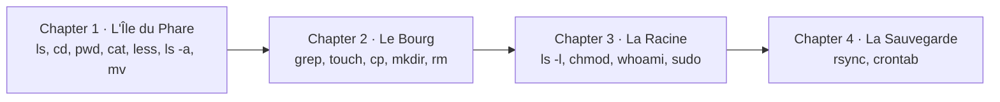

# Scenarios — Sysadmin Quests

*Learn the Linux command line by playing.* Published at
https://sysadmin.rouages.net and embeddable in other sites (see
[EMBEDDING.md](EMBEDDING.md)). The engine is in `src/moteur/`:

- `shell.ts`: a machine's engine (paths, permissions, pipes `|`,
  redirections `>` and `>>`, `sudo`, events);
- `console.ts`, `machines.ts`, `poste.ts`: the simulated network (the
  starting workstation, one machine per story, `ssh` and `exit` to go from
  one to another);
- `commandes/`: the commands, by family (`fichiers`, `texte`, `systeme`,
  `reseau`, `git`…); each one reads its arguments and the pipe's input,
  returns its output and reports its errors separately (they don't go
  through pipes, like a real shell's standard error);
- `monde.ts`: the building blocks of a world (places, objects, rights,
  events);
- `chapitres/`: one file per chapter, and `index.ts` which groups them into
  stories;
- `commandes/manuel.ts` and `commandes/pages.ts`: the manual (`man`,
  `--help`, `man -k`).

The interface is in `src/interface/` (`jeu.ts`, `styles.css`), the
`<quetes-de-sysadmin>` element in `src/element.ts`. All texts (stories,
messages, manual, interface) are in `src/textes/<language>/*.ftl`, English
first (see `docs/TRANSLATING.md`). Games are replayed by
`tests/quetes.test.ts` and one test file per story.

The stories and chapters below keep their original French titles, which are
also their names in the French version of the game; the English version
translates them (`src/textes/en/`).

## Principles

- **Inspired by the original, without copying it**: the idea (a place = a
  directory, an object = a file, commands learnt as you go) comes from
  [Terminus](https://web.mit.edu/mprat/Public/web/Terminus/Web/main.html),
  created at MIT by Shawn Conrad and Michele Pratusevich. Chapters 1 and 2
  have their own places and puzzles (the Lighthouse island, the harbour
  Town); they don't follow the original's route. The game was born as
  "Terminus en français" on Les rouages du net (rouages.net) before becoming
  this independent project, in October 2026.
- **Our own texts**: the story, places and dialogues are original, not a
  translation.
- **Real commands, real behaviours**: same paths (`..`, `~`, `/`), same
  rules (`mv` renames, `cp` copies, `rm` is final, `*` globs are expanded
  before the command runs, as the shell does). Deliberate differences are
  marked in the code and listed below.
- **One world, linked by `ssh`**: you start from your **workstation**
  (`you@desk`); each story runs on a machine of the network (`kingdom`,
  `datacenter`, `fourmiliere`, `manuscrit`, `bibliotheque`…), which you
  reach with `ssh` and leave with `exit`. At first, the workstation only has
  the kingdom's key. The other stories open **in waves**
  (`deverrouillage.ts`): each declares in `chapitres/index.ts` (`apres`) the
  chapters to finish before receiving its key, what it assumes you already
  know. Under a locked story, the menu shows what is missing; on-call duty
  only draws its incident from open stories. The menu stays a shortcut
  (accessibility, teachers); the `story` attribute opens a story directly,
  even without its key.

  | Story | opens after |
  |---|---|
  | L'Effaceur (The Eraser) | (from the start) |
  | Le Datacenter, Le Paquet perdu, La Machine à remonter le temps, Les Archives | "La Racine" (L'Effaceur) |
  | La Fabrique, L'Astreinte | "La nuit du redémarrage" (Le Datacenter) |
  | Les Lettres du quartier | "La nuit du redémarrage", "Le Paquet perdu" |
  | La Gazette | "La Machine à remonter le temps", "La nuit du redémarrage" |
  | La Ludothèque | "Les versions" (Les Archives) |
  | La Maison des associations | "Fermer la porte" (Les Lettres) |
  | La Coopérative | "La colocation" (Les Lettres), "Deuxième jour" (Le Datacenter) |
  | La Ruche | "Le pare-feu" (Les Lettres), "Le rebond" (La Maison) |
  | L'Audit | "La sentinelle" (Les Lettres), "Les droits partagés" (La Coopérative) |
  | Le Labo, La Veille, Le courrier indésirable, La flotte, La Rustine | see their sections below |
- **Stories and chapters**: in a story, each chapter has its world, its
  commands and its ending, and opens when the previous one is finished.
  Progress is kept in the browser (`localStorage`, key
  `quetes-de-sysadmin`, set with the `save-key` attribute), chapter by
  chapter. Each chapter shows a difficulty from 1 to 5 stars
  (`difficulty.ts`).
- **Safe examples**: private IP addresses (RFC 1918), carrier-grade NAT
  (RFC 6598) or addresses reserved for documentation (RFC 5737), names in
  `.internal` for internal machines and networks (reserved by ICANN for
  private networks in 2024) and in `.example` for anything public: sites,
  DNS zones, emails (RFC 6761). An invented name (`cooperative.fr`) could
  belong to someone: the game would teach you to aim at a real machine. The
  workstation's `/etc/hosts` explains it to players. Only exception:
  9.9.9.9, Quad9's real public DNS resolver.
- **Authentic outputs**: `ping`, `dig`, `traceroute`, `curl`, `ps`,
  `systemctl` answer in English, as on a real system; `git` and the basic
  error messages ("Permission denied") follow the game's language, as with
  a system set to that language.

### The manual, the first reflex

To learn to help yourself, the manual is available everywhere, from
chapter 1, and for every command of the game (even those you aren't allowed
to run yet, as on a real system):

- `man command`: a page in the usual format (NAME, SYNOPSIS, DESCRIPTION,
  OPTIONS, EXAMPLES, SEE ALSO), built by `commandes/manuel.ts` from the
  command's definition and its additions (`commandes/pages.ts`: options,
  examples, cross-references);
- `command --help`: a summary;
- `man -k word` and `apropos word`: look for a command by keyword;
  `whatis command`: one line;
- an unknown option gives the real coreutils message: "ls: invalid option
  -- 'z' / Try 'ls --help' for more information."

In chapter 1, the lesson on hidden files no longer gives the option: it
points to `man ls`, and the lighthouse keeper points to the EXAMPLES of
`man mv`. In chapter 2, the scroll introduces `--help` and `man -k`.

### Deliberate differences from a real Linux

| Command | In the game | On Linux |
|---|---|---|
| `less` | shows everything, like `cat` | shows page by page (`q` to quit) |
| `mv` | only moves objects (files) | also moves directories |
| `rm -r`, `cp -r` | refused | delete / copy whole directories |
| `grep` with no result | "(no line contains …)" | shows nothing |
| `grep` | basic (default), extended (`-E`) or fixed-string (`-F`) regular expressions, translated into JavaScript expressions; no `[[:alpha:]]` classes nor `\1` back-references | full POSIX |
| colours (`ls`, `grep`, `diff --color`, `systemctl`, `journalctl`, `ip -c`, `git`) | `ls` and `grep` colour on screen by default, like the `--color=auto` aliases of Debian's `~/.bashrc` (without an `alias` command); `ls` keeps the `/` after places even in colour; only the default colours of common types (places, links, programs, archives, images); the interface's "Colours" button plays the part of a terminal without colours | `LS_COLORS`/`dircolors`, `GREP_COLORS`, `diff --palette`, `SYSTEMD_COLORS`; the alias is read from `~/.bashrc` |
| `man` | shows the page at once, in a few sections | opens a full-screen page (arrows, `/word` to search, `q` to quit), much longer |
| `ls -l` | type and rights, owner, group (= owner), size, name | adds the link count and the date |
| permissions | owner, group, others; special bits shown (`s`, `t`); a directory's setgid passes its group (and the setgid) to what is created in it; 4-digit `chmod`; setuid and sticky not applied, no ACLs; a file moved into a setgid directory without a group of its own takes its group too | setuid, sticky applied, ACLs (`setfacl`), `mv` keeps the group |
| `usermod -G` | takes effect at once | a session's groups are read at login: you must log in again (the game says so in the text) |
| `chown`, `chgrp` | `-R` only | also `--reference`, `-h`… |
| `chmod -w` (without u/g/o) | acts on everyone | takes the `umask` into account |
| `umask` | a command with its `man` page; applies to the session; other accounts' mask is read from `/etc/profile`, `/etc/profile.d/*.sh`, `~/.bashrc`, `~/.profile` (the last `umask` line wins) | a bash builtin (`help umask`); `pam_umask`, `login.defs` |
| accounts (`usermod`, `userdel`, `gpasswd`, `chage`) | `usermod -L/-U/-e/-s/-G`; `userdel [-r] [-f]` (refused if a process of the account is running); `gpasswd -a/-d`; `chage -l/-E` (dates as YYYY-MM-DD); no readable `/etc/shadow`; shadow-utils' messages in the game's language | every option, `passwd`, `deluser`, `/etc/shadow` |
| `sudo`, `sudoers`, `visudo` | `/etc/sudoers` and `@includedir` (files with no dot or `~`), rules `who hosts=(account) [NOPASSWD:] commands`, `Cmnd_Alias`, wildcards; `sudo -l [-U account]`; `visudo [-c] [-f file]` checks when the editor closes and asks "What now?"; an error in the policy blocks sudo; only the player runs commands with sudo (other accounts: `sudo -l -U`); no user or host aliases, no `!` | sudoers' whole grammar, plugins, `sudoedit` |
| `who`, `pkill`, `which` | sessions described by the chapter (a session lives as long as its `sshd` runs); `pkill [-u account] [pattern]`; `which` deduces the path (`/usr/bin`, or `/usr/sbin` for section 8) | `w`, `loginctl`, all procps options; `which` reads the PATH |
| `rm` of a write-protected file | deletes without asking | asks for confirmation |
| `sudo` | asks for the password again only on the chapter's first use | remembers it for about 15 minutes |
| `cat` of an archive | an error message | shows unreadable bytes |
| `ping` | 4 pings by default | goes on until Ctrl+C |
| `traceroute` | stops 3 hops after the last one that answers | goes on up to 30 hops |
| `ps aux` | user, PID, %CPU, %MEM, command | adds VSZ, RSS, TTY, STAT, START, TIME |
| `tar` | computed size (text compressed to a third, media to 98 %); if there isn't room, nothing is written | real compression; a partial archive may remain |
| `git` | a single branch (`main`), files at the repository's root only, identifiers computed by the game, `commit` requires `-m`; remotes by path only (bare repositories of the machine); `push` and `pull` fast-forward only (no merge); `pre-receive` and `post-receive` hooks; `push` figures approximate | branches, subdirectories, SHA-1/SHA-256, text editor, remotes over SSH or HTTPS, merges, every hook |
| scripts (`sh`, hooks) | a reduced `/bin/sh` (`script.ts`): one command per line, `#`, `set -e`, `exit`, variables, `$(…)`, `read`, `&&`, `\|\|`, `[ … ]`; no `if`, `for`, `while`, `case` nor functions; a command succeeds if it wrote no error | the full language |
| `diff` | normal format, `-u` (three lines of context), `-r`, `-q`; the time in the `-u` header is the machine's | every option |
| `date`, `test`, `readlink` | `date` without option or `+FORMAT` (common directives); `test` (and `[ … ]` in a script): `-e -f -d -L -s -r -w -x -n -z`, `=`, `!=`, numeric comparisons; `readlink [-f]` | `date -d`, `-u`…; full `test`; `realpath` |
| Le Kiosque (La Gazette) | a simulated Node.js app: version read at start through a link, `/health` as JSON, configuration in a `.env` file, schema migration at start (never backwards); an hour of simulated visits on each nginx reload in "Le canari" | a real app and its PostgreSQL database |
| nginx log | "combined" format without the referrer and the user agent | two more fields at the end of the line |
| `ssh` | two models: on most machines, a key is accepted if it is the one the game gave for that machine; on `maison` and its internal network (`acces.ts`), the real behaviour: the other side's `authorized_keys`, passphrase, password if sshd accepts it (three tries), `-J`/`ProxyJump` (the next name is resolved by the jump machine), `-L` with `-f -N` (a process to stop with `kill`), remote command, `-G` (excerpt); no agent, `-R`, `-D` nor certificates; a single host key (ed25519); shortened usage message | all of it, agent, `ForwardAgent`, remote and dynamic forwarding |
| `exit` | has its `man` page | a bash builtin: `help exit` |
| `ssh` session | the machine keeps its state while the page stays open; a reload restarts the current chapter | the machine keeps its state |
| manual sections | 1 (commands), 5 (configuration files: `sshd_config`, `ssh_config`, `sudoers`) and 8 (administration: `usermod`, `reboot`) | also 2, 3, 4, 6 and 7 (system calls, libraries…) |
| systemd | services only (no targets nor dependencies; timers and hand-written units: see below); the clock moves one second per action | units of every type |
| `tail -f`, `journalctl -f` (live activity) | the command keeps control until Ctrl-C; the screen moves 3 s on the machine per real second, and each typed command moves a few (`Chapitre.activite`, see `src/moteur/activite.ts`): visitors, robots, scanners write to the logs; in a pipe (`tail -f log \| grep …`), the game shows it once without following | real time; a pipe that follows continuously; `tail -F` reopening a replaced file |
| `systemctl` without being root | "Access denied", you need `sudo` | asks for the password (polkit) |
| `sudo` after `reboot` | still remembers the password | asks for it again |
| `sshd` | some of the keywords; all errors listed at once; the password is only asked on machines with the real ssh (`maison`); no `StrictModes` (rights of `~/.ssh` not checked) nor options in `authorized_keys` | stops at the first error; offers the password everywhere; refuses an `authorized_keys` writable by others |
| `ufw` | IPv4 and IPv6 rules merged ("(v6)" lines for show); no outgoing rules, routing, logging, `insert` nor `reset`; messages in the game's language, close to ufw's own | all of it |
| `ss` | sockets described by the chapter, and the current ssh session (on the port you came in through) | every socket of the system |
| fail2ban | `sshd`, `nginx-limit-req` and `recidive` jails (others load, without a filter; an enabled jail without a log prevents starting); a jail's `port` limits the ban; `findtime` not applied (every failure in the log counts); filter reduced to "Failed password", "Invalid user", "Failed publickey"; the banned workstation keeps its open session | several jails; `findtime` window; full filters; the ban also cuts the current session |
| `rsync` | `-a`, `-v`, `-n`, `--delete`; local, or remote over ssh (`machine:path`, in either direction, with the same keys and jumps as `ssh`); a file changes if its contents change; "sent/received" figures approximate | compares size and date, every option, rsync daemon |
| `scp`, `ssh-copy-id` | `scp`: `-r`, `-P`, `-J`, `-i`, a copy in either direction (not between two remote machines), immediate progress line; `ssh-copy-id`: `-i`, `-p`, `-J`, the most recent `~/.ssh/id*.pub` key by default | `scp` between two remote machines (`-3`); `ssh-copy-id -f`, `-n` |
| `sftp` | interactive session (`sftp>`) through the same jumps and keys as `ssh`; `ls`, `cd`, `pwd`, `lcd`, `lls`, `lpwd`, `get [-r]`, `put [-r]`, `mkdir`, `rm`, `rmdir`, `rename`, `help`, `bye`; an existing directory receives the contents | `-b` (batch file), `reget`/`reput`, globs, `chmod`, `df` |
| `lftp` and shared hosting | FTP (Pure-FTPd) that refuses clear text (explicit FTPS, AUTH TLS); certificate checked against the requested name (`ssl:verify-certificate`); `-u`, `-e`, `-c`, `open`, `user`, `set`, `ls`, `cd`, `pwd`, `lcd`, `lpwd`, `mirror` (`-R`, `--delete`, `--dry-run`, `-v`), `put`, `get`, `mkdir`, `rm`, `cat`; the connection happens on the first remote command; the hosting is described by the story | SFTP and HTTP through lftp, `~/.lftprc`, `~/.netrc`, queues, background jobs, globs |
| internal machines | behind `maison`, `wiki` and `archives` exist as soon as you connect to them; you get in by ssh from `maison`, or with `-J` from the workstation (`exit` then brings you back to the workstation); a missing program answers `command not found` | a real, routed network |
| `crontab`, cron | the editor is always `nano`; no environment variables nor `%`; the game "lets the night pass" when the crontab changes | cron runs continuously; `select-editor` on the first `crontab -e` |
| `unattended-upgrade`, `apt-config` | `--dry-run`, `-d`, `-v`; `Origins-Pattern` (keys `o`, `n`, `l`, `a`, `site`, wildcards), `Package-Blacklist`, `Mail`, `MailReport`, `Automatic-Reboot`, `Automatic-Reboot-Time`; `apt-daily-upgrade.service` only runs the pass if `APT::Periodic::Unattended-Upgrade` asks for it; `apt.conf.d` read like apt (last value wins, lists that grow, `;` required); `apt-config dump [prefix]`; package origins described by the chapter; the scheduled reboot isn't played | autoremove, `MinimalSteps`, battery, `#include`/`#clear`, full `--debug` output, `apt-cache policy` |
| `apt` | `update`, `install [-y]`, `list --installed`, `list --upgradable`, `upgrade` and `full-upgrade` (the updates described by the chapter); a small catalogue, approximate versions and sizes; a package that fails to start isn't left "half-configured"; an interrupted upgrade leaves its packages unpacked (`dpkg --configure -a`); `/var/run/reboot-required` for a kernel or the libc | the whole Debian catalogue, `remove`, `search`, `show`, `apt-get`…; dpkg keeps each package's state |
| local network (`ip`, `ifup`, `ifdown`) | IPv4 only; `ip addr`, `ip link`, `ip route` (show, add, del, set, `-br`, `-d`), 802.1Q VLAN interfaces; `/etc/network/interfaces` read like ifupdown (`auto`, `iface … inet static`, `manual`, `loopback`, `address`, `netmask`, `gateway`, `vlan-raw-device`, `source`); the switch and its ports are described by the chapter; no visible ARP, MTU, bonding nor systemd-networkd | all of iproute2, ifupdown2, NetworkManager, systemd-networkd |
| `dnsmasq` | DHCP only (DNS options are accepted and ignored); `interface` (with `*`), `except-interface`, `dhcp-range`, `dhcp-host`, `dhcp-option`; devices ask for an address each time the service starts; the address is derived from the MAC address; no lease renewal | DNS, TFTP, PXE, DHCPv6, renewal |
| `nft` (nftables) | IPv4; `ip`, `inet` tables (`ip6` read, with no effect); base `filter` and `nat` chains (hooks, priorities, policy), regular chains (`jump`, `goto`); matches `iifname`, `oifname`, `ip saddr`, `ip daddr`, `ip protocol`, `meta l4proto`, `tcp`/`udp` `dport`/`sport` (services known to the game), `ct state`, `!=` negation, anonymous sets; actions `counter`, `log`, `accept`, `drop`, `reject`, `masquerade`, `snat` (in `postrouting`), `dnat` (in `prerouting`, to an address and port); `define`, `include`; `-f`, `-c`, `-a`; `add`, `insert`, `delete`, `flush`, `list`; the traffic is that of the devices described by the chapter (and visitors from the internet), and counters count one pass per exchange; error messages close to nft's; the `input` chain doesn't cut the game's ssh session | named sets, maps, `limit`, `quota`, IPv6, `bridge`, `netdev`, `nft monitor`, rules on packet contents |
| `nft` under ufw and fail2ban | on machines without hand-written nftables rules: `list ruleset`, `list tables`, `list table`, read-only; `ip filter` table (chains `INPUT`, `OUTPUT`, `ufw-before-input`, `ufw-user-input`, `ufw-after-input`), `inet f2b-table` table of fail2ban's nftables action; counters at zero; a multi-port profile as a `{ 80, 443 }` set | the `ip6 filter` table, ufw's logging and routing chains, real counters; you could write to it (and ufw would overwrite it) |
| `sysctl`, `conntrack` | `sysctl`: read, `-w`, `key=value`, `-p`, `--system`, `-a`, `-n` on a few keys (`/proc/sys` is a real directory of the game); `/etc/sysctl.d/*.conf` then `/etc/sysctl.conf` at boot; `conntrack -L` (`-p`, `-s`, `-d`), `-C`, `-F`: the current exchanges, including the ssh session | every kernel key; `conntrack -E`, `-D`, detailed UDP and ICMP states |
| `wg`, `wg-quick` (WireGuard) | `genkey`, `genpsk`, `pubkey`, `show`, `showconf`; `wg-quick up`, `down`, `strip`; the `wg-quick@wg0` service; the public key isn't computed with Curve25519 (a fingerprint stands in for it, in the right format); peers are described by the chapter (Malik's laptop, another site's router and its network); `wg-quick` adds a route per `AllowedIPs` outside the interface's network; a peer behind a home router (NAT) is only reachable with `PersistentKeepalive` (no simulated delay); no `wg set`, `PostUp`, checked `PresharedKey`, IPv6, nor all traffic through the tunnel on the router side; `wg-quick` without sudo refuses instead of re-running sudo | Curve25519, `wg set`, `syncconf`, `PostUp`/`PostDown`, IPv6, `wg-quick save` |
| OpenLDAP (`ldapsearch`, `ldapadd`, `ldapmodify`, `ldapdelete`, `ldappasswd`, `ldapwhoami`, `slappasswd`, `slapcat`) | one directory per machine (`etat.ldap`), a reduced schema (core, cosine, inetorgperson, nis: the common classes, their required attributes); LDIF (`changetype`, `add`/`replace`/`delete`, `-`, folded lines), filters `&`, `\|`, `!`, `=`, `*`; `-x`, `-D`, `-W`, `-w`, `-H`, `-Y EXTERNAL` (root through `ldapi:///`, as on Debian), `-b`, `-s`, `-LLL`, `-f`, `-c`; Debian's access rights (anonymous read except `userPassword`, write by the administrator or root); `{SSHA}` in the right format, but not a real SHA-1; the commands don't read the keyboard (a file or a pipe) | `cn=config`, replication, indexes, `memberOf`, base64 (`::`), TLS, SASL other than EXTERNAL, the full filter syntax (`>=`, `~=`) |
| FreeRADIUS (`freeradius`, `radtest`) | `clients.conf` (address or network, secret), the `ldap` module enabled by a link in `mods-enabled` (`server`, `identity`, `password`, `base_dn`, `user`, `group` and `membership_filter`), the `users` file (`DEFAULT`, `Ldap-Group`, `Auth-Type := Reject`, replies, `Fall-Through`); configuration read at start; `-XC`, `-X` (service stopped, the access point's requests told in short); access points speak PAP (as EAP-TTLS/PAP), no simulated EAP; a simplified configuration syntax | EAP (PEAP, TLS), accounting, `sites-available`, `unlang`, SQL, every module |
| Redis (`redis-server` service, `/etc/redis/redis.conf`) | only `bind` is read, at the service's start and restart (`*`, `0.0.0.0`, or loopback `127.0.0.1`/`::1`; without `bind`, every interface) to decide where port 6379 answers from; no simulated `redis-cli`, `requirepass` nor `protected-mode`; PostgreSQL has no `listen_addresses` (its port is closed with ufw) | the whole `redis.conf`, `redis-cli`, ACLs, `CONFIG SET`, `listen_addresses` in `postgresql.conf` |
| nmap | TCP only; `-sV`, `-sT`, `-sS` (root), `-sn`, `-Pn`, `-n`, `-F`, `-p`, `-oN`; targets are a name, an address, a network (`/16` to `/32`) or a range `192.0.2.20-25`; everything is seen from the internet (127.0.0.1: from inside, without firewall); only the chapter's machines answer, an address outside the simulated network never answers; the 1000 common ports shrink to the declared services; the duration is computed, without waiting | `-sU`, `-O`, `-A`, NSE scripts, `-oX`/`-oG`, packet timing, every service's real ports |
| Lynis (`lynis audit system`) | some sixty lines instead of 300; reads `sshd_config`, pending apt updates, `UMASK` in `/etc/login.defs`, `/etc/issue` and ufw; the index is computed with fixed penalties (not Lynis's weighting); `/var/log/lynis-report.dat` is written (`hardening_index=`, `warning[]=`, `suggestion[]=`); only `audit system`, `show version`; without root, the audit is refused (Lynis would run in restricted mode) | the 200 tests, profiles, `show details`, `--pentest`, compliance modules |
| `ping` on a local network | a device answers if it is in the VLAN of the interface whose network contains its address; a private address sent to the home router is lost; a device name is recognised without DNS | ARP, local DNS, `/etc/hosts` |
| `tmux`, `uname`, `dpkg` | `tmux new [-s]`, `ls`, `attach [-t]`, `detach`, `kill-session`, one window per session; no key bindings (`tmux detach` for Ctrl+b d); attach replays the last lines; the session's name shows before the prompt (the status bar); `uname -r/-a`; `dpkg --configure -a` | windows, panes, key bindings, `screen`; every dpkg option |
| `nginx` | `-t`, `-T`, `-v`; some of the directives; the site is chosen by `server_name` then `default_server`; `location` by prefix, `=`, `^~`, or regular expression (`~`, `~*`, JavaScript syntax rather than PCRE), chosen in nginx's order; `proxy_set_header` (variables `$remote_addr`, `$proxy_add_x_forwarded_for`, `$http_…`, `$host`, `$scheme`), `root`, `alias`, `index`, `return`, `proxy_pass` to a simulated app or an `upstream` (`weight`, `backup`, `down`, weighted round robin, next server if one doesn't answer; `max_fails`/`fail_timeout` not applied); `try_files` read but not applied | every directive and module |
| Apache (`apache2ctl`, `a2ensite`, `a2enmod`…) | `configtest`/`-t`, `-S`, `-M`, `-v` (even without root); `start`, `stop`, `restart`, `graceful` go through systemd; some of the directives (others are refused like those of a missing module: "Invalid command"); virtual host chosen by address and port, then `ServerName`/`ServerAlias`, otherwise the first; `<Directory>` without wildcards; `.htaccess` reread on each request, with `AllowOverride` by category; `mod_rewrite`: `RewriteEngine`, `RewriteCond` (`-f`, `-d`, `-s`, `=`, expressions, `[NC]`, `[OR]`), `RewriteRule` (`[L]`, `[END]`, `[R]`, `[F]`, `[G]`, `[QSA]`, `[NC]`), in the server or per directory, at most 10 internal redirects; no PHP, CGI, compression nor access log; without an argument, `a2ensite` & co. list the choices without asking | every directive and module, interactive `apache2ctl` without an argument |
| `curl` on the site's machine | only reaches the machine itself (localhost, its name, its address), or an `ssh -L` tunnel opened on the workstation | the whole network |
| `tar` | `-C`; a truncated archive stops at the cut (messages close to GNU tar); root keeps owners and rights | also `--strip-components`, `-p`, multi-volume archives… |
| `ssh-keygen` | `-R`, `-F`, `-l -f`; creates ed25519 keys only (`-t`, `-C`, `-N`, `-f`), fake but well-formed, with their randomart | every key type, conversion, certificates… |
| `certbot` | a single certificate, the chapter's; `certificates`, `renew`, `certonly`, `reconfigure`; simulated authority (the HTTP-01 challenge goes through the simulated nginx); the files in `live/` are rewritten (no links to `archive/`); the nginx plugin doesn't change the configuration | several certificates, a real ACME authority, symbolic links, DNS challenges |
| `openssl` | `x509` (`-dates`, `-subject`, `-issuer`, `-ext`, `-checkend`) and `s_client -connect` (returns at once); the PEM contents are specific to the game | hundreds of subcommands; real X.509; `s_client` waits for input |
| `curl https://` | checks the dates and names of the presented certificate (error 60), `-k` to skip | also checks the full chain of trust, OCSP… |
| clock | Paris time: CET in winter, CEST in summer (unless the chapter sets a time zone) | the machine's time zone |
| `restic` | `-r` and `--password-file` required (no environment variables); `snapshots`, `ls`, `find`, `diff`, `dump`, `restore`, `backup`, `forget`, `prune`, `check`, `stats`; no `init`; one "pack" per backup; repository files unreadable but not binary; no progress bars | all of it, and `mount`, `copy`, `key`, `tag`, remote repositories (sftp, S3, rest-server) |
| symbolic links | `ln -s` (`-f`, `-n`), followed to read, write and enter; `ls -l` shows them; `readlink` | also `realpath`, `find -L`… |
| `curl` | `-I`, `-i`, `-k`, `-L`, `-H` (Host, or a forwarded header), `-X`, `-d` (only the method); only reaches the machine you are on (nginx, Caddy, an app on its port, a container) | every option, the whole network |
| DNS (BIND) | A, AAAA, CNAME, MX, NS, TXT, SOA zones; a primary (`named`), a secondary that copies when the serial increases (at once), a public resolver with a cache, or the machine's server as a recursive resolver (`recursif`); a `;` inside quotes isn't a comment, a TXT's strings are joined; `dig` (`@server`, type, `+short`, `+noall +answer`), `host`, `named-checkzone`, `named-checkconf` (braces and files), `rndc reload`/`status`; no AUTHORITY section, DNSSEC nor reverse zones | all of it |
| Postfix | `main.cf` read like `postconf` (some of the parameters; an unknown name: "unused parameter"), `postconf` (`-n`, `-d`, `-x`, `-e`, `-h`), `postfix check/reload/start/stop/status/flush`, `postqueue -p/-f`, `mailq`, `postsuper -d`; the queue (reasons, identifiers) and `/var/log/mail.log`; no real SMTP: the servers on the other side (declared by the story) check SPF, DKIM, DMARC with the simulated DNS, without a cache; Postfix doesn't retry by itself (`postqueue -f`); the chroot is only simulated for the milter's socket | a full MTA, automatic retries, TLS, `master.cf` |
| OpenDKIM | `opendkim.conf` (`Domain`, `Selector`, `KeyFile`, `Socket`, `Mode`, `RequireSafeKeys`); refuses an unreadable key or one readable by others; `opendkim-genkey` (`-b`, `-d`, `-D`, `-s`, `-v`), `opendkim-testkey` (`-d`, `-s`, `-k`, `-v`); no real cryptography (the public key is computed from the private file), no `KeyTable`/`SigningTable` nor DNSSEC | real RSA signing, key tables, several domains |
| Ansible | `ansible.cfg` (`./`, `~/.ansible.cfg`, `/etc/ansible`), INI inventory (groups, `:vars`, `:children`), a subset of YAML; modules `ping`, `debug`, `apt`, `copy`, `file`, `lineinfile`, `user`, `service`/`systemd`, `command`, `shell`; `become`, `--check`, `--diff`, handlers, `--limit`, `--force-handlers`; ssh connection without questions (BatchMode); no real fact gathering, Jinja variables, roles, loops nor Python on the targets | Jinja templates, roles, collections, `ansible-vault`, facts |
| Caddy | the Caddyfile (addresses, global options, one or several sites, the adapter's errors), `caddy validate`, `adapt` (simplified JSON), `fmt`, `reload` (through the admin API), `version`; automatic HTTPS: a Let's Encrypt certificate for domain names, 308 redirection, a failed challenge if DNS doesn't lead to the machine or if the firewall closes 80 and 443; directives applied: `root`, `file_server`, `respond`, `redir`, `reverse_proxy` (others are recognised with no effect); a failed challenge is retried as soon as its cause is gone; JSON logs | named matchers, `handle`, ZeroSSL, internal certificates (`localhost`, IPs), renewal, `caddy run` beside the service |
| SPF, DKIM, DMARC | SPF (RFC 7208): `ip4`, `a`, `mx`, `include`, `all`, `redirect=`, qualifiers, at most ten lookups, two records = `permerror`; DKIM: the key published under `selector._domainkey`, CNAMEs followed; DMARC (RFC 7489): `p=`, `rua=`, relaxed alignment (organisational domain: the last two labels); aggregate reports are files given by the story | `ip6`, `exists`, `ptr`, SPF macros, strict alignment, `sp=`, `pct=` applied, reports received as attachments |
| `awk` | program in single quotes: patterns, `BEGIN`/`END`, fields, arrays, `printf`, common functions, `-F`, `-v`; no `getline`, redirection in `print`, user-defined functions nor `?:` | the full language (mawk on Debian) |
| web traffic | in "Le soir du concert", one minute of simulated traffic after each nginx reload; `limit_req` follows nginx's algorithm (leaky bucket, burst, `nodelay`); no `delay=` nor `limit_conn` | real, continuous traffic |
| Docker | images from a simulated registry, containers (layer, volumes, bind mounts, ports, `--restart`), `run`, `ps`, `images`, `pull`, `logs` (`-n`, `-t`), `exec` (`-u`; `ls`, `cat`, `env`, `id`, `whoami`), `cp`, `stop`, `start`, `restart`, `rm`, `port`, `update --restart`, `inspect` (`-f '{{.Field}}'`), `volume`; without `-d`, `run` returns; no network between containers outside Compose, no `build` | all of Docker |
| Docker Compose | `compose.yaml` in reduced YAML (mappings, lists, strings, `[a, b]`); keys `image`, `ports`, `volumes`, `environment`, `env_file`, `depends_on`, `restart`, `user`, `read_only`, `cap_drop`, `security_opt`; `up` (recreates what changed), `down` (`-v`), `ps`, `logs`, `config`, `restart`, `stop`, `start`, `exec`, `pull`; a service that fails to start is restarted once if it has a `restart` policy | the whole Compose specification, `build`, `healthcheck`, profiles |
| Docker and the firewall | a port published on 0.0.0.0 answers from outside whatever the ufw rules (like Docker's iptables rules); `nc -zv` from another machine; `system df`, `image prune` (`-a`), `container prune`, `volume prune` (`-a`), `system prune` (`-a`, `--volumes`), `rmi` | the DOCKER-USER chain, ufw-docker, `iptables -L` |
| A container's user | `--user`/`-u` and `user:` (a name from the image or `uid[:gid]`, an uid unknown to the image gets gid 0), `docker exec -u`; the container's uid is the machine's (no userns-remap): Unix rights applied by number on bind mounts, files created as that uid, processes visible in `ps aux`; `--read-only` prevents writing outside volumes; `--cap-drop` and `--security-opt` are kept (and shown by `inspect`) with no other effect; a fallen container is restarted on each command (no doubling delay) | userns-remap, rootless mode, real capabilities, seccomp, AppArmor, rights on named volumes |
| `nc` | `-z`, `-v`, a port range; without `-z`, returns | full netcat (listen, send, proxy) |
| disks (`lsblk`, `mount`, `umount`) | devices described by the chapter; `mount` without an argument, `-o ro`; a read-only medium refuses any creation (an existing file's contents can still be changed by a redirection); on a machine with described storage (`stockage.ts`, Le Labo), `lsblk` shows disks, partitions and RAID arrays, with `-d` and `-o` (NAME, MAJ:MIN, RM, SIZE, RO, TYPE, MOUNTPOINT(S), MODEL, SERIAL, FSTYPE, UUID) | every option, real file systems; RM and RO always 0 |
| `smartctl` | `-a`, `-x`, `-H`, `-i`, `-A`, `-l error`, `-l selftest`, `-t short/long` (the test is logged at once, without waiting); an ATA disk's attributes, values derived from the chapter's counts; exit code as a bit mask (64, 128) | NVMe, SCSI, `-d`, `-s`, `-X`, the drive database, every attribute |
| `mdadm` | RAID 1 only: `--detail` (`-D`), `--detail --scan`, "manage" mode (`--fail`, `--remove` including `failed`, `--add`, `--re-add`, several in a row); the real kernel's refusals (removing an active member, failing the last up-to-date member, a partition already in use); one array rebuilt at a time, half an hour per command; a whole disk in an array erases its table | `--assemble`, `--grow`, `--examine`, `--zero-superblock`, `--monitor`, other RAID levels, a real bitmap (`--re-add` catches up faster) |
| `mdadm --create` | RAID 1 only (`--level`, `--raid-devices`, `--run`, `missing`), on free disks or partitions; the real "Continue creating array?" question; the initial sync progresses with the commands | other levels, `--chunk`, `--bitmap`, `--name`, `--homehost` |
| `sfdisk` | GPT tables: `-l`, `-d`, writing a script read from standard input (that of `-d`); refuses a disk in use; copies the script's identifiers, like the real one | interactive mode (a message explains it), `--force`, `--no-reread`, MBR tables, hand-written scripts beyond `start=`, `size=`, `type=`, `uuid=` |
| `grub-install` | `grub-install /dev/DISK` in BIOS mode on a GPT table: the "BIOS boot" partition is required; refuses a partition | UEFI, `--target`, `--boot-directory`, `update-grub` |
| LVM (`pvs`, `vgs`, `lvs`, `pvcreate`, `pvremove`, `vgextend`, `vgreduce`, `pvmove`, `lvextend`) | 4 MiB extents, segments per PV; `lvextend -L`/`-l` (`+`, `%FREE`, `%VG`), `-r` (lvm2 2.03's output); real refusals (partitioned disk, member of an array, PV still in use, not enough space); default columns only | `lvcreate`, `lvreduce`, `lvremove`, snapshots, thin volumes, `-o`, `--units`, `pvdisplay`… |
| fstab, emergency mode (`mount -a`, `blkid`, `findmnt`, `systemctl default`) | fstab read like mount and systemd (`UUID=`, `LABEL=`, `/dev/…`, `/dev/disk/by-*`, `nofail`, `noauto`); at boot, a missing source without `nofail` stops the machine in emergency mode (faithful systemd log, the 90 s wait played at once); `systemctl default`/`exit` resume with the fstab read at the last `daemon-reload`; `mount -a`'s hint when fstab has changed; `findmnt --verify` (sources, types, mount points); `blkid` (`-U`, `-L`) | swap, network mounts, `x-systemd.*`, `fsck`, hand-written `.mount` units, `findmnt` on /proc and /sys |
| `resize2fs`, `update-initramfs` | `resize2fs` grows an LV's ext4 to its size (online); `update-initramfs -u` keeps a copy of `mdadm.conf` | shrinking, a given size, other file systems; the initramfs's real contents |
| `rsnapshot` | `configtest`, `-t`, `-v`, `du`, rotation of the levels (`cp -al` then `rsync`); some of the directives; messages close to rsnapshot 1.4 | `backup_script`, `link_dest`, `sync_first`, remote backups |
| PostgreSQL | roles and "peer" authentication; `psql -c/-f/-l` with a reduced SQL (`SELECT count(*)`, `SELECT … WHERE col = v ORDER BY … LIMIT`, `DELETE`, `TRUNCATE`, `DROP TABLE`, `ALTER ROLE … PASSWORD` by the `postgres` account, `\l`, `\dt`, `\d`, `\du`); a role's password is only read by one chapter's app ("Les traces"); `pg_dump` (text, `-Fc`, `-t`, `-f`), `pg_restore` (`-l`, `-d`, `-t`, `--data-only`, `--clean`), `createdb`, `dropdb`; a `-Fc` archive only holds a reference kept by the game; one primary key per table | all of PostgreSQL, interactive psql, WAL and point-in-time recovery |
| `lsof`, `truncate`, `logrotate` | `lsof` only knows the open files described by the chapter (`+L1`, `-p`, `-u`, a file); `logrotate`: some of the directives, `-d`, `-f`, `-v`, shortened outputs | every option, every open file of the system |
| memory (`free`, `top`, `dmesg`) | each process's memory is described by the chapter; no swap, the cache isn't freed (`available` = `free`); the OOM killer kills the biggest process (no `oom_score_adj`); `top` shows a snapshot and returns (`-b`, `-n`, `-o`, `-c`); `dmesg` (`-T`) for root only | swap, cache reclaim, the OOM killer's score, interactive `top`, `htop` |
| `iostat`, `pidstat`, `ionice` | `iostat` `-c`, `-d`, `-x`, `-k`, `-m`, `-y`, interval and count; `pidstat -d`, `-u`; `ionice -p`, `-c`, `-n`; one disk, a simplified queue model (waiting climbs beyond 60 % of capacity); ionice priorities only count with `mq-deadline` or `bfq`; every report gives the current instant | several disks, partitions (`-p`), `iotop`, `ionice` on a command to start, cgroup v1 `blkio` |
| systemd overrides | `systemctl edit`, `set-property` (`MemoryMax=`, `IOReadBandwidthMax=`, `IOWriteBandwidthMax=`), `daemon-reload`; in overrides, only `MemoryMax=`, `IO*BandwidthMax=` and `Restart=` of `[Service]` count; a service restarted by `Restart=` starts again at once | every directive, `RestartSec=`, `StartLimitBurst=`, `systemctl cat`, `revert` |
| inodes | `df -i`, `du --inodes`: one inode per file or place; a medium can declare its number of inodes (and those used by the system); no free inode, no creation | reserved blocks, `tune2fs`, inodes of symbolic links and special files |
| `find` | `-name`, `-type`, `-mtime`, `-maxdepth`, `-delete`, `-print`; age is counted on the simulated machine's clock | `-exec`, `-newer`, `-size`, `-user`, operators (`-o`, `!`) |
| "Argument list too long" | a program (not `cd`, `echo`, `pwd`, `test`, `printf`) refuses more than 2 MiB of arguments (ARG_MAX) | the limit also counts the environment; `xargs` |
| huge outputs | the screen only keeps the last 2,000 lines of an output (with a note) | the terminal's scrollback |
| time | each machine has a time zone and a clock offset (`etat.heure`); `date` (`-s`), `timedatectl` (`status`, `show`, `list-timezones`, `set-timezone`, `set-ntp`, `set-time`, `timesync-status`); timesyncd tries its servers (`NTP=`, otherwise `FallbackNTP=`) and syncs at once when it starts; the journal follows the machine's time; time zones come from `Intl` | gradual clock adjustment, a separate RTC, `hwclock`, chrony |
| monitoring | `check_disk` (`-w`, `-c`, `-W`, `-K`, `-p`), `check_http` (`-H`, `-I`, `-p`, `-u`, local machine only), `check_procs` (`-C`, `-w`, `-c`); exit codes 0 to 3; no real `man` page (plugins answer `--help`) | every plugin and its options, `check_curl` |
| `mail`, `last` | `mail`: `-s`, `-E`, local delivery in `/var/mail` after `/etc/aliases` (on a machine with Postfix, mail goes through its queue and can leave the machine), list of the mailbox without interactive mode; `last`: logins described by the chapter, `-n` | mail leaving the machine (MTA), interactive `mail`, `lastb`, `who` |
| systemd timers | hand-written units in `/etc/systemd/system` (`.service`: `Type=`, `ExecStart=`, `User=`; `.timer`: `OnCalendar=` with day of week, `*-*-*` and `H:M[:S]`, `OnBootSec=`, `OnActiveSec=`, `OnUnitActiveSec=`, `Unit=`), to the minute; `list-timers`, `systemd-analyze calendar`; cron mails what a job writes | `Persistent=`, `RandomizedDelaySec=`, `AccuracySec=`, dependencies between units |
| exit codes | a command returns 1 if it wrote an error, unless it gives its own (plugins, `grep`); in a pipe, the last command's | every code of the real tools |
| zombies | `ps -ef` shows the parent; no signal acts on a zombie; they disappear when their parent stops | `wait()`, `SIGCHLD`, adoption by a subreaper |
| `sudo -u`, `crontab -u`, `usermod -L` | `sudo -u account` without other options; `crontab -u` for root only; `usermod -L/-U` marks the account without showing `/etc/shadow` | every option |
| locking yourself out | the game's menu reopens the session | the host's rescue console (VNC, KVM) |
| `nano` | a text area: `^O` write, `^X` exit (with `Y`/`N`/`^C`), buttons for keyboards without Ctrl; no search, cut and paste nor line numbers; the text wraps; messages close to nano's in the game's language | every shortcut of the help bar, no automatic wrapping |

## Story 1: L'Effaceur (The Eraser)

A creature, the Eraser, roams the kingdom and erases everything it touches.
We find out it isn't wicked: it is a program obeying an old order, written
by mistake in its configuration, at the Root (`/`). Technical moral: a
program does what it was told, not what was meant.

The places and files below carry their French names, which are also the
internal names; the English game translates them (`Phare` → `Lighthouse`,
`crabe` → `crab`, `noms.ftl`).

### Chapter 1 — L'Île du Phare (done)

The Eraser has erased the lighthouse's bulb: without light, no boat can leave
the island for the Town.

| Place | Puzzle | Command learnt |
|---|---|---|
| Cabane | read the message from Maëlle, the lighthouse keeper | `ls`, `cat` |
| Plage | sign, net mender (Tab key, ↑ arrow) | `cd`, `cd ..`, `pwd` |
| Colline/EcoleDesSignaux/SalleDExercice | put the crab back in the Bucket | `mv object Place` |
| Colline/EcoleDesSignaux/Cours | manual, paths, hidden file `.note_secrete`, moving and renaming at once | `man`, `~`, `/`, `ls -a` |
| Jetee | move the net blocking the Lighthouse to the Harbour's Shed | `mv filet ~/Port/Hangar` (path from `~`) |
| Port/Remise → Phare/Escalier/Lanterne | bring back the spare bulb, hidden, under the exact name `ampoule` | `ls -a`, `mv .ampoule_de_secours …/Lanterne/ampoule` |

### Chapter 2 — Le Bourg (done)

The boat drops the character at the harbour Town.

| Place | Puzzle | Command learnt |
|---|---|---|
| Mairie | which poster speaks of the Eraser, then the key under the `.paillasson` | `grep Effaceur *`, `ls -a` |
| Mairie/Archives | read the Eraser's chronicle | `grep`, `grep -i` |
| Boulangerie | three sourdoughs for the baker | `cp` |
| Atelier | make a gear, then five: the clock starts again and opens the Alley's gate | `touch`, `cp` |
| Ruelle | a barricade too heavy for `mv` | `rm` (and no recycle bin) |
| Ruelle/Cour/Egout | pay the rats with the Market's cheese, without going back | `cp ~/Marche/fromage .` (full path, `.`) |
| Egout/Galerie | find Nour at the edge of the Slide | — |
| Ecole | rebuild Nour's Classroom (a place) | `mkdir` |

### Chapter 3 — La Racine (done)

Why "The Root" and not "The Kernel": on Linux, the kernel is the system's
central program; the file tree starts from the root `/`, and the
administrator is called `root`.

The Slide drops the character in their real home, `/home/vous` (`/home/you`
in English). The world finally looks like a real Linux: `/home`, `/etc`,
`/var/log`, `/root`.

| Place | Puzzle | Command learnt |
|---|---|---|
| `/home/vous` | the Eraser erases a memory on each command: the `souvenirs` place is `rwxrwxrwx` | `ls -l`, `chmod o-w` (erasing = writing in the place) |
| `/var/log` | the daemon's log shows two targets instead of one | `cat`, `grep cible` |
| `/etc/effaceur.conf` | "cible = /Royaume /Corbeille": one space too many; the file belongs to root | Permission denied |
| `journal.txt` | find your password (written down, "a very bad idea") | `grep "mot de passe"` (quotes) |
| `/etc` | install the fixed version | `sudo cp ~/effaceur.conf.corrige /etc/effaceur.conf` |
| bonus | `/root`, `/etc/sudoers`, `/home/nour` (a diary: we don't read it, even as root) | `sudo ls`, `sudo cat`, `whoami`, `sudo cd` (not found: `cd` is a shell builtin) |

The outcome: the character was the kingdom's administrator. They were the
one who wrote the configuration, with one space too many. The Eraser wasn't
wicked: it did exactly what had been written for it. `sudo`'s message
("Think before you type") is the real one.

### Chapter 4 — La Sauvegarde (done)

Maëlle wants memories never to disappear again: a backup disk is mounted on
`/mnt/sauvegarde`. The chapter plays on `royaume`; the keys to the other
machines are still given at the end of La Racine (chapter 3).

| Step | Command learnt |
|---|---|
| Copy | `rsync -av ~/souvenirs/ /mnt/sauvegarde/souvenirs/` (the trailing slash matters), `rsync -n` to try |
| Automate | `crontab -e`, a line `15 3 * * * rsync -a ~/souvenirs/ /mnt/sauvegarde/souvenirs/` (or `@daily`); `crontab -l` |
| The night passes | the game runs the jobs that fall between midnight and 6 am (`src/moteur/cron.ts`); a memory that arrived during the day must end up in the backup |
| Restore | in the morning, a memory is erased: `rsync -a` or `cp` from the backup |

Goal checked on the state: the night updated the backup (including the new
memory), the erased memory is back, identical, and a night job with `rsync`
stays scheduled.

Expected traps: `rsync` without `-a` (`skipping directory`), the trailing
slash forgotten (`souvenirs/souvenirs`), an invalid crontab (`bad hour`,
refused on install), a job that doesn't fall in the night, a job that fails
(cron's mail shows rsync's error), `--delete` after the erasure (the backup
loses the memory too). Other accepted solutions: `@daily`, copying the whole
directory, restoring with `cp`. Debrief: trailing slash, `-n`, scheduling,
testing the restore, the 3-2-1 rule and versions; links to `rsync(1)` and
`crontab(5)`.

## Story 2: Le Datacenter (done, five chapters)

First day of the internship: the media library's website answers with 503
errors. Awa, the operations lead, is in a meeting; her notes guide you.

| Step | Command learnt |
|---|---|
| Read the log `/var/log/nginx/access.log` | `head`, `tail`, `wc -l` |
| Count the 503 errors | `grep " 503 " … \| wc -l` (pipe) |
| Find who sends so many requests | `cut -d " " -f 1 … \| sort \| uniq -c \| sort -n \| tail -3` |
| See the overload | `ps aux` |
| Block the robot in a file owned by root | `echo "deny …;" \| sudo tee -a /etc/nginx/blocked.conf` (and why `sudo echo … >>` fails) |
| Have the configuration reread | `sudo systemctl reload nginx` |
| Restart the stuck service | `sudo kill PID` (systemd restarts it) |
| Write the report | `… > rapport.txt`, `echo … >> rapport.txt` |

Expected traps: `kill` before blocking (the service goes back to 99 %),
`tee` without `-a` or `>` overwriting `blocked.conf` (a `.bak` backup
exists).

### Chapter 2 — Deuxième jour (done)

Malo comes to help: he must read nginx's logs without `sudo`, and the web
team needs a shared directory closed to other accounts. The machine has real
accounts and groups (`/etc/passwd`, `/etc/group`), like a Debian: the logs
belong to `www-data`, group `adm`, mode 640.

| Step | Command learnt |
|---|---|
| Understand why you can read the logs without `sudo` | `id`, `id malo`, `groups`, `ls -l /var/log/nginx` |
| Give Malo read access to the logs | `sudo usermod -aG adm malo` |
| Team directory | `sudo chgrp web-team /srv/equipe` then `sudo chmod 770 /srv/equipe` (or `chown root:web-team`, `chmod g+w,o-rx`) |

Goals checked on the state: Malo reads both logs and stays in `web-team`,
the logs stay closed to others, and the team (and only the team) enters,
reads and writes in `/srv/equipe`.

Expected traps: `usermod -G` without `-a` (Malo loses `web-team`),
`chmod o+r` on the logs (IP addresses readable by everyone: personal data),
`chmod 777` on the share, `chgrp` without being the owner. Debrief: least
privilege, `-aG`, setgid to go further, links to `usermod(8)`, `chmod(1)`
and Debian's system groups.

### Chapter 3 — La nuit du redémarrage (done)

The server rebooted last night (automatic updates) and the site went down.
Two problems hidden since Friday: `nginx` was disabled during a test, and a
`chown -R root:` gave root the directory where `php-fpm` (account
`www-data`) writes its log. The machine has a real simulated systemd
(`src/moteur/systemd.ts`): services, journal, clock, reboots.

| Step | Command learnt |
|---|---|
| Find what isn't running | `systemctl --failed`, `systemctl status nginx catalogue` |
| Understand why | `journalctl -xeu catalogue`, `journalctl -b -p err`, `ls -l /var/log` |
| Repair | `sudo chown www-data: /var/log/catalogue`, `sudo systemctl restart catalogue` |
| Make it last | `sudo systemctl enable --now nginx` |
| Prove it | `sudo reboot` (the ssh session is cut), then `systemctl --failed` |

Goal checked on the state: after a reboot, without restarting anything by
hand, both services run, and you have checked their state.

Expected traps: `start` without `enable` (nginx doesn't come back at the
next reboot), `chmod 777` on the log directory, `systemctl` without `sudo`.
Debrief: `--failed` after every reboot, `journalctl -xeu`, start isn't
enable, a service's directory belongs to its account, links to `systemctl`
and `journalctl` (freedesktop.org).

### Chapter 4 — Le grand incendie (done)

Last night, the host's datacenter burned down (a nod to the OVHcloud fire in
Strasbourg, in March 2021). The host delivers a new machine, same name and
same address, but empty, and with a **new SSH host key**. The nightly
backups were in another datacenter: they are mounted on `/mnt/sauvegarde`,
with Awa's recovery plan (`PRA.txt`).

| Step | Command learnt |
|---|---|
| Reconnect | `ssh datacenter` refuses ("REMOTE HOST IDENTIFICATION HAS CHANGED!"); compare the announced fingerprint, `ssh-keygen -R datacenter.internal` (the name written in `known_hosts`), then `yes` |
| Install the web server | `sudo apt update`, then `sudo apt install nginx` (which starts and enables it); `curl http://localhost` |
| Check the backup | `tar -tzf`: last night's archive is truncated ("Unexpected EOF"); `ls -l` shows its size |
| Restore | `sudo tar -xzf /mnt/sauvegarde/medialibrary-2026-10-22.tar.gz -C /` |
| Reload without breaking | `sudo nginx -t` ("a duplicate default server"), remove `sites-enabled/default`, `sudo nginx -t`, `sudo systemctl reload nginx` |
| Test | `curl http://medialibrary.example` |

Goal checked on the state: nginx runs, starts with the machine, and serves
for `medialibrary.example` the page of the last intact backup (the 22nd's).

Expected traps: `apt install` before `apt update` ("Unable to locate
package"), `apt` without `sudo` (dpkg's lock), the truncated archive
(extracted, it gives back the configuration without the pages: 404), an
extraction into `~` (without `-C /`), Wednesday's backup (older than
needed), the two `default_server` (the reload is refused, the old
configuration stays), `ssh-keygen -R datacenter` (the short name isn't in
`known_hosts`). Other accepted solutions: restoring before installing (nginx
doesn't start on install, then `systemctl start`), keeping Debian's site and
removing the media library's `default_server`, `cd /` then `tar -xzf`
without `-C`. Debrief: 3-2-1 with a far copy, a written and tried recovery
plan, rereading your backups, accepted loss (one day), host key, `nginx -t`;
links to apt(8), nginx's documentation, GNU tar and ssh-keygen.

### Chapter 5 — Le certificat a expiré (done)

Three months after the fire, the media library's HTTPS certificate expired
this morning; browsers show a warning. On the day of the fire, the
certificate had been requested before the site was restored: certbot noted
`/var/www/html` (Debian's default site) as the challenge directory. For 30
days, every automatic renewal has failed silently (404). Since June 2025,
Let's Encrypt no longer sends an email before expiry.

| Step | Command learnt |
|---|---|
| See as a visitor | `curl https://medialibrary.example` (error 60), `openssl s_client -connect … \| openssl x509 -noout -dates` |
| The certificate on disk | `sudo certbot certificates`, `openssl x509 -in … -noout -dates -subject -ext subjectAltName` |
| Why it wasn't renewed | `systemctl --failed`, `journalctl -u certbot`, `sudo certbot renew --dry-run` (the challenge gets a 404) |
| The right directory | `cat /etc/letsencrypt/renewal/medialibrary.example.conf`; `sudo certbot renew --webroot -w /var/www/medialibrary` |
| Have nginx serve the new one | `sudo systemctl reload nginx` (nginx reads the certificate on load) |
| Make it last | `sudo certbot reconfigure --cert-name medialibrary.example --deploy-hook "systemctl reload nginx"` |

Goal checked on the state: nginx presents a valid certificate for both of
the site's names, the next automatic renewal would succeed (the challenge is
served), and nginx will be reloaded afterwards (a deploy hook in the renewal
file, an executable script in `renewal-hooks/deploy/`, or certbot's nginx
plugin).

Expected traps: `certbot` without `sudo`, `--dry-run` that saves nothing,
fixing only `webroot_path` without `[[webroot_map]]`, the renewed
certificate that nginx doesn't serve yet, a non-executable deploy hook
script, `--nginx` without the `python3-certbot-nginx` package. Other
accepted solutions: editing the renewal file with `nano`,
`certonly --webroot -w … -d … -d …`, `--deploy-hook` on `renew`, the nginx
plugin (`apt install python3-certbot-nginx`, `certbot renew --nginx`),
restarting the `certbot` service. Debrief: 90 days and 30 days, monitoring
expiry yourself, `--dry-run`, the HTTP-01 challenge, deploy hook; links to
certbot's documentation, Let's Encrypt's challenges and `openssl x509`.

## Story 3: Le Paquet perdu (done)

"The internet doesn't work any more" at the community café. Kofi's notebook
gives the method: test step by step, from near to far.

| Step | What you find out |
|---|---|
| `ping 192.168.1.1` | the local network works |
| `ping 9.9.9.9` | the internet works |
| `ping letters.example` | "Temporary failure in name resolution": DNS |
| `dig letters.example`, `cat /etc/resolv.conf` | the computer asks the old home router, which is gone |
| `dig @9.9.9.9 letters.example` | the name does exist |
| `sudo cp /etc/resolv.conf.box /etc/resolv.conf` | DNS repaired |
| `ping letters.example` | 100 % packet loss… |
| `traceroute letters.example` | home router, ISP, exchange point, host, then silence |
| `curl -I https://letters.example` | `HTTP/2 200`: the server was just ignoring ping |

## Story 4: La Machine à remonter le temps (done)

The cat of Inès, a novelist, walked on the keyboard; she saved and made a
commit. `git log`, `git show HEAD`, `git diff HEAD~1 roman.txt`,
`git restore --source=HEAD~1 roman.txt`, then `git add` and `git commit` to
record the repaired version (without erasing history). Then, putting her
poems in safety: `git init`, `git add .`, `git commit -m`.

## Story 5: Les Archives (done, two chapters)

The neighbourhood library's server shuts down at midnight; Rosa only has a
64 MB USB stick. `du -sh` and `df -h` show that the collection (174 MB)
doesn't fit; `tar` fails ("No space left on device"). `find fonds -name
"*.tmp"` finds 120 MB of temporary files, deleted with `-delete`. The
compressed archive (`tar -czf`) is then 48 MB; `tar -tzf` checks it. An
archivist's moral: a single copy isn't a backup.

### Chapter 2 — Les versions (done)

Since January, the collection lives on a new server, backed up every night
with restic on the disk the town hall lends (`/mnt/mairie`, almost full).
Four nights ago, an "automatic correction" script damaged the transcription
of Marie's diary; each backup kept the damaged version. Thirty snapshots,
from 7 January to 5 February.

| Step | Command learnt |
|---|---|
| Open the repository | `restic -r … --password-file … snapshots` (or the password typed in) |
| Find when it happened | `restic find --long journal_de_marie.txt` (the date changes on 2 February), `restic diff A B`, `restic dump ID file` |
| Restore | `restic restore ID --target /tmp/restauration --include …` then `cp` (the full path is recreated), or `restic dump … > file` |
| Make room | `restic forget --keep-daily 7 --keep-weekly 4 --keep-monthly 12 --dry-run`, then without `--dry-run`, then `restic prune` (or `--prune`); `df -h /mnt/mairie` |
| Check | `restic check` |
| Protect the password | `chmod 600 ~/.config/restic/mot-de-passe` |

Goal checked on the state: the diary is back, identical, a snapshot still
holds the good version, the disk has space again, the repository has been
checked since its last change, and the password file is no longer readable
by other accounts.

Expected traps: `restic` without `-r`, a wrong password, the restore that
recreates the full path under `--target`, `forget` without `prune` (the
space doesn't come back), too strict a policy before restoring (no snapshot
holds the good version any more). Other accepted solutions: redirected
`dump`, `forget --prune` at once, a new backup after restoring then a
shorter policy. Debrief: versions rather than a mirror, retention policy,
forget isn't prune, check and test restores, encryption and keeping the
password; links to restic's documentation.

## Story 6: Les Lettres du quartier (nine chapters)

Kofi's association (seen in Le Paquet perdu) rents a small server for its
site, `letters.example` (machine `lettres`, the same address as in Le Paquet
perdu). The host delivered it with the default configuration: root login and
passwords accepted.

### Chapter 1 — Fermer la porte (done)

The simulated SSH server (`src/moteur/sshd.ts`) reads `/etc/ssh/sshd_config`
like OpenSSH: keywords, `Include` read in its place, **the first value read
wins**, default values. The applied configuration is the one of the `ssh`
service's last start or reload, and that is what the workstation's `ssh`
command checks to accept or refuse a connection.

| Step | Command learnt |
|---|---|
| See the attacks | `journalctl -u ssh` (brute force on root, admin, test, ubuntu) |
| Change the configuration | `sudo nano /etc/ssh/sshd_config`: `PermitRootLogin no`, `PasswordAuthentication no` |
| Check | `sudo sshd -t` (file and line of the error), `sudo sshd -T` (effective configuration) |
| Apply | `sudo systemctl reload ssh` (refused if the configuration is wrong: the old one stays) |
| Prove you can still get in | `exit`, then `ssh lettres` |

Goal checked on the state: the *applied* configuration refuses root and
passwords, still accepts the player's account, and a new connection has
succeeded since.

Expected traps: a typo (`PermitRootLogin non`), the
`sshd_config.d/50-cloud-init.conf` file included first that keeps
`PasswordAuthentication yes`, changing without reloading, an `AllowUsers`
that forgets your own account (you lock yourself out: the current session
stays open, and the game's menu serves as the host's rescue console). Other
accepted solution: a `sshd_config.d/00-…conf` file, read first. Debrief:
keys only, never root directly, `sshd -t` and `sshd -T`, keep a session
open, links to `sshd_config(5)` and `sshd(8)` (man.openbsd.org).

### Chapter 2 — Le pare-feu (done)

A scan (nmap's output) shows the site's database (MariaDB, 3306) reachable
from the internet. The simulated firewall (`src/moteur/parefeu.ts`) follows
ufw: default policy, ordered rules (the first that matches decides),
established connections never cut. The workstation's `ssh` command runs into
it: `deny` gives `Connection timed out`, `reject` `Connection refused`.

| Step | Command learnt |
|---|---|
| Who listens, and where? | `ss -tln`, `sudo ss -tlnp` (0.0.0.0 versus 127.0.0.1) |
| Allow the useful doors | `sudo ufw allow "Nginx Full"`, `sudo ufw limit OpenSSH` (or `allow from 192.0.2.2 to any port 22`) |
| Enable | `sudo ufw enable` (y/n question) |
| Check | `sudo ufw status verbose`, then `exit` and `ssh lettres` |

Goal checked on the state: firewall active, incoming denied by default, SSH
reachable from the workstation, 80 and 443 from the internet, 3306 closed,
and a new ssh connection succeeded since it was enabled.

Expected traps: enabling before allowing SSH (the session holds, the next
one is blocked: the menu serves as a rescue console), `default allow` (the
database stays open), forgetting the site, not enabling. Other accepted
solution: `default reject` and SSH from the workstation's address only.
Debrief: `ss -tlnp` first, allow SSH before `enable`, `limit`,
`bind-address`, links to `ufw(8)` and `ss(8)`.

### Chapter 3 — La sentinelle (done)

fail2ban runs with Debian's settings (`sshd` jail, 10-minute ban).
`/var/log/fail2ban.log` shows robots coming back as soon as their ban ends,
and Rania, the webmaster, banned after five user-name mistakes. The
simulated fail2ban (`src/moteur/fail2ban.ts`) reads the configuration in the
order `jail.conf`, `jail.d/*.conf`, `jail.local`, `jail.d/*.local` (the last
read wins; `[sshd]` over `[DEFAULT]`, whatever the file), counts failures in
SSH's log and bans at `maxretry`, except `ignoreip`. The workstation's `ssh`
command runs into the bans (`Connection refused`).

| Step | Command learnt |
|---|---|
| Understand | `cat /var/log/fail2ban.log`, `sudo fail2ban-client status sshd`, `journalctl -u ssh` |
| Give Rania her access back | `sudo fail2ban-client set sshd unbanip 198.51.100.40` |
| Tune | `sudo nano /etc/fail2ban/jail.local`: `bantime = 1h`, `ignoreip = 127.0.0.1/8 ::1 192.0.2.2 198.51.100.40` |
| Apply and check | `sudo fail2ban-client -t`, `sudo systemctl reload fail2ban`, `sudo fail2ban-client status sshd` |

Goal checked on the state: the loaded configuration enables the jail, bans
for at least an hour and ignores Rania and the workstation; Rania and the
workstation aren't banned, both robots are; and you have checked the jail's
state since.

Expected traps: a syntax error (configparser's real message), `maxretry = 3`
without `ignoreip` (the workstation, which failed three connections
yesterday, bans itself: the menu serves as a rescue console), forgetting to
reload, forgetting that Rania stays banned (a ban survives the reload),
editing `jail.conf` (it works, but a warning explains why it's a bad idea).
Other accepted solutions: `jail.d/*.local`, `bantime = -1`, `ignoreip` in
CIDR.

### Chapter 4 — La colocation (done)

The community café (the one from Le Paquet perdu) moves onto the Lettres'
server: two sites on one machine. And Rania's workshop calendar, a small
Node.js program listening only on `127.0.0.1:3000`, must show under
`http://letters.example/agenda/`.

| Step | Command learnt |
|---|---|
| See how a site is enabled | `ls -l /etc/nginx/sites-enabled` (a symbolic link) |
| Create the café's site | `sudo cp sites-available/letters sites-available/cafe`, `sudo nano …` (server_name, root, no default_server) |
| Enable it | `sudo ln -s /etc/nginx/sites-available/cafe /etc/nginx/sites-enabled/` |
| Test before DNS | `curl -H "Host: cafe.example" http://127.0.0.1` |
| Publish the calendar | `location /agenda/ { proxy_pass http://127.0.0.1:3000/; }`, `sudo nginx -t`, `sudo systemctl reload nginx` |
| Understand a 502 | `sudo tail /var/log/nginx/error.log`, `sudo systemctl enable --now agenda` |

Goal checked on the state: nginx serves the café's page for `cafe.example`,
the Lettres' for `letters.example`, the calendar under `/agenda/` and
`/agenda/semaine`, and the `agenda` service will start with the machine.

Expected traps: `ln -s` with a relative path read from the wrong place (a
broken link, `nginx -t` fails), the copied file that keeps `default_server`
("duplicate default server") or `server_name` ("conflicting server name",
the café shows the Lettres), the calendar stopped (502, `connect() failed`
in error.log), `proxy_pass` without a trailing slash ("Cannot GET
/agenda/"), `start` without `enable`. Other accepted solutions: a file
written from scratch, `localhost` in `proxy_pass`, a copy instead of a link
in `sites-enabled`. Debrief: sites-available and sites-enabled,
default_server and server_name, testing with `Host`, proxy_pass's trailing
slash, 502 and error.log, an app behind a proxy on 127.0.0.1; links to
nginx's documentation.

### Chapter 5 — Ça marche chez moi (done)

Kofi "pointed" cafe.example at the server… in his own computer's
`/etc/hosts`. At his place, the café's site works; elsewhere, the name leads
to the old host, and `www.cafe.example` doesn't exist. The Lettres' server
is authoritative for the zone (BIND, `named`); the registry keeps a copy
(`ns2.registry.example`). The simulated DNS is in `src/moteur/dns.ts`.

| Step | Command learnt |
|---|---|
| See what others see | `dig cafe.example` (public resolver, old address, decreasing TTL) |
| Ask the authoritative servers | `dig @localhost cafe.example`, `dig @ns2.registry.example cafe.example SOA +short` |
| Fix the zone | `sudo nano /etc/bind/zones/db.cafe.example`: the address, `www IN CNAME cafe.example.`, the serial |
| Check, reload | `named-checkzone cafe.example …`, `sudo rndc reload`, `journalctl -u named` |

Goal checked on the state: both authoritative servers answer the new address
for `cafe.example` and `www.cafe.example`, the MX is still there, the
Lettres' zone hasn't moved.

Expected traps: the "home-made" `/etc/hosts`, the resolver keeping the old
answer in cache (a 24-hour TTL), a mistyped address (`bad dotted quad`, the
zone stays the old one), the forgotten serial ("zone serial unchanged", ns2
keeps the old zone), the forgotten trailing dot
(`cafe.example.cafe.example.`), `rndc` without `sudo`. Other accepted
solutions: an A record for `www`, `systemctl reload named`. Debrief: test
like the others, authoritative servers versus resolver, serial,
`named-checkzone`, trailing dot, lowering the TTL before a move; links to
BIND's documentation and RFC 1034.

### Chapter 6 — Le soir du concert (done)

Concert night at the café: the calendar (an app serving some twenty pages
per second) no longer answers, visitors get 504s. A robot is scraping the
calendar from three addresses, 24 requests per second. After each nginx
reload, the game plays a minute of traffic, written to `access.log`.

| Step | Command learnt |
|---|---|
| Read the response codes | `awk '{print $9}' access.log \| sort \| uniq -c` |
| Find who is asking | `awk '{print $1}' … \| sort \| uniq -c \| sort -n`, `awk '$9 == 504 {print $1}' …` |
| Limit the rate | `limit_req_zone $binary_remote_addr zone=agenda:10m rate=2r/s;` then `limit_req zone=agenda burst=10 nodelay;` (and `limit_req_status 429;`) |
| Check | `sudo nginx -t`, `sudo systemctl reload nginx`, the next minute in `access.log` and `error.log` |

Goal checked on the state: during the last simulated minute, every visitor
request was served, and rate limiting refused at least 60 % of the robot's
requests.

Expected traps: `limit_req` without `limit_req_zone` ("zero size shared
memory zone"), a limit without burst (a page and its four files at once:
real people are refused), too loose or misplaced a limit (the robot still
gets through), `deny` of the robot's addresses (works tonight, but isn't a
lasting rule). Other accepted solutions: the zone in `conf.d/`, the limit on
the whole site, a rate of 1 request per second. Debrief: read the logs
before acting, limit per address where it is costly, burst and `nodelay`,
429, `deny` versus a lasting rule; links to `limit_req`, the log format and
awk (POSIX).

### Chapter 7 — Le port (done)

SSH's log overflows with robots, all on port 22. Rania suggests moving SSH
to port 2222: it protects from nothing, but the log will be readable again.
Three doors to open before closing one (sshd, ufw, the workstation's
`~/.ssh/config`), and a sentinel to warn.

| Step | Command learnt |
|---|---|
| Understand | `journalctl -u ssh`, `sudo ufw status`, `sudo nft list ruleset` (the rules ufw and fail2ban write) |
| Listen on both ports | `Port 22` and `Port 2222` in `sshd_config`, `sudo sshd -t`, `sudo ufw allow 2222/tcp`, `sudo systemctl reload ssh`, `sudo ss -tlnp` |
| Test from the workstation | `Port 2222` in `~/.ssh/config` (or `ssh -p 2222`); the host key is recorded as `[letters.example]:2222` in `known_hosts` |
| Close the old door | remove `Port 22`, `sudo ufw delete allow OpenSSH` |
| The sentinel | `[sshd]` then `port = 2222` in `jail.local`, `sudo systemctl reload fail2ban`, `sudo nft list table inet f2b-table` |

Goal checked on the state: sshd only listens on 2222; ufw lets 2222 through
and no longer 22; the sshd jail blocks port 2222; the workstation is
connected through port 2222 thanks to its `~/.ssh/config`.

Expected traps: removing port 22 before opening 2222 in ufw (a warning; the
next connection hangs, the menu serves as a rescue console), forgetting the
workstation ("Connection refused" on 22, with a reminder of the port), a
`port = 2222` in `jail.local`'s `[DEFAULT]`, which `jail.conf`'s
`[sshd]` `port = ssh` keeps overriding. Other accepted solutions:
`ssh -p 2222` to test, `port = ssh,2222`, `ufw limit 2222/tcp`. Debrief: a
port isn't a protection, open before closing, everything that mentions the
port follows, ufw and fail2ban write nftables rules, `ssh.socket` on Ubuntu;
links to `sshd_config(5)`, `ssh_config(5)`, `jail.conf(5)` and ufw.

### Chapter 8 — La récidive (done)

Since the port change, the same addresses are banned for an hour, unbanned,
banned again, over and over; and the calendar's robot, which nginx has
limited since concert night, insists ("limiting requests" in `error.log`).
`jail.conf` has ready-made jails, disabled.

| Step | Command learnt |
|---|---|
| Understand | `grep -c "Ban 203.0.113.66" /var/log/fail2ban.log`, `grep -c "limiting requests" /var/log/nginx/error.log`, `grep "^\[" /etc/fail2ban/jail.conf` |
| Enable the jails | `[recidive]` and `[nginx-limit-req]` with `enabled = true` in `jail.local` (or `jail.d/*.local`) |
| Check | `sudo fail2ban-client -t`, `sudo systemctl reload fail2ban`, `sudo fail2ban-client status`, `status recidive`, `status nginx-limit-req`, `sudo nft list table inet f2b-table` |

Goal checked on the state: `recidive` and `nginx-limit-req` loaded, both
repeat offenders banned by `recidive` (on every port), the robot's three
addresses by `nginx-limit-req`, Rania and the visitors spared, `recidive`
longer than `sshd`, a jail's state checked.

Expected traps: `enabled = true` in `[DEFAULT]` (every jail of `jail.conf`,
including apache and postfix: "Have not found any log file", the service
doesn't reload), a `recidive` that doesn't ban longer than `sshd`, Rania
removed from `ignoreip` (the nginx jail bans her; `unban`). Other accepted
solutions: `jail.d/*.local`, `bantime = -1`, another `maxretry`. Debrief:
log, filter, action; enable in its own section; `dbpurgeage`;
`bantime.increment`; links to `jail.conf(5)`, fail2ban's `jail.conf` and
`limit_req`.

### Chapter 9 — L'atelier de réparation (done)

The repair workshop's old host is closing; their site ran on Apache, with a
`.htaccess` that rewrites the short addresses of the repair guides
(`/guide/42`, printed as QR codes on the posters). Rania installed
`apache2`, which doesn't start. It goes behind nginx, on `127.0.0.1:8080`,
like the calendar. The chapter compares Apache and nginx.

| Step | Command learnt |
|---|---|
| Understand the failure | `systemctl status apache2`, `journalctl -u apache2` ("Address already in use"), `sudo ss -tlnp` |
| Change port | `Listen 127.0.0.1:8080` in `/etc/apache2/ports.conf`, `sudo apache2ctl configtest`, `sudo systemctl restart apache2` |
| Enable the site | `sudo apache2ctl -S`, `sudo a2ensite repair` (Rania's link, without `.conf`, is ignored), `<VirtualHost 127.0.0.1:8080>` |
| Publish it | `sudo ln -s /etc/nginx/sites-available/repair /etc/nginx/sites-enabled/`, `sudo nginx -t`, `sudo systemctl reload nginx` |
| The short addresses | `<Directory /var/www/repair> AllowOverride All`, `/var/log/apache2/repair-error.log`, `sudo a2enmod rewrite`, `sudo systemctl restart apache2` |

Goal checked on the state: Apache runs, enabled at boot, only listens on the
loopback; through nginx, `repair.example` serves the workshop's home page
and `/guide/42` guide 42; `letters.example` stays intact.

Expected traps: port 80 already taken (AH00072), the AH00558 warning
(harmless), a `Listen 8080` that listens on every address, the default site
answering (VirtualHost left on `*:80`, a link without `.conf`, or nginx
passing `Host: 127.0.0.1:8080`), the `.htaccess` ignored (404, Debian's
`AllowOverride None`), `RewriteEngine` without the module (500, "Invalid
command" in the site's log), an insufficient `AllowOverride` category ("not
allowed here"), a looping rule (AH00124). Other accepted solutions: the
rules in the VirtualHost (`RewriteRule ^/guide/…`), `AllowOverride
FileInfo`, `*:8080`, `000-default` moved too with `proxy_set_header Host
$host;` in nginx, or disabled (`a2dissite`). Debrief: nginx and Apache side
by side, one program per port, `-S`, `Host` behind a proxy, `.htaccess` and
performance; links to Apache's documentation (virtual hosts, `.htaccess`,
`mod_rewrite`).

## Story 7: La Fabrique (four chapters)

The neighbourhood fablab (machine `fabrique`, 192.0.2.15) lends tools to
residents through the tool library, a small web app running in Docker.
Yasmine looks after it. Docker is simulated in `src/moteur/docker.ts`
(images, containers and their layer, volumes, bind mounts, published ports,
restart policies); the images' apps are described by the chapters.

### Chapter 1 — La mise à jour (done)

The tool library was started two weeks ago with a plain `docker run`,
without a volume: its database lives in the container's layer. Version 1.5
is out, and there are 37 ongoing loans not to lose.

| Step | Command learnt |
|---|---|
| See what runs | `sudo docker ps -a`, `docker logs`, `curl http://localhost:8080` (and `docker` without `sudo`: the socket refuses) |
| Know where the data is | `sudo docker inspect -f '{{json .Mounts}}' outiltheque`, `docker exec outiltheque ls -l /var/lib/outiltheque` |
| Put the database in safety | `sudo docker cp outiltheque:/var/lib/outiltheque ./sauvegarde` |
| The new container | `docker stop outiltheque`, `docker run -d --name … -p 8080:8080 -v outiltheque-donnees:/var/lib/outiltheque --restart unless-stopped registry.example/outiltheque:1.5` |
| Put the database back | `docker cp sauvegarde/. container:/var/lib/outiltheque`, `docker restart` (the database migrates), `docker logs` |

Goal checked on the state: a version 1.5 container runs, publishes port
8080, keeps its database in a volume or a directory of the machine, finds
the 37 loans there, and will come back with the machine (`always` or
`unless-stopped`).

Expected traps: `docker` without `sudo`, `docker rm` of a running
container, `docker rm -f` before copying the database (lost for good: the
chapter restarts from the menu), port 8080 still taken by the old container
("port is already allocated"), the new container creating an empty
database, forgetting `--restart`. Other accepted solutions: a directory of
the machine (`-v /srv/outiltheque:/var/lib/outiltheque`), copying the
database into the volume before starting, `docker update --restart`,
`always`. Debrief: `inspect` before touching, volumes, `docker cp`,
replacing without deleting too early, `--restart`, the docker group equals
root; links to Docker's documentation.

### Chapter 2 — La composition (done)

The fablab wants a site to book its machines: the `reservations` app and its
PostgreSQL database, described in a `compose.yaml` copied from a tutorial
(`/srv/reservations`). Compose is simulated in `src/moteur/compose.ts`
(reduced YAML, variables from `.env`, the project's network where each
service is reachable by its name, named volumes).

| Step | Command learnt |
|---|---|
| Start, look | `sudo docker compose up -d`, `docker compose ps`, `docker compose logs appli`, `curl http://localhost:8081` |
| Reach the database | `DATABASE_URL=postgres://…@db:5432/…` (the service's name, not `localhost`) |
| Keep the data | `volumes: - donnees:/var/lib/postgresql/data` and `volumes: donnees:` at the bottom of the file |
| Take the secret out | `${POSTGRES_PASSWORD}` in `compose.yaml`, the value in `.env`, `chmod 600 .env`; `docker compose config` |
| Make it last | `restart: unless-stopped` on each service, then `docker compose up -d` |

Goal checked on the state: the containers match the current file and `.env`,
the app is connected to the database, the database keeps its data in a
volume, the password is no longer in `compose.yaml` but in a `.env` readable
by root only, and both services have a restart policy.

Expected traps: `localhost` in a container (`ECONNREFUSED 127.0.0.1:5432`),
the obsolete `version:` (a warning), a variable missing from `.env`
(PostgreSQL refuses to initialise without a password), a password changed
after the database was created (`password authentication failed`:
`POSTGRES_PASSWORD` is only used at initialisation; `down -v` erases the
volumes), a `.env` readable by everyone, forgetting `restart`. Debrief:
service names, named volume, secrets in `.env`, `config`, `down -v`,
`restart`; links to Compose's documentation and the PostgreSQL image.

### Chapter 3 — Le trou dans le pare-feu (done)

Rania tested the server from home: PostgreSQL answers on port 5432, whereas
ufw only allows SSH, 8080 and 8081. Yasmine had added
`ports: - "5432:5432"` to the database for pgAdmin. Docker publishes this
port with its own iptables rules, applied before ufw's. And the disk is 92 %
full.

| Step | Command learnt |
|---|---|
| Test like the world | from the workstation: `nc -zv fabrique 5432` (then 22, 3306…) |
| Understand | `sudo ss -tlnp` (docker-proxy on 0.0.0.0:5432), `sudo ufw status` (no 5432); `ufw deny 5432` changes nothing |
| Close | in `compose.yaml`: remove the database's `ports:`, or `"127.0.0.1:5432:5432"`; `sudo docker compose up -d`; test again from the workstation |
| Make room | `df -h /`, `sudo docker system df`, `docker image prune -a`, `docker container prune` |

Goal checked on the state: port 5432 no longer answers from outside, both
apps still answer, the disk is under 75 %, and the useful volumes (including
`wiki-ancien`, which no container uses) are still there.

Expected traps: believing `ufw status`, adding a ufw rule (no effect),
`docker image prune` without `-a` (too little space gained),
`docker volume prune -a` erasing the wiki (the chapter restarts from the
menu), an image used by a stopped container (protected). Other accepted
solutions: no port at all for the database, `docker system prune -a -f`,
`docker rmi`. Debrief: publish as little as possible, `127.0.0.1` and an SSH
tunnel, test from outside, `system df` and `prune`, the danger of
`volume prune -a`; links to Docker's documentation (ufw, published ports,
pruning).

### Chapter 4 — Les pleins pouvoirs (done)

The fablab's photo gallery (`/srv/galerie`, port 8082) receives photos sent
by visitors. Its image declares no user and `compose.yaml` has no `user:`:
it runs as root. The files it writes in the mounted `photos/` directory
belong to root on the machine, and Yasmine can no longer manage the photos
without `sudo`. Rania reminds that a flaw in the gallery would give root on
everything mounted.

| Step | Command learnt |
|---|---|
| Who am I, inside and outside | `sudo docker exec galerie-galerie-1 id` (uid=0), `ps aux` on the machine (the gallery's process as root) |
| Change user | `user: "1001:1001"` in `compose.yaml` (or `docker run --user`), `sudo docker compose up -d` |
| Understand the failure | `docker compose ps` (Restarting), `docker compose logs` (EACCES), `ls -lan photos` (numeric uid and gid, hidden files) |
| Give the directory | `sudo chown -R 1001:1001 /srv/galerie/photos`; Docker restarts the gallery by itself |

Goal checked on the state: a gallery container runs under a uid other than 0
and answers, the 14 photos are there, Yasmine (uid 1001) can write in the
directory, and neither it nor `.miniatures` is world-writable.

Expected traps: a name unknown to the image (`user: galerie`: "unable to
find user galerie: no matching entries in passwd file"), `chown` without
`-R` (the `.miniatures` directory stays root's), `user: node` (uid 1000: on
the machine, its files belong to the player, and Yasmine still can't write),
`chmod 777`, a deleted photo (the chapter restarts from the menu). Other
accepted solutions: `docker run -u`, another uid with Yasmine's group and
`chmod -R g+w`. Debrief: `id` and `ps aux`, the uid shared with the machine
(without userns-remap), `USER`/`--user`/`user:`, numbers rather than names,
`chown -R` rather than `chmod 777`, `--cap-drop ALL`, `no-new-privileges`,
`--read-only`, neither `--privileged` nor a mounted Docker socket, rootless
mode; links to Docker's documentation.

## Story 8: La Gazette (five chapters)

The neighbourhood's online newspaper (machine `gazette`, 192.0.2.16) learns
to deploy: Samia (editor-in-chief) and Théo (intern). Phase 6 of the
roadmap.

### Chapter 1 — Le dépôt nu (done)

The site is served by nginx from `/var/www/gazette`, where everyone copied
their files by hand. The code is tracked by git in `~/gazette`.

| Step | Command learnt |
|---|---|
| See what has drifted | `diff -r ~/gazette /var/www/gazette` (Théo's fix only exists on the server) |
| The server's repository | `sudo git init --bare /srv/git/gazette.git`, `sudo chown -R you: …` |
| The hook | `hooks/post-receive`: `git --work-tree=/var/www/gazette checkout -f main`, `chmod +x` |
| Publish | `git remote add prod /srv/git/gazette.git`, `git commit -am`, `git push prod main` |

Goal checked on the state: the site is exactly the last commit of the
server's repository, checked out by its hook, with the article, Théo's fix,
then the calendar's corrected date (asked for once the site is online).
Expected traps: a repository created with sudo ("insufficient permission"),
no hook, a non-executable hook (git's hint), `checkout` without `-f`
(untracked files), Théo's fix overwritten by the deployment, a fix made
directly on the server. Debrief: a single source, bare repository, hooks,
`--shared=group`; links to the git book and githooks.

### Chapter 2 — Le retour arrière (done)

Each push is published in `/srv/gazette/releases/<date>`, and the link
`/srv/gazette/current` (served by nginx) points to the online version.
Théo's layout, without `index.html`, gives a 403.

| Step | Command learnt |
|---|---|
| Understand | `curl -I`, `ls -l /srv/gazette`, `readlink`, `ls releases/*` |
| Roll back | `ln -sfn releases/20270514101502 current` |
| The safeguard | in the hook, `cd` into the new version then `sh tests.sh` BEFORE `ln -sfn` (with `set -e`) |
| Publish the fix | `git pull prod main`, `mv accueil.html index.html`, `git add .`, `git commit`, `git push` |

Goal checked on the state: the new layout is online, published by the hook
after its tests, and a new broken push from Théo (simulated as soon as the
hook runs the tests) wasn't put online. Expected traps: `ln -sf` without
`-n` (the link is created inside the broken version), tests after the
switch, tests run from the repository (everything is refused), `push`
refused until you have fetched Théo's commits.

### Chapter 3 — Bleu et vert (done)

Le Kiosque (newsletter subscriptions, Node.js) runs on the blue slot (port
3001) behind nginx; the green slot (3002) is free.

| Step | Command learnt |
|---|---|
| The new version beside it | `ln -sfn /srv/kiosk/versions/1.5.0 /srv/kiosk/vert`, `sudo systemctl start kiosk-vert` |
| Check its health | `curl -s localhost:3002/health` (503), `cat …/NOTES.txt`, the variable in `/etc/kiosk/kiosk.env`, `systemctl restart` |
| Switch | `proxy_pass http://127.0.0.1:3002/;`, `sudo nginx -t`, `sudo systemctl reload nginx` |

Goal checked on the state: nginx (loaded configuration) sends `/kiosk/` to a
healthy 1.5.0 instance, and the other instance still runs. Expected traps:
changing the link without restarting, switching before `/health`,
forgetting the `reload`, stopping blue at once.

### Chapter 4 — Le canari (done)

1.6.0 passes `/health` but crashes on `/archives`. Green serves 1.5.0.

| Step | Command learnt |
|---|---|
| The canary | `upstream kiosk { server 127.0.0.1:3002 weight=9; server 127.0.0.1:3001 weight=1; }`, `proxy_pass http://kiosk/;`, reload |
| Watch | `awk '{print $9}' access.log \| sort \| uniq -c`, `grep " 500 "`, `curl localhost:3001/archives` |
| Stop, start again | `down`, reload; 1.6.1 published; a new canary; then everything to blue |

Goal checked on the state: all of `/kiosk/` goes to a healthy 1.6.1, after
an error-free 1.6.1 canary, green still on. Expected traps: switching
everything at once to 1.6.0 (every archive visit a 500), a 50 % "canary".

### Chapter 5 — La migration (done)

Théo put 2.0.0 on green and switched nginx; at start, it migrated the
database (schema 3 → 4). It doesn't work (a renamed variable), and blue
(1.6.1) can no longer read the database.

| Step | Command learnt |
|---|---|
| Understand | `curl localhost:3002/health`, `curl localhost:3001/health`, `sudo journalctl -u kiosk-vert` (the migration), the release notes |
| Fix forward | `KIOSK_SMTP_URL=…` in `kiosk.env`, `systemctl restart kiosk-vert` |
| Rebuild the safety net | `ln -sfn …/2.0.0 /srv/kiosk/bleu`, `systemctl restart kiosk-bleu` |

Goal checked on the state: nginx serves a healthy 2.x instance, and the
other instance also runs a healthy 2.x. Expected trap: going back to blue
(1.6.1), which answers 500. Debrief: back up before a migration
(`pg_dump`), expand then contract, fix forward.

## Story 9: La Ludothèque (three chapters)

The neighbourhood toy library's server (machine `ludotheque`, 192.0.2.17):
Bérénice (president) and Malo (volunteer). Phase 7 of the roadmap.

### Chapter 1 — La rançon (done)

Monday morning, the share (`/srv/partage`) is encrypted (`.locked`); a
ransom note lies in every directory. The `accueil` account's password was
guessed; a program still runs under that account, and its crontab restarts
it. The NAS's nightly copy (`rsync --delete`) is encrypted too.

| Step | Command learnt |
|---|---|
| Measure | `find /srv/partage -name "*.locked" \| wc -l`, `cat LISEZ-MOI…` (we don't pay) |
| Stop the attack | `ps aux`, `sudo kill 3141`, `sudo crontab -u accueil -l/-r`, `sudo usermod -L accueil`, `journalctl -u ssh` |
| Find a backup | `ls /mnt/nas/partage` (encrypted), `lsblk -f` (the `SAUVEGARDE` disk) |
| Restore | `sudo mount -o ro /dev/sdb1 /mnt/cle`, `restic snapshots`, `restic restore latest --target /`, `find … -delete`, `sudo umount /mnt/cle` |

Goal checked on the state: the encryptor is stopped and doesn't come back,
the account is locked, the six files are restored, no `.locked` nor ransom
note left, and the disk is unmounted. Expected traps: restoring before
stopping the encryptor (the files are encrypted again), forgetting the
crontab (it comes back), plugging in the backup during the attack,
unmounting from inside the mount point ("target is busy").

### Chapter 2 — Les instantanés (done)

Setting up rsnapshot (Debian's configuration) for `/srv/partage/` to the
second disk, 7 dailies and 4 weeklies, and running it with cron. The game
lets two weeks pass; on the last evening, Bérénice overwrites the inventory
with an old copy.

| Step | Command learnt |
|---|---|
| Configure | `/etc/rsnapshot.conf` (tabs), `rsnapshot configtest`, `rsnapshot -t daily` |
| Schedule | `sudo crontab -e`: `0 3 * * 1 … weekly`, `30 3 * * * … daily` |
| Observe | `ls /mnt/instantanes`, `rsnapshot du`, `ls -i` (same inode), `diff` |
| Restore | `cp …/daily.1/localhost/srv/partage/inventaire.csv /srv/partage/` |

Goal checked on the state: 7 daily snapshots and a weekly one on
`/mnt/instantanes`, and the inventory back to its version of two days
before. Expected traps: spaces instead of tabs, an ordinary account's
crontab (cron's mail says so), the latest snapshot (taken after the
mistake).

### Chapter 3 — La base (done)

The loans live in a PostgreSQL database; Malo copies its files with
rsnapshot while it runs.

| Step | Command learnt |
|---|---|
| Connect | `psql -l` (unknown role), `sudo -u postgres psql -d ludo -c "\dt"` |
| Back up | `sudo -u postgres pg_dump -Fc -f /var/backups/postgresql/ludo.dump ludo` |
| Test | `createdb ludo_test`, `pg_restore -d ludo_test …`, `SELECT count(*)` |
| Repair | the `prets` table emptied: `pg_restore -d ludo --data-only -t prets …` |
| Schedule | `sudo crontab -u postgres -e` |

Goal checked on the state: a cron job runs `ludo`'s `pg_dump` as
`postgres`, an archive exists, a test database has the same row counts, and
the loans are back. Expected traps: the `>` redirection with `sudo -u`,
restoring over the live database, reinjecting into a full table
(duplicates), `pg_dump` in root's crontab.

## Story 10: L'Astreinte (seven chapters)

On-call nights for Radio Quartier (machine `radio`, 192.0.2.18), with Zoé, a
technical volunteer. The classic failures, one per night, then monitoring
that warns before things break. Phase 7 of the roadmap.

### Chapter 1 — Le disque plein (done)

2:47 am: the night recording fails, "No space left on device". The stream
relay (`radio-stream`) has been writing its log in debug mode for three days
(16 GB).

| Step | Command learnt |
|---|---|
| Find | `df -h`, `sudo du -sh /var/log/*`, `tail` (DEBUG lines) |
| The trap | `rm` of a file still open: `df` stays full, `sudo lsof +L1` shows `(deleted)` |
| Empty | `sudo truncate -s 0 /var/log/radio/stream.log` (or restart the relay) |
| Fix | `loglevel = info` in `/etc/radio/stream.conf`, `systemctl restart radio-stream` |
| Prevent | `/etc/logrotate.d/radio` (`rotate`, `daily`, `copytruncate` or `postrotate … systemctl reload`), `logrotate -d` |

Goal checked on the state: the disk is under 80 %, no deleted file is still
held open, the relay runs without debug, and a valid logrotate configuration
covers its log and knows how to have it reopened. Expected traps: `rm` of an
open file, a rotation that renames without having the file reopened (the
relay writes into `stream.log.1`), a misspelt directive.

### Chapter 2 — La mémoire (done)

4:31 am: the live stream only broadcasts silence. The night playlist
(`radio-playlist`, a Node program) was killed by the OOM killer: it keeps
every decoded track in memory (a leak). And zombie processes (`<defunct>`)
resist `kill -9`.

| Step | Command learnt |
|---|---|
| Understand | `systemctl status` (`Result: oom-kill`), `sudo dmesg -T` or `journalctl -k` (`Out of memory: Killed process`), `free -h` |
| See the leak | restart, then `top -o %MEM` from one command to the next; the kernel strikes again |
| Contain | `sudo systemctl edit radio-playlist`: `[Service]`, `MemoryMax=600M`, `Restart=on-failure` (or `systemctl set-property … MemoryMax=`, a hand-written override and `daemon-reload`) |
| The zombies | `ps -ef` (the parent, PPID 2305), `kill` can't do anything, `sudo systemctl restart radio-podcast` |

Goal checked on the state: the playlist runs with a memory limit between
256 MB and 1 GB and an automatic restart, no zombies left, the relay active.
Expected traps: `kill -9` on a zombie, restarting without a limit (the OOM
killer comes back), a limit without `Restart=` (the playlist stays stopped),
too low a limit (killed at start) or too high, a hand-written override
without `daemon-reload`.

### Chapter 3 — Les inodes (done)

3:20 am: the night recording fails again, "No space left on device", but
`df -h` says the data volume (`/srv/radio`, 1 GiB) is almost empty. The
relay has been writing a small file per listen there since March: the 65,536
inodes are used up.

| Step | Command learnt |
|---|---|
| Understand | `df -h` (22 %), `sudo touch` ("No space left on device"), `df -i` (100 %) |
| Find | `sudo du --inodes -d 1 /srv/radio`, `ls \| wc -l` |
| The trap | `rm *`: "Argument list too long" (ARG_MAX) |
| Clean up | `find /srv/radio/stats -type f -mtime +30` (look), then `-delete` |
| Prevent | a cron job (root or radio): `find … -mtime +30 -delete`; the game lets a day and a night pass |

Goal checked on the state, after the simulated night: no statistics file
younger than 31 days has disappeared, the oldest is at most 60 days old,
less than 80 % of the inodes are used. Expected traps: `rm *`, the player's
crontab (not allowed to delete `radio`'s files: cron's mail), a job that
deletes everything (the month's report is lost), a schedule that doesn't
fall in the night.

### Chapter 4 — L'horloge (done)

Monday, 9:12 am: the morning show (6 am – 9 am) only recorded from 8:09. The
server, migrated this weekend to a standard image, lives in UTC (cron starts
the recording at 6 am UTC, 8 am in Paris) and its clock is nine minutes
slow: timesyncd is stopped, and its configuration points to the old host's
NTP server.

| Step | Command learnt |
|---|---|
| Understand | `date` (UTC), `timedatectl` (time zone, `synchronized: no`, `NTP service: inactive`), `sudo crontab -u radio -l`, the recording's log |
| The time zone | `timedatectl list-timezones`, `sudo timedatectl set-timezone Europe/Paris` |
| NTP | `sudo timedatectl set-ntp true`; `journalctl -u systemd-timesyncd` (no answer); `NTP=ntp.hosting.example` in `/etc/systemd/timesyncd.conf`, `systemctl restart systemd-timesyncd`, `timedatectl timesync-status` |
| cron | `sudo systemctl restart cron` (it reads the time zone at start) |

Goal checked on the state: Europe/Paris time zone, clock synchronised by
timesyncd, enabled at boot, cron restarted after the time zone change.
Expected traps: `date -s` by hand (the clock drifts again), a misspelt time
zone, `set-time` with NTP active, timesyncd started without being enabled,
cron not restarted.

### Chapter 5 — La sonde (done)

After four nights of repairing after the fact, Zoé wants to be warned before
things break. Her probe (`/usr/local/bin/probe`) runs monitoring plugins and
mails whatever isn't OK; it only looks at the system disk, and nothing runs
it. Then Zoé organises a drill: the next night, two failures (the relay
falling at 1:10 am, an import exhausting `/srv/radio`'s inodes from 1:40
am).

| Step | Command learnt |
|---|---|
| The plugins | `/usr/lib/nagios/plugins/check_disk -w 20% -c 10% -W 20% -K 10% -p /srv/radio`, `check_http -H localhost -p 8000 -u /direct`, `check_procs -C flux -c 1:` (outside the PATH) |
| The alert | `… \| grep -v " OK" \| mail -E -s Alerte-radio root`, `/etc/aliases`, `/var/mail/zoe` |
| Schedule | `probe.service` (`Type=oneshot`) and `probe.timer` (`OnCalendar=*:0/5`, `WantedBy=timers.target`), `systemd-analyze calendar`, `systemctl daemon-reload`, `enable --now`, `list-timers` (or a crontab line) |
| Check | the drill night, `journalctl -u sonde` |

Goal checked on the state, after the simulated night (replayed each time the
probe or its schedule changes): the fallen relay gave an alert within 15
minutes, the inodes before being exhausted, and no alert was sent while all
was well. Expected traps: plugins called without their path,
`OnUnitActiveSec=` alone (never fires), a timer changed without
`daemon-reload`, too tight a threshold (false alerts), a probe that watches
neither the inodes nor the live stream.

### Chapter 6 — Le post-mortem (done)

Sunday night, Théo was on call: the live stream cut out for 45 minutes. His
notes are approximate; the facts are in the logs. The automatic update
(unattended-upgrades, needrestart) restarted the relay at 2:13 am, which
couldn't start again: an unknown option had been waiting in `stream.conf`
since 20 August, never applied.

| Step | Command learnt |
|---|---|
| The facts | `journalctl --since "2027-09-12 02:00" --until "…"`, `last`, `/var/log/apt/history.log`, `/var/log/unattended-upgrades/`, `/var/mail/theo` |
| The origin | `journalctl \| grep stream.conf` (the `sudo nano` command of 20 August) |
| Write | `nano postmortem.md`: summary, timeline, impact, causes, what worked, actions |

Goal checked on the file's state: no "(to be completed)" left, the timeline
with 2:13, 2:15 and 2:58, the impact (45 minutes), the trigger and the
cause (`stream.conf`, since 20 August), at least two actions, and no word
that looks for someone to blame (a list in the texts file). Zoé rereads at
each save and says what is missing.

### Chapter 7 — Le goulot (done)

Every day at 4 pm, the live stream has half-second gaps. The machine looks
overloaded, but the processor does nothing: the day's archiving (an `rsync`
started by a timer) saturates the disk, and the relay's reads queue up. The
archiving mustn't be stopped: the day's shows must be archived.

| Step | Command learnt |
|---|---|
| Understand | `top` (`wa`, the load), `iostat -x` (`%util`, `r_await`), `sudo pidstat -d` (who), `journalctl -u radio-stream` |
| The false remedy | `sudo ionice -c 3 -p 2190` (nothing changes), `cat /sys/block/vda/queue/scheduler` (`[none]`) |
| Limit | `sudo systemctl set-property radio-archives "IOWriteBandwidthMax=/dev/vda 20M"` (or `systemctl edit` and `daemon-reload`) |
| Check | `iostat -x` (the wait drops), `journalctl -u radio-stream` |

Goal checked on the state: the live relay is served in time, the archiving
still runs, and its limit (saved in `/etc`) targets the right disk, without
going under 5 MiB/s. Expected traps: `ionice` under the `none` scheduler,
stopping the archiving, a limit on `/dev/sda`, too low a limit. Other
accepted solutions: `IOReadBandwidthMax=`, a path (`/srv`) instead of the
disk, `systemctl edit`. Debrief: iowait and load, `iostat -x`,
`pidstat -d`, io.max versus ionice, `set-property` versus `edit`; links to
`iostat(1)`, `systemd.resource-control(5)` and cgroup v2's io controller.

## Story 11: La Maison des associations (five chapters)

The neighbourhood's community centre (machine `maison`, 192.0.2.19): a
gateway, the only machine visible from the internet, and behind it an
internal network (`wiki`, 10.20.0.11, and `archives`, 10.20.0.12). Yasmine,
the coordinator, hands IT over to the player; Gaspard, the former volunteer,
has moved away. Here, ssh works for real (`acces.ts`): no key given by the
game. Phase 2 of the roadmap.

### Chapter 1 — Les clés (done)

A brand-new account, with a temporary password (`lilas-2027`, `lilac-2027`
in English).

| Step | Command learnt |
|---|---|
| Create your key pair | `ssh-keygen` (on the workstation), optional passphrase |
| Install it | `ssh-copy-id maison` (password one last time), or `~/.ssh/authorized_keys` by hand |
| Close | `PasswordAuthentication no` in `sshd_config` (or a file in `sshd_config.d`), `sshd -t`, `systemctl reload ssh` |
| Check | `exit`, `ssh maison`: in by key |

Goal checked on the state: sshd applies `PasswordAuthentication no`, a key
of your own is authorised, and a key connection happened after this load.
Expected traps: `ssh-copy-id` before `ssh-keygen` (it installs the kingdom's
key, the most recent in `~/.ssh`, which ssh won't offer), closing the door
before installing your key (the menu serves as a rescue console).

### Chapter 2 — Le rebond (done)

The wiki is only reachable from the gateway; Gaspard used to leave his
private key there.

| Step | Command learnt |
|---|---|
| Jump | `ssh -J maison wiki` (the wiki's host key is checked from the workstation) |
| The shortcut | `Host wiki`, `HostName wiki`, `ProxyJump maison` in the workstation's `~/.ssh/config`; `ssh -G wiki` |
| Where am I? | `hostname`, the prompt |

Goal checked on the state: a key connection to the wiki, a `Host` block on
the workstation that leads there through maison (checked as ssh would read
it), and no private key on maison. Expected traps: `ssh wiki` from the
workstation (unknown name), from maison ("Permission denied"), a private key
copied onto maison (`scp`).

### Chapter 3 — Le tunnel (done)

The wiki's admin page only listens on the wiki's 127.0.0.1:8080, and the
wiki has neither a browser nor curl; three sign-ups are waiting.

| Step | Command learnt |
|---|---|
| Understand | `ss -tln`, `systemctl status wiki-admin` (on the wiki) |
| The tunnel | `ssh -f -N -L 8080:localhost:8080 wiki` |
| Act | `curl localhost:8080/admin`, `/admin/valider/samir`, `/admin/valider/lea` |
| Close again | `ps`, `kill` |

Goal checked on the state: Samir and Léa approved, the advertising account
not, no tunnel left open on the workstation. Expected traps:
`-L 8080:localhost:8080 maison` (localhost as seen from maison),
`-L 8080:wiki:8080 maison` (the service doesn't listen on the wiki's
address), `-N` without `-f`, approving the advert (you can reject it
afterwards).

### Chapter 4 — Les transferts (done)

Before the general meeting: the activity report to bring back, the shared
directory's backup to redo.

| Step | Command learnt |
|---|---|
| Bring back | `scp wiki:/srv/wiki/exports/rapport-2027.pdf .` (from the workstation, through the shortcut) |
| Back up | from maison, with the dedicated `id_sauvegarde` key: `rsync -avn /srv/partage/ archives:/srv/sauvegardes/partage/`, then without `-n` |
| Repair | `rsync -av --delete …` (after a `-n` try) |

Goal checked on the state: the report intact on the workstation, every file
of the shared directory identical on archives, with no extra copied
directory. Expected traps: the forgotten trailing slash (a
`partage/partage` directory), `--delete` without a dry run. The debrief
talks about FTP and telnet, which send passwords in clear text.

### Chapter 5 — L'hébergeur (done)

The Maison's new website is ready on the wiki (`/srv/wiki/site`); it is
published on shared hosting that only offers FTP, and now refuses clear-text
FTP. Gaspard used to publish with FileZilla, without encryption, to
`ftp.community.example` (a name that points to the host, but that its
certificate doesn't cover).

| Step | Command learnt |
|---|---|
| Bring back | from the workstation, `sftp wiki`: `cd /srv/wiki`, `ls`, `get -r site`, `lls`, `bye` |
| Connect | `lftp -u maisonasso ftp.hosting.example` (the password asked, FTPS by default) |
| Publish | `mirror -R --delete --dry-run site public_html`, then without `--dry-run` |

Goal checked on the state: `public_html` holds exactly the wiki's site, and
the last upload went encrypted, certificate checked. Expected traps:
clear-text FTP (`421 Sorry, cleartext sessions…`), Gaspard's name
(`certificate common name doesn't match`), verification turned off
(`ssl:verify-certificate no`), `mirror` without `-R` (the old site brought
back to the workstation), `mirror -R site` without a target (a `site`
directory beside `public_html`), without `--delete` (the 2025 prices stay
online).

## Story 12: La Coopérative (six chapters)

The neighbourhood's cooperative grocery (machine `cooperative`,
192.0.2.20): the till (a service), the till team (Lina, Karim), a shared
deployment account (`deploy`). Awa, the coordinator, hands the server over
to the player when Marc, who ran it, leaves. The roadmap's gaps: accounts,
sudoers, shared rights, a secret exposed by nginx, `X-Forwarded-For`,
`apt upgrade` and tmux.

### Chapter 1 — Le départ (done)

| Step | Command learnt |
|---|---|
| See | `who`, `ps -u marc`, `sudo crontab -l -u marc`, `/home/deploy/.ssh/authorized_keys` |
| Close | `usermod -e 1` (or `chage -E 0`, `usermod -s /usr/sbin/nologin`, `userdel`); `usermod -L` alone isn't enough |
| Remove | his line in `deploy`'s `authorized_keys`, `gpasswd -d marc sudo`, `pkill -u marc` |
| Keep | the backup script outside `/home/marc`, in root's crontab (or `/etc/cron.d`) |

Goal checked on the state: marc can no longer get in (account expired,
without a shell or deleted, or password locked and no key left), his key is
no longer in `deploy` (the two others are), no sudo nor processes left, and
the backup runs as root or deploy. Expected traps: `usermod -L` alone (the
key gets through), emptying deploy's whole `authorized_keys`, `userdel -r`
before taking the script over (yesterday's backup contains it), the job in
your own crontab.

### Chapter 2 — Les droits partagés (done)

| Step | Command learnt |
|---|---|
| The directory | `chgrp -R till`, `chmod -R g+w`, `chmod g+s` (or `2775`), `ls -ld` |
| The mask | `umask`, `umask 002` in Lina's and Karim's `~/.profile` (or `/etc/profile.d`) |
| sudo | `which systemctl`, `sudo visudo -f /etc/sudoers.d/till`: `%till ALL=(root) /usr/bin/systemctl restart till`, `sudo -l -U lina`, `visudo -c` |

Goal checked on the state: the directory (group till, group write, setgid),
the existing files, both accounts' mask, and what the sudo policy allows
(restarting the till) and refuses (a shell, stopping ssh), without errors.
Expected traps: a command without a path (visudo refuses and asks "What
now?"), a `till.conf` file (ignored), an `ALL` rule, `systemctl` without
arguments, a mistake written with nano (sudo refuses everything).

### Chapter 3 — Le secret (done)

The payment key is lying around on the internet: the site is served from
the app's directory (`root /srv/till/app`), with its `.env` and its `.git`.

| Step | Command learnt |
|---|---|
| Observe | `curl http://coop.example/.env`, `sudo grep '\.env' /var/log/nginx/access.log` |
| Close | `location ~ /\. { deny all; }` (or rights www-data can't read), `nginx -t`, `reload` |
| Block | `deny 203.0.113.77;` |
| Change the key | `.env`, then `systemctl restart till` (the app only rereads its `.env` at start), `curl 127.0.0.1:3000/health` |

Goal checked by requests to the simulated nginx: `/.env` and `/.git/config`
are no longer served, `/` and `/till/` answer, the offending address gets
403, and the app has loaded the new key. Expected traps: blocking only
`/.env` (the token in `.git/config` still leaks), a `deny all` that closes
the whole site, the key written without restarting the app.

### Chapter 4 — Le proxy (done)

Nobody can log in to the till any more: a robot is trying passwords, and the
app (Express), which sees everyone as 127.0.0.1 behind nginx, has locked
everyone out.

| Step | Command learnt |
|---|---|
| Understand | compare `/var/log/till/app.log` (127.0.0.1) and `access.log` (198.51.100.66) |
| nginx | `proxy_set_header X-Forwarded-For $proxy_add_x_forwarded_for;` (or `$remote_addr`) |
| The app | `TRUST_PROXY=loopback` in `.env` (or nginx's address), `systemctl restart till` |

On each nginx reload or app start, the game replays five minutes of traffic
(the robot, with a fake `X-Forwarded-For` on each try, then Lina). Goal
checked on this traffic: Lina gets in, and it is the robot's address that is
locked. Expected traps: nothing on nginx's side (everyone stays 127.0.0.1),
`TRUST_PROXY=true` (the robot changes address at will),
`$http_x_forwarded_for` (nginx passes on the client's header without
appending to it).

### Chapter 5 — Les mises à jour (done)

Months without an update; before opening time, the cooperative's Wi-Fi drops
once, in the middle of the upgrade.

| Step | Command learnt |
|---|---|
| See | `uname -r`, `sudo apt update`, `apt list --upgradable` |
| Upgrade | `tmux new -s maj`, `sudo apt upgrade`; after the drop: `tmux ls`, `tmux attach -t maj` (without tmux: `sudo dpkg --configure -a`) |
| Reboot | `cat /var/run/reboot-required.pkgs`, `sudo reboot`, `uname -r` |
| Check | `systemctl --failed`, `systemctl status till`, `sudo systemctl enable --now till` |

Goal checked on the state: no pending update left, dpkg clean, the new
kernel running, nginx and the till active, the till enabled at boot.
Expected traps: `apt upgrade` before `apt update` (nothing to do), the
upgrade outside tmux (dpkg interrupted, apt refuses everything), forgetting
to reboot (the old kernel runs), the till never enabled (it doesn't come
back), nested tmux.

### Chapter 6 — Les mises à jour automatiques (done)

New vulnerabilities, already. Marc had installed `unattended-upgrades`
without ever enabling it (`20auto-upgrades` at "0"); Awa wants security
updates every day, a report to root, a reboot only when the cooperative is
closed (it is open 7 am – 8 pm), and above all not `nodejs` (Marc added the
version 22 repository; the till requires 20).

| Step | Command learnt |
|---|---|
| Understand | `ls /var/log/unattended-upgrades`, `systemctl list-timers`, `apt-config dump APT::Periodic`, `sudo systemctl start apt-daily-upgrade` (which does nothing) |
| Enable | `APT::Periodic::Update-Package-Lists "1";` and `APT::Periodic::Unattended-Upgrade "1";` in `20auto-upgrades` |
| Configure | `Unattended-Upgrade::Mail "root";`, `Automatic-Reboot "true";`, `Automatic-Reboot-Time "02:00";` in `50unattended-upgrades` |
| Try, then prove | `sudo unattended-upgrade --dry-run --debug` (nodejs: origin not allowed), `sudo systemctl start apt-daily-upgrade`, `/var/log/unattended-upgrades/unattended-upgrades.log` |

Goal checked on the state: both tasks enabled, a pass started by the service
installed the security updates, `nodejs` stayed at 20, the mail report and
the automatic night reboot are set, the till runs. Expected traps: a
forgotten `;` ("E: Syntax error", apt refuses everything), `origin=*`
(nodejs goes to 22: the till wouldn't restart; restart the chapter),
`Automatic-Reboot` without a time (immediate reboot in the middle of the
day), the service started before enabling. Other accepted solutions: a file
of your own (`52cooperative`), `nodejs` in `Package-Blacklist`, another
night time, another recipient. Debrief: 20auto-upgrades (when) and
50unattended-upgrades (what), third-party repositories by hand, report and
scheduled reboot; links to the Debian wiki, `unattended-upgrade(8)` and
`apt.conf(5)`.

## Story 13: La Ruche (phase 9)

A third place (offices of associations, a café with a guest Wi-Fi, a
printer and cameras). Its router is a Debian (machine `ruche`, 192.0.2.21):
`eth0` to the ISP's home router, `eth1` to the switch. Malik, the manager;
the electrician has split the network into VLANs on the switch. Phase 9 of
the roadmap.

### Chapter 1 — Les VLAN (done)

The switch has three VLANs (10 offices, 20 guests, 30 equipment), port 1 as
an 802.1Q trunk to the router; the router still talks flat.

| Step | Command learnt |
|---|---|
| See | `ip -br a`, `ip route`, `ping`, `plan-commutateur.txt` |
| Try | `ip link add link eth1 name eth1.10 type vlan id 10`, `ip addr add`, `ip link set … up`, `ip -d link show` |
| Make it last | `/etc/network/interfaces` (`auto eth1.10`, `iface eth1.10 inet static`, `address`), `ifup -a` |

Goal checked on the state: for each VLAN, an interface up on `eth1` with the
right number and the `.1` address of its network, and the same in
`/etc/network/interfaces`. Expected traps: a wrong VLAN number
(`Destination Host Unreachable`), only `ip` (doesn't survive a reboot), a
wrong mask in the file, `ip` without sudo.

### Chapter 2 — Le DHCP (done)

dnsmasq still serves the old flat network; the new printer can only ask for
its address over DHCP, but must keep `10.10.30.10`.

| Step | Command learnt |
|---|---|
| See | `journalctl -u dnsmasq`, `/var/lib/misc/dnsmasq.leases` |
| Configure | `/etc/dnsmasq.d/hive`: `interface=eth1.10,…` (or `eth1*`), one `dhcp-range` per VLAN, `dhcp-host=MAC,imprimante,10.10.30.10` |
| Apply | `dnsmasq --test`, `systemctl restart dnsmasq`, `ping imprimante` |

Goal checked on the state: each DHCP device has an address in its VLAN's
network, the printer its own, and dnsmasq doesn't listen on `eth0`. Expected
traps: keeping `interface=eth1` (doesn't listen on `eth1.10`), no
restriction (dnsmasq hears the home router: a "rogue DHCP"), a misspelt
option (`bad option`), the printer without a reservation.

### Chapter 3 — Les zones (done)

The addresses are there, but nothing goes out: the router doesn't forward
packets, and nobody translates the private addresses. Sacha, the former
volunteer, had done it by hand (`notes-de-sacha.txt`); everything went at
the reboot. Malik also wants zones: offices go everywhere, guests only to
the internet, equipment nowhere (but the NAS records the cameras).

| Step | Command learnt |
|---|---|
| See | `sysctl net.ipv4.ip_forward`, `nft list ruleset`, `conntrack -L` (`[UNREPLIED]`, the translated address), `journalctl -k` (`log prefix`) |
| Route, translate | `sysctl -w`, a `type nat hook postrouting` chain with `oifname "eth0" masquerade` |
| Filter | `forward` chain with `policy drop`, `ct state established,related accept`, then `iifname`/`oifname` (or `ip saddr`/`ip daddr`, sets `{ … }`) zone by zone |
| Make it last | `/etc/sysctl.d/*.conf` (or `/etc/sysctl.conf`), `sysctl --system`, `/etc/nftables.conf`, `nft -c -f`, `systemctl enable --now nftables` |

Goal checked on the state: the devices' simulated traffic (the internet from
the offices and the Wi-Fi, printing, the cameras' recording; a visitor's
phone to the NAS and a camera, the camera to its manufacturer) passes or is
blocked as planned, now and with what the router would load at boot, without
refusing a new ssh connection from the admin workstation. Expected traps:
routing without translating (replies don't come back), translating without
filtering (the camera goes out, the visitor sees the NAS), `policy drop`
without `ct state` (replies are dropped), the `input` chain closing ssh, a
mistake in the file (`syntax error`, the service doesn't start), everything
by hand (lost at `reboot`), `nft` and `sysctl -w` without sudo.

### Chapter 4 — Le télétravail (done)

Malik wants to open the NAS from home; someone suggests "opening port 445 on
the home router". Instead: a WireGuard VPN on the router. Malik's laptop
already has its keys (its public key is in the email); its
`malik-laptop.conf` file waits for the `[Peer]` part (the router). The zones
firewall is in place, with an `input` chain closed by default.

| Step | Command learnt |
|---|---|
| The keys | `umask 077`, `wg genkey \| tee privatekey \| wg pubkey > publickey` |
| The router | `/etc/wireguard/wg0.conf`: `[Interface]` (`Address`, `ListenPort`, `PrivateKey`), `[Peer]` (`PublicKey`, `AllowedIPs = 10.10.99.2/32`); `wg-quick up wg0`, `wg show` (`latest handshake`) |
| The laptop | the router's `PublicKey`, `Endpoint = hive.example:51820`, `AllowedIPs = 10.10.10.0/24` |
| The firewall | `udp dport 51820 accept` (input), `iifname "wg0" oifname "eth1.10" accept` (forward), in `/etc/nftables.conf` |
| Make it last | `systemctl enable --now wg-quick@wg0` |

Goal checked on the state: the laptop does its handshake and reaches the
NAS, now and at the next boot (service enabled, files), ssh stays open to
the admin workstation, and no copy of the router's private key is readable
by other accounts. Expected traps: `wg genkey > privatekey` without `umask`
(wg's warning, then a world-readable key), the `input` chain dropping UDP,
the private key given instead of the public one, `wg-quick up` then the
service ("already exists"), a rule typed by hand and lost at reboot,
`wg show` without sudo.

### Chapter 5 — La DMZ (done)

The room-booking site now runs on site, on a small server (`web`,
10.10.40.10) that the electrician put in a new VLAN 40, the DMZ. Inès, a
volunteer, would like ports 80 and 443 of the public address to lead there;
Malik wants the server, if it is hacked, to see nothing else.

| Step | Command learnt |
|---|---|
| The VLAN | `eth1.40` in `/etc/network/interfaces`, `ifup eth1.40`, `ping web` |
| Publish | a `type nat hook prerouting priority dstnat` chain, `iifname "eth0" tcp dport { 80, 443 } dnat to 10.10.40.10` |
| Let through | `forward`: `iifname "eth0" oifname "eth1.40" tcp dport { 80, 443 } accept` (the address after translation), `iifname "eth1.40" oifname "eth0" accept` (updates) |
| Check | `conntrack -L -s 203.0.113.77` (the reply comes from 10.10.40.10), `/etc/nftables.conf`, `systemctl reload nftables` |

Goal checked on the state: the simulated traffic (a visitor from the
internet to ports 80, 443 and 22 of the public address, the server to its
updates, the NAS and the printer, the offices to the server, and chapter 3's
zones) passes or is blocked as planned, now and at the next boot, ssh
staying open to the admin workstation. Expected traps: `dnat` without a
`forward` rule, a `forward` rule expecting the public address (it never
sees it), publishing everything (`dnat` without a port: the server's ssh
visible from the internet), a DMZ that can open connections inwards,
everything by hand (lost at reboot).

### Chapter 6 — L'Annexe (done)

La Ruche opens a second place, the Annexe (network 10.20.10.0/24, a router
behind its ISP's home router). Sami, a volunteer there, has created his keys
and prepared `annex-wg0.conf`; the Annexe's router becomes one more peer on
the remote-work `wg0`.

| Step | Command learnt |
|---|---|
| The router | one more `[Peer]` in `wg0.conf`: `AllowedIPs = 10.10.99.3/32, 10.20.10.0/24`; `systemctl restart wg-quick@wg0`; `ip route` (wg-quick's route) |
| The Annexe | the router's `PublicKey` (`wg show`), `Endpoint`, `AllowedIPs = 10.10.10.0/24`, `PersistentKeepalive = 25` |
| Check | `wg show` (two peers), `ping 10.20.10.20` |

Goal checked on the state: a computer at the Annexe reaches the NAS, a
computer in the offices prints at the Annexe, the Annexe doesn't reach the
cameras, Malik still reaches the NAS, now and at the next boot. Expected
traps: the file changed without restarting `wg0`, only the tunnel address in
`AllowedIPs` (the Annexe network's packets are dropped), the offices'
network missing on the Annexe's side, no `PersistentKeepalive` (the Annexe
falls asleep behind its home router), opening everything from the tunnel
(the Annexe sees the cameras), `wg-quick up` on an interface already up.

### Chapter 7 — L'annuaire (done)

The team's accounts are in an OpenLDAP directory installed by Sacha on the
router (`dc=thehive,dc=example`). Before the offices' Wi-Fi, which will rely
on it, it must be brought up to date: Camille has left, Sami (the Annexe)
arrives.

| Step | Command learnt |
|---|---|
| Read | `ldapsearch -x -LLL uid=camille`, `"(memberUid=camille)" dn`, `"(objectClass=posixAccount)" uidNumber` |
| Remove | `ldapdelete -x -D cn=admin,… -W uid=camille,…`, then `ldapmodify` (`delete: memberUid`) in each group |
| Add | an LDIF based on `modele-ines.ldif` (`inetOrgPerson`, `posixAccount`, a free `uidNumber`), `slappasswd` for the hash, `ldapadd`; or `sudo … -Y EXTERNAL -H ldapi:///` |
| Check | `ldappasswd -S`, `ldapwhoami -x -D uid=sami,… -W`, `ldapsearch -x -LLL cn=bureaux` |

Goal checked on the directory's state: no trace of Camille left (entry and
`memberUid`), Sami exists (classes, hashed password, unique `uidNumber`) and
is in the `bureaux` group, `slapd` runs. Expected traps: writing anonymously
(`Strong(er) authentication required`), a wrong password (`Invalid
credentials`), a forgotten required attribute (`Object class violation`), a
clear-text password (Sacha's template had one), a `uidNumber` already taken,
Camille still in the groups after `ldapdelete`, Sami outside the group,
`slapd` stopped.

### Chapter 8 — Le Wi-Fi des bureaux (done)

No more shared Wi-Fi password on a sticky note: a WPA2-Enterprise access
point (802.1X, on VLAN 30) asks the router's RADIUS server (FreeRADIUS)
whether each person may come in, according to the directory, and in which
VLAN.

| Step | Command learnt |
|---|---|
| Let the access point talk | `iifname "eth1.30" udp dport 1812 accept` (`input` chain, in the file) |
| Declare the access point | `clients.conf`: `client bornes { ipaddr = 10.10.30.0/24  secret = … }` |
| The directory | `ln -s ../mods-available/ldap mods-enabled/ldap`; `base_dn`, `identity`, `password`, `membership_filter` (memberUid) |
| The VLAN | `mods-config/files/authorize`: `DEFAULT Ldap-Group == "bureaux"` → `Tunnel-Private-Group-Id = 10`, then `DEFAULT` → 20 |
| Check | `freeradius -XC`, `systemctl restart freeradius`, `radtest`, `journalctl -u freeradius`, `freeradius -X` (service stopped) |

Goal checked on the state: the access point's simulated requests (Malik,
Inès, Sami → VLAN 10; Léo → VLAN 20; Camille, removed from the directory →
refused) get the right answer, now and at the next boot. Expected traps: the
closed `input` chain, the configuration changed without restarting, a wrong
shared secret, the `ldap` module not enabled, the module anonymous (no
`userPassword`), no `memberOf` (the groups are `posixGroup`), the entry for
everyone before the group's, a syntax error (`Expecting section start
brace`), `freeradius -X` with the service running (`Address already in
use`).

## Story 14: L'Audit (five chapters)

Nadia's bakery takes its orders online; her insurer wants a security audit
before renewing the contract. Salomé, an independent auditor, goes through
the server (machine `fournil`, 192.0.2.22: nginx, the order app under the
`commandes` account, PostgreSQL, Redis) with a fine-tooth comb and hands in
her report. The closing story: it brings together what the others teach
separately (SSH, accounts, sudo, rights, firewall, logs, cron) and asks you
to **check** as much as to fix. Everything stays defensive: you take stock,
read a report, repair, trace an intrusion back. Phase 11 of the roadmap.

### Chapter 1 — Le périmètre (done)

Salomé has you take stock before starting: you read the engagement letter
(the scope is ONE server, `fournil.internal`, 192.0.2.22), scan with `nmap`
and write your notes. The neighbour's server (the pizzeria, 192.0.2.24,
which shares the home router) looks "interesting" — an open database: it is
**out of scope**.

| Step | Command learnt |
|---|---|
| The framework | `cat lettre-de-mission.txt` |
| The inventory | `nmap -sV fournil.internal` (open ports and versions) |
| The evidence | `nmap -sV -oN inventaire.txt fournil.internal` |
| The notes | `nano notes-audit.md`: scope, what you found (5432 and 6379), out of scope |

Goal checked on the state: a `nmap -sV` trace of the Fournil kept in a file,
completed notes that name the database (5432), Redis (6379) and the
out-of-scope machine (Salomé rereads at each save). Expected trap: scanning
the whole network (`192.0.2.16/28`) probes the neighbour; the game accepts
it and the debrief tells it (`{ $faute }`): nothing blocks, everything is
said. Debrief: the ethics of auditing (written authorisation, exact scope,
observe without exploiting).

### Chapter 2 — Le rapport (done)

Four hygiene findings: C1 root can log in over SSH, C2 a forgotten account
(Lucas, an intern who left, still in sudo), C3 passwordless sudo for the
admin account (`90-cloud-init-users`), C4 `/srv/commandes/.env` (the
database password) readable by everyone.

| Step | Command learnt |
|---|---|
| C1 | `sudo nano /etc/ssh/sshd_config` (`PermitRootLogin no`), `sudo sshd -t`, `sudo systemctl reload ssh`, `sudo sshd -T` |
| C2 | `sudo userdel lucas`, or `sudo usermod -L -e 1 lucas` + `sudo gpasswd -d lucas sudo`; `id`, `sudo chage -l` |
| C3 | `sudo -l` (the `NOPASSWD` rule), `sudo visudo -f /etc/sudoers.d/90-cloud-init-users` (or `sudo rm`) |
| C4 | `ls -l`, `sudo chmod 600 /srv/commandes/.env` (or 640 with the `commandes` group) |

Goal checked on the state: root refused by the configuration sshd loaded,
without locking out the player's account; Lucas deleted (or locked, expired
AND out of sudo); no `NOPASSWD` rule left for the player's account, sudo
still working; the file closed to other accounts but readable by the app.
Expected traps: the file changed without reloading sshd ("no effect"), a new
`sshd_config` that locks the account out, an account locked but still in
sudo, a broken sudoers file, a secret closed to the app (`chown root`).

### Chapter 3 — L'exposition (done)

Salomé's port scan (`balayage-audit.txt`) finds PostgreSQL (5432) and Redis
(6379) reachable from the internet; ufw is installed but off; Redis has no
password and listens everywhere (`bind * -::*`).

| Step | Command learnt |
|---|---|
| See | `sudo ss -tlnp` (`0.0.0.0` everywhere, `127.0.0.1` only) |
| Filter | `sudo ufw allow OpenSSH`, `sudo ufw allow "Nginx Full"`, then `sudo ufw enable` |
| Close at the source | `bind 127.0.0.1 -::1` in `/etc/redis/redis.conf`, `sudo systemctl restart redis-server` |
| Check | `ss -tln`, `ufw status verbose`, a new `ssh fournil` connection |

Goal checked on the state: firewall active (incoming denied by default), SSH
from the workstation, 80 and 443 reachable from the internet, 5432 and 6379
closed, Redis active and listening only on `127.0.0.1`, a new ssh connection
succeeded since enabling. Expected traps: enabling ufw before allowing SSH,
cutting the site, too broad a rule on the database or Redis, stopping Redis
(the app needs it), changing `redis.conf` without restarting (the program
doesn't reread its configuration by itself).

### Chapter 4 — Les traces (done)

In ssh's log, a login to Nadia's account in the night of 13 March at 3:12
am, from 203.0.113.99; Nadia was asleep. Her `authorized_keys` holds two
keys: the other one passes itself off as one of Nadia's keys
(`nadia@portable`); only the fingerprint gives it away.

| Step | Command learnt |
|---|---|
| Find | `journalctl -u ssh \| grep Accepted`, `last nadia` |
| Identify | `sudo ssh-keygen -l -f /home/nadia/.ssh/authorized_keys`, compared with the fingerprint in the log |
| Revoke | remove that line (and only that one) from `authorized_keys` |
| Look for persistence | `sudo crontab -u nadia -l`, then `sudo crontab -u nadia -e` (remove `curl … \| sh`, keep `sauvegarde.sh`) |
| What it read | `sudo cat /home/nadia/.bash_history`: the intruder read `/srv/commandes/.env` (world-readable before "Le rapport") |
| Change the secret | `sudo -u postgres psql -c "ALTER ROLE commandes PASSWORD '…'"`, the same password in `.env`'s `DATABASE_URL`, `sudo systemctl restart commandes` |

Goal checked on the state: the intruder's key removed and Nadia's kept; the
intruder's job removed and the backup kept; a new database password of at
least twelve characters, the same in PostgreSQL and in `.env`, and the app
restarted with it. Expected traps: trusting the key's comment, erasing the
whole `authorized_keys` (Nadia locked out), `crontab -r` (the backup goes
too), too short a password, changing it on one side only (the app no longer
starts: "password authentication failed"), forgetting to restart the app.
The debrief recalls what the game doesn't simulate: keeping a copy of the
logs, notifying whoever must be (data protection authorities of several
countries are cited).

### Chapter 5 — La contre-visite (done)

The fixes of chapters 2 to 4 are in place (firewall active, Redis on
localhost, root closed). Salomé comes back to check: you show it, you don't
just say it.

| Step | Command learnt |
|---|---|
| Look again | `nmap -sV fournil.internal`: only 22, 80 and 443 left; but OpenSSH's version is the one from before the update |
| Audit | `sudo lynis audit system`: a warning (`PKGS-7392`, vulnerable packages) and suggestions; `sudo grep suggestion /var/log/lynis-report.dat` |
| Fix | `sudo apt update`, `sudo apt upgrade`; `sshd_config` (`X11Forwarding`, `MaxAuthTries`, `AllowTcpForwarding`, `AllowAgentForwarding`), `UMASK` in `/etc/login.defs`, the `/etc/issue` banner; `sudo sshd -t`, `sudo systemctl reload ssh` |
| Prove | run `lynis` and `nmap -sV` again (OpenSSH's version has changed) |
| Report | `nano rapport-cloture.md`: summary, findings fixed, evidence (the exact index), still to do (a Lynis identifier still open) |

Goal checked on the state: no warning left and a hardening index of at least
70 (real, recomputed on the machine), ssh's configuration applied, a last
scan that only sees 22, 80 and 443 with OpenSSH's updated version, a last
Lynis audit that reflects the machine, and a complete report. Lynis also
gives suggestions that aren't fixed (file integrity, antimalware, remote
logging, `auditd`): they go in the report with their identifier. Expected
traps: the configuration changed without reloading sshd (Lynis reads the
file, not the service), a report without the last audit's index, an
out-of-scope scan.

### The starting plan: the audit mission (auditor's side, done)

The plan agreed with the project owner before story 14: playing **the audit
itself**, from the signed engagement to the follow-up visit, alongside the
original three chapters that had the player as **the audited party** (read
the report, fix, trace back). Everything stays defensive: nothing is
exploited; you observe, report, have things fixed and check. It became the
five chapters above: *Le périmètre* (new: the scan done by the player with
`nmap` replaces the provided `balayage-audit.txt`), *Le rapport*,
*L'exposition*, *Les traces* (the original three), and *La contre-visite*
(new: `nmap` and Lynis again, and the closing report written in `nano`).
The new tool, `nmap` (with its `man` page, `--help`, the real outputs), is
simulated on the story's network only: an address outside the simulated
network never answers. Debrief links: nmap's official documentation
(https://nmap.org/book/man.html) and ANSSI's guides.

## Story 15: Le Labo (four chapters)

The server of the Labo, the neighbourhood photo club (machine `labo`),
rented from a host: two 2 TB disks in software RAID 1. `md0` holds the
system (`/`), `md1` the members' photos (`/srv`). Odile, the president,
isn't a technician; the host replaces a disk on request (a ticket with the
serial number), but the RAID is the customer's business. Storage is
described by `stockage.ts` (disks, SMART, GPT partitions, arrays); the
commands in `commandes/stockage.ts`. The story opens after "Le disque plein"
(L'Astreinte).

### Chapter 1 — Le disque qui fatigue (done)

For two days, smartd has been writing that `sdb` has unreadable sectors, and
the kernel has reread blocks from the other mirror. Yet SMART says
"PASSED".

| Step | Commands |
|---|---|
| Read the alert | `mail`, `cat /var/mail/you`, `sudo dmesg` |
| See the RAID | `cat /proc/mdstat`, `sudo mdadm --detail /dev/md0` |
| Judge the disk | `sudo smartctl -a /dev/sdb`, then `/dev/sda` to compare |
| Take `sdb` out | `sudo mdadm --manage /dev/md0 --fail /dev/sdb2 --remove /dev/sdb2`, then `md1` and `sdb3` |
| The ticket | `smartctl -i` or `lsblk -o NAME,SERIAL`, then `~/ticket.txt` with `sdb`'s serial number |

False leads: `--remove` without `--fail` ("Device or resource busy");
taking out a member on `sda`, the healthy disk (put it back with
`--re-add`); only one array of the two; a ticket giving `sda`'s serial
number.

### Chapter 2 — Le disque neuf (done)

The disk has been replaced, blank; the arrays run on `sda` alone.

| Step | Commands |
|---|---|
| See the new disk | `lsblk`, `cat /proc/mdstat` (`[U_]`) |
| Copy the table | `sudo sfdisk -d /dev/sda \| sudo sfdisk /dev/sdb` |
| Rebuild | `sudo mdadm --manage /dev/md0 --add /dev/sdb2`, then `md1` and `sdb3`; `cat /proc/mdstat` until `[UU]` |
| Boot from either | `sudo grub-install /dev/sdb` |

False leads: adding a partition that doesn't exist yet; the reverse
direction (`sfdisk` refuses to write on `sda`, in use); the whole disk in an
array (its table is overwritten); GRUB on a partition, or on a disk without
a "BIOS boot" partition.

Since chapter 1, the photos are in an LVM logical volume (`labo/photos`,
mounted on `/srv`) on top of `md1`, as Debian's installer suggests ("RAID
then LVM"); `lvm.ts` describes LVM.

### Chapter 3 — La place qui manque (done)

`/srv` is 97 % full and the winter competition needs 1.5 TB; the `labo`
group has no space left. The host has plugged in two new 4 TB disks.

| Step | Commands |
|---|---|
| Understand | `df -h`, `sudo vgs`, `sudo pvs`, `sudo lvs`, `lsblk` |
| An array of the new disks | `sudo mdadm --create /dev/md2 --level=1 --raid-devices=2 /dev/sdc /dev/sdd` (then `y`) |
| Give it to LVM | `sudo pvcreate /dev/md2`, `sudo vgextend labo /dev/md2` |
| Grow | `sudo lvextend -r -l +100%FREE /dev/labo/photos` (or `lvextend` then `resize2fs`) |
| Booting | `sudo mdadm --detail --brief /dev/md2 \| sudo tee -a /etc/mdadm/mdadm.conf`, `sudo update-initramfs -u` |

False leads: a single disk in the group (repaired with a degraded array
`… /dev/sdd missing`, `pvmove`, `vgreduce`, `pvremove`, then `mdadm
--add`); `lvextend` without the file system (`df` doesn't move);
`sudo … >> mdadm.conf` (the redirection isn't done by root); the whole of
`mdadm --detail --scan` appended (md0 and md1 twice); the initramfs rebuilt
before the last change to `mdadm.conf`.

### Chapter 4 — Le redémarrage qui coince (done)

After a reboot (a new kernel), the server stopped in emergency mode. Théo
had added the scans' USB disk to `fstab` by its name, `/dev/sdc1`; since
chapter 3, `sdc` is one of the 4 TB disks, and the USB disk is called
`sde`. You play as root on the host's console (`fstab.ts`: reading fstab,
boot, emergency mode).

| Step | Commands |
|---|---|
| Read the log | `journalctl -xb` ("Timed out waiting for device … /dev/sdc1") |
| Find the disk | `lsblk -f`, `blkid` (`sde1`, label `SCANS`, its UUID) |
| Fix | `nano /etc/fstab`: `UUID=…  /srv/scans  ext4  defaults,nofail  0  2` |
| Check | `findmnt --verify`, `systemctl daemon-reload`, `mount -a` |
| Resume | `systemctl default` (or `exit`, or `reboot`) |

False leads: resuming the boot without fixing anything (back to emergency
mode); `/dev/sde1` (right today, fragile tomorrow); the UUID without
`nofail`; resuming without `daemon-reload` (systemd keeps the old fstab);
deleting the line (the server boots, but no more scans); an unreadable line.

## Story 16: La Veille (five chapters)

Six months after "L'Audit" (story 14, "I'll come back in six months:
security has to be checked again"), Salomé returns — no longer to audit,
but to pass on a habit: the weekly security watch, which you keep up on
your own once she's gone. Le Fournil's business has grown: the machine
(`petrin`, 192.0.2.24) is a new server (a migration), Salomé and Nadia take
up their roles again. Each chapter matches a real sysadmin gesture: reading
a bulletin, sorting, fixing without breaking, proving, then automating what
can be. Everything stays defensive: no real CVE is cited (fictitious
identifiers, `CVE-2099-NNNNN`, shaped like real ones), nothing is
exploited, only a version or configuration proof is checked. No new tool:
everything relies on what the game already does (`apt`, `nmap`, `lynis`,
`ss`, `curl`, `grep`, `systemctl`, `crontab`/timers,
`unattended-upgrades`).

### Chapter 1 — Le bulletin (done)

A weekly file (like a security advisory mailing list: Debian Security
Advisories, oss-security…) lists five fictitious CVEs, each with its
package, its CVSS score, the affected version range, the fixed version and a
summary. Before worrying, you must check that each line really concerns
THIS server: a package that isn't installed, or already past the fixed
version, isn't an alert.

| Step | Command learnt |
|---|---|
| Read | `cat bulletin-securite.txt` |
| Check installation and version | `apt list --installed` |
| Sort | `nano veille.md`: "Concerns this server" or "Not applicable", and why |

Goal checked on the state: `veille.md` puts nginx, rsync and openssh-server
under "Concerns this server" (the last one already protected by
`KbdInteractiveAuthentication no`, with nothing more asked), and
python3-certbot-nginx (not installed) and curl (already up to date) under
"Not applicable". Expected traps: marking certbot or curl as relevant,
forgetting nginx, rsync or openssh-server.

### Chapter 2 — La priorité (done)

Two CVEs remain to handle (nginx, rsync), with a CVSS score and a different
exposure: nginx (80, 443) is reachable from the internet; rsync has no
listening port (a command-line tool, not a service). The score alone isn't
enough: it must be crossed with exposure, already learnt in "Le périmètre"
and "L'exposition".

| Step | Command learnt |
|---|---|
| Review exposure | `ss -tlnp` or `nmap -sV petrin.internal` |
| Decide | `nano priorite.md`: an order of treatment, justified; and openssh-server (already protected) |

Goal checked on the state: `priorite.md` puts nginx before rsync (even
though its score is lower), with a justification that cites exposure (not
just the score), and notes that openssh-server has nothing to do here.
Expected trap: sorting only by decreasing CVSS score (rsync before nginx).

### Chapter 3 — Le correctif (done)

nginx and rsync each have a Debian fix already published. `apt upgrade`
installs all available updates at once (not one by one), after refreshing
the package list.

| Step | Command learnt |
|---|---|
| Refresh | `sudo apt update` |
| Fix | `sudo apt upgrade` |
| Check the site holds | `curl -I http://fournil.example/` |

Goal checked on the state: nginx and rsync at the fixed version, and the
site still served (200). Expected trap: `apt upgrade` without `apt update`
first ("Upgrading: 0").

### Chapter 4 — Sans preuve, pas de certitude (done)

A fix that isn't checked is only an intention (the lesson of "La
contre-visite", taken up again). You prove again that both packages are up
to date, and look in nginx's access log for whether the HTTP/2 flaw had
already been tried.

| Step | Command learnt |
|---|---|
| Prove again | `apt list --upgradable` (nothing must show any more) |
| Look for an attempt | `grep "HTTP/2" /var/log/nginx/access.log` |
| Check the site holds | `curl -I http://fournil.example/` |

Goal checked on the state: both packages confirmed up to date, an earlier
attempt found in the access log (an empty HTTP/2 request, refused by nginx,
a few days before the fix), and the site still served.

### Chapter 5 — Mettre en veille (done)

A one-off check isn't enough: the watch is a habit. Two things to set up,
which run on their own without replacing the human decision:
`unattended-upgrades` restricted to **security** updates only, and a weekly
appointment (a systemd timer or a `cron` job) that mails the list of
pending packages.

| Step | Command learnt |
|---|---|
| Enable | `/etc/apt/apt.conf.d/20auto-upgrades`: both periodic tasks at `"1"` |
| Restrict to security | `/etc/apt/apt.conf.d/50unattended-upgrades`: keep only the `label=Debian-Security` lines, set `Unattended-Upgrade::Mail` |
| Schedule | a systemd timer (`/etc/systemd/system/*.timer` and `*.service`, `systemctl enable --now`) or a `crontab -e` job, which mails `apt list --upgradable` with `mail` |

Goal checked on the state: both tasks of `20auto-upgrades` enabled,
`50unattended-upgrades` limited to security updates with a mail report, and
an active, persistent timer (or cron job). Expected traps: enabling without
restricting to security (or the reverse), an appointment that doesn't
survive a reboot (outside `/etc`).

### The story's debrief

What happened: a regular watch turns an alert into a routine rather than an
emergency. Good practice: sort by exposure as much as by severity, fix then
prove, look for traces of an exploitation already tried, and automate what
can be without losing the human decision. Documentation: Debian Security
(https://www.debian.org/security/), the CVE glossary
(https://www.cve.org/), the CVSS calculator
(https://www.first.org/cvss/calculator/4-0), `unattended-upgrades`
(https://wiki.debian.org/UnattendedUpgrades), `systemd.timer`
(https://www.freedesktop.org/software/systemd/man/latest/systemd.timer.html).

### What deliberately stays out of this story

Understanding a flaw to fix it better doesn't require exploiting it in the
game. A more offensive version (a Kali-like audit machine, deeper
reconnaissance tools) would remain a separate story, with its own
safeguards, to design separately if the project decides so (see
`docs/OFFENSIVE-STORY.md`).

## Story 17: Le courrier indésirable (three chapters)

The Community Gardens (server `jardin`, 203.0.113.30, `gardens.example`)
left their host for their own server: website, mail (Postfix) and DNS
(BIND, with a secondary at the registry). Their emails no longer arrive, or
end up in spam. On the other side, simulated mail servers check SPF, DKIM
and DMARC with the DNS the internet sees: mailbox.example (strict),
verifier.example (which answers with its results, like check-auth) and
newsmail.example (the newsletter provider). The story opens after "Ça
marche chez moi" (DNS).

### Chapter 1 — Le facteur (done)

| Step | Command learnt |
|---|---|
| See what's waiting | `mailq`, `grep deferred /var/log/mail.log` (451 4.7.26: neither SPF nor DKIM) |
| Read the SPF | `dig TXT gardens.example` (the old host's) |
| Fix it | the zone (`v=spf1 mx -all`), the serial, `named-checkzone`, `rndc reload`, `dig @ns2.registry.example` |
| Send again | `sudo postqueue -f`, `mailq` |

Goal checked on the state: the secondary publishes an SPF that allows
203.0.113.30, and the five welcome emails have gone. Expected traps: two SPF
records (`permerror`), the forgotten serial. Other accepted solutions: `a`,
`ip4:203.0.113.30`, `~all`.

### Chapter 2 — La signature (done)

| Step | Command learnt |
|---|---|
| See what a recipient sees | `echo test \| mail -s test check-auth@verifier.example`, `mail` |
| The key | `opendkim-genkey -d gardens.example -s mail -D /etc/dkimkeys`, `chown opendkim:` |
| opendkim | `/etc/opendkim.conf` (`Domain`, `Selector`, `KeyFile`, `Socket`), `systemctl restart opendkim`, `journalctl -u opendkim` |
| The milter | `postconf -e` (`smtpd_milters`, `non_smtpd_milters`, `milter_default_action`), `systemctl reload postfix` |
| Publish the key | the `.txt` file in the zone, the serial, `opendkim-testkey -vvv` |

Goal checked on the state: an email dropped on the machine would be signed
for gardens.example, and the signature checks out with the key the internet
sees. Expected traps: the key created by root (unreadable for opendkim), a
world-readable key ("key data is not secure"), Debian's local socket seen
from Postfix's chroot, the two network socket syntaxes, `smtpd_milters`
alone, "key not secure" (DNSSEC, harmless), the serial.

### Chapter 3 — La politique (done)

| Step | Command learnt |
|---|---|
| Read the aggregate reports | `grep source_ip rapports_dmarc/*.xml`, `less` (the unaligned provider, a spoofer) |
| Align the provider | `nm1._domainkey IN CNAME nm1.dkim.newsmail.example.`, the serial |
| Tighten | `_dmarc IN TXT "v=DMARC1; p=quarantine; rua=…"` |

Goal checked on the state: the internet sees p=quarantine (or reject) with
rua=, the newsletter and the server's emails pass DMARC. Expected traps:
quarantine before alignment, the provider's SPF include (which aligns
nothing), the CNAME without a trailing dot, two DMARC records.

## Story 18: La flotte (three chapters)

The neighbourhood centres have three servers (north, south, east, on
10.30.0.0/24, a `deploy` account with passwordless sudo) and a control
machine, `pilote` (192.0.2.25, `pilot` in English), where Ansible is
installed. Théo started an `~/ansible` directory before leaving. The story
opens after "Les clés" (ssh by key).

### Chapter 1 — L'inventaire (done)

| Step | Command learnt |
|---|---|
| Run from the right directory | `cd ansible` (otherwise "No inventory was parsed") |
| Host keys | `ansible centres -m ping` ("Host key verification failed"), `ssh deploy@north` then `yes` |
| The account | `remote_user` in `ansible.cfg` (or `-u deploy`, `ansible_user=`) |
| The missing centre | `ansible-inventory --graph`, the INI inventory |

Goal checked on the state: the inventory's `centres` group holds the three
centres, and the last ping reached them all. Other accepted solution:
`host_key_checking = False`.

### Chapter 2 — Le playbook (done)

| Step | Command learnt |
|---|---|
| Run Théo's playbook | `ansible-playbook site.yml` (mkdir fails on north, the motd line duplicated) |
| Describe a state | `ansible-doc copy`, `ansible-doc file`, `ansible-doc lineinfile` |
| Rehearse safely | `ansible-playbook site.yml --check --diff` |
| Check idempotence | a second run: `changed=0` |

Goal checked on the state: htop installed, a single "Ansible" line in
`/etc/motd`, `/srv/shared` present on the three centres, and the last full
run changed nothing. Expected traps: `lineinfile` leaving the duplicate that
was already there, a YAML error, a misspelt module. Other accepted solution:
`command` with `creates=`.

### Chapter 3 — La répétition (done)

| Step | Command learnt |
|---|---|
| Rehearse | `ansible-playbook ssh.yml --check --diff` (the handler not found) |
| One centre first | `--limit north`, the handler's name (case included) |
| Catch up the reload | `ansible north -b -m service -a "name=ssh state=reloaded"` (or `--force-handlers`) |
| All of them | `ansible-playbook ssh.yml`, then a run that changes nothing |

Goal checked on the state: on the three centres, the file and the
configuration loaded by sshd say `PasswordAuthentication no`, and the last
full run changed nothing. Expected trap: the file changed without sshd being
reloaded (the handler is only notified on a change).

## Story 19: La Rustine (one chapter)

La Rustine ("The Patch"), the community bike workshop, has a small public
server (`rustine`, `patch` in English, 203.0.113.40, `cycles.example`) where
Inès installed Caddy "because it does HTTPS by itself". A short chapter to
compare with nginx and certbot ("Le certificat a expiré", Datacenter). The
story opens after "Le certificat a expiré" and "La colocation".

### Chapter 1 — Le cadenas (done)

| Step | Command learnt |
|---|---|
| Read what Caddy says | `systemctl status caddy`, `journalctl -u caddy` ("no automatic HTTPS will be applied") |
| Give the site its name | the Caddyfile (`:80` → `cycles.example`), `caddy validate`, `systemctl reload caddy` |
| Let the authority through | the journal ("Timeout during connect (likely firewall problem)"), `ufw allow 80/tcp`, `ufw allow 443/tcp` |
| Check | `curl -I http://cycles.example` (308), `curl https://cycles.example` |
| The posters' name | a `www.cycles.example` block with `redir`, or a list of addresses |

Goal checked on the state: seen from the internet (the firewall counts),
https://cycles.example serves the site with a valid certificate,
http://cycles.example redirects to HTTPS, https://www.cycles.example serves
the site or redirects to it; Caddy runs and will start with the machine.
Expected traps: `http://cycles.example` (HTTP only), a misspelt directive
(the reload fails, the old configuration stays), `caddy run` beside the
service, only port 443 open (certificate obtained, but HTTP closed from
outside), an unformatted Caddyfile (`caddy fmt --overwrite`). Other
accepted solutions: `cycles.example, www.cycles.example`, `caddy reload`,
`ufw allow http`.

## Ideas for later

- Le Paquet perdu, chapter 2: the local network (`ip a`, private addresses,
  NAT), linked with "the home router".
- More in `docs/ROADMAP.md`.

## Adding a chapter

The format of a quest (files, events, debrief, tests) is described in
[CONTRIBUTING.md](../CONTRIBUTING.md). In short:

1. Create `src/moteur/chapitres/<id>.ts`, which exports a `Chapitre` (see
   `monde.ts`): known commands, world (`d()` for a place, `f()` for an
   object), state of the simulated tools (`etat()`, `initialiser()`),
   events (condition → message, once) and the final event.
2. Write its texts in `src/textes/en/chapitre-<id>.ftl` then
   `src/textes/fr/`, and its hints in `indices-<story>.ftl`.
3. Add it to a story of `HISTOIRES` in `chapitres/index.ts` (or create a
   new story, with its machine and its `apres`), at the end of
   `ORDRE_DU_CODE` and `tests/progression/ordre.txt`, and in a learning
   path (`parcours.ts`).
4. Check it can be finished: a test that replays it in every language (the
   solution, another one, the false leads), then in Chromium at 1000 and
   375 px. Give it its section in this document.
